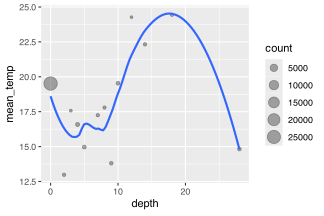
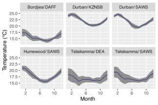
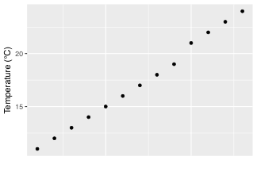
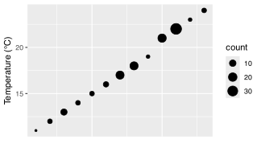
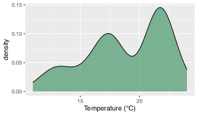
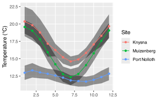

> “*Conducting data analysis is like drinking a fine wine. It is important to swirl and sniff the wine, to unpack the complex bouquet, to appreciate the experience. Gulping the wine does not work.*”
>
> — Daniel B. Wright

> “*If you torture the data long enough, it will confess to anything.*”
>
> — Ronald Coase

# 1 Introduction

In the previous session you used the main transformation verbs one at a time. Here you learn the move that makes them genuinely useful: `group_by()`. Grouping lets you ask questions at the level of sites, dates, species, depths, or any other unit that matters scientifically.

Grouped data are not a different kind of object. A grouped tibble is a regular data frame with **grouping metadata attached**. That metadata changes how verbs like `summarise()`, `mutate()`, and [`filter()`](https://rdrr.io/r/stats/filter.html) behave.

> **TIP:**
>
> Each line should answer one question: “What rows do I want?” → “How should I group them?” → “What summary do I need?” If a pipeline feels confusing, run it stepwise and inspect intermediate outputs.

``` numberSource
# Load libraries
library(tidyverse)

# load the data from a .RData file
load(here::here("data", "BCB744", "SACTNmonthly_v4.0.RData"))

# Copy the data as a dataframe with a shorter name
SACTN <- SACTNmonthly_v4.0

# Remove the original
rm(SACTNmonthly_v4.0)
```

# 2 Group observations (rows) by variables (columns) with `group_by()`

With the SACTN dataset loaded you will now look at the effect that `group_by()` has on other `tidyverse` functions. First you will create a new object called `SACTN_depth`. If you look at this object in the RStudio GUI it will not appear to be any different from `SACTN`. That is the danger: grouping is **invisible** unless you check it. You will see that `group_by()` is working as intended when you create summaries from the `SACTN_depth` dataframe.

Remember that you do not need to put the last bracket on its own line. I like to do so in order to reduce the chances that I will forget to type it after the final argument within the last function in the code chunk.

``` numberSource
# Group by depth
SACTN_depth <- SACTN %>% 
  group_by(depth)

# Check grouping explicitly
group_vars(SACTN_depth)
```

    R> [1] "depth"

``` numberSource
group_keys(SACTN_depth)[1:5,]
```

    R> # A tibble: 5 × 1
    R>   depth
    R>   <dbl>
    R> 1     0
    R> 2     2
    R> 3     3
    R> 4     4
    R> 5     5

``` numberSource
# Calculate mean temperature by depth
SACTN_depth_mean <- SACTN_depth %>% 
  summarise(mean_temp = mean(temp, na.rm = TRUE),
  count = n()
)

# Visualise the results
SACTN_depth_mean
```

    R> # A tibble: 13 × 3
    R>    depth mean_temp count
    R>    <dbl>     <dbl> <int>
    R>  1     0      19.5 26299
    R>  2     2      13.0   237
    R>  3     3      17.6   141
    R>  4     4      16.6   529
    R>  5     5      15.0   408
    R>  6     7      17.2   227
    R>  7     8      17.8   201
    R>  8     9      13.8   311
    R>  9    10      19.5   362
    R> 10    12      24.3   137
    R> 11    14      22.3   223
    R> 12    18      24.4   191
    R> 13    28      14.8   306

> **NOTE:**
>
> - How many groups do you have?
> - Which variables define them?
> - Do you expect many rows per group or one?

Let us visualise the newly created summary dataframe and see what we get there.

``` numberSource
# Why does the relationship between depth and temperature look so odd?
ggplot(data = SACTN_depth_mean, mapping = aes(x = depth, y = mean_temp)) +
  geom_point(aes(size = count), alpha = 1/3) +
  geom_smooth(se = FALSE)
```

[](15-tidiest_files/figure-html/fig-tidiest-group-2-1.svg "Figure 1: Relationship between depth and mean temperature.")

Figure 1: Relationship between depth and mean temperature.

> **TIP:**
>
> `group_by()` changes the unit of work from **rows** to **groups**.\
> `summarise()` collapses each group to fewer rows; `mutate()` keeps row count but uses group-wise calculations.

## 2.1 Grouping by multiple variables

As you may have guessed by now, grouping is not confined to a single column. One may use any number of columns to perform elaborate grouping measures. Let us look at some ways of doing this with the SACTN data.

``` numberSource
# Create groupings based on temperatures and depth
SACTN_temp_group <- SACTN %>% 
  group_by(round(temp), depth)

# Create groupings based on source and date
SACTN_src_group <- SACTN %>% 
  group_by(src, date)

# Create groupings based on date and depth
SACTN_date_group <- SACTN %>% 
  group_by(date, depth)
```

Now that you have created some grouped data frames, the next question is obvious: what summaries make sense for those groups?

I prefer `group_by() + summarise()` because the grouping logic is visible in the code. That makes the analysis easier to read and much easier to check later.

## 2.2 Ungrouping

Once you level up our **tidyverse** skills you will routinely be grouping variables while calculating statistics. This then poses the problem of losing track of which dataframes are grouped and which are not. **Grouping persists** until you remove it, and that persistence can surprise you in later steps. Happily, to remove any grouping we just use `ungroup()`. No arguments required, just the empty function by itself. Too easy.

``` numberSource
SACTN_ungroup <- SACTN_date_group %>% 
  ungroup()
```

Tip: if you are done summarising, `ungroup()` immediately so that later steps do not inherit group structure by accident.

# 3 Chain functions with the pipe (`%>%`)

This brings you back to the pipe. A pipeline lets you express the full sequence in one place: start with the data, declare the grouping, calculate the summary, inspect the result. The next chunk does exactly what the earlier two-step version did, but without creating an extra intermediate object.

``` numberSource
SACTN_depth_mean_2 <- SACTN %>% # Choose a base dataframe
  group_by(depth) %>% # Group by the depth column
  summarise(mean_temp = mean(temp, na.rm = TRUE), # Calculate means
  count = n() # Count observations
) # Safety measure
```

Take a moment and compare the `SACTN_depth_mean_2` object that you have just created against the `SACTN_depth_mean` object you created at the beginning of this session. Same same.

This is easier to read because the sequence of operations is explicit.

> **NOTE:**
>
> In order to create the `SACTN_depth_mean_2` dataframe I first started by taking the original SACTN data. I then grouped the data into different depth categories. After this I calculated the mean temperature for each depth category, as well as counting the number of observations within each depth group.

Pipelines can become too long. When they do, split them. The goal is not to write the longest possible chain, but the clearest one.

# 4 Group all the functions!

You have played around quite a bit with grouping and summarising, but that is not all you can do. You can use `group_by()` very nicely with [`filter()`](https://rdrr.io/r/stats/filter.html) and `mutate()` as well.

You can do some rather imaginative things when you combine all of these tools together. In fact, you should be able to accomplish almost any task you can think of. For example, what if you wanted to create a new object that is a subset of only the sites in the `SACTN` that had at least 30 years (360 months) of data?

``` numberSource
SACTN_30_years <- SACTN %>%
  group_by(site, src) %>%
  filter(n() > 360)
```

Or what if we wanted to calculate anomaly data for each site?

``` numberSource
SACTN_anom <- SACTN %>%
  group_by(site, src) %>% 
  mutate(anom = temp - mean(temp, na.rm = T)) %>% 
  select(site:date, anom, depth, type) %>% 
  ungroup()
```

> **NOTE:**
>
> ``` numberSource
> SACTN %>% 
>   # 1) Choose the rows we care about
>   filter(site %in% c("Paternoster", "Oudekraal")) %>%
>   # 2) Declare the grouping logic
>   group_by(site, src) %>%
>   # 3) Compute a group-wise summary
>   summarise(mean_temp = mean(temp, na.rm = TRUE),
>             sd_temp = sd(temp, na.rm = TRUE)) %>%
>   # 4) Drop grouping once we are done
>   ungroup()
> ```
>
> Each line answers a single question. If you can explain each line, the pipeline is doing the right thing.

Now, let us select only two sites, calculate their mean and standard deviations. Note how whichever columns you give to`group_by()` will be carried over into the new dataframe created by `summarise()`.

``` numberSource
SACTN %>% 
  filter(site == "Paternoster" | site == "Oudekraal") %>%
  group_by(site, src) %>% 
  summarise(mean_temp = mean(temp, na.rm = TRUE), 
            sd_temp = sd(temp, na.rm = TRUE))
```

    R> # A tibble: 3 × 4
    R> # Groups:   site [2]
    R>   site        src   mean_temp sd_temp
    R>   <fct>       <chr>     <dbl>   <dbl>
    R> 1 Paternoster DEA        12.8   0.879
    R> 2 Paternoster SAWS       13.6   1.40 
    R> 3 Oudekraal   DAFF       12.3   1.36

Remember: grouping choices encode scientific assumptions. Summarising across the wrong groups is not just “statistically odd” – it can be conceptually invalid.

# 5 Going deeper

You learned in the previous session that you should avoid using comparison operators to compare logical arguments as this tends to not produce the results you would expect. Below you will see what happens when you try to repeat the code chunk above, but using a logical operator within a comparison operator.

``` numberSource
SACTN %>% 
  filter(site == "Paternoster" | "Oudekraal") %>% # This line has been changed/shortened
  group_by(site, src) %>% 
  summarise(mean_temp = mean(temp, na.rm = TRUE), 
            sd_temp = sd(temp, na.rm = TRUE))
```

Oh no, you broke it! This is a common error while learning to write code so do try to keep this rule in mind as it can cause a lot of headaches. An easy way to spot this problem is if your line of code has more logical operators than comparison operators you are probably going to have a bad time. This is doubly unfortunate as you would need to write less code if this were not so. Happily, there is a shortcut for just this problem, `%in%`. Whenever you want to use operators to filter by more than two things, it is most convenient to create an object that contains the names, numbers that you want to filter by. You then replace your comparison and logical operators with that one simple symbol (`%in%`).

> **WARNING:**
>
> If you see a **standalone character string** inside [`filter()`](https://rdrr.io/r/stats/filter.html), something is almost certainly wrong.\
> Use `%in%` when you want to match against a list of values.

``` numberSource
# First create a character vector containing the desired sites
selected_sites <- c("Paternoster", "Oudekraal", "Muizenberg", "Humewood")

# Then calculate the statistics
SACTN %>% 
  filter(site %in% selected_sites) %>%
  group_by(site, src) %>% 
  summarise(mean_temp = mean(temp, na.rm = TRUE), 
            sd_temp = sd(temp, na.rm = TRUE))
```

    R> # A tibble: 5 × 4
    R> # Groups:   site [4]
    R>   site        src   mean_temp sd_temp
    R>   <fct>       <chr>     <dbl>   <dbl>
    R> 1 Paternoster DEA        12.8   0.879
    R> 2 Paternoster SAWS       13.6   1.40 
    R> 3 Oudekraal   DAFF       12.3   1.36 
    R> 4 Muizenberg  SAWS       15.9   2.76 
    R> 5 Humewood    SAWS       18.0   2.03

The `%in%` operator can be a very useful shortcut, but sometimes you cannot avoid the comparison, logical operator dance. For example, if you wanted to find temperatures at Port Nolloth that were over 10°C but under 15°C you could use either of the following two filters. Remember that whenever you see a `,` in the filter function it is the same as the `&` logical operator. Of the two different techniques shown below, I would be more inclined to use the first one. The fewer symbols you use to write your code the better. Both for readability, error reduction.

``` numberSource
SACTN %>% 
  filter(site == "Port Nolloth", temp > 10, temp < 15)

SACTN %>% 
  filter(site == "Port Nolloth", !(temp <= 10 | temp  >= 15))
```

As you may imagine, performing intricate logical arguments like this may get out of hand rather quickly. It is advisable to save intermediate steps in a complex workflow to avoid too much heartache. Where exactly these ‘fire breaks’ should be made is up to the person writing the code.

> **WARNING:**
>
> - Forgetting to `ungroup()` and getting unexpected multiple rows.
> - Using `|` instead of `%in%` for multi-value matches.
> - Using `n()` without grouping and assuming it is per-group.
> - Using `slice()` as if it were stable over time.

# 6 Pipe into **ggplot2**

It is also possible to combine piped code chunks and **ggplot2** chunks into one ‘combi-chunk’. I prefer not to do this as I like saving the new dataframe I have created as an object in my environment before visualising it so that if anything has gone wrong (as things tend to do) I can more easily find the problem.

Regardless of what you may or may not prefer to do, the one thing that must be mentioned about piping into **ggplot2** is that when you start with the `ggplot()` function you switch over from the pipe (`%>%`) to the plus sign (`+`). There are currently efforts to address this inconvenience, but are not yet ready for public consumption.

``` numberSource
SACTN %>%
  filter(site %in% c("Bordjies", "Tsitsikamma", "Humewood", "Durban")) %>%
  select(-depth, -type) %>%
  mutate(month = month(date),
         index = paste(site, src, sep = "/ ")) %>%
  group_by(index, month) %>%
  summarise(mean_temp = mean(temp, na.rm = TRUE),
            sd_temp = sd(temp, na.rm = TRUE)) %>%
  ggplot(aes(x = month, y = mean_temp)) +
  geom_ribbon(aes(ymin = mean_temp - sd_temp, ymax = mean_temp + sd_temp), 
              fill = "black", alpha = 0.4) +
  geom_line(col = "navy", size = 0.3) +
  facet_wrap(~index) +
  scale_x_continuous(breaks = seq(2, 12, 4)) +
  labs(x = "Month", y = "Temperature (°C)")
```

[](15-tidiest_files/figure-html/fig-tidyiest-ggplot-1.svg "Figure 2: Line and ribbon plots for the climatologies of several sites.")

Figure 2: Line and ribbon plots for the climatologies of several sites.

# 7 Additional useful functions

There is an avalanche of useful functions to be found within the **tidyverse**. In truth, you have only looked at functions from three packages: **ggplot2**, **dplyr**, and **tidyr**. There are far, far too many functions even within these three packages to cover within a week. But that does not mean that the functions in other packages, such as **`purrr`** are not also massively useful for our work. For now we will see how the inclusion of a handful of choice extra functions may help to make our workflow even tidier.

## 7.1 Rename variables (columns) with `rename()`

You have seen that you select columns in a dataframe with `select()`, but if you want to rename columns you have to use, you guessed it, `rename()`. This functions works by first telling R the new name you would like, and then the existing name of the column to be changed. This is perhaps a bit back to front, but such is life on occasion.

``` numberSource
SACTN %>% 
  rename(source = src)
```

    R>            site source       date     temp depth type
    R> 1  Port Nolloth    DEA 1991-02-01 11.47029     5  UTR
    R> 2  Port Nolloth    DEA 1991-03-01 11.99409     5  UTR
    R> 3  Port Nolloth    DEA 1991-04-01 11.95556     5  UTR
    R> 4  Port Nolloth    DEA 1991-05-01 11.86183     5  UTR
    R> 5  Port Nolloth    DEA 1991-06-01 12.20722     5  UTR
    R> 6  Port Nolloth    DEA 1991-07-01 12.53810     5  UTR
    R> 7  Port Nolloth    DEA 1991-08-01 11.25202     5  UTR
    R> 8  Port Nolloth    DEA 1991-09-01 11.29208     5  UTR
    R> 9  Port Nolloth    DEA 1991-10-01 11.37661     5  UTR
    R> 10 Port Nolloth    DEA 1991-11-01 10.98208     5  UTR

## 7.2 Create a new dataframe for a newly created variable (column) with `transmute()`

If for whatever reason you wanted to create a new variable (column), as you would do with `mutate()`, but you do not want to keep the dataframe from which the new column was created, the function to use is `transmute()`.

``` numberSource
SACTN %>% 
  transmute(kelvin = temp + 273.15)
```

    R>  [1] 284.6203 285.1441 285.1056 285.0118 285.3572 285.6881 284.4020 284.4421
    R>  [9] 284.5266 284.1321

This makes a bit more sense when paired with `group_by()` as it will pull over the grouping variables into the new dataframe. Note that when it does this for you automatically it will provide a message in the console.

``` numberSource
SACTN %>% 
  group_by(site, src) %>% 
  transmute(kelvin = temp + 273.15)
```

    R> # A tibble: 10 × 3
    R> # Groups:   site, src [1]
    R>    site         src   kelvin
    R>    <fct>        <chr>  <dbl>
    R>  1 Port Nolloth DEA     285.
    R>  2 Port Nolloth DEA     285.
    R>  3 Port Nolloth DEA     285.
    R>  4 Port Nolloth DEA     285.
    R>  5 Port Nolloth DEA     285.
    R>  6 Port Nolloth DEA     286.
    R>  7 Port Nolloth DEA     284.
    R>  8 Port Nolloth DEA     284.
    R>  9 Port Nolloth DEA     285.
    R> 10 Port Nolloth DEA     284.

## 7.3 Count observations (rows) with `n()`

You have already seen this function sneak its way into a few of the code chunks in the previous session. You use `n()` to count any grouped variable automatically. It cannot be given any arguments, so you must organise our dataframe in order to satisfy its needs. It is the diva function of the **tidyverse**; however, it is terribly useful as you usually want to know how many observations your summary stats are based on.

> **TIP:**
>
> If you see multiple rows after `summarise()`, you are still grouped.\
> If you use `n()` without grouping, it counts **all** rows.

First you will run some stats, create a figure without documenting `n`. Then you will include `n` and see how that changes your conclusions.

``` numberSource
 SACTN_n <- SACTN %>% 
  group_by(site, src) %>% 
  summarise(mean_temp = round(mean(temp, na.rm = T))) %>% 
  arrange(mean_temp) %>% 
  ungroup() %>% 
  select(mean_temp) %>% 
  unique()

ggplot(data = SACTN_n, aes(x = 1:nrow(SACTN_n), y = mean_temp)) +
  geom_point() +
  labs(x = "", y = "Temperature (°C)") +
  theme(axis.text.x = element_blank(), 
        axis.ticks.x = element_blank())
```

[](15-tidiest_files/figure-html/fig-tidiest-n-1-1.svg "Figure 3: Dot plot showing range of mean temperatures for the time series in the SACTN dataset.")

Figure 3: Dot plot showing range of mean temperatures for the time series in the SACTN dataset.

This looks like a pretty linear distribution of temperatures within the SACTN dataset. But now let us change the size of the dots to show how frequently each of these mean temperatures is occurring.

``` numberSource
 SACTN_n <- SACTN %>% 
  group_by(site, src) %>% 
  summarise(mean_temp = round(mean(temp, na.rm = T))) %>% 
  ungroup() %>% 
  select(mean_temp) %>% 
  group_by(mean_temp) %>% 
  summarise(count = n())

ggplot(data = SACTN_n, aes(x = 1:nrow(SACTN_n), y = mean_temp)) +
  geom_point(aes(size = count)) +
  labs(x = "", y = "Temperature (°C)") +
  theme(axis.text.x = element_blank(), 
        axis.ticks.x = element_blank())
```

[](15-tidiest_files/figure-html/fig-tidiest-n-2-1.svg "Figure 4: Dot plot showing range of mean temperatures for the time series in the SACTN dataset with the size of each dot showing the number of occurrences of each mean.")

Figure 4: Dot plot showing range of mean temperatures for the time series in the SACTN dataset with the size of each dot showing the number of occurrences of each mean.

You see now when you include the count (`n`) of the different mean temperatures that this distribution is not so even. There appear to be humps around 17°C and 22°C. of course, you have created dot plots here just to illustrate this point. In reality if you were interested in a distribution like this one would use a histogram, or better yet, a density polygon.

``` numberSource
SACTN %>% 
  group_by(site, src) %>% 
  summarise(mean_temp = round(mean(temp, na.rm = T))
            ) %>% 
  ungroup() %>% 
  ggplot(aes(x = mean_temp)) +
  geom_density(fill = "seagreen", alpha = 0.6) +
  labs(x = "Temperature (°C)")
```

[](15-tidiest_files/figure-html/fig-tidiest-n-3-1.svg "Figure 5: Frequency distribution of mean temperature for each time series in the SACTN dataset.")

Figure 5: Frequency distribution of mean temperature for each time series in the SACTN dataset.

## 7.4 Select observations (rows) by number with `slice()`

If you want to select only specific rows of a dataframe, rather than using some variable like you do for [`filter()`](https://rdrr.io/r/stats/filter.html), you use `slice()`. The function expects us to provide it with a series of integers as seen in the following code chunk. Try playing around with these values and see what happens

``` numberSource
# Slice a sequence of rows
SACTN %>% 
  slice(10010:10020)

# Slice specific rows
SACTN %>%
  slice(c(1,8,19,24,3,400))

# Slice all rows except these
SACTN %>% 
  slice(-(c(1,8,4)))

# Slice all rows except a sequence
SACTN %>% 
  slice(-(1:1000))
```

It is discouraged to use slice to remove or select specific rows of data as this does not discriminate against any possible future changes in ones data. Meaning that if at some point in the future new data are added to a dataset, re-running this code will likely no longer be selecting the correct rows. This is why [`filter()`](https://rdrr.io/r/stats/filter.html) is a main function, `slice()` is not. This auxiliary function can however still be quite useful when combined with arrange.

Rule of thumb: if you care about **reproducibility**, prefer [`filter()`](https://rdrr.io/r/stats/filter.html) over `slice()`.

``` numberSource
# The top 5 variable sites as measured by SD
SACTN %>% 
  group_by(site, src) %>% 
  summarise(sd_temp = sd(temp, na.rm = T)) %>% 
  ungroup() %>% 
  arrange(desc(sd_temp)) %>% 
  slice(1:5)
```

    R> # A tibble: 5 × 3
    R>   site       src   sd_temp
    R>   <fct>      <chr>   <dbl>
    R> 1 Muizenberg SAWS     2.76
    R> 2 Stilbaai   SAWS     2.72
    R> 3 Mossel Bay SAWS     2.65
    R> 4 De Hoop    DAFF     2.51
    R> 5 Mossel Bay DEA      2.51

## 7.5 Summary functions

There is a near endless sea of possibilities when one starts to become comfortable with writing R code. You have seen several summary functions used thus far. Mostly in straightforward ways. But that is one of the fun things about R, the only limits to what you may create are within your mind, not the program. Here is just one example of a creative way to answer a straightforward question: ‘What is the proportion of recordings above 15°C per source?’. Note how you may refer to columns you have created within the same chunk. There is no need to save the intermediate dataframes if we choose not to.

``` numberSource
SACTN %>% 
  na.omit() %>% 
  group_by(src) %>%
  summarise(count = n(), 
            count_15 = sum(temp > 15)) %>% 
  mutate(prop_15 = count_15/count) %>% 
  arrange(prop_15)
```

    R> # A tibble: 7 × 4
    R>   src   count count_15 prop_15
    R>   <chr> <int>    <int>   <dbl>
    R> 1 DAFF    641      246   0.384
    R> 2 SAWS   8636     4882   0.565
    R> 3 UWC      12        7   0.583
    R> 4 DEA    2087     1388   0.665
    R> 5 SAEON   596      573   0.961
    R> 6 EKZNW   369      369   1    
    R> 7 KZNSB 15313    15313   1

The output of grouped summaries like this is the **shape most modelling and statistical functions expect**: one row per unit, one column per variable. Keep that endpoint in mind as you design your pipelines.

# 8 The new age *Redux*

Remember the spreadsheet example from the first day of the R workshop? Here it is repeated in a more efficient way. Now with bonus ribbons! In this chunk you see how to load, transform, and visualise the data all in one go. You would not normally do this, but it sure is snappy!

``` numberSource
read_csv(here::here("data", "BCB744", "SACTN_data.csv")) %>%
  mutate(month = month(date)) %>%
  group_by(site, month) %>%
  summarise(mean_temp = mean(temp, na.rm = TRUE),
            sd_temp = sd(temp, na.rm = TRUE)) %>%
  ggplot(aes(x = month, y = mean_temp, group = site)) +
  geom_ribbon(aes(ymin = mean_temp - sd_temp, ymax = mean_temp + sd_temp), 
              fill = "black", alpha = 0.4) +
  geom_point(aes(colour = site)) +
  geom_line(aes(colour = site)) +
  labs(x = "", y = "Temperature (°C)", colour = "Site")
```

[](15-tidiest_files/figure-html/fig-tidiest-new-age-1.svg "Figure 6: Tidiest new age.")

Figure 6: Tidiest new age.

## Reuse

[CC BY-NC-SA 4.0](https://creativecommons.org/licenses/by-nc-sa/4.0/)

## Citation

BibTeX citation:

``` quarto-appendix-bibtex
@online{smit2021,
  author = {Smit, A. J.},
  title = {15. {Tidiest} Data},
  date = {2021-01-01},
  url = {https://tangledbank.netlify.app/BCB744/intro_r/15-tidiest.html},
  langid = {en}
}
```

For attribution, please cite this work as:

Smit AJ (2021) 15. Tidiest data. [https://tangledbank.netlify.app/BCB744/intro_r/15-tidiest.html.](https://tangledbank.netlify.app/BCB744/intro_r/15-tidiest.html)
