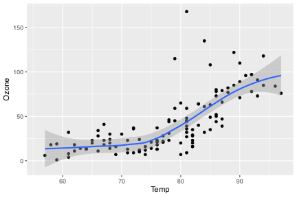

# 1 Introduction

This study is about air quality.

# 2 Methods

## 2.1 Data

The dataset used in this study is the `airquality` dataset from R, which contains daily air quality measurements in New York from May to September 1973. The dataset includes variables such as ozone levels, solar radiation, wind speed, and temperature.

## 2.2 Analysis

The R script in the code chunk further explores the impact of temperature on ozone level. All analyses were done in R ([R Core Team 2017](#ref-R2017)).

This is **bold** text. This is *italicised* text.

``` numberSource
library(ggplot2)

ggplot(airquality, aes(Temp, Ozone)) + 
  geom_point() + 
  geom_smooth(method = "loess")
```

[](r_markdown_example_files/figure-html/fig-airquality-1.svg "Figure 1: Temperature and ozone level.")

Figure 1: Temperature and ozone level.

# 3 Results

The results show that air has quality ([Figure 1](#fig-airquality)).

# 4 Discussion

We used R for the analyses ([R Core Team 2017](#ref-R2017)). The results confirm that of Schlegel ([2017](#ref-Schlegel2017)).

# 5 References

R Core Team (2017) [R: A Language and Environment for Statistical Computing](https://www.R-project.org/). R Foundation for Statistical Computing, Vienna, Austria

Schlegel RW, Oliver ECJ, Wernberg T, Smit AJ (2017) Nearshore and offshore co-occurrence of marine heatwaves and cold-spells. Progress in Oceanography 151:189–205.

## Reuse

[CC BY-NC-SA 4.0](https://creativecommons.org/licenses/by-nc-sa/4.0/)

## Citation

BibTeX citation:

``` quarto-appendix-bibtex
@online{smit2027,
  author = {Smit, A. J. and Smit, AJ},
  title = {R {Markdown} and {Quarto} Demo},
  date = {2027-05-07},
  url = {https://tangledbank.netlify.app/BCB744/intro_r/r_markdown_example.html},
  langid = {en}
}
```

For attribution, please cite this work as:

Smit AJ, Smit A (2027) R Markdown and Quarto demo. [https://tangledbank.netlify.app/BCB744/intro_r/r_markdown_example.html.](https://tangledbank.netlify.app/BCB744/intro_r/r_markdown_example.html)
