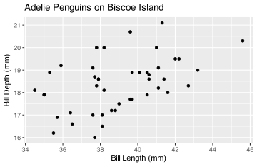
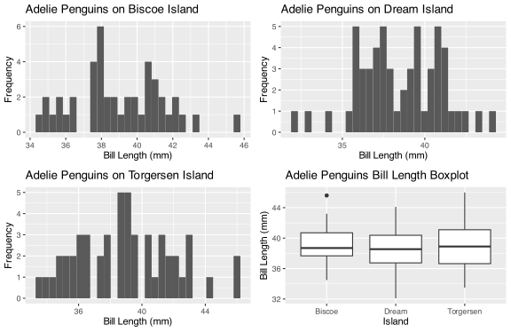
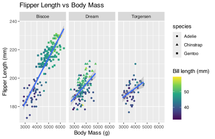
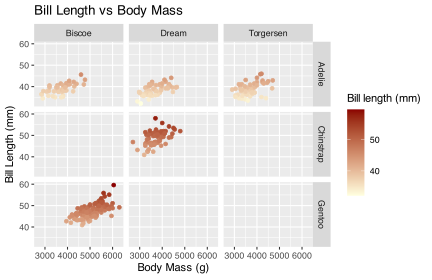
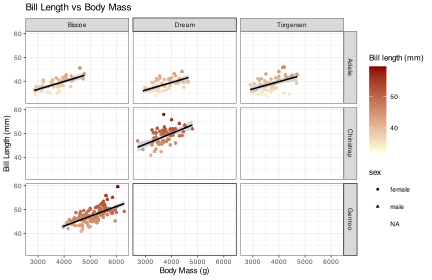
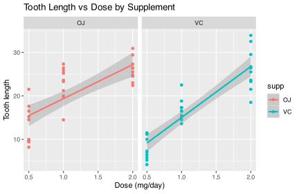
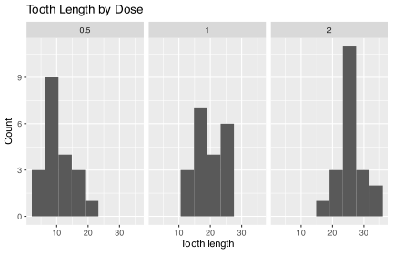
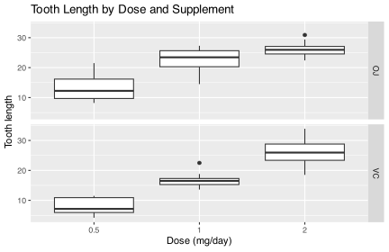
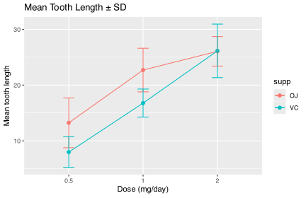
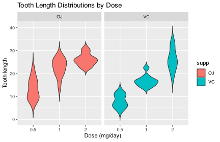

# The self-assessment sheet is on iKamva

# 6-8. Graphics with ggplot2, faceting figures, and brewing colours

In these sets of tasks you will generate several figures. For every figure generated, also please provide a narrative explanation of the patterns shown within the figures (sometimes this is mentioned explicitely, but not always; describe your figure(s) in EVERY question).

## Question 1

Create a scatterplot of `bill_length_mm` against `bill_depth_mm` for `Adelie` penguins on `Biscoe` island. **(/10)**

**Answer**

``` numberSource
library(palmerpenguins) # ✓ 
library(tidyverse) # ✓ 
data(penguins)
head(penguins)
```

    R> # A tibble: 6 × 8
    R>   species island    bill_length_mm bill_depth_mm flipper_length_mm body_mass_g
    R>   <fct>   <fct>              <dbl>         <dbl>             <int>       <int>
    R> 1 Adelie  Torgersen           39.1          18.7               181        3750
    R> 2 Adelie  Torgersen           39.5          17.4               186        3800
    R> 3 Adelie  Torgersen           40.3          18                 195        3250
    R> 4 Adelie  Torgersen           NA            NA                  NA          NA
    R> 5 Adelie  Torgersen           36.7          19.3               193        3450
    R> 6 Adelie  Torgersen           39.3          20.6               190        3650
    R> # ℹ 2 more variables: sex <fct>, year <int>

``` numberSource
penguins %>% # ✓ 
  filter(island == "Biscoe" & species == "Adelie") %>%  # ✓ 
  ggplot(aes(x = bill_length_mm, y = bill_depth_mm)) +  # ✓ 
  geom_point() +  # ✓ 
  labs(title = "Adelie Penguins on Biscoe Island",  # ✓ 
         x = "Bill Length (mm)", # ✓ 
         y = "Bill Depth (mm)") # ✓ 
```

[](BCB744_Task_B_files/figure-html/fig-library-palmerpenguins-1.svg "Figure 1: Adelie bill length vs. bill depth on Biscoe Island.")

Figure 1: Adelie bill length vs. bill depth on Biscoe Island.

The scatter reveals a moderately ordered morphometric relationship, *i.e.*, individuals with longer bills tend, generally, to exhibit greater bill depth, though the association is not tightly constrained. The dispersion suggests intraspecific variability rather than discrete clustering, with no obvious sub-grouping. These groupings might be revealed once we take into acocunt the additional categorical structure in the data.

## Question 2

Create histograms of `bill_length_mm` for `Adelie` penguins on all three islands (one figure per island). Save each figure as a separate R object which you can later reuse. Again for `Adelie` penguins, create a boxplot for `bill_length_mm` showing all the data on one plot. Save it too as an R object. Combine the four saved figures into one figure using `ggarrange()`. **(/25)**

**Answer**

``` numberSource
library(ggpubr) # ✓

# Create histograms
adelie_biscoe <- penguins %>% # ✓ x 5
  filter(island == "Biscoe" & species == "Adelie") %>% 
  ggplot(aes(x = bill_length_mm)) + 
  geom_histogram() + 
  labs(title = "Adelie Penguins on Biscoe Island", 
       x = "Bill Length (mm)", 
       y = "Frequency")

adelie_dream <- penguins %>% # ✓ x 5
  filter(island == "Dream" & species == "Adelie") %>% 
  ggplot(aes(x = bill_length_mm)) + 
  geom_histogram() + 
  labs(title = "Adelie Penguins on Dream Island", 
       x = "Bill Length (mm)", 
       y = "Frequency")

adelie_torgersen <- penguins %>% # ✓ x 5
  filter(island == "Torgersen" & species == "Adelie") %>% 
  ggplot(aes(x = bill_length_mm)) + 
  geom_histogram() + 
  labs(title = "Adelie Penguins on Torgersen Island", 
       x = "Bill Length (mm)", 
       y = "Frequency")

# Create boxplot # ✓ x 5
adelie_boxplot <- penguins %>% 
  filter(species == "Adelie") %>% 
  ggplot(aes(x = island, y = bill_length_mm)) + 
  geom_boxplot() + 
  labs(title = "Adelie Penguins Bill Length Boxplot", 
       x = "Island", 
       y = "Bill Length (mm)")

# Combine figures # ✓ x 1
ggarrange(adelie_biscoe, adelie_dream, adelie_torgersen, adelie_boxplot, 
          ncol = 2, nrow = 2)
```

[](BCB744_Task_B_files/figure-html/fig-library-ggpubr-1.svg "Figure 2: Adelie bill length histograms by island plus overall boxplot.")

Figure 2: Adelie bill length histograms by island plus overall boxplot.

The histograms indicate island-level differentiation in bill length structure. Biscoe birds *seem* display a distribution shifted toward longer bills, whereas Dream and Torgersen populations centre on shorter modal values. Overlap is extensive across all islands, but the positional offsets imply geographic structuring (whether ecological or genetic) within Adelie morphology.

## Question 3

Create a scatter plot of `flipper_length_mm` against `body_mass_g` and use `facet_wrap()` to create separate panels for each island (combine all species). Plot the three species as **distinct point shapes**, and map a **continuous colour scale** to `bill_length_mm`. Add a best‑fit straight line with 95% confidence intervals through the points, ignoring the effect of species. Take into account which variable best belongs on `x` and `y`. Describe your findings. **(/10)**

**Answer**

``` numberSource
penguins %>% # ✓ x 7
  ggplot(aes(x = body_mass_g, y = flipper_length_mm)) + 
  geom_point(aes(shape = species, colour = bill_length_mm)) + 
  scale_colour_viridis_c() +
  geom_smooth(method = "lm", se = TRUE) +
  facet_wrap(~island) + 
  labs(title = "Flipper Length vs Body Mass", 
       x = "Body Mass (g)",
       y = "Flipper Length (mm)",
       colour = "Bill length (mm)")
```

[](BCB744_Task_B_files/figure-html/fig-penguins-x-1.svg "Figure 3: Flipper length vs. body mass faceted by island with species shapes and bill-length colour scale.")

Figure 3: Flipper length vs. body mass faceted by island with species shapes and bill-length colour scale.

- The `body_mass_g` variable is best suited to the `x`-axis as it is the independent variable. The `flipper_length_mm` variable is best suited to the `y`-axis as it is the dependent variable.
- [x] For all penguin species, the `flipper_length_mm` and `body_mass_g` variables show a positive correlation, with larger penguins having longer flippers, higher body masses.
- [x] The colour scale shows that bill length tends to increase with body mass, especially for Gentoo penguins.
- [x] Species are clearly separated by shape, and Gentoo penguins occupy the largest body‑mass and flipper‑length ranges.

Or something like:

Across all islands, flipper length scales positively with body mass to produce an oblique band of points that points to a biomechanical relationship between flipper properties and body size. Species separation is legible through shapes assigned to the species: Gentoo individuals occupy the upper mass:flipper relationship, while Adelie cluster at lower magnitudes. The colour gradient adds a third dimension—bill length increases along the same mass trajectory, reinforcing the impression of integrated body scaling rather than isolated trait enlargement.

## Question 4

Create a scatter plot of `bill_length_mm` and `body_mass_g` and use `facet_grid()` to create separate panels for each species and island. Map `bill_length_mm` to a **continuous colour scale** that you customise yourself (do not use the default palette). **(/10)**

**Answer**

``` numberSource
grid_plt <-  penguins %>% # ✓ x 7
  ggplot(aes(x = body_mass_g, y = bill_length_mm, colour = bill_length_mm)) + 
  geom_point() + 
  scale_colour_gradient(low = "lightyellow", high = "darkred") +
  facet_grid(species ~ island) + 
  labs(title = "Bill Length vs Body Mass", 
       x = "Body Mass (g)",
       y = "Bill Length (mm)",
       colour = "Bill length (mm)")
grid_plt
```

[](BCB744_Task_B_files/figure-html/fig-grid-plt-penguins-x-1.svg "Figure 4: Bill length vs. body mass faceted by species and island with a custom colour scale.")

Figure 4: Bill length vs. body mass faceted by species and island with a custom colour scale.

The faceted grid disentangles interspecific from geographic effects. Within each species panel, bill length rises with body mass, though the slope and spread vary. Gentoo shows the steepest scaling and the largest absolute values, while Adelie retains a compressed range. The customised colour gradient intensifies this visual interpretation since it visually thickens the upper mass–length zones and making trait amplification more legible.

## Question 5

Using the figure created in point 4, also show the effect of `sex` and add a best-fit straight line. Explain the findings. **(/10)**

**Answer**

``` numberSource
grid_plt +  # ✓ x 7
  geom_point(aes(shape = sex)) +
  geom_smooth(method = "lm", se = TRUE, colour = "black")
```

[](BCB744_Task_B_files/figure-html/code-grid-plt-x-1.svg)

- [x] The `bill_length_mm` and `body_mass_g` variables show a positive correlation, with larger penguins having longer bills, higher body masses.
- [x] The `sex` variable appears to have an effect on the relationship between `bill_length_mm` and `body_mass_g`, with male penguins tending to be heavier with longer bill lengths.
- [x] There also appears to be differences in the relationship between `bill_length_mm` and `body_mass_g` between the different species and islands.

Or…

Introducing sex causes dimorphism to become visible within species–island panels. Males tend to populate the upper mass and bill-length ranges, producing a stratified layering of points. The fitted regression line, which was calculated without sex partitioning, still shows a positive incline, but the sex-coded distribution implies that part of the apparent size scaling is mediated through sexual size differentiation rather than uniform growth alone.

## Question 6

What are the benefits of using faceting in data visualisation? **(/3)**

**Answer**

- [x] Faceting allows for the visualisation of multiple relationships in a single plot, making it easier to compare relationships between different groups.
- [x] Faceting can help to identify patterns and trends in the data that may not be immediately obvious when looking at the data as a whole.
- [x] Faceting can help to identify differences in relationships between different groups, such as species, islands or allowing for more detailed analysis of the data.

## Question 7

Use the built-in `ToothGrowth` dataset (guinea pig tooth length) to create a scatter plot of `len` against `dose`, coloured by `supp`, and faceted by `supp`. Add a best‑fit straight line with a 95% confidence interval. **(/10)**

**Answer**

``` numberSource
data(ToothGrowth) # ✓

ToothGrowth %>% # ✓ x 6
  ggplot(aes(x = dose, y = len, colour = supp)) + 
  geom_point() + 
  geom_smooth(method = "lm", se = TRUE) + 
  facet_wrap(~supp) + 
  labs(title = "Tooth Length vs Dose by Supplement",
       x = "Dose (mg/day)",
       y = "Tooth length")
```

[](BCB744_Task_B_files/figure-html/fig-toothgrowth-scatter-1.svg "Figure 5: Tooth length vs. dose, coloured and faceted by supplement.")

Figure 5: Tooth length vs. dose, coloured and faceted by supplement.

- [x] `dose` is the explanatory variable, so it belongs on the x‑axis; `len` is the response variable.
- [x] Tooth length increases with dose for both supplements.

Tooth length increases systematically with dose, producing increasing point clouds in both supplement panels. The regressions reinforce a dose-dependent growth response. But separation between supplements remains, such that at comparable doses, orange juice (OJ) tends to yield longer teeth than vitamin C (VC), implying differential bioavailability or metabolic uptake rather than a uniform pharmacological effect.

## Question 8

Create histograms of `len` for each `dose` (all supplements together) using `facet_wrap()`. **(/6)**

**Answer**

``` numberSource
ToothGrowth %>% # ✓ x 4
  ggplot(aes(x = len)) + 
  geom_histogram(bins = 8) + 
  facet_wrap(~dose) + 
  labs(title = "Tooth Length by Dose",
       x = "Tooth length",
       y = "Count")
```

[](BCB744_Task_B_files/figure-html/fig-toothgrowth-hist-1.svg "Figure 6: Tooth length distributions by dose.")

Figure 6: Tooth length distributions by dose.

Dose stratification adds a new view of the distributions. The lowest dose clusters tightly around shorter tooth lengths, while intermediate and high doses shift the distribution to the right and broadens it. This progressive shift of modal peaks indicates a graded biological response rather than a threshold effect, and variance expansion at higher doses suggests individual heterogeneity in treatment uptake.

## Question 9

Create boxplots of `len` by `dose` and facet by `supp` (one panel per supplement). **(/8)**

**Answer**

``` numberSource
ToothGrowth %>% # ✓ x 5
  ggplot(aes(x = factor(dose), y = len)) + 
  geom_boxplot() + 
  facet_grid(supp ~ .) + 
  labs(title = "Tooth Length by Dose and Supplement",
       x = "Dose (mg/day)",
       y = "Tooth length")
```

[](BCB744_Task_B_files/figure-html/fig-toothgrowth-box-1.svg "Figure 7: Tooth length by dose, separated by supplement.")

Figure 7: Tooth length by dose, separated by supplement.

Median tooth length rises with dose in both supplements, but the vertical separation between OJ and VC remains visible. OJ panels show higher medians and often wider interquartile ranges at equivalent doses. The boxplot geometry thus reiterates the double structure: dose drives the primary vertical ascent, and supplement modulates its amplitude.

## Question 10

Calculate the mean ± SD of `len` for each combination of `dose` and `supp`, then plot the means with error bars. **(/10)**

**Answer**

``` numberSource
tg_summary <- ToothGrowth %>% # ✓ x 7
  group_by(dose, supp) %>% 
  summarise(mean_len = mean(len),
            sd_len = sd(len),
            .groups = "drop")

tg_summary %>% 
  ggplot(aes(x = factor(dose), y = mean_len, colour = supp, group = supp)) + 
  geom_point(size = 2) + 
  geom_line() + 
  geom_errorbar(aes(ymin = mean_len - sd_len, ymax = mean_len + sd_len), width = 0.15) + 
  labs(title = "Mean Tooth Length ± SD",
       x = "Dose (mg/day)",
       y = "Mean tooth length")
```

[](BCB744_Task_B_files/figure-html/fig-toothgrowth-mean-sd-1.svg "Figure 8: Mean tooth length ± SD by dose and supplement.")

Figure 8: Mean tooth length ± SD by dose and supplement.

The lines show parallel increases across doses and confirms a consistent treatment response. Error bars widen modestly at higher doses, thus showing increased variability. OJ maintains an advantage across all doses, seen in its mean values sitting above those of VC. This reinforces the inference of supplement-specific efficacy layered atop the general dose effect.

## Question 11

Create a violin plot of `len` by `dose`, filled by `supp`, and facet by `supp`. **(/8)**

**Answer**

``` numberSource
ToothGrowth %>% # ✓ x 5
  ggplot(aes(x = factor(dose), y = len, fill = supp)) + 
  geom_violin(trim = FALSE) + 
  facet_wrap(~supp) + 
  labs(title = "Tooth Length Distributions by Dose",
       x = "Dose (mg/day)",
       y = "Tooth length")
```

[](BCB744_Task_B_files/figure-html/fig-toothgrowth-violin-1.svg "Figure 9: Tooth length distributions by dose and supplement.")

Figure 9: Tooth length distributions by dose and supplement.

The violins reveal distributional nuances not visible in the boxplots. Lower doses produce narrow, compact shapes; higher doses widen and elongate. This suggests both upward displacement and variance inflation. OJ violins often extend further into higher length ranges, their density ridges thickening above those of VC, visually encoding supplement divergence.

## Question 12

Create a small summary table showing the number of observations for each combination of `dose` and `supp`. **(/6)**

**Answer**

``` numberSource
ToothGrowth %>% # ✓ x 3
  count(dose, supp)
```

    R>   dose supp  n
    R> 1  0.5   OJ 10
    R> 2  0.5   VC 10
    R> 3  1.0   OJ 10
    R> 4  1.0   VC 10
    R> 5  2.0   OJ 10
    R> 6  2.0   VC 10

The summary table shows neatly balanced sampling, such that each dose–supplement combination contains identical counts. This removes sample-size bias from visual comparisons and allows distributional and mean differences to be interpreted as biological rather than artefactual.

## Question 13

Briefly describe two patterns you observe in any of the figures above. **(/4)**

**Answer**

- [x] Tooth length increases as dose increases for both supplements.
- [x] At the same dose, the `OJ` supplement tends to have higher tooth lengths than `VC`, especially at lower doses.

Two recurrent structures dominate the figures. First, dose exerts a monotonic positive effect on tooth growth across all representations (scatter, box, violin, and summary mean plots). Second, supplement type modulates this trajectory, so that OJ consistently produces greater tooth length than VC at equivalent doses, with the disparity most visible at lower concentrations where treatment sensitivity appears highest.

## Reuse

[CC BY-NC-SA 4.0](https://creativecommons.org/licenses/by-nc-sa/4.0/)

## Citation

BibTeX citation:

``` quarto-appendix-bibtex
@online{smit,
  author = {Smit, A. J.},
  title = {BCB744 {Task} {B}},
  url = {https://tangledbank.netlify.app/BCB744/tasks/BCB744_Task_B.html},
  langid = {en}
}
```

For attribution, please cite this work as:

Smit AJ BCB744 Task B. [https://tangledbank.netlify.app/BCB744/tasks/BCB744_Task_B.html.](https://tangledbank.netlify.app/BCB744/tasks/BCB744_Task_B.html)
