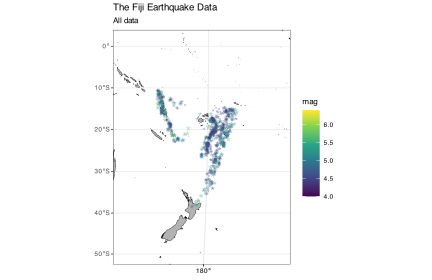
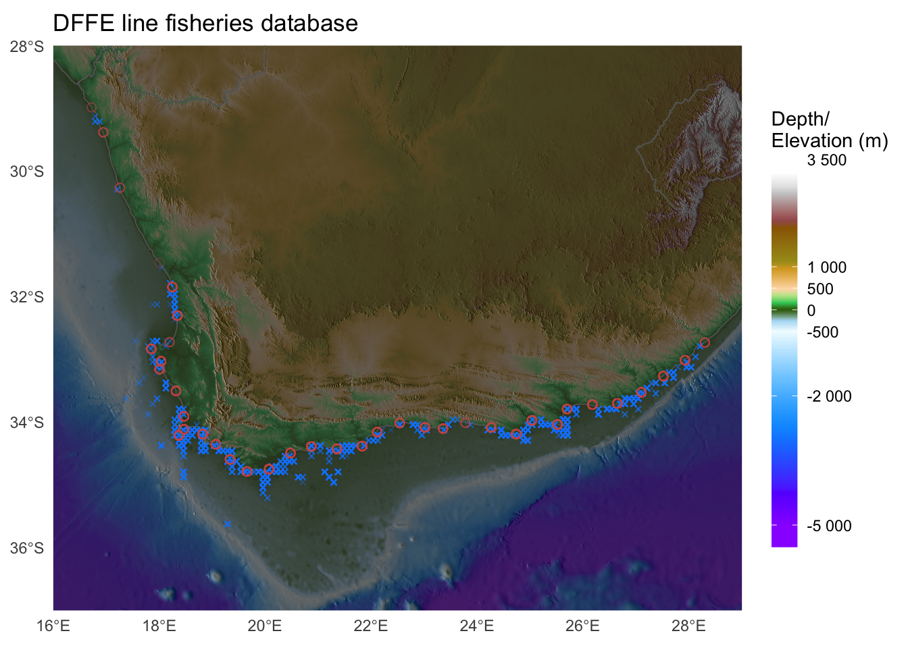

# 1 [Assessment sheet](BCB744_Task_Bonus_Surname.xlsx)

# 2 11. The Fiji earthquake data

[](BCB744_Task_Bonus_files/figure-html/fig-library-tidyverse-1.svg "Figure 1: Southwest Pacific base map using Natural Earth projection.")

Figure 1: Southwest Pacific base map using Natural Earth projection.

The questions concern the above figure.

## 2.1 Question 1

Please recreate the figure, above. You are welcome to reuse the code found on the website. Using this figure as starting point, do the following:

When plotting the earthquakes, include **only** the earthquake data for earthquakes of magnitude greater than the 75th percentile. Add a point for five of your favourite South Pacific island nations. Ensure the point is correctly associated with the island name, that the map is correctly labelled and has a title, and it is as close to publication quality as you can make it. Your script needs to show all the steps (thoroughly annotated) leading to the final figure.

Marks will also be assigned for the overall aethetic appearance of the map. Feel free to be creative, but ensure the final product remains publication quality. **(\30)**

## 2.2 Question 2

Successfully completing on of the options available in this task will earn you a *bonus of up* to **8 or 10% onto your CA mark**.

You have until 31 March 2025 to complete it.

- A map that is worthy of display will become a large format poster to display in the BCB Department. Your name displayed next to it will immortalise you for continued fame and glory amongst future BCB students.

- The winner of each category of map (hypometric and non-hypsometric) will also get a box of Lindt chocolate.

**Option 1 \[up to 10% bonus\]: Create a hypsometric map based on these examples**



The maps show the locations of linefish catches along the SA coast as per a DFFE dataset. I do not expect that you add these data points as you do not have access to this dataset. However, the location of the 58 coastal sections indicated by circles can be plotted using the [data provided here](../../data/BCB743/interp_LowRes_coords_58_sites.txt). You are also welcome to create a map of any topographically-interesting region on Earth, but be sure to include a few data points of some kind to draw our attention to some interesting features, statistics. Be creative!

Since I think a few of you might actually accomplish this, best add a few improvements to it to make your map even better than mine, stand out from that of your peers. There can be only one winner in each category and the best one wins (although everyone can benefit from the bonus marks).

Warning: You will need a fairly beefy computer to accomplish this task.

**Option 2 \[up to 8% bonus\]: Create an artistic map of your choice**

Alternatively, if you cannot access a powerful computer, for a **bonus of up to 8% onto your CAM**, create any (non-hypsometric) map of your choice of any region on Earth. Make something that you would be proud to display as a large format poster. The map may draw attention to an interesting regional geophysical, ecological, or socio-ecological (etc.) phenomena, or it may simply showcase your unique (but tasteful!) artistic ability. Show me some examples of what you wish to create before you start to avoid wasting your time on something too simple, entirely tasteless. There are many examples of beautiful maps on the internet that you may use as source of inspiration.

Whichever option you choose, please also submit your code together with the final product in a well-described Quarto .html document. Explain each step of the way, describe the rationale for the approach you take.

Good luck!

## Reuse

[CC BY-NC-SA 4.0](https://creativecommons.org/licenses/by-nc-sa/4.0/)

## Citation

BibTeX citation:

``` quarto-appendix-bibtex
@online{smit,
  author = {Smit, A. J.},
  title = {BCB744 Bonus Task},
  url = {https://tangledbank.netlify.app/BCB744/tasks/BCB744_Task_Bonus.html},
  langid = {en}
}
```

For attribution, please cite this work as:

Smit AJ BCB744 bonus task. [https://tangledbank.netlify.app/BCB744/tasks/BCB744_Task_Bonus.html.](https://tangledbank.netlify.app/BCB744/tasks/BCB744_Task_Bonus.html)
