# The self-assessment sheet is on iKamva

# 13–15. Tidyverse skills (tidy data → transform → group + graphics)

## Question 1

What are the key principles of tidy data? **(/3)**

**Answer**

- [x] Each variable forms a column.
- [x] Each observation forms a row.
- [x] Each type of observational unit forms a table.

## Question 2

Using the untidy data (`SACTN2`) and the tidy data (`SACTN2_tidy`), create line graphs, one for each of DEA, SAWS, and KZNSB, showing a time series of temperature. Ensure you have a column of three figures (`ncol = 1`). Use the fewest number of lines of code possible. You should end up with two graphs, each with three panels. **(/13)**

**Answer**

``` numberSource
load(here::here("data", "BCB744", "SACTN_mangled.RData"))

SACTN2_tidy <- pivot_longer(
  SACTN2,
  cols = c("DEA", "KZNSB", "SAWS"),
  names_to = "src",
  values_to = "temp"
)

# Plot starting from the wide (untidy) data
p1 <- SACTN2 |>
  pivot_longer(cols = c("DEA", "KZNSB", "SAWS"), names_to = "src", values_to = "temp") |>
  ggplot(aes(x = date, y = temp)) +
  geom_line(aes(colour = site, linetype = type)) +
  facet_wrap(~ src, ncol = 1) +
  labs(title = "Untidy (wide) → pivot_longer()", x = "Date", y = "Temperature (°C)")

# Plot starting from the tidy data
p2 <- ggplot(SACTN2_tidy, aes(x = date, y = temp)) +
  geom_line(aes(colour = site, linetype = type)) +
  facet_wrap(~ src, ncol = 1) +
  labs(title = "Tidy (long)", x = "Date", y = "Temperature (°C)")

p1
p2
```

[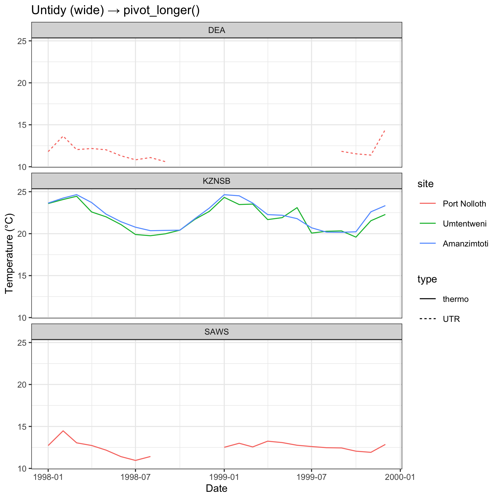](BCB744_Task_D_files/figure-html/fig-taskD-q2-1.png "Figure 1: SACTN2 temperature time series faceted by source (wide → long).")

Figure 1: SACTN2 temperature time series faceted by source (wide → long).

[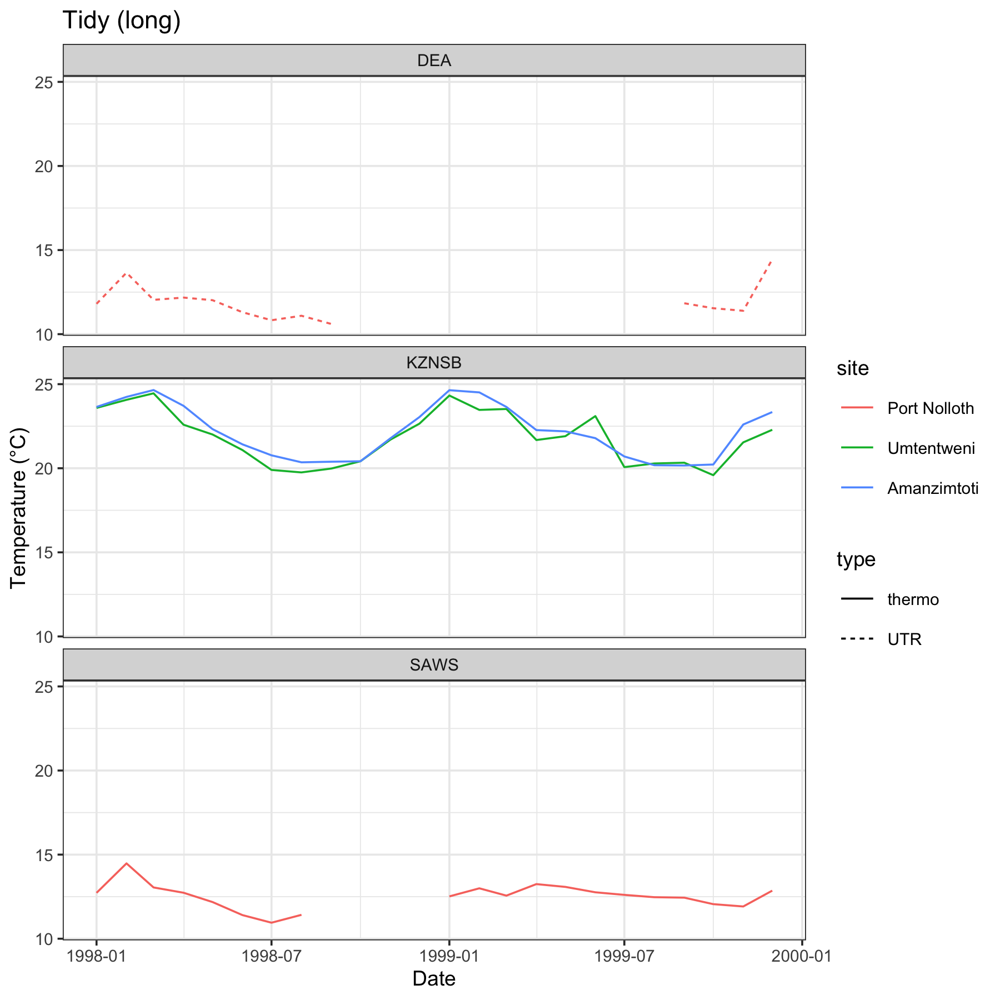](BCB744_Task_D_files/figure-html/fig-taskD-q2-2.png "Figure 2: SACTN2 temperature time series faceted by source (wide → long).")

Figure 2: SACTN2 temperature time series faceted by source (wide → long).

## Question 3

Load the `laminaria.csv` data (used in Chapter 13). Convert it to *long* format so that:

- measurement names are in a column called `measurement`
- the numeric values are in a column called `value`

Then make a boxplot of `value` by `measurement` and **flip** the axes (so measurements are on the y-axis). **(/10)**

**Answer**

``` numberSource
kelp <- read_csv(here::here("data", "BCB744", "laminaria.csv"))

kelp_long <- kelp |>
  pivot_longer(
    cols = blade_weight:total_length,
    names_to = "measurement",
    values_to = "value"
  )

ggplot(kelp_long, aes(x = measurement, y = value)) +
  geom_boxplot(outlier.alpha = 0.3) +
  coord_flip() +
  labs(x = NULL, y = NULL)
```

[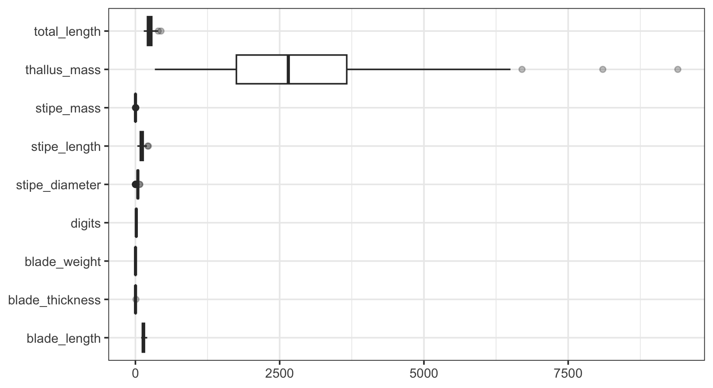](BCB744_Task_D_files/figure-html/fig-taskD-q3-1.png "Figure 3: Laminaria measurements in long format (boxplots).")

Figure 3: Laminaria measurements in long format (boxplots).

## Question 4

Using [`ggplot2::diamonds`](https://ggplot2.tidyverse.org/reference/diamonds.html), create a new factor called `price_bin` with three levels:

- `cheap` : price \< 1000
- `mid` : 1000 ≤ price \< 5000
- `expensive`: price ≥ 5000

Then make a faceted bar plot (faceted by `cut`) showing counts of diamonds by `price_bin`, filled by `cut`. **(/10)**

**Answer**

``` numberSource
diamonds2 <- ggplot2::diamonds |>
  mutate(
    price_bin = case_when(
      price < 1000 ~ "cheap",
      price < 5000 ~ "mid",
      TRUE ~ "expensive"
    ),
    price_bin = factor(price_bin, levels = c("cheap", "mid", "expensive"))
  )

ggplot(diamonds2, aes(x = price_bin, fill = cut)) +
  geom_bar() +
  facet_wrap(~cut) +
  labs(x = "Price bin (US$)", y = "Count")
```

[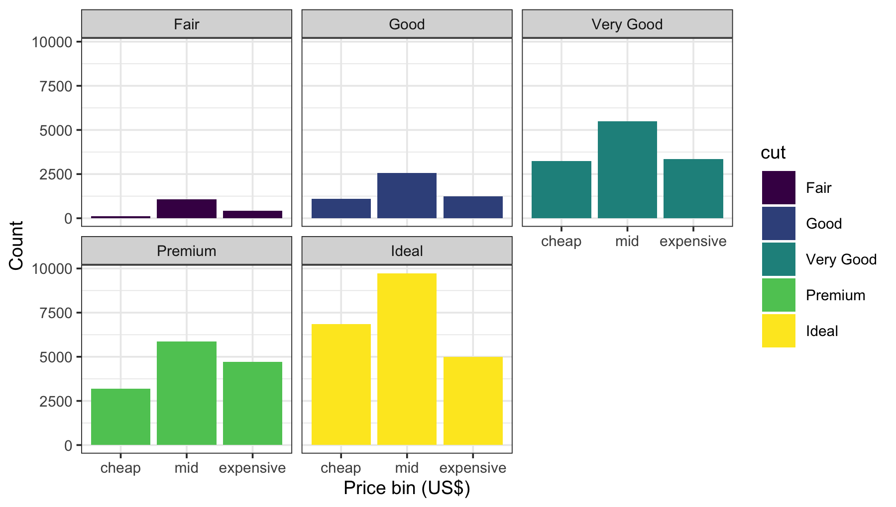](BCB744_Task_D_files/figure-html/fig-taskD-q4-1.png "Figure 4: Counts by price bin, filled by cut (diamonds).")

Figure 4: Counts by price bin, filled by cut (diamonds).

## Question 5

Using [`dplyr::storms`](https://dplyr.tidyverse.org/reference/storms.html), find the **top 5** storms (by name) with the highest **maximum wind**. Return a tibble with columns `name`, `year`, and `max_wind`, arranged from highest to lowest. **(/10)**

For bonus marks, use the **gt** R package, create a beautiful table with the same information. Ensure it is of publication quality, for instance to suit the style of the journal *Marine Biology*. **(/5)**

**Answer**

``` numberSource
# Top 5 storms by maximum wind speed
storms_top5 <- dplyr::storms |>
  group_by(name, year) |>
  summarise(max_wind = max(wind, na.rm = TRUE), .groups = "drop") |>
  arrange(desc(max_wind)) |>
  slice_head(n = 5)

storms_top5
```

    R> # A tibble: 5 × 3
    R>   name     year max_wind
    R>   <chr>   <dbl>    <int>
    R> 1 Allen    1980      165
    R> 2 Dorian   2019      160
    R> 3 Gilbert  1988      160
    R> 4 Wilma    2005      160
    R> 5 Irma     2017      155

**Bonus: publication-quality table (gt)**

``` numberSource
# If gt isn't installed on your machine yet:
# install.packages("gt")

library(gt)

storms_top5 |>
  gt() |>
  tab_header(
    title = md("**Top 5 storms by maximum wind speed**"),
    subtitle = md("From `dplyr::storms`")
  ) |>
  cols_label(
    name = "Storm",
    year = "Year",
    max_wind = md("Max wind (kt)")
  ) |>
  fmt_number(columns = max_wind, decimals = 0) |>
  cols_align(align = "left", columns = name) |>
  cols_align(align = "center", columns = year) |>
  cols_align(align = "right", columns = max_wind) |>
  tab_options(
    table.font.names = c("Times New Roman", "Times", "serif"),
    table.font.size = px(12),
    heading.title.font.size = px(14),
    heading.subtitle.font.size = px(12),
    table.width = pct(80),
    column_labels.font.weight = "bold",
    data_row.padding = px(3),
    table.border.top.style = "solid",
    table.border.top.width = px(1),
    table.border.bottom.style = "solid",
    table.border.bottom.width = px(1),
    table_body.hlines.style = "none"
  ) |>
  tab_style(
    style = cell_text(style = "italic"),
    locations = cells_body(columns = name)
  )
```

| **Top 5 storms by maximum wind speed** |  |  |
|----|----|----|
| From [`dplyr::storms`](https://dplyr.tidyverse.org/reference/storms.html) |  |  |
| Storm | Year | Max wind (kt) |
| Allen | 1980 | 165 |
| Dorian | 2019 | 160 |
| Gilbert | 1988 | 160 |
| Wilma | 2005 | 160 |
| Irma | 2017 | 155 |

Table 1

## Question 6

The dataset `msleep` (in **ggplot2**) contains life-history and sleep traits for mammals.

1.  Create a cleaned dataset that keeps only rows with a known `vore` (diet category) and non-missing `sleep_total`.
2.  For each `vore`, calculate:
    - `n` (number of species)
    - `mean_sleep` (mean of `sleep_total`)
    - `sd_sleep` (SD of `sleep_total`)
3.  Make a publication-quality figure showing `mean_sleep` by `vore` with **error bars** (±1 SD).

Order the `vore` categories from highest to lowest mean sleep. **(/12)**

**Answer**

``` numberSource
data(msleep, package = "ggplot2")

msleep_clean <- msleep |>
  filter(!is.na(vore), !is.na(sleep_total))

sleep_vore <- msleep_clean |>
  group_by(vore) |>
  summarise(
    n = n(),
    mean_sleep = mean(sleep_total),
    sd_sleep = sd(sleep_total),
    .groups = "drop"
  ) |>
  arrange(desc(mean_sleep)) |>
  mutate(vore = fct_inorder(vore))

sleep_vore
```

    R> # A tibble: 4 × 4
    R>   vore        n mean_sleep sd_sleep
    R>   <fct>   <int>      <dbl>    <dbl>
    R> 1 insecti     5      14.9      5.92
    R> 2 omni       20      10.9      2.95
    R> 3 carni      19      10.4      4.67
    R> 4 herbi      32       9.51     4.88

``` numberSource
ggplot(sleep_vore, aes(x = vore, y = mean_sleep)) +
  geom_col(width = 0.7, fill = "grey70", colour = "grey20") +
  geom_errorbar(
    aes(ymin = mean_sleep - sd_sleep, ymax = mean_sleep + sd_sleep),
    width = 0.15
  ) +
  coord_flip() +
  labs(
    x = "Diet category (vore)",
    y = "Mean total sleep (hours/day)"
  )
```

[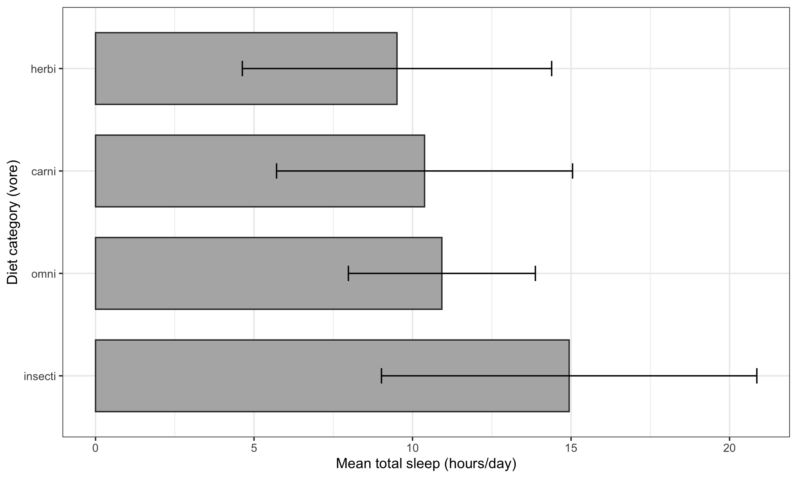](BCB744_Task_D_files/figure-html/fig-taskD-q6-1.png "Figure 5: Mean total sleep time by diet category (msleep), with ±1 SD.")

Figure 5: Mean total sleep time by diet category (msleep), with ±1 SD.

## Question 7

Using `SACTN`, create a column called `month` (as an ordered factor: Jan → Dec) and a column called `season` (DJF, MAM, JJA, SON).

Then calculate the mean temperature by `season` and `depth` and plot it as lines (x = depth, y = mean temp) with one line per season. **(/15)**

**Answer**

``` numberSource
# Ensure SACTN is loaded (from Question 6); if not, load again.
if (!exists("SACTN")) {
  load(here::here("data", "BCB744", "SACTNmonthly_v4.0.RData"))
  SACTN <- SACTNmonthly_v4.0
  rm(SACTNmonthly_v4.0)
}

SACTN2 <- SACTN |>
  mutate(
    month = factor(month(date, label = TRUE, abbr = TRUE),
                   levels = month.abb, ordered = TRUE),
    season = case_when(
      month %in% c("Dec", "Jan", "Feb") ~ "DJF",
      month %in% c("Mar", "Apr", "May") ~ "MAM",
      month %in% c("Jun", "Jul", "Aug") ~ "JJA",
      TRUE ~ "SON"
    ),
    season = factor(season, levels = c("DJF", "MAM", "JJA", "SON"))
  )

season_depth <- SACTN2 |>
  group_by(season, depth) |>
  summarise(mean_temp = mean(temp, na.rm = TRUE), .groups = "drop")

ggplot(season_depth, aes(x = depth, y = mean_temp, colour = season)) +
  geom_line() +
  geom_point() +
  labs(x = "Depth", y = "Mean temperature (°C)")
```

[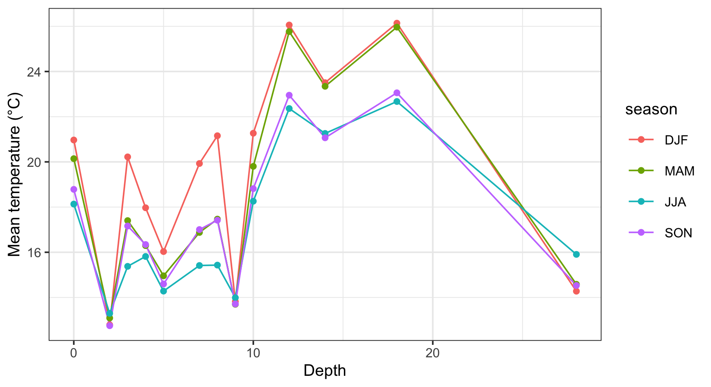](BCB744_Task_D_files/figure-html/fig-taskD-q7-1.png "Figure 6: Seasonal mean temperature by depth.")

Figure 6: Seasonal mean temperature by depth.

## Question 8

Using `SACTN`, filter to **one site of your choice** and create a time series plot of temperature (x = date, y = temp).

- Add a `geom_smooth()` (no SE ribbon)
- Facet by `depth`
- Ensure the x-axis tick labels are readable (rotate if needed)

**(/12)**

**Answer**

``` numberSource
site_choice <- "Amanzimtoti"  # choose any valid site name present in your data

SACTN |>
  filter(site == site_choice) |>
  ggplot(aes(x = date, y = temp)) +
  geom_line(alpha = 0.6) +
  geom_smooth(se = FALSE, linewidth = 0.6) +
  facet_wrap(~ depth, ncol = 1, scales = "free_y") +
  theme(axis.text.x = element_text(angle = 45, hjust = 1)) +
  labs(title = paste("SACTN temperature:", site_choice), x = "Date", y = "Temperature (°C)")
```

[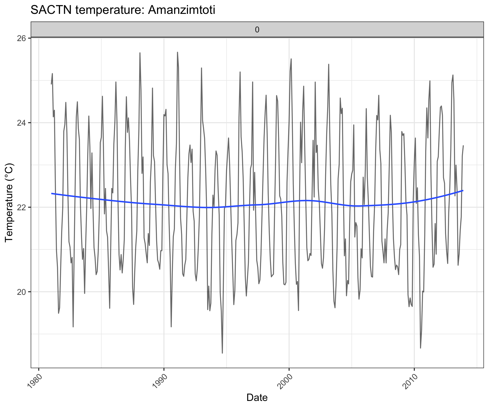](BCB744_Task_D_files/figure-html/fig-taskD-q8-1.png "Figure 7: Time series at one site, faceted by depth.")

Figure 7: Time series at one site, faceted by depth.

## Question 9

The object `SACTN4a` and `SACTN4b` (from `SACTN_mangled.RData`) store the *same observations split across two tables*.

- Join them into a single tidy table.
- Then create a faceted plot (one facet per `src`) showing `temp` through time.

**(/15)**

**Answer**

``` numberSource
load(here::here("data", "BCB744", "SACTN_mangled.RData"))

# SACTN4a stores date + temp, but site/src are embedded in an `index` string.
SACTN4a2 <- SACTN4a |>
  mutate(date = as.Date(date)) |>
  tidyr::separate(index, into = c("site", "src"), sep = "/ ", remove = TRUE)

# SACTN4b stores the identifiers as columns; rebuild `date`.
SACTN4b2 <- SACTN4b |>
  mutate(date = lubridate::make_date(year = year, month = as.integer(month), day = as.integer(day)))

# Join to get one tidy table
SACTN4 <- SACTN4b2 |>
  left_join(SACTN4a2, by = c("site", "src", "date"))

# Plot
SACTN4 |>
  ggplot(aes(x = date, y = temp, colour = site)) +
  geom_line(alpha = 0.6) +
  facet_wrap(~ src, ncol = 1) +
  labs(x = "Date", y = "Temperature (°C)")
```

[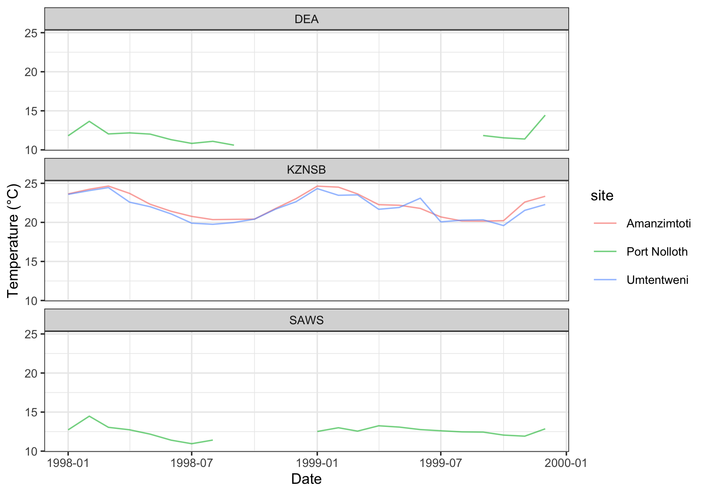](BCB744_Task_D_files/figure-html/fig-taskD-q9-1.png "Figure 8: SACTN4a + SACTN4b joined and plotted through time (faceted by src).")

Figure 8: SACTN4a + SACTN4b joined and plotted through time (faceted by src).

## Question 10

Using `SACTN`, compute a **temperature anomaly** per site as. Then create a histogram of anomalies and facet by `src`. **(/15)**

**Answer**

``` numberSource
SACTN_anom <- SACTN |>
  group_by(site) |>
  mutate(anom = temp - mean(temp, na.rm = TRUE)) |>
  ungroup()

ggplot(SACTN_anom, aes(x = anom)) +
  geom_histogram(bins = 40, colour = "white") +
  facet_wrap(~ src, ncol = 1) +
  labs(x = "Temperature anomaly (°C)", y = "Count")
```

[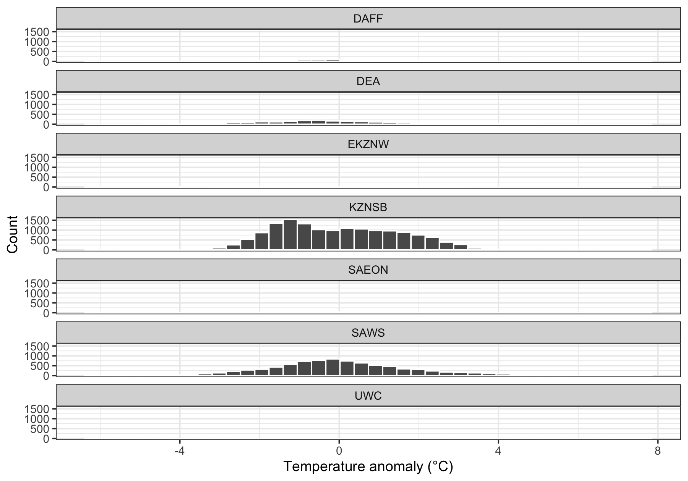](BCB744_Task_D_files/figure-html/fig-taskD-q10-1.png "Figure 9: Temperature anomalies by source (faceted).")

Figure 9: Temperature anomalies by source (faceted).

## Question 11 (complex)

Using `SACTN`, identify (for each `site`) the **warmest calendar month** (based on mean temperature across all years).

Return a table with `site`, `warmest_month`, and `mean_temp`, arranged from warmest to coolest mean temperature.

Then visualise the result as a dot plot of `mean_temp` by `site`, coloured by `warmest_month`. **(/20)**

**Answer**

``` numberSource
warmest_tbl <- SACTN |>
  mutate(month = month(date, label = TRUE, abbr = TRUE)) |>
  group_by(site, month) |>
  summarise(mean_temp = mean(temp, na.rm = TRUE), .groups = "drop") |>
  group_by(site) |>
  slice_max(order_by = mean_temp, n = 1, with_ties = FALSE) |>
  ungroup() |>
  rename(warmest_month = month) |>
  arrange(desc(mean_temp))

warmest_tbl
```

    R> # A tibble: 106 × 3
    R>    site           warmest_month mean_temp
    R>    <fct>          <ord>             <dbl>
    R>  1 Saxon          Feb                27.2
    R>  2 Sodwana        Mar                26.9
    R>  3 Leadsmanshoal  Feb                26.7
    R>  4 Durban         Feb                24.6
    R>  5 Scottburgh     Feb                24.5
    R>  6 Park Rynie     Feb                24.5
    R>  7 Brighton Beach Feb                24.5
    R>  8 Salt Rock      Feb                24.4
    R>  9 Umgababa       Feb                24.4
    R> 10 Antsey's Beach Feb                24.4
    R> # ℹ 96 more rows

``` numberSource
warmest_tbl |>
  mutate(site = fct_reorder(site, mean_temp)) |>
  ggplot(aes(x = mean_temp, y = site, colour = warmest_month)) +
  geom_point(size = 2.4) +
  labs(x = "Mean temperature in warmest month (°C)", y = NULL, colour = "Warmest month")
```

[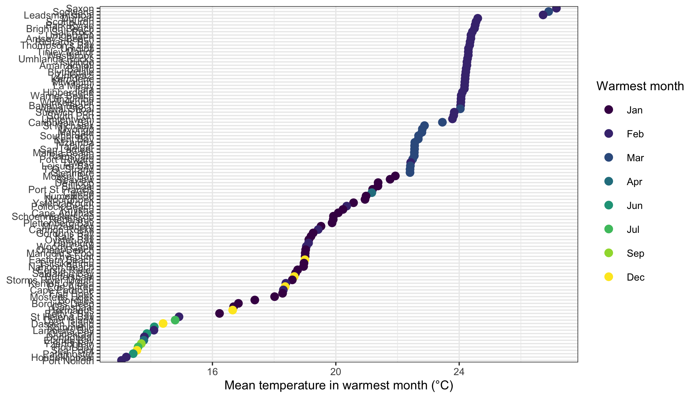](BCB744_Task_D_files/figure-html/fig-taskD-q11-1.png "Figure 10: Warmest month per site (dot plot).")

Figure 10: Warmest month per site (dot plot).

## Question 12 (complex)

Using `SACTN`, compute the **annual mean temperature** per `site` (one value per site-year). Then:

1.  Fit a simple linear trend (temperature ~ year) *per site*.
2.  Extract the slope (°C per year) for each site.
3.  Plot the slopes as a horizontal bar chart, ordered from the most negative to the most positive slope.

**(/25)**

**Answer**

``` numberSource
annual <- SACTN |>
  mutate(year = year(date)) |>
  group_by(site, year) |>
  summarise(mean_temp = mean(temp, na.rm = TRUE), .groups = "drop")

slopes <- annual |>
  group_by(site) |>
  summarise(
    slope = coef(lm(mean_temp ~ year))["year"],
    .groups = "drop"
  )

slopes
```

    R> # A tibble: 106 × 2
    R>    site             slope
    R>    <fct>            <dbl>
    R>  1 Port Nolloth   0.0195 
    R>  2 Hondeklipbaai  0.0574 
    R>  3 Doringbaai     0.0496 
    R>  4 Lamberts Bay   0.0143 
    R>  5 Elands Bay     0.0938 
    R>  6 St Helena Bay -0.0210 
    R>  7 Paternoster    0.00530
    R>  8 Saldanha Bay   0.0111 
    R>  9 Dassen Island  0.0251 
    R> 10 Yzerfontein    0.0255 
    R> # ℹ 96 more rows

``` numberSource
slopes |>
  mutate(site = fct_reorder(site, slope)) |>
  ggplot(aes(x = slope, y = site)) +
  geom_col() +
  geom_vline(xintercept = 0, linetype = 2) +
  labs(x = "Slope (°C per year)", y = NULL)
```

[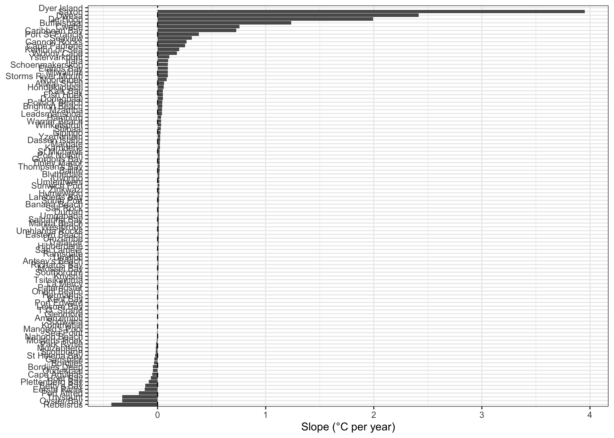](BCB744_Task_D_files/figure-html/fig-taskD-q12-1.png "Figure 11: Linear temperature trend (slope) per site.")

Figure 11: Linear temperature trend (slope) per site.

## Question 13 (complex)

Using `SACTN`, create a figure that answers this question:

> “Do deeper temperatures vary less through time than shallow temperatures?”

Your workflow must:

- summarise variability (e.g., SD or IQR) in a tidy way
- compare variability across depths (at least 3 depth levels)
- use an informative plot (not a table)
- include a short written interpretation (2–4 sentences)

**(/30)**

**Answer**

``` numberSource
var_depth <- SACTN |>
  group_by(site, depth) |>
  summarise(sd_temp = sd(temp, na.rm = TRUE), n = sum(!is.na(temp)), .groups = "drop")

var_depth |>
  ggplot(aes(x = depth, y = sd_temp)) +
  geom_boxplot(outlier.alpha = 0.3) +
  geom_jitter(width = 0.1, alpha = 0.4) +
  labs(x = "Depth", y = "SD of monthly temperature (°C)")
```

[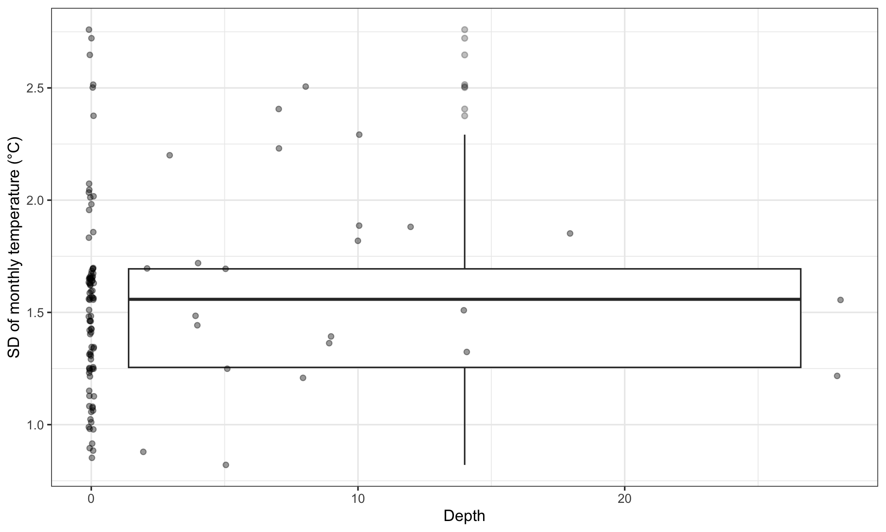](BCB744_Task_D_files/figure-html/fig-taskD-q13-1.png "Figure 12: Variability of temperature through time by depth.")

Figure 12: Variability of temperature through time by depth.

The deeper temperatures tend to show a smaller spread (lower SD) than shallow temperatures, consistent with stronger thermal buffering at depth. There is, however, clear site-to-site variability in SD at each depth, suggesting that local oceanography and exposure also influence stability through time. Using IQR instead of SD would be a robust alternative if outliers are a concern.

## Reuse

[CC BY-NC-SA 4.0](https://creativecommons.org/licenses/by-nc-sa/4.0/)

## Citation

BibTeX citation:

``` quarto-appendix-bibtex
@online{smit,
  author = {Smit, A. J.},
  title = {BCB744 {Task} {D}},
  url = {https://tangledbank.netlify.app/BCB744/tasks/BCB744_Task_D.html},
  langid = {en}
}
```

For attribution, please cite this work as:

Smit AJ BCB744 Task D. [https://tangledbank.netlify.app/BCB744/tasks/BCB744_Task_D.html.](https://tangledbank.netlify.app/BCB744/tasks/BCB744_Task_D.html)
