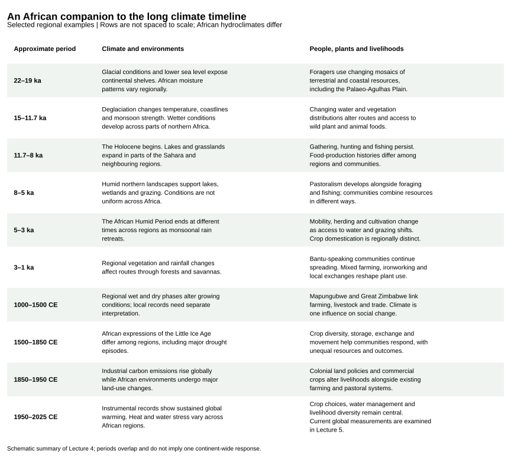
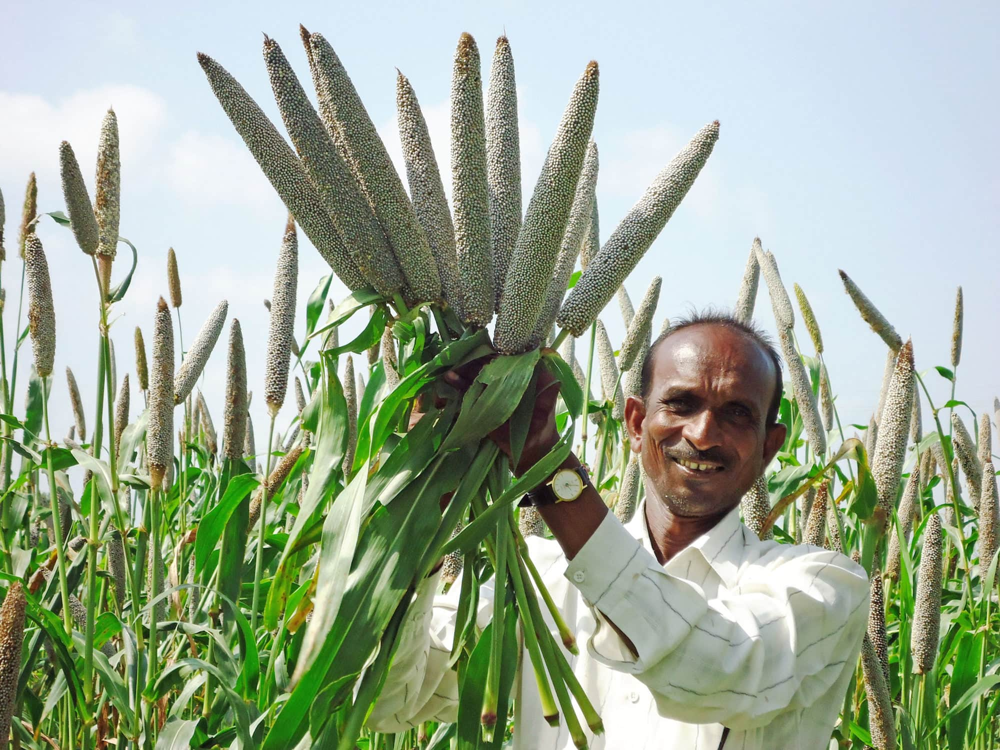
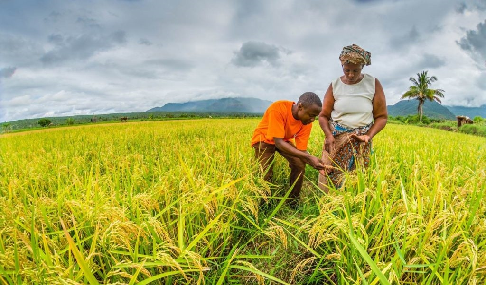
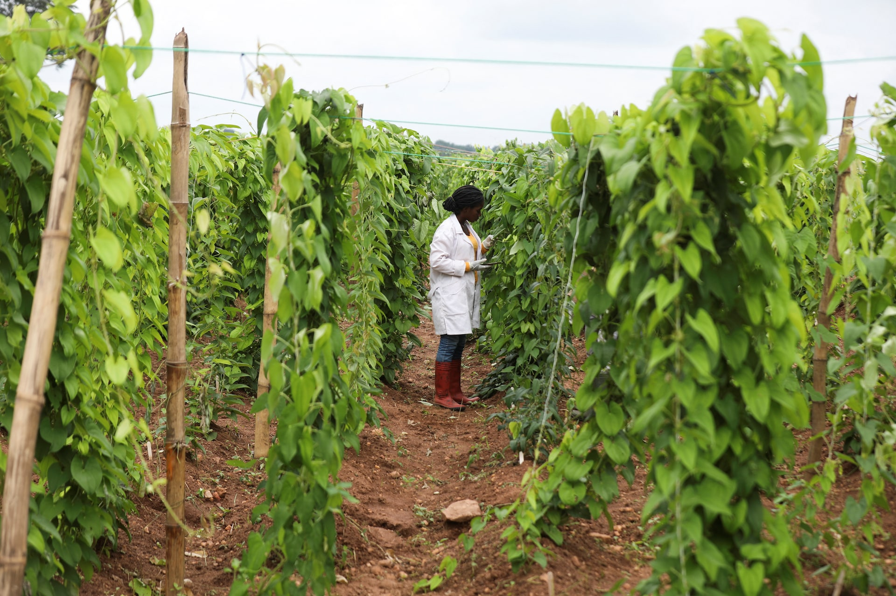

> **TIP:**
>
> - Reading a long climate timeline: time scale, temperature reference period and the gap between global and regional records.
> - Earth’s climate from the late Miocene to the Holocene, with orbital forcing, glacial cycles and changing CO₂.
> - Regional differences in African rainfall, lakes and vegetation, including the expansion of C₄ grasslands.
> - African hominin evolution, dispersal and the use of plant resources.
> - The African Humid Period, its time-transgressive end, and the domestication of indigenous crops.
> - Food production, diversified livelihoods and the responses of African societies to environmental change.

> **TIP:**
>
> This lecture places African human history within changing climates, vegetation and resource supplies. We use the long global temperature graphic to orient the last 22,000 years, then examine African examples over both that interval and deeper time. Plants connect these histories: their distributions, productivity and uses affect the food and materials available to people. [Lecture 5](../BDC223/L05-carbon_cycle.llms.md) follows the history of climate-change science and examines the current CO₂, temperature and carbon-cycle records.

> **TIP:**
>
> By the end of this lecture, you will be able to:
>
> 1.  Read a climate timeline, identifying its time scale, temperature reference period and geographical coverage.
> 2.  Explain how orbital forcing contributes to glacial cycles and African monsoon variability.
> 3.  Relate changing African vegetation and water supplies to hominin evolution, dispersal and resource use.
> 4.  Describe the African Humid Period and explain why its timing and effects differ among regions.
> 5.  Connect crop domestication, pastoralism and diversified livelihoods with the development of African societies.
> 6.  Distinguish evidence for environmental influence from claims that climate alone caused a social or evolutionary change.
> 7.  Apply these historical comparisons to questions about plant function, food supply and resilience.

> **NOTE:**
>
> - Reader, J. (1997). *Africa: A Biography of the Continent*. Knopf, New York.
> - [Shanahan, T. M., McKay, N. P., Hughen, K. A., Overpeck, J. T., Otto-Bliesner, B., Heil, C. W., King, J., Scholz, C. A., & Peck, J. (2015). The time-transgressive termination of the African Humid Period. *Nature Geoscience*, 8(2), 140–144.](https://doi.org/10.1038/ngeo2329)
> - [Grollemund, R., Branford, S., Bostoen, K., Meade, A., Venditti, C., & Pagel, M. (2015). Bantu expansion shows that habitat alters the route and pace of human dispersals. *Proceedings of the National Academy of Sciences*, 112(43), 13296–13301.](https://doi.org/10.1073/pnas.1503793112)

## 1 Reading the long climate timeline

The long scrolling graphic places selected events in human history alongside a reconstruction of Earth’s average temperature. **Time runs down the page; temperature runs horizontally.** The temperature reference is the **1961–1990 average**, as labelled at the top of the graphic. Its beginning, at about 20,000 BCE, lies roughly 22,000 years before the graphic’s publication in 2016, near the Last Glacial Maximum.

[](images/BDC223_L04_slide24.png "Figure 1: A historical teaching graphic of global temperature and selected human events. Randall Munroe’s 2016 Earth Temperature Timeline, with a course annotation for Great Zimbabwe. The original and its sources are available from xkcd, under CC BY-NC 2.5. Its future branches are historical illustrations, not the current projections used in this module.")

Figure 1: A historical teaching graphic of global temperature and selected human events. Randall Munroe’s 2016 Earth Temperature Timeline, with a course annotation for Great Zimbabwe. The original and its sources are available from [xkcd](https://xkcd.com/1732/), under [CC BY-NC 2.5](https://creativecommons.org/licenses/by-nc/2.5/). Its future branches are historical illustrations, not the current projections used in this module.

### 1.1 From glacial conditions to the Holocene

Large northern ice sheets and lower sea levels characterised the last glacial period. Orbital variations changed the seasonal and latitudinal distribution of incoming sunlight. Ice, ocean circulation and greenhouse gases responded, contributing to the transition out of glacial conditions. These processes operated over thousands of years. A single date on a timeline cannot capture the full sequence or the different responses among regions.

The Holocene began about **11,700 years ago**. Its relatively stable global temperatures provided the setting for many agricultural and urban developments, but African rainfall and vegetation continued to change. A small shift in the global mean can accompany substantial changes in a regional monsoon, lake level or growing season. We therefore need regional evidence alongside the global curve.

The graphic includes humorous entries as well as historical ones. Its event labels are an aid to orientation, rather than a complete chronology of migration, invention or domestication. People had reached several continents well before the dates shown near the top, and agriculture developed through different sequences in different places.

### 1.2 An African view alongside the graphic

The companion below follows the same broad interval through selected African examples. Regional hydroclimates and the dates of cultural changes differ across the continent. Read each row as a comparison between environmental conditions, plant resources and human responses. The longer narrative in [Section 2](#sec-africa-deep-time) begins before the scrolling graphic, with the Miocene and Pliocene.

[](images/climate/l04-african-timeline.svg "Figure 2: An African companion chronology from the last glacial period to 2025. Rows summarise selected examples discussed below and are not spaced to scale. For the changing southern coastal landscape see Marean et al. (2020); for regional differences in the end of the African Humid Period see Shanahan et al. (2015); and for habitat and Bantu dispersals see Grollemund et al. (2015).")

Figure 2: An African companion chronology from the last glacial period to 2025. Rows summarise selected examples discussed below and are not spaced to scale. For the changing southern coastal landscape see [Marean et al. (2020)](https://www.sciencedirect.com/science/article/pii/S0277379119309199); for regional differences in the end of the African Humid Period see [Shanahan et al. (2015)](https://www.nature.com/articles/ngeo2329); and for habitat and Bantu dispersals see [Grollemund et al. (2015)](https://doi.org/10.1073/pnas.1503793112).

### 1.3 Where the historical graphic ends

The original graphic labels **2016** as its present. Its future branches should be read in that historical context. The updated observational figures and the assessed emissions scenarios are in [Lecture 5](../BDC223/L05-carbon_cycle.llms.md#sec-current-records). Keep the global temperature reference periods explicit when comparing those figures with this one.

## 2 African climate and human evolution: deep-time perspectives

Africa’s deep-time history reveals an entanglement between changing climates, shifting vegetation regimes, and hominin/human development. From the late Miocene through the Pleistocene and into the Holocene, Africa’s climate oscillated between humid and arid extremes, which drove transformations of landscapes from lush forests to expansive savannas and deserts. In turn, our ancestors adapted to these fluctuations through evolutionary change, behavioural innovation, and migration. The drivers and responses eventually culminated in the development of agriculture and complex societies.

Here I will provide a chronological narrative of these processes. I build on “Africa: A Biography of the Continent” by John Reader ([1997](#ref-reader1997africa)), and integrate recent findings from paleoecology, archaeobotany, and climate modelling. I will examine how orbital-scale climate forces (e.g., monsoonal shifts and glacial cycles) shaped hominin evolution, how vegetation and hydrology characterised critical phases, the central ecological and cognitive roles of plants in early hominin life, the domestication of indigenous African crops, and the societal transformations spurred by food production. The focus is pan-African, drawing comparative insights from East Africa’s Rift Valley to the Sahel, West African forests, and Southern African refugia.

### 2.1 From forests to savannas (Miocene–Pliocene, ~10–3 Ma)

During the **Late Miocene (11.63–5.333 Ma)**, Africa’s climate embarked on a long-term drying trajectory that permanently altered its ecosystems. Although changes occurred in both hemispheres, the consequences were particularly monumental in Africa ([Herbert et al. 2016](#ref-herbert2016late)). Ten million years ago, tropical Africa remained dominated by dense forests and wooded landscapes, but tectonic upheavals (most dramatically the progressive uplift of the East African Rift highlands) combined with global cooling to destabilise these humid biomes. Best estimates suggest atmospheric CO₂ concentrations dropped from ~500 to \<350 ppm (with significant uncertainty but consistent directionality across multiple proxy compilations) during the **Late Miocene cooling (7–5.4 Ma)** ([Herbert et al. 2016](#ref-herbert2016late); [Brown et al. 2022](#ref-brown2022late)). Cooling was most pronounced at high latitudes, which steepened the temperature gradient between the poles and the equator ([Polissar et al. 2019](#ref-polissar2019synchronous)). These reductions catalysed the competitive expansion of C₄ grasses ([Herbert et al. 2016](#ref-herbert2016late)), and leaf-wax records from marine cores show C₄-dominated ecosystems spreading across Northwestern and East Africa from ca. 10 Ma ([Polissar et al. 2019](#ref-polissar2019synchronous)). Their water-efficient physiology allowed them to outcompete trees under increasingly seasonal rainfall regimes. Mean global surface temperatures, though still several degrees warmer than late-Quaternary glacials, were trending downward from the Miocene Climatic Optimum, while rainfall in East Africa grew more seasonal as tectonic relief reshaped monsoonal circulation and ocean–atmosphere linkages.

By around 8 Ma, the major expansion of C₄ grassland biomes was fully underway, a shift that reconfigured hominin foraging grounds and evolutionary possibilities. Strengthened monsoonal seasonality favoured grasses over arboreal cover, and paleoecological records point to the replacement of relatively homogenous tropical forests with a patchwork of contrasting habitats: upland mountains, freshwater lakes, dry savannas, and residual montane forests. This heterogeneity was not a mere background change but a force structuring early hominin adaptations, as resource acquisition strategies had to adjust to spatially fragmented environments. The mammalian fauna from this period indicates that despite regional aridity, water sources and varied habitats supported a rich biodiversity. One punctuating episode in this trajectory was the **Messinian Salinity Crisis (~5.3 Ma)**, when tectonic closure of the Gibraltar Strait led to the partial desiccation of the Mediterranean Sea. This event disrupted atmospheric circulation and likely reduced moisture delivery to northern Africa, intensifying aridity across the continent. The conjunction of falling CO₂, global cooling, altered hydrology, and tectonic reshaping thus established the ecological framework in which the earliest members of the hominin clade adapted and diversified and took their first steps toward bipedalism.

The earliest known hominins, *Sahelanthropus tchadensis* (~7 Ma) in Chad and *Orrorin tugenensis* (~6 Ma) in Kenya, date to this late Miocene interval. Paleoenvironmental data suggest these ancestral hominids inhabited wooded or mosaic environments rather than open grassland alone. For example, geological and floral evidence from *Ardipithecus ramidus* (~4.4 Ma) indicates a woodland habitat with closed-canopy forest patches ([WoldeGabriel et al. 2009](#ref-woldegabriel2009geological)). Thus, while the “savanna hypothesis” once postulated that hominins descended from trees as forests gave way to grasslands, the reality is more complex. Early bipeds likely evolved in heterogeneous settings that included both forested and open areas, requiring versatility. Hominin fossil sites from ~7–4 Ma (e.g., in the Rift Valley and central Africa) often show a mix of faunal indicators of wooded savanna and gallery forest, and suggests that our ancestors were adapting to a mosaic landscape rather than a singular savanna biome.

By the late Pliocene, during the **mid-Piacenzian Warm Period (~3.3–3.0 Ma)**, Africa entered a regime of heightened climatic variability superimposed on a background of sustained global warmth. Boron-isotope reconstructions place atmospheric CO₂ concentrations at ca. 330–395 ppm, and global mean temperatures were ~2–3 °C higher than today ([Vega et al. 2020](#ref-delavega2020atmospheric)). Global mean sea level probably stood ca. 15–20 m above present, although estimates range from ca. 5 to 25 m ([Dumitru et al. 2019](#ref-dumitru2019constraints); [Grant et al. 2019](#ref-grant2019amplitude)). Ocean–atmosphere circulation supported high primary productivity with sharp seasonal contrasts. On the African continent, hydroclimate was increasingly seasonal and strongly tuned to orbital precession: wetter precession minima alternated with arid maxima, redistributing resources at sub-100 kyr intervals and reshaping the nascent African monsoon system.

This climatic pattern translated into warmer, more productive lake districts and dynamic forest–savanna ecotones, though by ~2.8 Ma cooling intensified with the expansion of Northern Hemisphere ice. The precession-paced oscillation of the West African monsoon persisted, shifting rainfall belts latitudinally; humid phases nourished deep Rift Valley lakes and gallery forests, while intervening dry pulses contracted them, stripping back vegetation and leaving behind open landscapes. Climate model experiments identify elevated CO₂ as the largest single contributor to mid-Pliocene global warmth ([Lunt et al. 2012](#ref-lunt2012causes)). CO₂ therefore set the warm background state, while orbital precession set the rhythm of African wet and dry phases.

The ecological imprint of this structure was the “mosaic” landscape for which the Pliocene is now archetypal. Faunal and floral assemblages indicate a patchwork of savanna, woodland, and wetland habitats, interspersed with forested refugia. In East Africa, rainy seasons could extend for as long as eight months, yielding a gradient of ecological niches (from grasslands to shrublands, wooded zones, and riparian forests), each waxing and waning with orbital pacing. Such environmental heterogeneity did not simply provide a backdrop: it created alternating corridors and barriers, opportunities for niche exploitation alongside constraints on long-term stability. For early hominins, this shifting terrain was at once a laboratory of adaptation and a crucible of survival.

This is the environmental context within which *Australopithecus afarensis* flourished (c. 3.9–2.9 Ma); this species of hominin is well known from the skeleton “Lucy” (c. 3.2 Ma). Persisting for nearly a million years, *A. afarensis* displayed a remarkable behavioural and dietary flexibility that allowed it to sustain viable populations across these shifting landscapes. Its ability to exploit a broad range of resources (forest fruits, woodland tubers, savanna grasses, and lakeshore plants) highlights the adaptive strategies required for survival in Pliocene Africa.

At the same time, isotopic evidence points to a dietary shift underway: while earlier apes were tied largely to C₃ plant foods (forest fruits and leaves), australopiths began incorporating C₄ resources (grasses, sedges, and grazing animal tissues) into their diets. *Australopithecus bahrelghazali* (~3.5 Ma, Chad) shows particularly strong δ¹³C enrichment, suggesting a heavy reliance on open-habitat foods ([Lee-Thorp et al. 2012](#ref-lee2012isotopic)), a signal that East Africa’s grassland expansion was beginning to restructure hominin subsistence. *Australopithecus africanus* (South Africa, after ~3 Ma) likewise demonstrates a broad diet spanning woodland and savanna foods, highlighting regional diversity in both environments and adaptations.

Climatically, the Pliocene did not exhibit a steady “warm and wet” climate but exemplified an era of oscillation. Around 3.6–2.7 Ma, the intensification of Northern Hemisphere glaciation brought more pronounced glacial–interglacial cycles. In East Africa, deep Rift Valley lakes formed during humid pulses only to vanish during arid phases, leaving behind erratic records of expansion and collapse. This “boom–bust” hydrological rhythm imposed repeated selective pressures, rewarding dietary flexibility, mobility, and technological experimentation.

By ~2.8–2.5 Ma, a major global cooling and drying event (sometimes referred to as the “2.8 Ma event”) initiated a new trajectory. African landscapes tilted toward greater aridity, woodlands contracted, and savannas became more extensive. It is in this ecological reorganisation that we see the evolutionary branching of the hominin line. The robust australopiths (*Paranthropus*) evolved powerful jaws and teeth for hard, fibrous foods, while the first members of the genus *Homo* (e.g., *Homo habilis*) appear in the fossil record, associated with the earliest stone tools and a shift toward higher-quality, harder-to-acquire foods such as underground tubers and animal protein.

So, the late Miocene–Pliocene climate trend toward cooler, drier, and more variable conditions transformed Africa’s landscapes from continuous forests to patchwork savanna, woodland, and lakes. Hominins responded by evolving bipedal locomotion (useful for traversing open areas), broadening their diets to include tough C₄ plant foods and meat, and developing rudimentary tool use. The ecological role of plants in this phase was obvious: early hominins still relied heavily on plant foods (fruits, leaves, seeds, roots), and the cognitive challenge of locating and processing dispersed plant resources likely honed foraging intelligence. Paleoanthropological evidence suggests that plant foods such as edible roots and tubers may have been fallback resources in dry seasons; some researchers hypothesize that digging for tubers (perhaps with simple wooden tools) could have been an important adaptive strategy in more open, seasonal environments ([Laden and Wrangham 2005](#ref-laden2005rise)). Although such wooden digging sticks do not preserve archaeologically from the Pliocene, the later record (e.g., Middle Stone Age) shows early humans indeed used digging sticks to unearth geophytes. Consequently, by the close of the Pliocene (~2.6 Ma), Africa’s hominins had become animals of the savanna–woodland mosaic, resilient in the face of shifting climates and ready to embark on new evolutionary pathways.

> **NOTE:**
>
> During the early hominin periods, Africa supported a mosaic environment of open grassland, wooded savanna, and forests ([Reader 1997](#ref-reader1997africa)). The mode of living for early hominins like *Sahelanthropus*, *Orrorin*, and *Australopithecus afarensis* was primarily foraging and gathering, likely focusing on plant resources like fruits, leaves, and tubers, as well as insects and other small animals. Reader stresses that the fluctuating climate, oscillating between wetter and drier periods, shaped landscapes and pressured hominins into developing diverse dietary and technological adaptations to exploit these varied resources. This environmental pressure likely fostered a flexible, non-specialised diet that was key to survival across different habitats.

### 2.2 Pleistocene climate oscillations and the evolution of *Homo* (2.6 Ma–130 ka)

The **Pleistocene epoch**, beginning ~2.6 Ma with the formal onset of the **Quaternary**, amplified this variability into even sharper oscillations. Global climate fell under the pacing of glacial–interglacial cycles: first the ~41,000-year rhythm of orbital obliquity during the early Pleistocene, and after the Mid-Pleistocene Transition (~1 Ma), the longer ~100,000-year cycles. In Africa these rhythms expressed themselves as alternating pluvial and interpluvial phases: wet intervals in which Rift Valley lakes swelled, rivers spread, and savannas greened, followed by dry episodes when deserts expanded (Sahara, Kalahari) and forests retreated. Overlaid on these were the faster, precession-driven (~20,000-year) monsoonal cycles, which forced tropical rainfall belts into rapid oscillations, producing humid–arid pulses on timescales far shorter than a single glacial cycle. Thus, although much of Africa lay in the tropics, its climate was anything but stable: hominins of the early Pleistocene lived through extremes in hydroclimate that alternated between verdant and desiccated states, conditions broadly analogous to modern East Africa but expressed with heightened amplitude.

Atmospheric CO₂ by this stage is thought to have approached the Quaternary range of ~180–300 ppm that ice cores record directly for the last ~800,000 years, and this lower radiative baseline accentuated the contrast between glacial aridity and interglacial greening. In the East African Rift, precession-driven rainfall pulses repeatedly transformed arid basins into freshwater-rich environments, generating high-stands of deep lakes near ~1.9 Ma, the very interval marked by the dispersal of early *Homo* and the acceleration of technological innovation. These hydrological oscillations provided intermittent cornucopias of aquatic and terrestrial resources, only to collapse back into desiccation within a few millennia. In this climatic template, it was not the average condition but the amplitude and tempo of rainfall swings that carried the evolutionary force, shaping hominin ecologies, opportunities for dispersal, and the recurrent need to innovate in the face of shifting resources.

The genus *Homo* diversified and spread during the Pleistocene, displaying leaps in technology and cognition. Many hypotheses have been proposed to link these changes to environment. The classic “savanna hypothesis” argued that a steady trend toward aridity (and the spread of savanna) drove *Homo* adaptations (upright walking, tool-making, larger brains) ([Potts 1998a](#ref-potts1998environmental); [deMenocal 2004](#ref-demenocal2004african)). However, newer research emphasises environmental instability rather than any single habitat as the prime driver. Rick Potts’s variability selection hypothesis posits that hominins were selected for flexibility and innovation in response to fluctuating habitats ([Potts 1998b](#ref-potts1998variability)). An analysis of long climate records found that major evolutionary changes align with periods of heightened climate variability in East Africa ([Potts and Faith 2015](#ref-potts2015alternating)). In this view, adaptability to change, rather than narrow specialisation, was the trait that unstable climates favoured ([Potts 1998b](#ref-potts1998variability)).

The fossil and archaeological record of the early-to-mid Pleistocene supports a narrative of punctuated change correlated with climatic pulses. One of the most significant periods occurred around 1.9–1.8 Ma. At this time, multiple important events coincided: the speciation of *Homo ergaster*/*erectus* (early *Homo* with a substantially larger brain and body than earlier forms), the first major hominin dispersals out of Africa, and the peak of hominin species diversity (with *Homo*, *Paranthropus*, and late *Australopithecus* contemporaneously present) ([Shultz and Maslin 2013](#ref-shultz2013early)). Paleoenvironmental proxies indicate that this interval was marked by pronounced climate fluctuations in East Africa. Researchers have identified a series of “climate pulses” linked to Earth’s precession cycle that caused the repeated appearance and disappearance of deep lakes in the East African Rift System (EARS) ([Trauth et al. 2005](#ref-trauth2005late); [Shultz and Maslin 2013](#ref-shultz2013early)). Geological evidence shows that around 1.9 Ma, large, ephemeral freshwater lakes suddenly formed in basins along the Rift Valley, transforming arid scrub into productive wetlands ([Trauth et al. 2005](#ref-trauth2005late)). These lake high-stands are recorded by deep lake sediments and correspond to times of low dust deposition in West African and Mediterranean marine records, indicating wetter regional climate ([Shultz and Maslin 2013](#ref-shultz2013early)). The onset of this wet phase is statistically linked with hominin expansion and innovation. Hominins likely took advantage of the resource-rich lake margins (abundant water, aquatic foods, lush plant growth, and fauna) leading to population growth and the capacity to move into new territories ([Shultz and Maslin 2013](#ref-shultz2013early)). The dispersal of *Homo erectus* beyond Africa (to Eurasia by ~1.8 Ma) may have been enabled by such “window” periods of ameliorated climate, when savannas were greener and deserts like the Sahara reduced, easing migration routes.

The first possible evidence of controlled fire use appears around 1.7–1.0 million years ago (Ma), associated with *Homo erectus* sites. Some of the oldest claims come from Koobi Fora (Kenya) and Chesowanja (Kenya) at ~1.5 Ma, where reddened sediments and burned clay nodules have been reported ([Gowlett et al. 1981](#ref-gowlett1981early); [Bellomo 1994](#ref-bellomo1994methods)). Similarly, at Swartkrans (South Africa), bone fragments with thermal alteration dating to ~1–1.5 Ma have been interpreted as fire traces ([Brain and Sillen 1988](#ref-brain1988evidence)). These finds are debated, because natural bushfires can produce similar signals ([James 1989](#ref-james1989hominid)).

More secure evidence comes from Wonderwerk Cave (South Africa), where burned bone and ashed plant remains preserved in intact Acheulean sediments show that burning took place inside the cave ~1.0 Ma ([Berna et al. 2012](#ref-berna2012microstratigraphic)), and from Gesher Benot Ya‘aqov (Israel), ~780 ka, where archaeologists have identified burned flint microartifacts and charred plant remains in a spatially patterned context ([Goren-Inbar et al. 2004](#ref-goreninbar2004evidence)). These sites place secure control of fire in the later phase of *Homo erectus* evolution.

> **NOTE:**
>
> Fire use is transformative in hominin diets. Cooking:
>
> - Softens plant tissues (roots, tubers, seeds), making starchy underground storage organs digestible and safe.
> - Detoxifies many otherwise inedible or marginal foods (legumes, bitter roots, some leaves).
> - Tenderises meat and bone marrow, increasing caloric returns and shortening chewing time.
>
> The “cooking hypothesis” (Richard Wrangham and colleagues) argues that once fire use became habitual, *Homo erectus* shifted from raw foraging toward a higher-quality diet of cooked foods. This had cascading effects:
>
> - Cooking increases caloric yield, reducing the gut’s metabolic burden. This fits with anatomical evidence: *H. erectus* had smaller teeth and reduced gut volume compared to australopiths, consistent with reliance on more energy-dense, processed food.
> - More reliable access to calories (via cooking) is thought to have supported encephalisation (brain expansion). Brain size in *H. erectus* rose steadily after ~1.5 Ma, a trajectory that cooking plausibly facilitated.
> - Fire provided not only cooking but also light, warmth, and protection from predators. Campsites structured around hearths suggest new forms of social cohesion, communication, and division of labour.

Following this productive wet pulse, the climate swung back to drier conditions, and many of the Rift lakes shrank or vanished ([Trauth et al. 2005](#ref-trauth2005late); [Shultz and Maslin 2013](#ref-shultz2013early)). Interestingly, this coincides with what the fossil record shows as a winnowing of hominin diversity after ~1.5 Ma (only *Homo* remains, as *Paranthropus* goes extinct) and the progression of *Homo erectus* toward even larger brain size. One interpretation is that large, erratic climate shifts (pulsed climate variability) created an evolutionary filter. Species unable to cope with extreme swings (too specialised to either wet forests or dry plains) went extinct, whereas the lineage leading to modern humans survived by being generalists. The pulsed climate variability hypothesis specifically argues that these short, intense wet-dry cycles in East Africa were “fundamental to hominin speciation, encephalisation and migration” ([Shultz and Maslin 2013](#ref-shultz2013early)). By providing alternating periods of resource abundance and scarcity, the environment may have spurred early *Homo* to develop new foraging strategies (e.g., more meat consumption, cooperative hunting), improved technologies (Acheulean stone handaxes appear by ~1.6 Ma), and possibly social changes, all of which would help buffer against unpredictability.

Throughout the **Middle Pleistocene and the interval leading into it (~1.2 Ma–130 ka)**, Africa remained locked into oscillatory climates now dominated by 100,000-year glacial–interglacial cycles. The **Mid-Pleistocene Transition (~1.2–0.7 Ma, centred near 1 Ma)** showed a drastic reorganisation of the climate system: glacial intervals lengthened and intensified, with CO₂ minima sinking toward ~180–200 ppm and interglacial peaks recovering only to ~260–280 ppm. Africa’s hydrology mirrored these rhythms. During glacials, cooler and drier conditions prevailed: the Sahara and Kalahari expanded, tropical rainforests contracted into refugia, and savanna corridors narrowed to drought-dominated threads. During interglacials, monsoon systems strengthened, deserts retreated, and wetlands and forests expanded. Overlaying this slow 100-kyr pacing were precessional (~20-kyr) oscillations that forced rapid pulses of lake expansion and contraction, embedding high-frequency variability within the broader glacial–interglacial template. What emerges, therefore, is not a simple linear “savannisation” but an alternation of environments, namely oscillatory wet–dry phases that continually restructured ecologies.

Within this shifting template, hominin evolution marched on. *Homo heidelbergensis* (often regarded as archaic *Homo sapiens* in Africa) arose by ~0.6–0.5 Ma, and archaeological traces suggest adaptations well-suited to climatic instability. At sites such as Olorgesailie in Kenya, stratigraphic sequences between ~500–300 ka record alternating wet and dry phases, mirrored in hominin behaviour: changing prey species, shifts in tool raw materials, and altered landscape use as lake levels rose and fell. Evidence from this period suggests control of fire, large-game hunting, and possibly the construction of simple shelters: technological and social strategies that buffered against environmental unpredictability. By the later Middle Pleistocene, populations show increasingly derived traits, pointing to the emergence of *Homo sapiens* between ~300–200 ka, as reflected in fossils from Jebel Irhoud (Morocco) and Omo-Kibish (Ethiopia).

The timing is significant. Anatomically modern humans appeared in the context of **Marine Isotope Stage 6 (~190–130 ka)**, a protracted glacial marked by hyper-aridity across much of Africa. Global CO₂ oscillated largely between ~190–220 ppm, with finer-scale millennial variability now resolved in the EPICA ice-core record. Across Africa, proxies from speleothems and lacustrine deposits indicate widespread contraction of effective moisture: interior basins dried, lakes desiccated, and karst systems ceased growth, all signaling pervasive aridity. Yet the desiccation was not uniform. Along the southern Cape coast, cooler upwelling seas coupled with winter-rain regimes sustained pockets of relative humidity and edible geophyte abundance. Some researchers have proposed a demographic bottleneck during this glacial, although estimates of its severity vary widely. Paleoenvironmental and archaeological research suggests survival in ecological refugia, most prominently along the southern African coast, where upwelling systems and diverse littoral resources offered stable sustenance amidst continental desiccation. In this sense, the oscillatory mid-Pleistocene climate was not merely a backdrop but a structuring force: alternating corridors and refuges, constraints and opportunities, that conditioned the evolutionary trajectory of the genus *Homo*.

> **NOTE:**
>
> The appearance of *Homo erectus* coincided with increased climatic instability and the establishment of glacial-interglacial cycles. Reader mentions that these pressures favoured larger-brained hominins capable of more sophisticated tool use and social cooperation. The mode of living shifted towards more active hunting and gathering. The control of fire, a key technological adaptation, would have allowed for the cooking of meat and plant foods, increasing digestibility and energy intake. This technological and social evolution enabled *Homo erectus* to exploit a wider range of food sources and led to the first major dispersals from Africa.

### 2.3 Surviving the Late Pleistocene: modern humans in arid and humid extremes (130–12 ka)

The last phase of the **Pleistocene (~130–12 ka)** was marked by volatile climatic oscillations that repeatedly tested *Homo sapiens*. The termination of MIS 6 around 130 ka ushered in an abrupt warming into **MIS 5e, the Last Interglacial**. Atmospheric CO₂ rose toward ~270–280 ppm, and global warmth amplified the strength of the African monsoon. Northern Africa entered a pluvial phase, the so-called Eemian Green Sahara, when tropical rainfall belts surged northward and the present Sahara was transformed into grasslands dotted with lakes and river systems. Proxy records (lacustrine deposits, speleothems, dune chronologies) converge on the picture of a dramatically contracted desert, opening habitable corridors across what is now arid expanse.

This climatic window coincides with the earliest evidence for *Homo sapiens* dispersal beyond Africa. Fossils from Skhul and Qafzeh in Israel (~120 ka) demonstrate that modern humans reached the Levant when it functioned as a biogeographic extension of African savanna. Southern Africa, too, offered stable resource landscapes: coastal plains combined carbohydrate-rich geophytes with abundant marine protein, creating refugial ecotones where human populations could persist and experiment with new foraging strategies. The rainfall regime, however, was dipolar. While the north flourished under MIS 5e rains, the south showed greater variability, with MIS 5a–c marked by oscillations in precipitation that alternately contracted and expanded coastal habitability.

This opportunity was not permanent. By **MIS 4 (~70–60 ka)**, global cooling and lowered CO₂ (~190–210 ppm) brought renewed aridity. The Sahara re-expanded, monsoon corridors collapsed, and the Levantine populations that had earlier dispersed outward either disappeared or withdrew. What remained were scattered refugial populations within Africa, many along the southern coast, where a convergence of marine protein, edible geophytes, and relatively buffered rainfall regimes sustained continuity. This oscillatory pattern, already evident throughout the Pleistocene, repeated once more: humid interludes briefly opened corridors that invited dispersal and innovation, only to be snapped shut by the return of aridity. It was within these compressed windows of ecological opportunity and constraint that the hallmarks of behavioural modernity (symbolic expression, diversified technology, and complex sociality) were forged, their development calibrated to the waxing and waning of resource networks under orbital pacing, monsoonal reorganisations, and the fluctuations of CO₂.

Into this context of tightening aridity, the Toba eruption (~74 ka) occurred, injecting volcanic aerosols into the stratosphere. While early hypotheses cast Toba as a catastrophic bottleneck event that nearly extinguished Homo sapiens, recent high-resolution proxy records and archaeological data have undermined that view. Toba ash layers in Lake Malawi sediments show no evidence of a volcanic winter in East Africa ([Lane et al. 2013](#ref-lane2013ash)), and at Pinnacle Point on the South African south coast, occupation continued through the period in which Toba glass shards were deposited ([Smith et al. 2018](#ref-smith2018humans)). The climatic signal of Toba is now widely regarded as regionally heterogeneous and transient: a volcanic dimming imposed upon an already cooling world rather than a singular global catastrophe. In Africa, the ecological footprint appears to have been structured less by the eruption itself than by differential rainfall sensitivity. Coastal foragers, buffered by marine productivity and underground geophyte stores, weathered short-term disruptions, whereas interior populations, dependent on seasonal rainfall and freshwater lakes, were more vulnerable to moisture failures. This division is visible in paleoenvironmental reconstructions (lake low-stands, enhanced dust fluxes, and speleothem hiatuses) that point to strong aridity inland during MIS 4.

From MIS 4 into MIS 3 (~60–30 ka), atmospheric CO₂ rose modestly (~200–240 ppm), and African hydroclimates began to oscillate at higher frequency, paced by Dansgaard–Oeschger variability. Rainfall belts shifted latitudinally with millennial-scale pulses, alternately rehydrating and desiccating corridors. During wetter interstadials, savanna and lake systems expanded, facilitating range extensions and dispersal opportunities; during intervening arid episodes, habitats contracted and corridors pinched off. This rhythm is legible both in Saharan dust records (tracking shifts in aridity) and in East African Rift lake levels, which swung dramatically in phase with Northern Hemisphere temperature oscillations. Genetic and demographic inferences suggest that human populations tracked these oscillations, expanding during humid phases, then fragmenting or retreating into refugia when aridity returned.

In Africa itself, *Homo sapiens* populations likely contracted to favourable refuges during dry extremes. As noted, one important refuge during the harsh MIS6 glacial (~190–130 ka) appears to have been the southern coastal zone of South Africa ([Marean 2010](#ref-marean2010pinnacle)). Archaeological sites like Pinnacle Point and Blombos Cave on the South African Cape have yielded remarkable evidence of modern human habitation from ~164 ka ([Marean et al. 2007](#ref-marean2007early)) and, at one site or another, repeatedly through to ~70 ka and later ([Henshilwood et al. 2002](#ref-henshilwood2002emergence); [Smith et al. 2018](#ref-smith2018humans)). These people thrived at a time when much of inland Africa was extremely arid and depopulated. What sustained them was a unique combination of resources in this region: marine foods and geophytic plant resources. Paleoenvironmental reconstructions of the now-submerged Paleo-Agulhas Plain (the exposed continental shelf during glacial low sea levels) show that it supported a rich fynbos shrubland (part of the Cape Floral Region), which boasts the world’s highest diversity of edible geophytes (plants with underground bulbs and tubers) ([Marean et al. 2020](#ref-marean2020palaeo)). These carbohydrate-rich, starchy plant organs were available through most of the year, and many grow near the surface of sandy soils, where they can be gathered with little effort ([De Vynck et al. 2016](#ref-devynck2016seasonal); [Singels et al. 2016](#ref-singels2016foraging)). Additionally, the adjacent Indian Ocean coast provided shellfish, fish, and other seafood, supplying fatty acids and protein. Marean argues that this combination of shellfish and geophytes on the Cape south coast allowed the occupants of Pinnacle Point to persist while the climate elsewhere was hostile ([Marean 2010](#ref-marean2010pinnacle)). This resource base may have enabled a small band of modern humans to endure the glacial mega-droughts. Notably, evidence from these sites (such as heat-treated stone tools, shell beads for ornamentation, and pigment use around 164–70 ka) indicates a high level of behavioural and cognitive sophistication ([Henshilwood et al. 2004](#ref-henshilwood2004middle); [Marean et al. 2007](#ref-marean2007early); [Brown et al. 2009](#ref-brown2009fire)). The harnessing of diverse plant foods, including not just tubers for food but also wood and plant fibers for tools, and medicinal/technological uses of plants, was likely part and parcel of this cognitive florescence. A striking example is the discovery of 77,000-year-old plant bedding at Sibudu Cave in South Africa: layers of sedges and grasses were deliberately topped with leaves from aromatic, insect-repellent plants (e.g., *Cryptocarya* species) to create a comfortable, hygienic sleeping surface ([Wadley et al. 2011](#ref-wadley2011middle)). The leaves contain natural insecticides, suggesting these humans had detailed knowledge of plant properties and selected specific foliage to improve living conditions ([Wadley et al. 2011](#ref-wadley2011middle)). This is an early testament to the cognitive role of plants, not only as food, but as materials for technology (bedding, binding adhesives, etc.) and health (herbal compounds to deter pests).

As the Pleistocene drew to a close, humans faced one more major climatic trial: the **Last Glacial Maximum (LGM, ~21 ka)**. At the LGM, hyper-arid conditions once again prevailed over much of Africa: the Sahara reached its maximum extent, rainforests were fragmented, and even East Africa saw many lakes dry up or become alkaline. Yet by this time (20–15 ka), Homo sapiens had become truly adept at survival across varied ecotones, from the arid Sahara to equatorial forests. In North Africa, people probably persisted only around sparse refugial water sources; the famous rock paintings of the central Sahara are mostly younger and belong to the Holocene humid period described below. In Southern Africa and along coasts, people again concentrated where resources remained, such as along major rivers or productive coastal zones. Around 15,000 years ago, the ice age began to wane and a dramatic transition to warmer, wetter conditions occurred.

### 2.4 ~315,000–200,000 Years ago (early *Homo sapiens* emergence during climatic transition)

In Morocco, fossils from Jebel Irhoud dated to ~315,000 years represent some of the earliest known anatomically modern humans. These populations emerged during the major climatic transition around 300,000 years ago, when moisture patterns across Africa were reorganising. The Jebel Irhoud discoveries revealed that early *Homo sapiens* was not confined to a single region but was present across Africa during this important climatic period. The shift in vegetation patterns, with eastern Africa gaining relative abundance and diversity of vegetative resources after 300,000 years ago, may have created new selective pressures that contributed to the emergence of our species. Archaeological evidence shows these early humans were using advanced Middle Stone Age technology, including prepared core techniques and sophisticated hunting strategies. The environmental changes around this time likely facilitated population mixing and cultural exchange across the continent, contributing to the complex evolutionary processes that led to modern humans.

### 2.5 200,000–70,000 Years ago (Middle Stone Age innovation and behavioural modernity)

During this period, African populations developed increasingly sophisticated technologies and symbolic behaviours that mark the emergence of behavioural modernity. At Blombos Cave in South Africa, evidence of ochre processing workshops, engraved designs, and marine shell beads dating to ~100,000-70,000 years ago provides clear evidence of symbolic behaviour. The 73,000-year-old drawing from Blombos Cave represents some of the earliest known graphic designs created by humans. These developments occurred against a backdrop of continued climatic variability, with populations adapting to changing environmental conditions through technological and social innovations. The long tradition of symbolic behaviour spanning over 30,000 years at sites like Blombos Cave and Diepkloof Rock Shelter suggests that these behaviours evolved adaptively, becoming better suited for human perception, cognition, and cultural transmission.

### 2.6 ~70,000–50,000 Years ago (Late Pleistocene dispersals and cultural complexity)

This period saw both the culmination of symbolic behaviour in Africa and the beginning of major human dispersals out of the continent. The sophisticated cultural traditions evident in the archaeological record (including the refined ochre engravings and shell bead technologies) demonstrate that African populations had developed complex symbolic systems. These cultural innovations likely played important roles in enabling successful dispersals to other continents. Climate conditions during Marine Isotope Stage 4 (a cold period from 70,000-60,000 years ago), created both challenges and opportunities for human populations. The end of this cold period coincided with genetic evidence for population expansions and the beginning of successful colonisation of other continents.

> **NOTE:**
>
> The focus during this period is on the emergence of early *Homo sapiens* and the development of behavioural modernity. Hunting strategies became more sophisticated. Archaeological evidence from coastal South Africa, particularly sites like Pinnacle Point, shows that human populations relied heavily on coastal resources, especially shellfish, as a staple food source ([Marean et al. 2007](#ref-marean2007early)). Occupation there continued through the Toba eruption ([Smith et al. 2018](#ref-smith2018humans)), and the combination of shellfish and geophytes made the south coast a refugium during arid glacial phases ([Marean 2010](#ref-marean2010pinnacle)). The resilience of these populations demonstrates a high degree of adaptability and an understanding of diverse ecosystems, combining hunting and gathering with a reliable marine food source.

### 2.7 15,000–5,000 Years ago (African humid period and cultural transformation)

The African Humid Period represents one of the most dramatic environmental transformations in Africa’s recent history. Around 14,700 years ago, changes in Earth’s orbital parameters brought monsoon rains deep into northern Africa, transforming the Sahara into a green savanna ecosystem. This period, lasting until about 5,500 years ago, supported vast networks of lakes, rivers, and grasslands where today only desert exists. Lake Mega-Chad covered an estimated 350,000 km² at its largest extent. The environmental transformation enabled widespread human settlement across regions that are now uninhabitable.

Archaeological evidence reveals complex hunter-gatherer societies that developed sophisticated technologies and, later, herded cattle in some regions. At Nabta Playa in southern Egypt, Neolithic cultures flourished with advanced astronomical monuments between 11,000-5,000 years ago. Early claims of independent cattle domestication there have been revised: the early Holocene cattle bones from Nabta Playa and nearby Bir Kiseiba more likely come from hunted wild aurochs, and domestic cattle, descended from stock domesticated in the Middle East, become visible in the North African archaeological record from the mid-sixth millennium BCE, i.e. ca. 7,500 years ago ([Brass 2018](#ref-brass2018early)). The rock art of this period, found throughout the now-arid Sahara, depicts a rich fauna including elephants, hippos, crocodiles, and giraffes, providing vivid testimony to the dramatic environmental changes.

> **NOTE:**
>
> The African Humid Period saw a dramatic transformation of the Sahara into a green savanna. This allowed for widespread human settlement across regions that are now desert. The mode of living for people in this period was a transition from hunter-gatherer societies to more complex cultures that later herded cattle introduced from the Middle East, rather than domesticating them locally ([Brass 2018](#ref-brass2018early)). Neolithic cultures at sites like Nabta Playa flourished and had access to a wide range of fauna depicted in rock art, including elephants, hippos, and giraffes. The availability of abundant wild game and water sources likely supported the growth of these complex societies.

### 2.8 6,000–4,000 Years ago (end of the humid period and population migrations)

The end of the African Humid Period was not uniform across the continent but occurred in phases from north to south ([Shanahan et al. 2015](#ref-shanahan2015time)). The transition began around 6,000 years ago and accelerated around 5,500 years ago, with the most severe desiccation occurring around 4,000 years ago. In Egypt, the aridification of the Sahara between 5,000-4,000 years ago created massive environmental stress that likely drove populations toward permanent water sources. The drying was not gradual but occurred in relatively rapid phases over a few hundred years. As grasslands and lakes disappeared, desertification processes accelerated: vegetation loss reduced rainfall generation, light-colored land reflected rather than absorbed sunlight, and soil lost its moisture retention capacity.

This environmental crisis forced large-scale human migrations toward the Nile Valley, fundamentally reshaping the demographic landscape of northeastern Africa. The concentration of populations in the Nile Valley during this period provided the social and economic foundation for the emergence of complex Egyptian civilisation.

### 2.9 5,000–3,000 Years ago (early agricultural expansion and technological transitions)

As the Sahara became increasingly arid, African societies across the continent were developing and expanding agricultural systems based on indigenous crops adapted to local conditions. In West Africa, the domestication of key crops occurred in response to changing environmental conditions. **Pearl millet** was domesticated around 4,500 years ago in the region that is now northern Mali and Mauritania, probably as lakes created by the earlier humid period began to disappear. **African rice** was domesticated in northern Mali, while **yams** were domesticated in the Niger River Basin between eastern Ghana and western Nigeria. In the Sahel region, **sorghum** was domesticated by 3,000 BCE in Sudan.

These agricultural developments were closely tied to climatic changes. As the climate dried and lake networks vanished around 6,000 years ago, local populations began cultivating plants as wild food sources became less reliable. The genetic analysis of these crops shows that domestication was often a gradual process involving continued interbreeding between wild and cultivated varieties, which slowed full domestication but added crucial genetic diversity. This agricultural expansion provided the foundation for population growth and the development of more complex societies across sub-Saharan Africa.

> **NOTE:**
>
> This period sees the dramatic shift toward indigenous agriculture. Reader states that as the Sahara became increasingly arid, populations were forced to develop agricultural systems based on locally adapted crops. He emphasises that the domestication of these crops was a direct response to climatic stress. The transition from a hunter-gatherer to an agricultural mode of living allowed for population growth and the development of more complex, sedentary societies across sub-Saharan Africa (see [Section 2.15](#sec-food-consequences)). The desiccation of the Sahara also drove large-scale migrations towards the Nile Valley, providing the demographic foundation for the emergence of ancient Egyptian civilisation.

### 2.10 3,000–2,000 Years ago (Bantu expansion and Iron Age beginnings)

The expansion of Bantu-speaking peoples from West-Central Africa represents one of the most significant demographic and cultural transformations in African history. Beginning around 5,000 years ago but accelerating around 3,000 years ago, this expansion was closely tied to environmental changes and technological innovations. Climate change around 4,000 years ago created savanna corridors through the Congo rainforest, particularly the Sangha River Interval, which facilitated north-south movement of both people and species.

The Bantu expansion demonstrates how human societies adapted to and took advantage of environmental changes. Savanna-dwelling Bantu speakers showed a clear preference for familiar habitats as they moved southeastward, and their migration was significantly slowed when they encountered rainforest environments, with transitions into rainforest delayed by approximately 300 years compared to movements within savanna habitats ([Grollemund et al. 2015](#ref-grollemund2015bantu)). This expansion brought agriculture, livestock herding, and eventually iron-working technology to much of eastern and southern Africa.

> **NOTE:**
>
> The Bantu expansion was driven by a combination of technological innovation and environmental change. Reader notes that Bantu-speaking peoples brought agriculture and livestock herding to much of eastern and southern Africa. Their success was tied to their ability to cultivate crops like sorghum and millet and herd cattle, allowing them to support larger populations and settle new territories. Their expansion was facilitated by the creation of savanna corridors through the Congo rainforest due to climate change, demonstrating how environmental conditions enabled rather than hindered their movements.

### 2.11 2,000–1,000 Years ago (complex societies and climate adaptation)

By the start of this interval, the Sahara had been close to its present aridity for about two thousand years, since the severe desiccation of ca. 4,000 years ago (ca. 2,000 BCE). During this period, various African societies developed sophisticated strategies for managing environmental variability and building complex political systems. The rise of Great Zimbabwe (founded around 1000 CE) exemplifies how African societies adapted to challenging climatic conditions through innovative technologies. Located in a climate-sensitive region prone to drought, Great Zimbabwe developed an extensive water management system using “dhaka” pits, large depressions that collected and stored both surface and groundwater. LiDAR mapping suggests that the pits could store at least 18,000 cubic metres of water at any one time, which helped the city to support an estimated 10,000–18,000 inhabitants in a semi-arid environment ([Pikirayi et al. 2022](#ref-pikirayi2022climate)).

The Nok culture in central Nigeria (1500-200 BCE) provides important insights into early Iron Age developments. Contrary to earlier assumptions, the Nok culture began around 1500 BCE as a Neolithic society, with iron technology and elaborate terracotta sculptures appearing only around 900-500 BCE. This demonstrates that complex cultural traditions could develop independently of metallurgy, with iron technology being adopted later to enhance existing social and economic systems.

The Medieval Warm Period (c. 900-1300 CE) created favourable conditions for several African polities. In West Africa, the Mali Empire was founded towards the end of this period (c. 1235 CE) and flourished through the following century, building on trans-Saharan trade routes. The empire’s wealth, famously displayed during Mansa Musa’s pilgrimage to Mecca in 1324-1325, was built on controlling gold-producing regions and managing trade networks that connected sub-Saharan Africa with Mediterranean and Middle Eastern markets. These trade routes were possible because the Sahara, while still a desert, was more manageable for caravan travel during the Medieval Warm Period than during subsequent cooler periods.

In southern Africa, the end of this warm interval brought drought. Carbon-isotope records from baobab trees confirm an early fourteenth-century drought that coincided with the abandonment of Mapungubwe, in the Limpopo valley, around 1300 CE, although cultural factors contributed to the abandonment as much as environmental pressure ([Huffman and Woodborne 2016](#ref-huffman2016archaeology)). Great Zimbabwe rose to regional prominence in the following centuries.

> **NOTE:**
>
> Complex societies such as Great Zimbabwe arose in this period ([Reader 1997](#ref-reader1997africa)). Great Zimbabwe’s dhaka pits harvested and stored surface runoff and groundwater for a large population in a semi-arid environment ([Pikirayi et al. 2022](#ref-pikirayi2022climate)). This indicates that while agriculture and herding were the primary modes of living, advanced engineering was required to manage the environmental constraints of a climate-sensitive region.

### 2.12 1,300–1,850 CE (Little Ice Age impacts and societal responses)

The Little Ice Age brought significant challenges to African societies through altered precipitation patterns and temperature changes. The impacts were particularly severe in equatorial East Africa, where widespread drought and desiccation occurred from the late 1700s to about 1830.

Lake systems across the continent experienced dramatic changes: Lake Naivasha was reduced to a puddle, Lake Chad was desiccated, Lake Malawi became so low that people could traverse dry land where deep water normally existed, and Lake Rukwa completely dried up. These drought events were “more severe than any recorded drought of the twentieth century”. In West Africa, particularly the Sahel, the Little Ice Age was characterised by a progressive drying trend between 1250 and 1850 CE, with major drought events punctuating the period, the most severe occurring around 1600 CE.

The climatic stresses of the Little Ice Age forced African societies to develop new adaptive strategies. Some communities shifted their settlement patterns, moving to areas with more reliable water sources. Others diversified their economic activities, combining pastoralism, agriculture, and trade to reduce vulnerability to environmental shocks. The end of the Little Ice Age around 1850 CE brought relief to some regions, but also contributed to population growth and increased competition for resources, setting the stage for the social upheavals of the late 19th century.

> **NOTE:**
>
> The Little Ice Age brought significant challenges to African societies through altered precipitation patterns and widespread droughts. Communities adapted by diversifying their economic activities, combining pastoralism, agriculture, and trade to reduce vulnerability. This period highlights the importance of maintaining multiple livelihood strategies (a theme taken up again at the end of this lecture) as a way to build resilience against climate shocks.

### 2.13 1,850–1,960 CE (colonial period and imposed economic transformation)

The Industrial Revolution in Europe and North America was intimately connected to African resource extraction. Coal powered British imperial expansion, while African colonies supplied raw materials to European factories. This extraction-based economic model made African territories more vulnerable to climate shocks by reducing economic diversification and eliminating traditional adaptive strategies.

### 2.14 1,960–2,025 CE (independence, development challenges, and modern climate change)

The post-independence period has been marked by efforts to rebuild African economies while confronting accelerating climate change. The average rate of warming in Africa was +0.3°C per decade during 1991-2022, compared to +0.2°C per decade between 1961-1990 ([World Meteorological Organization 2023](#ref-wmo2023state)).

In South Africa, mean annual temperatures rose between 1960 and 2010 by more than 1.5 times the observed global average of 0.65 °C. Hot extremes have become more frequent and cold extremes less frequent. Annual rainfall has not changed significantly, but there are fewer rainy days and, in most hydrological zones, a tendency towards less autumn rain ([Department of Environmental Affairs 2013](#ref-dea2013climate)). Climate models project continued warming throughout the 21st century. Under unconstrained emissions, warming over South Africa could exceed 3 °C above the 1961–2000 average, and effective international mitigation would make these hotter scenarios less likely ([Department of Environmental Affairs 2013](#ref-dea2013climate)).

Despite these challenges, archaeological research shows that African societies have long adjusted their livelihoods to environmental change. In the Lake Abhe basin of the Ethiopian Afar, a 9,000-year record of lakeside settlement shows that flexible, multiple-resource economies were the human response to strongly fluctuating lake levels, even after herding began ([Khalidi et al. 2020](#ref-khalidi2020years)). Across the mid-Holocene Sahara, subsistence was diverse and adjusted to local conditions, and lakes that persisted during aridification supported resilient communities of hunter-gatherer fisherfolk ([Manning et al. 2023](#ref-manning2023habitat)). These historical lessons are increasingly relevant as Africa faces unprecedented climate challenges while building modern economies.

### 2.15 Food crops and their role in social and political responses for African societies

The agricultural developments discussed, particularly the domestication of drought-tolerant crops, had extensive social and political consequences for African societies. The shift from foraging to farming fundamentally reshaped human social organisation and led to the rise of food surpluses, the establishment of social hierarchies, and the development of more complex and stratified societies.

#### Pearl millet (*Cenchrus americanus*)

[](images/pearl-millet.jpg "Pearl Millet (Cenchrus americanus).")

Pearl Millet (*Cenchrus americanus*)[^1].

- Domesticated around 4,500 years ago in northern Mali and Mauritania. Pearl millet is one of the most drought-tolerant cereals in the world. As a C4 grass, it has high photosynthetic efficiency and requires minimal water. It can produce a significant grain yield with as little as 250 mm of annual precipitation and has an extensive root system to access water deep in the soil. It is also highly tolerant of high temperatures, with optimum growth temperatures of 33-35°C and the ability to withstand temperatures up to 42°C. This tolerance to heat and aridity is a key adaptation.
- The domestication of pearl millet allowed people to remain in and expand into the increasingly arid regions of the Sahel after the end of the African Humid Period. Instead of being forced to migrate to river valleys, communities could establish permanent settlements in semi-arid zones. This agricultural stability provided a foundation for population growth and the development of more complex societies, as labour could be invested in activities beyond daily foraging.

#### African rice (*Oryza glaberrima*)

[](images/african-rice.jpg "African Rice (Oryza glaberrima).")

African Rice (*Oryza glaberrima*)[^2].

- Domesticated in northern Mali. Unlike its Asian counterpart, African rice is highly adapted to the unique, variable conditions of West Africa. It is known for its tolerance to a range of stresses, including drought and iron toxicity in soils, and it grows in ecosystems that range from rain-fed uplands to deep-water floodplains and coastal mangrove areas ([Sarla and Swamy 2005](#ref-sarla2005oryza); [Sikirou et al. 2018](#ref-sikirou2018screening)).
- The ability of African rice to cope with both droughts and floods provided a much-needed degree of food security in an environment characterised by unpredictable wet and dry cycles. Its competitiveness against weeds ([Sarla and Swamy 2005](#ref-sarla2005oryza)) also reduced the labour required for cultivation. The cultivation of African rice enabled communities in West Africa, especially in the Niger River Basin, to develop agricultural systems that were resilient to climatic fluctuations, and which supported the growth of urban centers and more complex social structures.

#### Yams (*Dioscorea* spp.)

[](images/yams.jpg "Yams (Dioscorea spp.).")

Yams (*Dioscorea* spp.)[^3].

- Domesticated in the Niger River Basin. Yams are a high-carbohydrate tuber that can be stored for long periods. Yams are a staple root crop that thrives in the humid tropics. They are particularly resilient to pests and diseases and, most importantly, can fill the “hunger gap” during lean or drought periods because the tubers can be stored for extended periods. This storage capacity provides critical food security.
- The domestication of yams in the Niger River Basin provided a reliable, storable high-carbohydrate food source. This reduced the pressure of seasonal food scarcity, and enabled communities to build up a food surplus. This surplus allowed for population growth and the specialisation of labour, and so moving beyond subsistence farming. The development of permanent settlements and the ability to weather periods of environmental stress were direct consequences of the reliable food source provided by yams.

#### Sorghum (*Sorghum bicolor*)

[](images/sorghum-bicolor.jpg "Sorghum (Sorghum bicolor).")

Sorghum (*Sorghum bicolor*)[^4].

- A cereal domesticated in Sudan by 3,000 BCE. As a C4 plant, sorghum is well-known for its exceptional tolerance to drought, high salinity, and high temperatures. It can grow on marginal lands with low nutrient input and is often considered a “star crop” for combating hunger in the face of climate change. Its deep roots and ability to reduce water loss through leaf-rolling mechanisms make it highly resilient to water stress.
- Sorghum cultivation was central to the development of agricultural societies in the Sahel and eastern Africa. Its ability to grow in arid and semi-arid regions meant that populations could expand beyond river valleys and into drier savannas, supporting the large-scale migrations and demographic changes, such as the Bantu expansion. Its reliability in harsh climates made it a cornerstone of food production and a key factor in the sustained growth of many early African societies.

#### Food surplus and sedentism

The transition from a nomadic, hunter-gatherer lifestyle to a sedentary, agricultural one was driven by the **reliability of new food sources**. Crops like sorghum and pearl millet, which can be stored for long periods, allowed communities to accumulate a food surplus. This surplus provided a buffer against environmental shocks, such as drought, and enabled populations to grow. With a stable food supply, people no longer had to constantly move in search of sustenance, leading to the establishment of **permanent settlements**. This shift to sedentism created a new dynamic where communities could invest in more durable infrastructure, such as granaries for storage or, in the case of Great Zimbabwe, complex water management systems.

#### Specialisation and social stratification

A stable food supply meant that not everyone had to be involved in food production. This allowed for **labour specialisation**. Some individuals could become full-time potters, blacksmiths, or weavers, while others focused on activities like leadership or ritual. This specialisation gave rise to social hierarchies. Leaders emerged who managed the distribution of the food surplus, organised labour for large-scale projects, and controlled trade networks. The Nok culture in Nigeria, with its elaborate terracotta sculptures, is a prime example of a society where complex cultural traditions and specialised craftsmanship developed before the widespread adoption of iron technology.

#### Population growth and expansion

The combination of a reliable food source and sedentism led to significant **population growth**. Larger populations required more sophisticated political structures to manage conflicts and organise communities. The Bantu expansion, discussed above, is a great illustration of this. The Bantu-speaking peoples, armed with agricultural knowledge and later, iron technology, were able to expand across the continent, replacing or integrating with existing hunter-gatherer populations. Their agricultural lifestyle allowed them to support higher population densities, giving them a distinct advantage.

### 2.16 Lessons from deep-time adaptation

African history reveals that successful climate adaptation has consistently involved flexibility, diversity, and innovation rather than rigid adherence to single strategies. From the earliest hominins navigating Miocene climate transitions to modern communities facing 21st-century warming, the key to survival has been maintaining multiple livelihood options and strong social networks for sharing resources and knowledge. The archaeological and isotopic evidence shows that communities mixing pastoralism, cultivation, hunting-gathering, and fishing were making context-specific choices that enhanced their resilience to unpredictable conditions.

This deep-time perspective challenges modern development approaches that often privilege intensive agriculture or single-sector economic growth. Instead, Africa’s 10,000-year history of climate adaptation suggests that maintaining diverse, flexible livelihood systems, combined with strong social networks and adaptive institutions, provides the most robust foundation for weathering environmental uncertainty. For BDC223, these histories connect environmental change with plant resources, food supply and the options available to people. Lecture 5 examines the present global measurements and the physical processes behind recent warming.

## 3 Summary

- The long temperature timeline shows global mean temperature relative to the 1961–1990 average from about 20,000 BCE; a small change in the global mean can accompany large regional changes in monsoon rainfall, lake levels and vegetation.
- Late Miocene cooling and falling CO₂, together with tectonic uplift and more seasonal rainfall, favoured the expansion of C₄ grasses and replaced continuous forest with a mosaic of grassland, woodland, lakes and forest patches.
- Orbital forcing paced African climate: precession (~20,000 years) drove monsoon pulses, and glacial cycles shifted from a ~41,000-year to a ~100,000-year rhythm after the Mid-Pleistocene Transition.
- Early hominins lived in mosaic landscapes, and their diets broadened to include C₄ foods, tubers and, later, cooked plant and animal foods; hypotheses such as variability selection link this flexibility to unstable climates rather than to a single habitat.
- During arid glacial phases, coastal refugia such as the southern Cape supported modern humans with marine foods and the edible geophytes of the Palaeo-Agulhas Plain.
- The African Humid Period turned much of the Sahara into savanna with lakes from about 14,700 to 5,500 years ago, and it ended at different times in different regions.
- Drought-tolerant indigenous crops such as pearl millet, sorghum, African rice and yams allowed food surpluses, permanent settlement and population growth in a drying landscape.
- Regional archaeological records show that African communities often responded to climate variability by combining herding, farming, fishing and foraging, but climate alone rarely explains a social or evolutionary change.

## 4 Self-test questions

> **NOTE:**
>
> Time runs down the page, from about 20,000 BCE near the Last Glacial Maximum to 2016, and temperature runs horizontally as the difference from the 1961–1990 average. The curve is a global mean. A small change in the global mean can accompany a large change in a regional monsoon, lake level or growing season, so African rainfall and vegetation kept changing during the relatively stable Holocene. Regional records are needed to see those changes.

> **NOTE:**
>
> Orbital variations change the seasonal and latitudinal distribution of incoming sunlight. Glacial–interglacial cycles followed a ~41,000-year (obliquity) rhythm in the early Pleistocene and a ~100,000-year rhythm after the Mid-Pleistocene Transition (~1 Ma); glacials were cooler and drier in Africa, with expanded deserts and contracted forests. Precession (~20,000 years) controlled the strength and position of the monsoon, so humid and arid pulses, with deep Rift Valley lakes appearing and disappearing, occurred within each glacial cycle.

> **NOTE:**
>
> Atmospheric CO₂ fell from ~500 to \<350 ppm during late Miocene cooling, and rainfall became more seasonal as the East African Rift was uplifted. C₄ photosynthesis concentrates CO₂ around Rubisco and uses water efficiently, so C₄ grasses outcompeted trees under low CO₂ and seasonal drought. Hominin tooth enamel records the carbon isotopes of the diet: *Australopithecus bahrelghazali* (~3.5 Ma, Chad) shows strong δ¹³C enrichment, indicating a large share of C₄ foods from open habitats.

> **NOTE:**
>
> From about 14,700 to 5,500 years ago, orbital changes brought monsoon rain deep into northern Africa, and the Sahara became savanna with lakes and rivers; Lake Mega-Chad reached an estimated 350,000 km². The end came in phases from north to south, because the monsoon rain belt retreated southwards as northern summer insolation declined. Feedbacks then sped up the drying in some places: loss of vegetation reduced rainfall, pale bare ground reflected more sunlight, and soils held less moisture.

> **NOTE:**
>
> Pearl millet is a C₄ grass that can produce a useful grain yield with as little as 250 mm of annual rainfall. It has an extensive root system that reaches water deep in the soil, an optimum growth temperature of 33–35 °C, and it tolerates temperatures up to 42 °C. After the African Humid Period, these traits let communities stay in and expand into the semi-arid Sahel, rather than moving to river valleys, and the stored grain supported permanent settlement and population growth.

> **NOTE:**
>
> The evidence supports an environmental influence: aridification between ca. 5,000 and 4,000 years ago drove people towards permanent water in the Nile Valley, which concentrated the population. Concentration of people is a precondition, however, not a full explanation. The rise of a state also depended on agriculture, food surpluses, labour specialisation, leadership and trade, so the claim should be restated as climate change creating conditions that people responded to, rather than climate alone causing the outcome.

> **NOTE:**
>
> 18,000 m³ ÷ 18,000 people = 1 m³ (1,000 L) per person; 18,000 m³ ÷ 10,000 people = 1.8 m³ (1,800 L) per person. The store therefore held at least ca. 1,000 to 1,800 L for each inhabitant. In a drought-prone, semi-arid region, engineering of this kind buffered the city against dry spells, an example of a society adapting to climatic constraints through technology and organisation.

## 5 Multiple-choice questions

Click an option to check your answer. A green tick marks the correct option, and its explanation then appears below the options.

**1.** On the long temperature timeline, suppose a point near 18,000 BCE plots at −4 °C. Which reading of that point is most correct?

- Global mean temperature was then about 4 °C below the 1961–1990 global average.
- Global mean temperature was then about 4 °C below the value in the year 2016.
- Global mean temperature was then about −4 °C, so most land was frozen solid.
- Each location was then about 4 °C colder than its own local 1961–1990 mean value.

The horizontal axis is a global mean anomaly relative to the 1961–1990 average. It is not an absolute temperature, it is not referenced to 2016, and a global mean says nothing exact about the anomaly at any one place.

**2.** During the last glacial termination, which change is best classified as a climate forcing rather than a feedback?

- A reorganisation of ocean circulation that redistributed heat between the two hemispheres.
- A retreat of the northern ice sheets that exposed darker land and absorbed more sunlight.
- A rise in atmospheric CO₂ as the oceans released carbon while the climate was warming.
- A change in the seasonal and latitudinal distribution of sunlight from orbital variation.

Orbital variation changes incoming sunlight independently of the climate state, so it is the external forcing. Ice, ocean circulation and greenhouse gases responded to that forcing and in turn amplified it, which makes them feedbacks.

**3.** Which statement best expresses Potts’s variability selection hypothesis?

- A steady trend towards aridity favoured traits suited to life on open savanna grasslands.
- Long, stable wet periods favoured large brains, because food was plentiful for long spans.
- Each habitat favoured specialised traits, so hominins split into many narrow, separate dietary niches.
- Fluctuating habitats favoured traits that let hominins cope with change, such as flexibility.

Variability selection links hominin evolution to environmental instability, not to any single habitat. The steady-aridity option describes the older savanna hypothesis, and specialisation is the opposite of what the hypothesis predicts.

**4.** Which observation most weakens the classic savanna hypothesis for the origin of hominin bipedalism?

- Savannas expanded and woodlands contracted during the global cooling event near 2.8 Ma.
- *Ardipithecus ramidus* (~4.4 Ma) lived in woodland with patches of closed-canopy forest.
- *Australopithecus bahrelghazali* shows strong δ¹³C enrichment, implying open-habitat foods.
- Leaf-wax records show C₄ grasslands spreading across East Africa from about 10 Ma onwards.

The savanna hypothesis holds that hominins became bipedal as forest gave way to open grassland. An early biped living in wooded habitat with forest patches contradicts that sequence; the other observations describe grassland spread or open-habitat diets and are consistent with it.

**5.** Tooth enamel from a fossil hominin shows strong δ¹³C enrichment. Which conclusion is best supported?

- It ate little meat, because animal tissue cannot carry the carbon signal of the plants eaten.
- It ate mainly grass leaves, because grasses are the only foods that carry a C₄ carbon signal.
- A large share of its dietary carbon came from C₄ sources, such as grasses, sedges or grazers.
- It lived in closed forest, because forest fruits and leaves carry an enriched C₄ carbon signal.

Enriched δ¹³C shows that much of the carbon came from C₄ photosynthesis. That carbon could arrive directly from C₄ grasses and sedges or indirectly from animals that grazed them; forest fruits and leaves are C₃ foods.

**6.** Why could the southern Cape coast support modern humans during arid glacial phases such as MIS 6?

- Higher glacial sea levels flooded the shelf and created wetlands rich in fish and aquatic plants.
- Shellfish and year-round edible geophytes on the exposed Palaeo-Agulhas Plain were both on hand.
- Summer monsoon rain intensified there during glacials and sustained dense fruiting forests.
- C₄ grasslands spread over the coastal plain and supported herds that people hunted for food.

Low glacial sea level exposed the Palaeo-Agulhas Plain, whose fynbos had a high diversity of edible geophytes, while the adjacent coast supplied shellfish. The region had a winter-rain regime, not an intensified summer monsoon.

**7.** Which pairing of an indigenous African crop with a trait that buffers climatic variability is most correct?

- Sorghum: a shallow-rooted crop that escapes drought by completing its growth in a few weeks.
- African rice: tolerates both drought and flooding, from rain-fed uplands to deep-water floodplains.
- Pearl millet: a C₃ grass that needs high rainfall but survives short periods of waterlogged soil.
- Yams: a C₄ cereal whose dry grain stores well and so fills the hunger gap during drought years.

African rice grows from uplands to floodplains and mangroves and tolerates drought, which suits unpredictable wet and dry cycles. Pearl millet and sorghum are deep-rooted C₄ cereals, and yams are stored tubers, not cereals.

**8.** A lake core from an East African rift basin records deep-lake diatoms between 1.92 and 1.88 Ma, with ages uncertain by ±40 kyr. A marine core off West Africa shows low dust deposition over a similar interval. In a nearby basin, the oldest fossils attributed to *Homo erectus* are dated to 1.89 Ma ± 50 kyr. Precession cycles last about 20 kyr. Which interpretation is best supported?

- The dust record contradicts the lake record; because low dust deposition marks dry conditions upwind, the basin was arid throughout the time in question.
- The records differ in their central dates; because a causal link requires identical dates, the wet phase and the new species are unrelated, separate events.
- The records overlap within their dating errors; because all three fall within one precession cycle, the wet phase is shown to have caused the speciation.
- The records overlap within their dating errors; because the errors span several precession cycles, a link is plausible but the sequence is unresolved.

The records coincide within error, which is consistent with a link, but errors of ±40 to 50 kyr cover several 20-kyr precession cycles, so the wet phase and the fossils cannot be placed in sequence. Low dust indicates wetter source regions, which agrees with the lake record.

**9.** At a Saharan site, northern summer insolation declined smoothly from about 9,000 to 4,000 years ago. Pollen shows grassland persisting until about 5,600 years ago and then giving way to desert within about 300 years. Over the same centuries, sediment proxies show that the land surface became paler and soil moisture fell. Which interpretation is most correct?

- Insolation decline was the forcing; vegetation loss, paler ground and drier soils were feedbacks that amplified it, so a gradual forcing gave an abrupt response.
- Vegetation loss was the forcing; the insolation decline was too gradual to matter, so the drying began with changes in local land use by people at the site.
- Insolation decline and vegetation loss were both forcings; paler ground absorbs more sunlight, so it warmed the surface and should have restored rainfall.
- Insolation decline was the forcing; the abrupt pollen change shows that insolation itself fell suddenly at 5,600 years ago, so no feedback is required to explain it.

The orbital insolation change is external and gradual. Loss of vegetation reduced rainfall generation, paler ground reflected more sunlight, and drier soils held less water; these responses reinforced the drying, so the local change was faster than the forcing.

**10.** Three lake records lie on a north–south transect from the Sahara into the Sahel. Lake sediments end at about 6,000 years ago at 25°N, 5,000 years ago at 18°N and 4,000 years ago at 12°N. Each age is uncertain by about ±200 years, and all three lakes were dated in the same laboratory with the same method. Which interpretation is best supported?

- The ages differ by far more than their errors; the end of the humid period was time-transgressive, consistent with a southward retreat of the rain belt.
- The ages differ by less than their combined errors; the end of the humid period was synchronous, consistent with one abrupt continent-wide drying event.
- The ages differ by far more than their errors; the records are unreliable, because one orbital forcing should produce a single date at every site.
- The ages differ by far more than their errors; the end of the humid period was time-transgressive, consistent with a northward advance of the monsoon rain belt.

Differences of 1,000 years are far larger than ±200 years, so drying genuinely began earlier in the north and later in the south. A rain belt retreating southwards as northern summer insolation declined would produce this pattern.

**11.** A Lake Malawi core contains the Toba ash layer (~74 ka). Pollen and temperature proxies in the centimetres directly above and below the ash show no significant change. At a South African south-coast site, a layer containing Toba glass shards lies between occupation layers with similar shellfish and stone-tool types. Which conclusion is best supported?

- Both records show a volcanic winter; Toba caused the population bottleneck that genetic evidence attributes to early modern humans.
- Neither record shows a volcanic winter; Toba caused no severe crisis at these two sites, although effects elsewhere remain possible.
- Neither record shows a volcanic winter; Toba had no climatic effect anywhere, because two African sites can represent the whole globe.
- The ash layer itself shows a volcanic winter; the unchanged proxies above it reflect later sediment mixing that erased the signal.

Unchanged proxies across the ash and continued occupation through the shard layer show no volcanic winter at these sites. Two sites cannot exclude effects elsewhere, and the presence of ash records the eruption, not its climatic consequences.

**12.** A long sediment record from a Rift Valley basin shows deep-lake phases recurring about every 20,000 years. A marine isotope record from the same region shows glacial cycles of about 41,000 years before about 1 Ma and about 100,000 years afterwards. The 20-kyr lake phases continue through both intervals and are more frequent in interglacials than in glacials. Which interpretation is best supported?

- The lake phases follow obliquity through monsoon strength; fast humid–arid pulses sit within glacial cycles that changed from precession to ~100-kyr pacing.
- The lake phases follow the glacial cycles directly; each humid–arid pulse is one full glacial cycle, and these cycles shortened to ~20 kyr after 1 Ma.
- The lake phases follow precession through monsoon strength; the change to ~100-kyr glacial cycles therefore ended the 20-kyr pulses after 1 Ma.
- The lake phases follow precession through monsoon strength; fast humid–arid pulses sit within glacial cycles that changed from obliquity to ~100-kyr pacing.

A ~20-kyr period identifies precession, which controls monsoon strength. Glacial cycles followed the ~41-kyr obliquity rhythm before the Mid-Pleistocene Transition and ~100 kyr afterwards, and the precession pulses continued within them, with wetter conditions in interglacials.

**13.** A modelling group simulates the mid-Piacenzian Warm Period. In run 1, CO₂ rises from the pre-industrial value to 380 ppm while orbit, ice and vegetation stay at modern values, and global mean temperature rises by most of the reconstructed 2 to 3 °C. In run 2, CO₂ stays pre-industrial but orbital precession is varied; global mean temperature barely changes, but North African summer rainfall alternates between wet and dry states every ~20 kyr. Which interpretation is most correct?

- CO₂ explains most of the global warmth; precession explains the rhythm of African rainfall, so the two controls act on different aspects of the climate.
- Precession explains most of the global warmth; CO₂ explains the rhythm of African rainfall, so the two controls act on different aspects of the climate.
- CO₂ and precession are interchangeable; either one alone explains both the global warmth and the ~20-kyr rhythm of African rainfall in the model.
- CO₂ explains most of the global warmth; precession has no climatic role at all, because it leaves the global mean temperature almost unchanged.

Run 1 shows that elevated CO₂ sets the warm background state. Run 2 shows that precession redistributes sunlight by season and latitude, which paces monsoon rainfall without changing the global mean much. A small global change can therefore accompany a large regional one.

**14.** Linguists build a family tree of Bantu languages and map each branch onto its habitat. Branches that stay within savanna advance steadily, but transitions into rainforest are delayed by about 300 years relative to movements within savanna. Pollen records show that a savanna corridor, the Sangha River Interval, opened through the Congo rainforest about 4,000 years ago, and several branches pass through it. Which interpretation is best supported?

- Habitat affected the route but not the pace; the corridor channelled movement, but rates of advance were the same in forest as in savanna habitats.
- Habitat affected the pace but not the route; people crossed forest and savanna along the same paths, but simply moved more slowly within the forest.
- Habitat affected both the pace and the route of the expansion; the corridor offered familiar savanna, so people moved through it more readily than through forest.
- Habitat had no effect on the expansion; the 300-year delay reflects the time needed to develop iron tools for clearing forest along every route taken.

The 300-year delay at rainforest transitions shows an effect on pace, and the use of the savanna corridor shows an effect on route. Savanna-adapted farmers and herders preferred familiar habitats, as Grollemund et al. (2015) concluded.

**15.** African warming averaged +0.3 °C per decade during 1991–2022 and +0.2 °C per decade during 1961–1990. At the more recent rate, how much warming accumulates over the 31 years from 1991 to 2022?

- About 0.93 °C, because 0.3 °C per decade × 3.1 decades = 0.93 °C.
- About 0.10 °C, because 0.3 °C per decade ÷ 3.1 decades = 0.10 °C.
- About 0.62 °C, because 0.2 °C per decade × 3.1 decades = 0.62 °C.
- About 9.3 °C, because 0.3 °C per year × 31 years gives 9.3 °C in all.

31 years = 3.1 decades; 0.3 °C per decade × 3.1 = 0.93 °C. Treating the rate as per year gives 9.3 °C, and using the 1961–1990 rate gives 0.62 °C.

**16.** Between 1960 and 2010, South Africa’s mean annual temperature rose by more than 1.5 times the observed global average rise of 0.65 °C. What is the minimum South African warming, and its average rate?

- More than ca. 0.98 °C, an average of about 0.020 °C per decade.
- More than ca. 0.43 °C, an average of about 0.09 °C per decade.
- More than ca. 0.98 °C, an average of about 0.20 °C per decade.
- More than ca. 2.15 °C, an average of about 0.43 °C per decade.

1.5 × 0.65 °C = 0.975 °C ≈ 0.98 °C over 50 years (5 decades), so 0.975 ÷ 5 ≈ 0.20 °C per decade. 0.02 is the rate per year; 0.43 °C comes from dividing by 1.5; 2.15 °C comes from adding 1.5 to 0.65.

**17.** Great Zimbabwe’s dhaka pits could store at least 18,000 m³ of water. Assume a population of 15,000, a full store at the start of a 120-day dry season and no refilling during it (1 m³ = 1,000 L). What daily allowance per person does the store provide?

- 1,200 L per person per day (18,000,000 L ÷ 15,000)
- 0.01 L per person per day (1.2 ÷ 120, left in m³)
- 15 L per person per day (1.8 m³ per person ÷ 120 days)
- 10 L per person per day (1.2 m³ per person ÷ 120 days)

18,000 m³ ÷ 15,000 people = 1.2 m³ = 1,200 L per person; 1,200 L ÷ 120 days = 10 L per person per day. Because the store held at least 18,000 m³, this is a minimum. 15 L uses 10,000 people, and 1,200 L omits the division by days.

**18.** Since the Mid-Pleistocene Transition (~1 Ma), glacial cycles have lasted about 100,000 years, and precession cycles about 20,000 years. About how many glacial cycles have occurred since then, and how many precession cycles fit within each?

- About 10 glacial cycles, each holding about 50 precession cycles
- About 10 glacial cycles, each holding about 5 precession cycles
- About 100 glacial cycles, each holding about 5 precession cycles
- About 24 glacial cycles, each holding about 2 precession cycles

1,000,000 ÷ 100,000 = 10 glacial cycles, and 100,000 ÷ 20,000 = 5 precession cycles per glacial cycle (50 in total). Using the 41,000-year obliquity period gives ~24 cycles, which applies before the transition, not after it.

**19.** During late Miocene cooling, atmospheric CO₂ fell from about 500 ppm to about 350 ppm. By what percentage did CO₂ decline relative to its starting value?

- A fall of 0.015%, because 150 ppm is 0.015% of all air molecules.
- A fall of 43%, because 150 ppm is 43% of the final 350 ppm.
- A fall of 30%, because 150 ppm is 30% of the starting 500 ppm.
- A fall of 70%, because 350 ppm is 70% of the starting 500 ppm.

Relative decline = (500 − 350) ÷ 500 = 0.30, or 30%. Dividing by 350 uses the wrong base, 70% is the fraction remaining, and 0.015% expresses the change as a share of the atmosphere, not of the starting CO₂.

**20.** Sorghum was domesticated in Sudan by about 3,000 BCE, and pearl millet in the western Sahel about 4,500 years ago. Taking the present as about 2,000 CE, which crop was domesticated first, and by about how much?

- Pearl millet, by about 1,500 years, because 3,000 BCE is 3,000 years ago.
- Sorghum, by about 2,500 years, because 3,000 BCE is about 7,000 years ago.
- Sorghum, by about 500 years, because 3,000 BCE is about 5,000 years ago.
- Pearl millet, by about 500 years, because 2,500 BCE precedes 3,000 BCE.

3,000 BCE + 2,000 years = about 5,000 years ago, and 4,500 years ago = 2,500 BCE, so sorghum came about 500 years earlier. Larger BCE numbers are older, so 3,000 BCE precedes 2,500 BCE.

## 6 References

Bellomo RV (1994) Methods of determining early hominid behavioral activities associated with the controlled use of fire at FxJj 20 Main, Koobi Fora, Kenya. Journal of Human Evolution 27:173–195. doi: [10.1006/jhev.1994.1041](https://doi.org/10.1006/jhev.1994.1041)

Berna F, Goldberg P, Horwitz LK, Brink J, Holt S, Bamford M, Chazan M (2012) Microstratigraphic evidence of in situ fire in the Acheulean strata of Wonderwerk Cave, Northern Cape province, South Africa. Proceedings of the National Academy of Sciences 109:E1215–E1220. doi: [10.1073/pnas.1117620109](https://doi.org/10.1073/pnas.1117620109)

Brain CK, Sillen A (1988) Evidence from the Swartkrans cave for the earliest use of fire. Nature 336:464–466. doi: [10.1038/336464a0](https://doi.org/10.1038/336464a0)

Brass M (2018) Early North African cattle domestication and its ecological setting: A reassessment. Journal of World Prehistory 31:81–115. doi: [10.1007/s10963-017-9112-9](https://doi.org/10.1007/s10963-017-9112-9)

Brown KS, Marean CW, Herries AIR, Jacobs Z, Tribolo C, Braun D, Roberts DL, Meyer MC, Bernatchez J (2009) Fire as an engineering tool of early modern humans. Science 325:859–862. doi: [10.1126/science.1175028](https://doi.org/10.1126/science.1175028)

Brown RM, Chalk TB, Crocker AJ, Wilson PA, Foster GL (2022) Late miocene cooling coupled to carbon dioxide with pleistocene-like climate sensitivity. Nature Geoscience 15:664–670.

De Vynck JC, Cowling RM, Potts AJ, Marean CW (2016) Seasonal availability of edible underground and aboveground carbohydrate resources to human foragers on the Cape south coast, South Africa. PeerJ 4:e1679. doi: [10.7717/peerj.1679](https://doi.org/10.7717/peerj.1679)

deMenocal PB (2004) African climate change and faunal evolution during the Pliocene–Pleistocene. Earth and Planetary Science Letters 220:3–24. doi: [10.1016/S0012-821X(04)00003-2](https://doi.org/10.1016/S0012-821X(04)00003-2)

Department of Environmental Affairs (2013) [Long-term adaptation scenarios flagship research programme (LTAS) for South Africa: Climate trends and scenarios for South Africa](https://www.sanbi.org/wp-content/uploads/2018/04/ltas-factsheetclimate-trends-and-scenarios2013.pdf). Department of Environmental Affairs, Pretoria

Dumitru OA, Austermann J, Polyak VJ, Fornós JJ, Asmerom Y, Ginés J, Ginés A, Onac BP (2019) Constraints on global mean sea level during Pliocene warmth. Nature 574:233–236. doi: [10.1038/s41586-019-1543-2](https://doi.org/10.1038/s41586-019-1543-2)

Goren-Inbar N, Alperson N, Kislev ME, Simchoni O, Melamed Y, Ben-Nun A, Werker E (2004) Evidence of hominin control of fire at Gesher Benot Ya‘aqov, Israel. Science 304:725–727. doi: [10.1126/science.1095443](https://doi.org/10.1126/science.1095443)

Gowlett JAJ, Harris JWK, Walton D, Wood BA (1981) Early archaeological sites, hominid remains and traces of fire from Chesowanja, Kenya. Nature 294:125–129. doi: [10.1038/294125a0](https://doi.org/10.1038/294125a0)

Grant GR, Naish TR, Dunbar GB, Stocchi P, Kominz MA, Kamp PJJ, Tapia CA, McKay RM, Levy RH, Patterson MO (2019) The amplitude and origin of sea-level variability during the Pliocene epoch. Nature 574:237–241. doi: [10.1038/s41586-019-1619-z](https://doi.org/10.1038/s41586-019-1619-z)

Grollemund R, Branford S, Bostoen K, Meade A, Venditti C, Pagel M (2015) Bantu expansion shows that habitat alters the route and pace of human dispersals. Proceedings of the National Academy of Sciences 112:13296–13301. doi: [10.1073/pnas.1503793112](https://doi.org/10.1073/pnas.1503793112)

Henshilwood C, d’Errico F, Vanhaeren M, Niekerk K van, Jacobs Z (2004) Middle Stone Age shell beads from South Africa. Science 304:404. doi: [10.1126/science.1095905](https://doi.org/10.1126/science.1095905)

Henshilwood CS, d’Errico F, Yates R, Jacobs Z, Tribolo C, Duller GAT, Mercier N, Sealy JC, Valladas H, Watts I, Wintle AG (2002) Emergence of modern human behavior: Middle Stone Age engravings from South Africa. Science 295:1278–1280. doi: [10.1126/science.1067575](https://doi.org/10.1126/science.1067575)

Herbert TD, Lawrence KT, Tzanova A, Peterson LC, Caballero-Gill R, Kelly CS (2016) Late miocene global cooling and the rise of modern ecosystems. Nature Geoscience 9:843–847.

Huffman TN, Woodborne S (2016) Archaeology, baobabs and drought: Cultural proxies and environmental data from the Mapungubwe landscape, southern Africa. The Holocene 26:464–470. doi: [10.1177/0959683615609753](https://doi.org/10.1177/0959683615609753)

James SR (1989) Hominid use of fire in the Lower and Middle Pleistocene: A review of the evidence. Current Anthropology 30:1–26. doi: [10.1086/203705](https://doi.org/10.1086/203705)

Khalidi L, Mologni C, Ménard C, Coudert L, Gabriele M, Davtian G, Cauliez J, Lesur J, Bruxelles L, Chesnaux L, Redae BE, Hainsworth E, Doubre C, Revel M, Schuster M, Zazzo A (2020) 9000 years of human lakeside adaptation in the Ethiopian Afar: Fisher-foragers and the first pastoralists in the Lake Abhe basin during the African Humid Period. Quaternary Science Reviews 243:106459. doi: [10.1016/j.quascirev.2020.106459](https://doi.org/10.1016/j.quascirev.2020.106459)

Laden G, Wrangham R (2005) The rise of the hominids as an adaptive shift in fallback foods: Plant underground storage organs (USOs) and australopith origins. Journal of Human Evolution 49:482–498. doi: [10.1016/j.jhevol.2005.05.007](https://doi.org/10.1016/j.jhevol.2005.05.007)

Lane CS, Chorn BT, Johnson TC (2013) Ash from the Toba supereruption in Lake Malawi shows no volcanic winter in East Africa at 75 ka. Proceedings of the National Academy of Sciences 110:8025–8029. doi: [10.1073/pnas.1301474110](https://doi.org/10.1073/pnas.1301474110)

Lee-Thorp J, Likius A, Mackaye HT, Vignaud P, Sponheimer M, Brunet M (2012) Isotopic evidence for an early shift to C4 resources by pliocene hominins in chad. Proceedings of the National Academy of Sciences 109:20369–20372.

Lunt DJ, Haywood AM, Schmidt GA, Salzmann U, Valdes PJ, Dowsett HJ, Loptson CA (2012) On the causes of mid-Pliocene warmth and polar amplification. Earth and Planetary Science Letters 321–322:128–138. doi: [10.1016/j.epsl.2011.12.042](https://doi.org/10.1016/j.epsl.2011.12.042)

Manning K, Breeze PS, Drake N, Dunne J, Casanova E, Evershed RP (2023) Habitat fragmentation and the sporadic spread of pastoralism in the mid-Holocene Sahara. Quaternary Science Reviews 309:108070. doi: [10.1016/j.quascirev.2023.108070](https://doi.org/10.1016/j.quascirev.2023.108070)

Marean CW (2010) Pinnacle Point Cave 13B (Western Cape Province, South Africa) in context: The Cape Floral kingdom, shellfish, and modern human origins. Journal of Human Evolution 59:425–443. doi: [10.1016/j.jhevol.2010.07.011](https://doi.org/10.1016/j.jhevol.2010.07.011)

Marean CW, Bar-Matthews M, Bernatchez J, Fisher E, Goldberg P, Herries AIR, Jacobs Z, Jerardino A, Karkanas P, Minichillo T, Nilssen PJ, Thompson E, Watts I, Williams HM (2007) Early human use of marine resources and pigment in South Africa during the Middle Pleistocene. Nature 449:905–908. doi: [10.1038/nature06204](https://doi.org/10.1038/nature06204)

Marean CW, Cowling RM, Franklin J (2020) The Palaeo-Agulhas Plain: Temporal and spatial variation in an extraordinary extinct ecosystem of the Pleistocene of the Cape Floristic Region. Quaternary Science Reviews 235:106161. doi: [10.1016/j.quascirev.2019.106161](https://doi.org/10.1016/j.quascirev.2019.106161)

Pikirayi I, Sulas F, Nxumalo B, Sagiya ME, Stott D, Kristiansen SM, Chirikure S, Musindo T (2022) Climate-smart harvesting and storing of water: The legacy of dhaka pits at Great Zimbabwe. Anthropocene 40:100357. doi: [10.1016/j.ancene.2022.100357](https://doi.org/10.1016/j.ancene.2022.100357)

Polissar PJ, Rose C, Uno KT, Phelps SR, deMenocal P (2019) Synchronous rise of African C$_4$ ecosystems 10 million years ago in the absence of aridification. Nature Geoscience 12:657–660. doi: [10.1038/s41561-019-0399-2](https://doi.org/10.1038/s41561-019-0399-2)

Potts R (1998a) Environmental hypotheses of hominin evolution. American Journal of Physical Anthropology 107:93–136. doi: [10.1002/(SICI)1096-8644(1998)107:27+\<93::AID-AJPA5\>3.0.CO;2-X](https://doi.org/10.1002/(SICI)1096-8644(1998)107:27+%3C93::AID-AJPA5%3E3.0.CO;2-X)

Potts R (1998b) Variability selection in hominid evolution. Evolutionary Anthropology 7:81–96. doi: [10.1002/(SICI)1520-6505(1998)7:3\<81::AID-EVAN3\>3.0.CO;2-A](https://doi.org/10.1002/(SICI)1520-6505(1998)7:3%3C81::AID-EVAN3%3E3.0.CO;2-A)

Potts R, Faith JT (2015) Alternating high and low climate variability: The context of natural selection and speciation in Plio-Pleistocene hominin evolution. Journal of Human Evolution 87:5–20. doi: [10.1016/j.jhevol.2015.06.014](https://doi.org/10.1016/j.jhevol.2015.06.014)

Reader J (1997) Africa: A biography of the continent. Knopf, New York

Sarla N, Swamy BPM (2005) *Oryza glaberrima*: A source for the improvement of *oryza sativa*. Current Science 89:955–963.

Shanahan TM, McKay NP, Hughen KA, Overpeck JT, Otto-Bliesner B, Heil CW, King J, Scholz CA, Peck J (2015) The time-transgressive termination of the African Humid Period. Nature Geoscience 8:140–144. doi: [10.1038/ngeo2329](https://doi.org/10.1038/ngeo2329)

Shultz S, Maslin M (2013) Early human speciation, brain expansion and dispersal influenced by African climate pulses. PLOS ONE 8:e76750. doi: [10.1371/journal.pone.0076750](https://doi.org/10.1371/journal.pone.0076750)

Sikirou M, Shittu A, Konaté KA, Maji AT, Ngaujah AS, Sanni KA, Ogunbayo SA, Akintayo I, Saito K, Dramé KN, Ahanchédé A, Venuprasad R (2018) Screening African rice (*oryza glaberrima*) for tolerance to abiotic stresses: I. Fe toxicity. Field Crops Research 220:3–9. doi: [10.1016/j.fcr.2016.04.016](https://doi.org/10.1016/j.fcr.2016.04.016)

Singels E, Potts AJ, Cowling RM, Marean CW, De Vynck J, Esler KJ (2016) Foraging potential of underground storage organ plants in the southern Cape, South Africa. Journal of Human Evolution 101:79–89. doi: [10.1016/j.jhevol.2016.09.008](https://doi.org/10.1016/j.jhevol.2016.09.008)

Smith EI, Jacobs Z, Johnsen R, Ren M, Fisher EC, Oestmo S, Wilkins J, Harris JA, Karkanas P, Fitch S, Ciravolo A, Keenan D, Cleghorn N, Lane CS, Matthews T, Marean CW (2018) Humans thrived in South Africa through the Toba eruption about 74,000 years ago. Nature 555:511–515. doi: [10.1038/nature25967](https://doi.org/10.1038/nature25967)

Trauth MH, Maslin MA, Deino A, Strecker MR (2005) Late Cenozoic moisture history of East Africa. Science 309:2051–2053. doi: [10.1126/science.1112964](https://doi.org/10.1126/science.1112964)

Vega E de la, Chalk TB, Wilson PA, Bysani RP, Foster GL (2020) Atmospheric CO$_2$ during the Mid-Piacenzian Warm Period and the M2 glaciation. Scientific Reports 10:11002. doi: [10.1038/s41598-020-67154-8](https://doi.org/10.1038/s41598-020-67154-8)

Wadley L, Sievers C, Bamford M, Goldberg P, Berna F, Miller C (2011) Middle Stone Age bedding construction and settlement patterns at Sibudu, South Africa. Science 334:1388–1391. doi: [10.1126/science.1213317](https://doi.org/10.1126/science.1213317)

WoldeGabriel G, Ambrose SH, Barboni D, Bonnefille R, Bremond L, Currie B, DeGusta D, Hart WK, Murray AM, Renne PR, Jolly-Saad MC, Stewart KM, White TD (2009) The geological, isotopic, botanical, invertebrate, and lower vertebrate surroundings of *ardipithecus ramidus*. Science 326:65. doi: [10.1126/science.1175817](https://doi.org/10.1126/science.1175817)

World Meteorological Organization (2023) [State of the climate in Africa 2022](https://doi.org/10.18356/9789263113306). World Meteorological Organization, Geneva

## Footnotes

## Reuse

[CC BY-NC-SA 4.0](https://creativecommons.org/licenses/by-nc-sa/4.0/)

## Citation

BibTeX citation:

``` quarto-appendix-bibtex
@online{smit2026,
  author = {Smit, A. J. and J. Smit, A.},
  title = {Lecture 4: {Earth’s} Climate},
  date = {2026-11-06},
  url = {https://tangledbank.netlify.app/BDC223/L04-climate.html},
  langid = {en}
}
```

For attribution, please cite this work as:

Smit AJ, J. Smit A (2026) Lecture 4: Earth’s climate. [https://tangledbank.netlify.app/BDC223/L04-climate.html.](https://tangledbank.netlify.app/BDC223/L04-climate.html)

[^1]: Source: A.S. Rao/ICRISAT, https://www.cgiar.org/innovations/high-iron-pearl-millet-for-better-health/

[^2]: Source: African Researchers Magazine, https://www.africanresearchers.org/unlocking-africas-rice-sector-sustainable-agronomic-practices-for-enhanced-productivity/

[^3]: Source: REUTERS/Temilade Adelaja.

[^4]: Source: Cambridge University Botanic Garden, https://www.botanic.cam.ac.uk/learning/trails/dyestrail/sorghumbicolor/
