> **TIP:**
>
> - [Lab 3: PI Curves (Jassby and Platt)](../BDC223/Lab3_PI_curves.llms.md)

> **TIP:**
>
> - Chlorophyll *a* and the accessory pigments (chlorophylls *b* and *c*, carotenoids and phycobilins), their absorption spectra, and the green gap.
> - The transfer of energy from accessory pigments to chlorophyll *a*.
> - Pigments as indicators of algal groups.
> - The photosynthesis–irradiance (P–I) curve: α, P_(max), the saturation irradiance parameter (I_(k)), photoinhibition, respiration, the light compensation point, and net and gross photosynthesis.
> - Models of the P–I curve: the hyperbolic tangent model of Jassby and Platt, with and without respiration, and the model of Platt and colleagues with photoinhibition, fitted to simulated kelp data.
> - How habitat and environmental stress change the P–I parameters.
> - Absorption spectra and action spectra.

> **TIP:**
>
> [Lecture 6](../BDC223/L06-light.llms.md) described the light available to plants on land and in water. This lecture explains how plants and algae capture that light with pigments, and how the rate of photosynthesis responds to the amount of light, summarised by the P–I curve and its parameters. You will fit the same models to data in [Lab 3](../BDC223/Lab3_PI_curves.llms.md). The self-study [Lecture 7b](../BDC223/L07b-measuring_photosynthesis.llms.md) follows on directly and explains how the photosynthetic rates used to build a P–I curve are measured. The pigments introduced here return in [Lecture 8](../BDC223/L08-chromatic_adaptation.llms.md), which asks whether seaweeds match their pigments to the colour of light at depth.

> **TIP:**
>
> By the end of this lecture, you will be able to:
>
> 1.  Describe the absorption spectra of chlorophylls *a* and *b*, and explain the green gap and why leaves look green.
> 2.  Name the three classes of photosynthetic pigments, give examples of each, and explain why the pigments in a water sample can indicate which groups of algae are present.
> 3.  Explain how accessory pigments extend the range of wavelengths used in photosynthesis and how they pass absorbed energy to chlorophyll *a*.
> 4.  Draw and label a P–I curve, and define α, P_(max), I_(k), the light compensation point, photoinhibition, and net and gross photosynthesis.
> 5.  Write the hyperbolic tangent model of Jassby and Platt with and without a respiration term, calculate I_(k) from P_(max) and α, and explain how the parameters are estimated by non-linear regression.
> 6.  Explain how the model of Platt and colleagues represents photoinhibition, and when it is needed.
> 7.  Explain how P–I parameters differ between intertidal and subtidal seaweeds and how environmental stress affects P_(max).
> 8.  Distinguish an absorption spectrum from an action spectrum, and explain why the two differ between about 450 and 500 nm.

> **NOTE:**
>
> - [Saffo, M. B. (1987). New light on seaweeds. *BioScience*, 37(9), 654–664.](../docs/Saffo_1987.pdf)
> - [Haxo, F. T., & Blinks, L. R. (1950). Photosynthetic action spectra of marine algae. *Journal of General Physiology*, 33(4), 389–422.](../docs/Haxo%20and%20Blinks%20(1950).pdf)
> - [Jassby, A. D., & Platt, T. (1976). Mathematical formulation of the relationship between photosynthesis and light for phytoplankton. *Limnology and Oceanography*, 21(4), 540–547.](https://doi.org/10.4319/lo.1976.21.4.0540)

[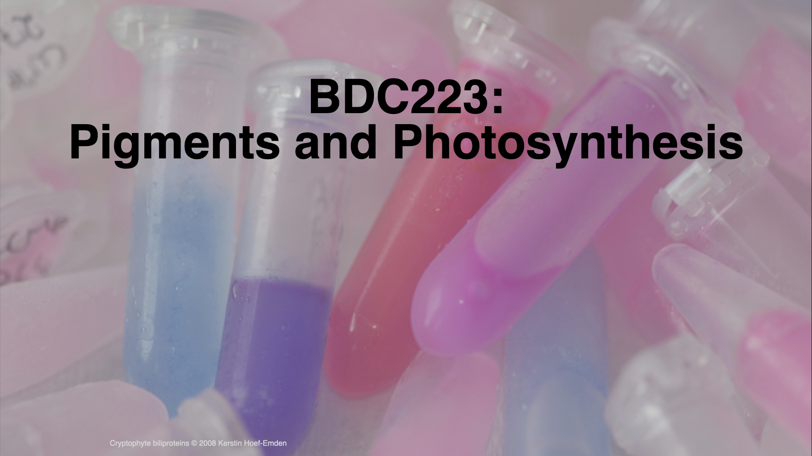](images/BDC223_L06a_slide01.jpeg)

## 1 Introduction: pigments and photosynthesis

[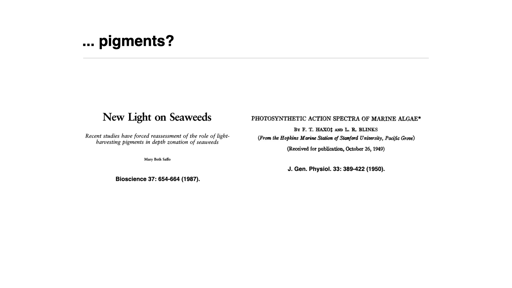](images/BDC223_L06a_slide02.jpeg)

This lecture follows on from the lecture on light and deals with pigments and photosynthesis. Much of it, and of the lecture on chromatic adaptation that follows, is based on two papers that you need to read, namely Saffo ([1987](#ref-saffo1987new)) on the pigments of seaweeds and Haxo and Blinks ([1950](#ref-haxo1950photosynthetic)) on the photosynthetic action spectra of marine algae. Both are on iKamva and are linked under Required Reading above. Please read them while you work through these lectures, because they explain the material covered here in much greater detail.

## 2 Overview of pigments in photosynthetic organisms

[Download the six pigment slides (PDF)](slides/L07a-pigments-photosynthesis/L07a-pigments-slides.pdf).

[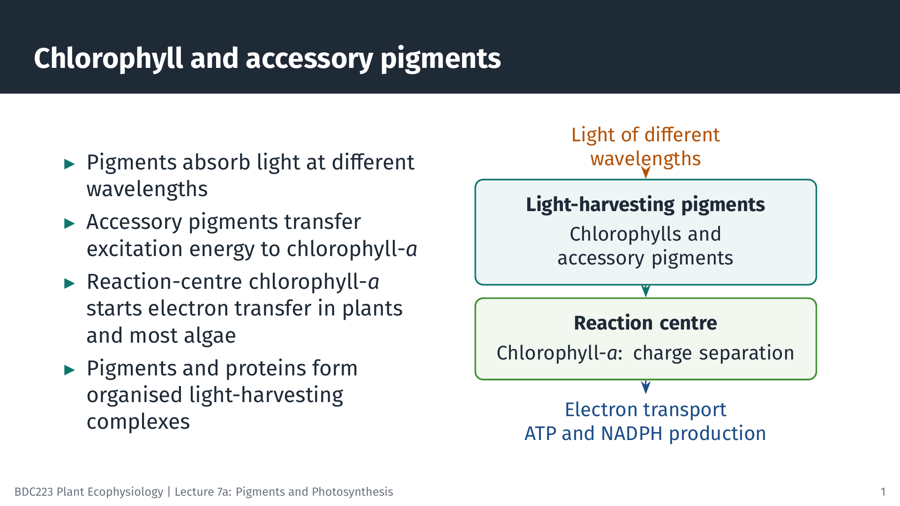](images/L07a/L07a-pigments-slide-1.png)

To exploit the light available in the environment, plants and algae (indeed, all oxygenic photosynthetic organisms) rely on a range of pigments that extract energy from light and convert it into chemical potential energy in the process of photosynthesis.

The predominant photosynthetic pigment in plants and most oxygenic algae and cyanobacteria is chlorophyll-*a*. In the reaction centre, chlorophyll-*a* initiates the electron transfer that converts absorbed light energy into chemical energy. Accessory pigments support light harvesting by absorbing light and transferring excitation energy towards the reaction centre.

## 3 Absorption properties of chlorophyll-*a* and accessory pigments

Chlorophyll-*a* absorbs light mainly in the blue and red regions. In the previous lecture you saw that photosynthetically active radiation (PAR) is defined as the band between $400$ and $700$ nm. Within that band, not all light is equally effective at driving photosynthesis. This is because chlorophyll-*a* in living cells absorbs most strongly at about $435$ nm (blue light) and $675$ nm (red light).

Regardless of where these primary producers are (on land, in water, or elsewhere), they are sensitive to blue and red light. If they do not have sufficient light at precisely those wavelengths, their rate of photosynthesis will be impaired.

[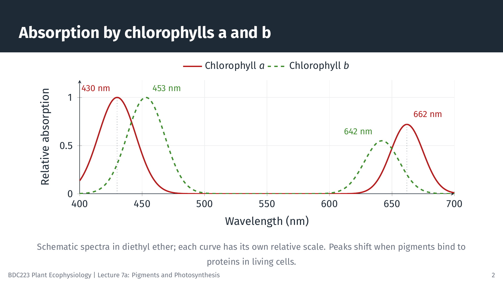](images/L07a/L07a-pigments-slide-2.png)

The graph shows schematic absorption spectra of chlorophyll-*a* and chlorophyll-*b* extracted into diethyl ether. In this solvent, chlorophyll-*a* (the red line) has two main peaks, near $430$ nm (blue) and $662$ nm (red). Chlorophyll-*b* (the dashed green line) peaks near $453$ and $642$ nm. These curves show relative shapes, not measured percentage absorption. In living cells, protein binding shifts the peaks; chlorophyll-*a* absorbs strongly at about $435$ and $675$ nm, as noted above.

[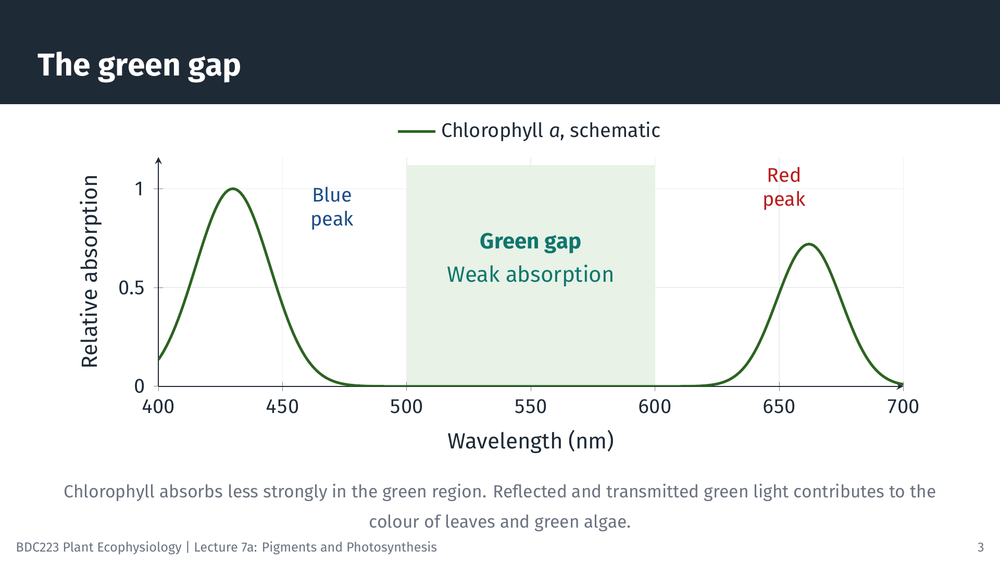](images/L07a/L07a-pigments-slide-3.png)

Chlorophyll-*b* harvests light and passes excitation energy towards reaction-centre chlorophyll-*a*, broadening the range of light used for photosynthesis. In the middle of these spectra is a region where chlorophylls absorb relatively weakly. This is often called the “green gap”. Green light reflected or transmitted by leaves contributes to their green appearance; weak absorption does not mean that no green light can be used.

> **NOTE:**
>
> Accessory pigments transfer the energy they capture from light to chlorophyll-*a* through a mechanism known as resonance energy transfer (more precisely, Förster resonance energy transfer, or FRET, in biophysical terms). This is a non-radiative process, meaning that the energy is not emitted as light and then reabsorbed, but is instead conveyed directly through electromagnetic interactions between the excited accessory pigment and the chlorophyll-*a* molecule. When a photon excites an accessory pigment, its electrons are elevated to a higher energy state; as this energy relaxes, it is transferred to a neighbouring chlorophyll-*a* molecule if the two pigments are sufficiently close (usually within 2–6 nanometres) and their electronic energy levels are appropriately aligned. At distances below ~1–2 nanometres, excitonic coupling can take place, wherein the excited states of neighbouring pigments become quantum-mechanically delocalised across multiple molecules rather than localising on discrete donors and acceptors.
>
> The thylakoid membrane in chloroplasts is not a disordered soup of pigments but a carefully arranged molecular architecture known as the light-harvesting complex (LHC). Within these complexes, accessory pigments (such as chlorophyll-*b* and various carotenoids) are embedded in protein scaffolds alongside chlorophyll-*a* in spatial configurations that maximise energy transfer efficiency. The proteins hold pigments at precise orientations and distances that facilitate resonance coupling between excited states. The energy “hops” from pigment to pigment down an energetic gradient, ultimately funnelling to the reaction centre chlorophyll-*a*, where the photochemical conversion (electron transfer) occurs. This funnel-like arrangement of pigments and the efficiency of resonance transfer together allow plants and algae to capture a broad spectrum of solar radiation and direct it toward the relatively narrow photochemical core without significant loss.

## 4 The green gap and accessory pigments

[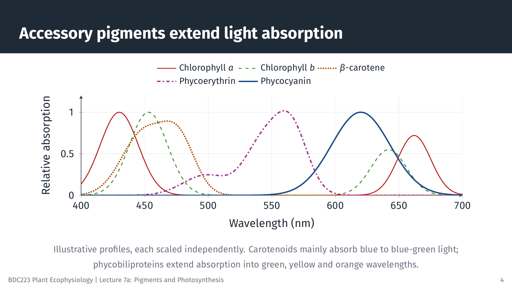](images/L07a/L07a-pigments-slide-4.png)

Plants have evolved various pigments to fill that green gap. Among the most notable of these are carotenoids, which include beta-carotene, and the phycobilins, such as phycoerythrin and phycocyanin. Carotenoids are also the pigments responsible for the orange colour in carrots, as indicated by the orange line on many absorption spectra.

Carotenoids mainly absorb blue to blue-green light, while phycobiliproteins extend absorption into green, yellow and orange wavelengths. They transfer excitation energy towards chlorophyll-*a*. These accessory pigments complement its absorption range and help organisms use a wider range of available light.

At first glance, the diversity of accessory pigments appears as vast as the diversity of light climates in the ocean, on land, and in freshwater. However, experiments by Engelmann in the 1880s and, later, by Haxo and Blinks in 1950 (discussed in your papers) ([Engelmann 1883](#ref-engelmann1883farbe); [Haxo and Blinks 1950](#ref-haxo1950photosynthetic); [Saffo 1987](#ref-saffo1987new)) demonstrate that the diversity of accessory pigments does not necessarily correspond to the diversity of environmental light conditions.

## 5 Classification and function of pigments

[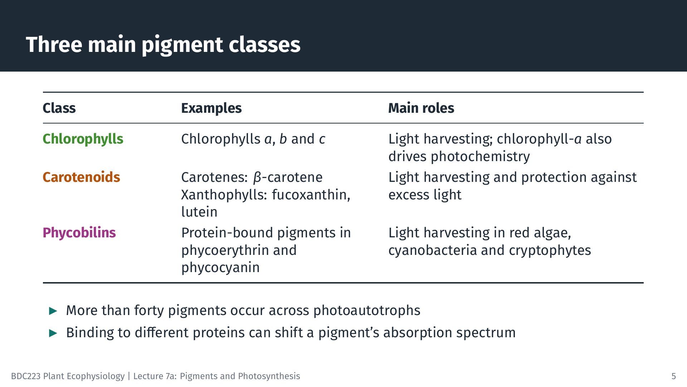](images/L07a/L07a-pigments-slide-5.png)

There are three main pigment classes:

1.  **Chlorophylls** – The major photosynthetic pigments. chlorophyll-*a* is primary, with chlorophylls-b and -c acting as accessory pigments that transfer absorbed energy to chlorophyll-*a*.
2.  **Carotenoids** – Includes beta-carotene and xanthophylls, which also serve as accessory pigments.
3.  **Phycobilins** – Light-absorbing pigments bound to proteins in phycobiliproteins such as phycocyanin and phycoerythrin, found in red algae, cyanobacteria and some other algae.

Across all photoautotrophs, there are more than forty pigments involved. They bind differently to the proteins making up the photosynthetic machinery, expanding the plant’s ability to absorb different wavelengths, especially in the green gap, and maintain high photosynthetic efficiency in a range of environments.

[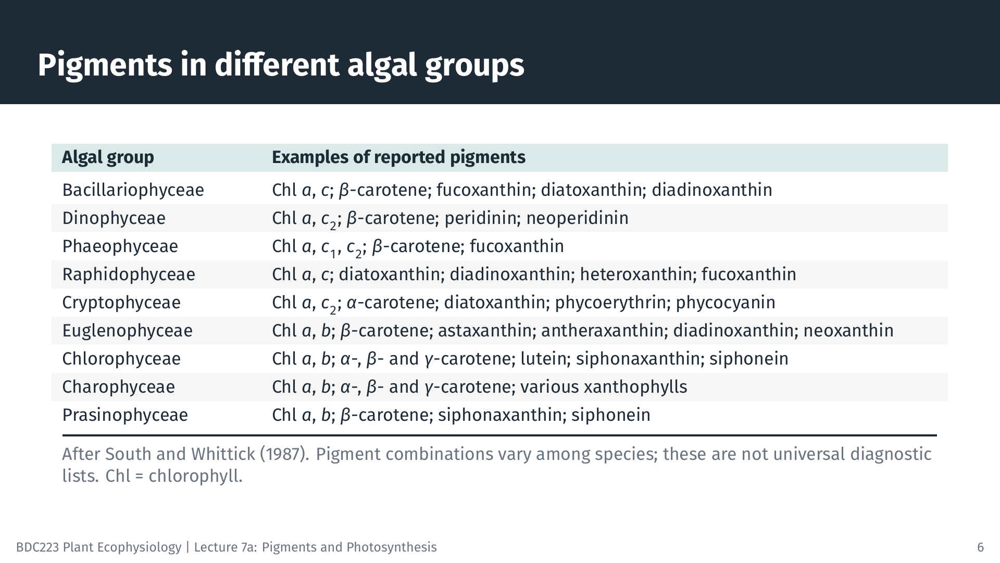](images/L07a/L07a-pigments-slide-6.png)

Especially in algae, the types of pigments present can indicate taxonomic relationships and phylogenetic heritage. By extracting pigments from a seawater sample, for example, one can deduce the classes of algae present. Similar underpinnings occur in terrestrial plants, with certain pigments associated with specific plant types.

> **NOTE:**
>
> [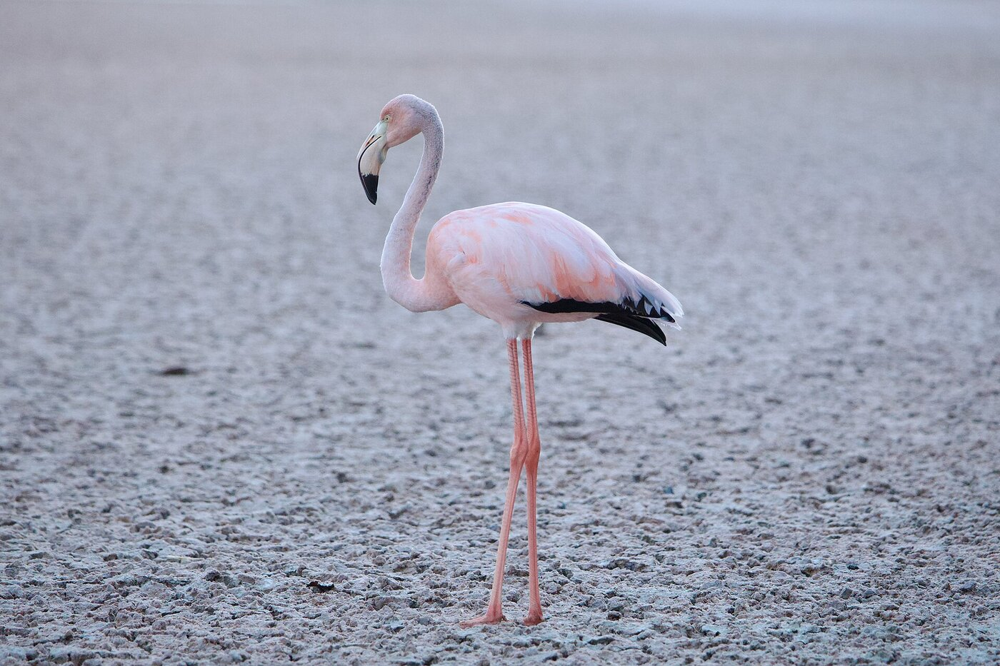](images/L07a/flamingo.jpg "American flamingo (Phoenicopterus ruber), Floreana Island, Galápagos. Its pink comes from carotenoids in its food. Photo: E. Bailey, Wikimedia Commons, CC0.")
>
> American flamingo (*Phoenicopterus ruber*), Floreana Island, Galápagos. Its pink comes from carotenoids in its food. Photo: E. Bailey, [Wikimedia Commons](https://commons.wikimedia.org/wiki/File:American_flamingo_in_Gal%C3%A1pagos_(Phoenicopterus_ruber).jpg), CC0.
>
> [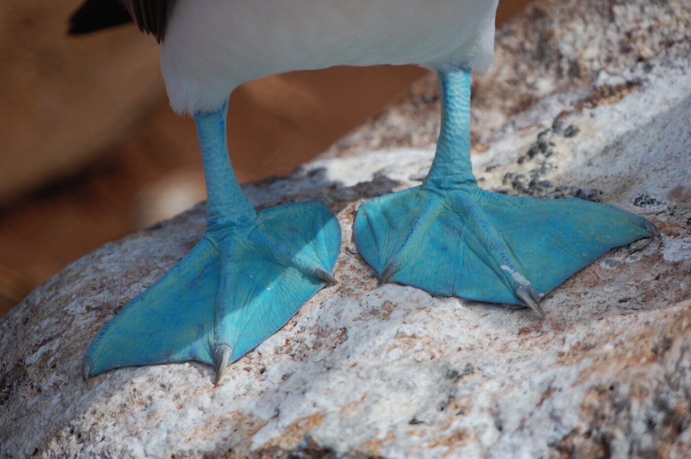](images/L07a/booby.jpg "The feet of a blue-footed booby (Sula nebouxii), Galápagos Islands. Foot colour changes with the bird’s condition. Photo: Lt Elizabeth Crapo, NOAA Corps, NOAA Photo Library via Wikimedia Commons, public domain.")
>
> The feet of a blue-footed booby (*Sula nebouxii*), Galápagos Islands. Foot colour changes with the bird’s condition. Photo: Lt Elizabeth Crapo, NOAA Corps, [NOAA Photo Library via Wikimedia Commons](https://commons.wikimedia.org/wiki/File:Anim1631_-_Flickr_-_NOAA_Photo_Library.jpg), public domain.
>
> Carotenoids are made by plants, algae, photosynthetic bacteria and some fungi. Animals cannot make them from scratch, so the carotenoids found in animals come from their food, sometimes chemically modified after they are eaten ([Maoka 2019](#ref-maoka2019carotenoids)). The pink of flamingos, the orange flesh of salmon and the yellow of goldfinches are all pigments that began in algae or plants and passed up the food chain to the animal. A flamingo kept without carotenoids in its diet loses its pink colour.
>
> Many animals do more than store what they eat. Birds with red feathers, beaks or legs eat yellow carotenoids and convert them into red ketocarotenoids. The enzyme responsible, a cytochrome P450 called CYP2J19, was identified in red siskins, canaries and zebra finches ([Lopes et al. 2016](#ref-lopes2016genetic); [Mundy et al. 2016](#ref-mundy2016red)), and together with a second enzyme (BDH1L) it is enough to carry out the conversion ([Toomey et al. 2022](#ref-toomey2022mechanism)). The same enzyme colours the red oil droplets in the cone cells of the bird retina, so the pigment a bird displays and the pigment it uses to see red are made in the same way ([Lopes et al. 2016](#ref-lopes2016genetic)).
>
> Because carotenoids must be eaten, and because they also act as antioxidants and support the immune system, carotenoid colours are thought to be honest signals of condition. Across 88 bird species, the intensity of carotenoid colour and the concentration of carotenoids in the blood were both positively, although modestly, related to immune response ([Simons et al. 2012](#ref-simons2012what)). Whether this works through a trade-off between display and health is still debated ([Koch and Hill 2018](#ref-koch2018carotenoid)). In the blue-footed booby, foot colour changes quickly with the bird’s condition, and females paired with males whose feet had been experimentally dulled laid smaller second eggs ([Dentressangle et al. 2008](#ref-dentressangle2008maternal)).
>
> There are exceptions to the rule that animals cannot make carotenoids. Pea aphids, spider mites and gall midges carry carotenoid-synthesis genes that their ancestors acquired from fungi by lateral gene transfer, and red pea aphids owe their colour to one of these genes ([Moran and Jarvik 2010](#ref-moran2010lateral); [Altincicek et al. 2012](#ref-altincicek2012horizontally); [Cobbs et al. 2013](#ref-cobbs2013carotenoids)).
>
> The link to this lecture is direct. In photosynthetic organisms, carotenoids harvest light in the green gap and protect the photosynthetic machinery against excess light by quenching harmful excited states. Animals that eat them borrow the same chemistry for colour, vision and antioxidant protection. For a popular account, see [Why are some animals so colorful? (Popular Science)](https://www.popsci.com/science/why-animals-are-colorful-carotenoids/).

## 6 What is photosynthesis?

Photosynthesis is the conversion of light energy (radiant energy) into chemical potential energy. In the light reactions, which take place in photosystems I and II in the thylakoid membranes, absorbed light energy splits water, releases oxygen as a byproduct, and produces ATP and NADPH. Carbon fixation follows in the Calvin cycle, in the stroma of the chloroplast, where the ATP and NADPH are used to fix $\mathrm{CO}_2$ taken up from the environment into sugars.

As a function of light intensity, photosynthesis responds with an increased rate, up to a point. This relationship is described by the photosynthesis-irradiance (PI) curve.

> **NOTE:**
>
> [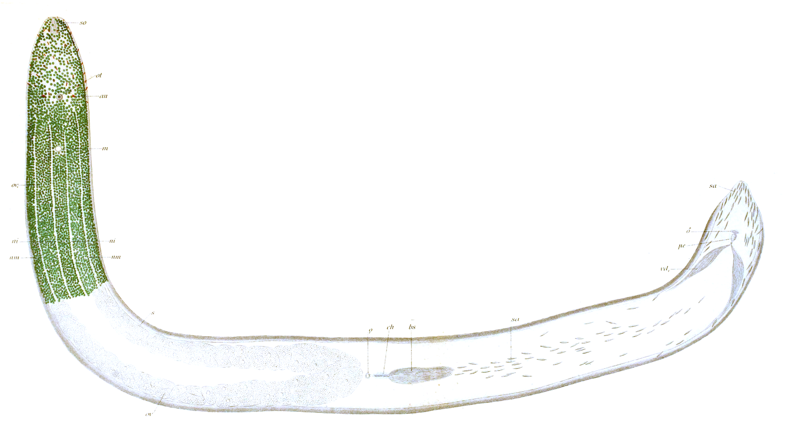](images/L07a/symsagittifera_graff.png "Symsagittifera roscoffensis (as Convoluta roscoffensis), drawn by Ludwig von Graff (1891), partly coloured to show the green algal cells beneath the skin. Wikimedia Commons, public domain.")
>
> *Symsagittifera roscoffensis* (as *Convoluta roscoffensis*), drawn by Ludwig von Graff (1891), partly coloured to show the green algal cells beneath the skin. [Wikimedia Commons](https://commons.wikimedia.org/wiki/File:Symsagittifera_roscoffensis_(from_Graff,_1891).png), public domain.
>
> [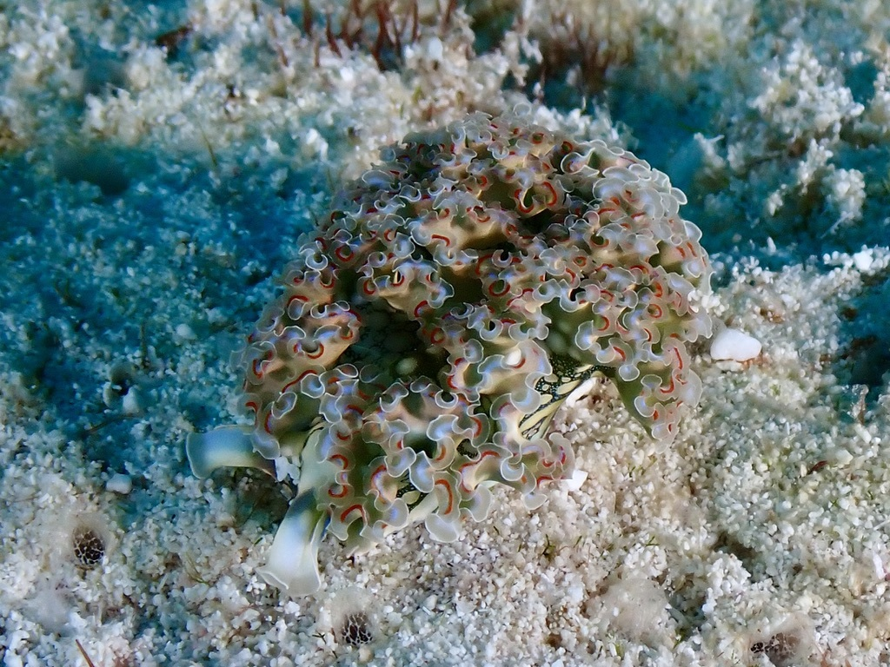](images/L07a/elysia_crispata.jpg "The lettuce sea slug (Elysia crispata), a sacoglossan from the Caribbean, Mexico. Photo: Chris Spain, Wikimedia Commons, CC0.")
>
> The lettuce sea slug (*Elysia crispata*), a sacoglossan from the Caribbean, Mexico. Photo: Chris Spain, [Wikimedia Commons](https://commons.wikimedia.org/wiki/File:Elysia_crispata_419082940.jpg), CC0.
>
> Some animals photosynthesise by taking over the photosynthetic machinery of algae. There are two quite different ways of doing this.
>
> **Housing whole algae.** The “mint-sauce worm” *Symsagittifera roscoffensis* (formerly *Convoluta roscoffensis*) is a small acoel flatworm, not a mollusc, that lives on sandy beaches of the north-east Atlantic. Its green colour comes from many living cells of the green alga *Tetraselmis convolutae* held beneath its skin. Young worms hatch without algae and must take them up from the surrounding water; without them they die, so the partnership is obligatory ([Bailly et al. 2014](#ref-bailly2014chimerical)). Adult worms do not feed: photosynthesis by their algae was estimated to supply carbon equal to about 174% of the worm’s body carbon each day ([Thomas et al. 2022](#ref-thomas2022environmental)). At low tide the worms gather in large numbers at the sunlit surface of wet sand. The algae inside the worm photosynthesise less efficiently than free-living cells and show signs of chronic stress, so the relationship may be closer to farming than to an equal partnership ([Androuin et al. 2020](#ref-androuin2020better)).
>
> **Keeping only the chloroplasts.** Some sacoglossan sea slugs go further. *Elysia chlorotica* pierces the filaments of the yellow-green alga *Vaucheria litorea*, sucks out the contents, digests everything else, and keeps the chloroplasts inside the cells lining its digestive gland. These stolen chloroplasts, called kleptoplasts, keep photosynthesising for most of the slug’s roughly ten-month life, so that the slug can live on light and air. They do not divide and are not passed to the eggs, so each generation must steal its own ([Rumpho et al. 2011](#ref-rumpho2011making)). Among animals, long-term retention of functional chloroplasts is known almost only from this group of sea slugs ([Händeler et al. 2009](#ref-handeler2009functional)).
>
> The puzzle is how the chloroplasts survive. A chloroplast depends on hundreds of proteins encoded in the algal nucleus, which the slug has digested. Explanations include unusually robust chloroplasts, long-lived proteins and support from the slug itself; there is no clear evidence that algal genes were transferred into the slug genome ([Cruz and Cartaxana 2022](#ref-cruz2022kleptoplasty)). Recent work shows that the slug encloses each chloroplast in its own membrane-bound compartment, which keeps the chloroplast working and, when the slug is starved, digests it as food ([Allard et al. 2025](#ref-allard2025host)).
>
> Both cases connect to [Lecture 3](../BDC223/L03-photosynthetic-evolution.llms.md). The chloroplast itself began as a free-living cyanobacterium taken up by a host cell. The worm and the sea slug show, within living animals, earlier and incomplete versions of the same process.

## 7 The photosynthesis-irradiance (PI) curve

[Download the six P–I curve and spectra slides (PDF)](slides/L07a-pigments-photosynthesis/L07a-photosynthesis-slides.pdf).

[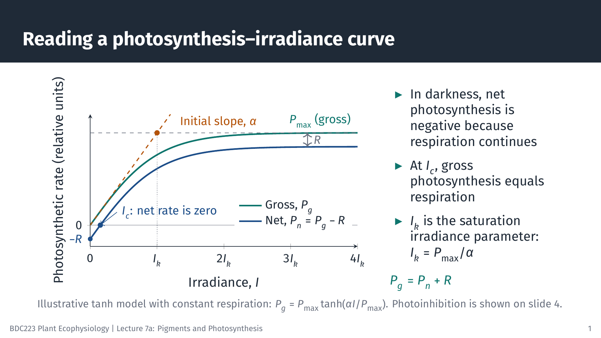](images/L07a/L07a-photosynthesis-slide-1.png)

The axes of the PI curve are as follows.

- **Y-Axis**: Rate of photosynthesis, measured by carbon incorporation (e.g., mg C m$^{-2}$ s$^{-1}$, mg C m$^{-2}$ hr$^{-1}$, or mg C m$^{-2}$ day$^{-1}$).
- **X-Axis**: Irradiance (light intensity).

[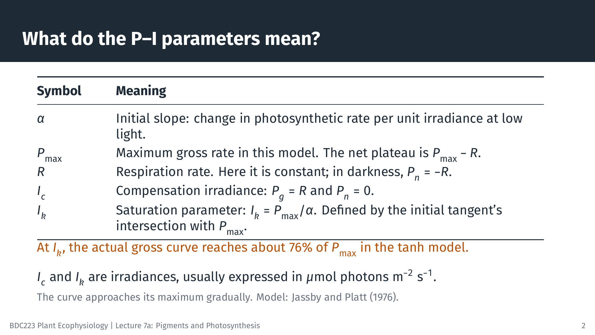](images/L07a/L07a-photosynthesis-slide-2.png)

Initially, the PI curve is linear: as irradiance increases, photosynthesis increases at a rate defined by the slope $\alpha$ (alpha). Alpha reflects the plant’s sensitivity to changes in irradiance. A steep alpha (steep slope) means more sensitivity to small changes in light; a shallow slope indicates less sensitivity and a need for greater changes in light intensity to affect photosynthesis rate.

As irradiance increases further, the gross rate approaches the maximum rate, $P_{max}$. The saturation irradiance parameter, $I_k$, is the irradiance where the initial linear slope, extended upwards, meets the horizontal line at $P_{max}$, so that $I_k = P_{max}/\alpha$. The actual curve is still below $P_{max}$ at this point: in the hyperbolic tangent model it reaches about 76% of $P_{max}$. Well above $I_k$, additional light produces little increase in rate. The reaction centres then receive more energy than electron transport and carbon fixation (Rubisco in particular) can process, so these steps set the maximum rate. If respiration is constant, the net rate approaches $P_{max}-R$.

Should irradiance keep increasing, photosynthesis can decline, a phenomenon called photoinhibition. Here, excessive light can damage the photosynthetic apparatus (particularly the reaction centre of photosystem II), or trigger protective mechanisms that dissipate the excess absorbed energy as heat. Both lower the rate of photosynthesis.

Respiration occurs at all times, consuming oxygen, while photosynthesis (in the presence of light) produces it. At low light, the rate of oxygen production by photosynthesis is less than the rate of consumption by respiration, resulting in net negative oxygen production. The light compensation point is the irradiance where net oxygen production is zero.

**Net photosynthesis**: Above the compensation point: positive net oxygen evolution.\
**Gross photosynthesis**: Total oxygen produced, regardless of respiration.

We return to these parameters (the light compensation point, $\alpha$, $P_{max}$, $I_k$, etc.) in the practical sessions, where you will fit models to real data.

What we saw above is the standard textbook interpretation and formulation of a PI curve. Several mathematical models describe its shape, and two of the most widely used are the hyperbolic tangent model of Jassby and Platt ([1976](#ref-jassby1976mathematical)) and the model of Platt et al. ([1980](#ref-platt1980photoinhibition)), which includes photoinhibition.

### 7.1 The hyperbolic tangent model

The hyperbolic tangent model was proposed by Jassby and Platt ([1976](#ref-jassby1976mathematical)). It has become one of the most widely used models for describing the relationship between photosynthetic rate and irradiance (light intensity) in aquatic photosynthetic organisms, including algae ranging from kelp to phytoplankton. The model captures the core dynamics of photosynthesis, in which the rate of photosynthesis initially increases with light intensity but eventually saturates as the photosynthetic machinery reaches its maximum rate. This is a simple model, but it is effective because the biologically meaningful parameters can be directly interpreted to assess plant or algal productivity in various light environments.

The hyperbolic tangent model is expressed as:

$$P(I) = P_{\text{max}} \times \tanh\left(\frac{\alpha I}{P_{\text{max}}}\right)$$

Where:

- $P(I)$ represents the photosynthetic rate at a given irradiance $I$ (light intensity),
- $P_{\text{max}}$ is the maximum photosynthetic rate (also referred to as the light-saturated rate),
- $\alpha$ is the initial slope of the curve, which reflects the photosynthetic efficiency at low light levels,
- $I$ is the irradiance (light intensity),

The saturation irradiance, $I_{\text{k}}$, follows from the two parameters as $I_{\text{k}} = P_{\text{max}}/\alpha$. It is the irradiance at which the initial linear slope, extended upwards, meets the horizontal line at $P_{\text{max}}$. The curve itself approaches $P_{\text{max}}$ gradually, and at $I_{\text{k}}$ the modelled rate is about 76% of $P_{\text{max}}$, since $\tanh(1) \approx 0.76$.

The hyperbolic tangent function $\tanh$ is used to smoothly describe the transition between the linear increase in photosynthesis at low light intensities and the eventual plateau at higher intensities, where photosynthesis becomes light-saturated. The light compensation point, the point at which photosynthesis equals respiration (i.e., net photosynthesis is zero), can also be derived from this model once a respiration term is added (see below).

The model describes the essential processes of photosynthesis with just two parameters: $P_{\text{max}}$ and $\alpha$. Both parameters are biologically meaningful and tell us how efficiently an organism can convert light into chemical energy under different light conditions. For example, higher values of $P_{\text{max}}$ indicate a greater potential for photosynthesis under optimal light conditions, while the value of $\alpha$ indicates how quickly photosynthesis responds to low light.

Applications of the hyperbolic tangent model are numerous. It is commonly used to estimate the photosynthetic performance of marine and freshwater algae, seagrasses, and macroalgae under varying environmental conditions. In kelp forests, for instance, we may use this model to assess how different species adapt to light intensities at various depths or how photosynthetic performance shifts in response to seasonal changes in light availability. Looking at phytoplankton, the model helps estimate productivity across different layers of the water column, where light intensity decreases with depth.

Below are a few lines of data taken from a hypothetical P-I experiment. The data are for five replicate experiments with the same light intensities (independent variable), representing conditions typically encountered by kelp at latitudes between 36° S and 23° S.

|     | Replicate | Light (μmol photons m⁻² s⁻¹) | Photosynthesis (mg C m⁻² h⁻¹) |
|:----|----------:|-----------------------------:|------------------------------:|
| 3   |         1 |                          100 |                          4.59 |
| 17  |         2 |                          200 |                          8.83 |
| 53  |         5 |                          200 |                          8.05 |
| 44  |         4 |                          350 |                         12.27 |
| 35  |         3 |                          500 |                         12.57 |
| 54  |         5 |                          250 |                          9.38 |
| 34  |         3 |                          450 |                         11.90 |
| 11  |         1 |                          500 |                         13.53 |
| 27  |         3 |                          100 |                          4.20 |

Table 1

[](L07a-pigments_photosynthesis_files/figure-html/fig-jassby-platt-1.svg "Figure 1: Jassby and Platt (1976) model fitted to simulated P-I data for a hypothetical kelp. The black dashed curve is the fit for the first replicate. Its initial slope (orange) meets the horizontal line at Pmax (blue) above Ik; the vertical dotted line marks this irradiance.")

Figure 1: Jassby and Platt (1976) model fitted to simulated P-I data for a hypothetical kelp. The black dashed curve is the fit for the first replicate. Its initial slope (orange) meets the horizontal line at Pmax (blue) above Ik; the vertical dotted line marks this irradiance.

After fitting the model to the data, we can determine the values for $P_{\text{max}}$ and $\alpha$ for each replicate and determine the average value across the five fits. The combined plot ([Figure 1](#fig-jassby-platt)) displays the observed data points for all replicates and the fitted curve from the first replicate.

The average model fit values of the estimated parameters across all replicates are as follows:

- $P_{\text{max}}$: 13.05 mg C m⁻² h⁻¹
- $\alpha$: 0.05 mg C m⁻² h⁻¹ (μmol photons m⁻² s⁻¹)⁻¹

### 7.2 Considering the light compensation point

The **light compensation point** ($I_c$) is the irradiance level at which the rate of photosynthesis equals the rate of respiration, resulting in a net photosynthetic rate of zero. Below this point, the organism consumes more energy (via respiration) than it produces through photosynthesis, leading to a net loss of energy. Estimating $I_c$ is important for determining the minimum light intensity required for the survival of photosynthetic organisms, after compensation for the effect of cellular respiration.

To find the compensation point, we need to find where the net photosynthetic rate is zero. First, consider what happens if we try this using the model above, which does not yet include respiration:

$$0 = P_{\text{max}} \times \tanh\left(\frac{\alpha I}{P_{\text{max}}}\right).$$

Because $P_{\text{max}}$ is positive, dividing both sides by it gives:

$$\tanh\left(\frac{\alpha I}{P_{\text{max}}}\right) = 0.$$

The hyperbolic tangent function is zero only when its input is zero. Here, its input is $\alpha I/P_{\text{max}}$, so:

$$\frac{\alpha I}{P_{\text{max}}} = 0
\quad\Rightarrow\quad I = 0,$$

since $\alpha$ is also positive. Thus, zero light is the result of solving for a zero photosynthetic rate; it was not a value of irradiance that we chose at the start.

The model without respiration only gives a zero rate at zero light. To describe a positive light compensation point, where photosynthesis balances respiration, we must include the **dark respiration rate** ($R$):

$$P(I) = P_{\text{max}} \times \tanh\left(\frac{\alpha I}{P_{\text{max}}}\right) - R$$

With respiration included, the net rate at zero light is $P(0) = 0 - R = -R$.

Now, $I_c$ is the irradiance at which $P(I) = 0$:

$$0 = P_{\text{max}} \times \tanh\left(\frac{\alpha I_c}{P_{\text{max}}}\right) - R$$

Rearranging gives a closed-form solution:

$$I_c = \frac{P_{\text{max}}}{\alpha}\,\operatorname{artanh}\left(\frac{R}{P_{\text{max}}}\right)$$

The inverse hyperbolic tangent, $\operatorname{artanh}$, is also written $\operatorname{atanh}$ or $\tanh^{-1}$. Here, the superscript $-1$ means the inverse function, not the reciprocal $1/\tanh$. In R, this function is called [`atanh()`](https://rdrr.io/r/base/Hyperbolic.html).

The example below finds $I_c$ numerically with [`uniroot()`](https://rdrr.io/r/stats/uniroot.html). It uses the parameter values chosen for the simulated kelp: $P_{\text{max}} = 13$, $\alpha = 0.05$ and $R = 2$.

``` numberSource
Pmax <- 13
alpha <- 0.05
R <- 2

net_rate <- function(I) Pmax * tanh(alpha * I / Pmax) - R

Ic <- uniroot(net_rate, interval = c(0, 200))$root
Ic
```

    [1] 40.32014

The net rate is negative at zero light and positive at an irradiance of 200 µmol photons m⁻² s⁻¹. [`uniroot()`](https://rdrr.io/r/stats/uniroot.html) searches between these two values for the irradiance where `net_rate(I)` equals zero. The result is $I_c =$ 40.32 µmol photons m⁻² s⁻¹, which agrees with the formula above. Numerical root-finding can also be used when a model has no explicit formula for $I_c$.

|     | Replicate | Light (μmol photons m⁻² s⁻¹) | Photosynthesis (mg C m⁻² h⁻¹) |
|:----|----------:|-----------------------------:|------------------------------:|
| 3   |         1 |                          100 |                          3.65 |
| 37  |         4 |                            0 |                         -2.17 |
| 5   |         1 |                          200 |                          6.98 |
| 57  |         5 |                          400 |                          9.43 |
| 54  |         5 |                          250 |                          7.41 |
| 60  |         5 |                          550 |                         10.98 |
| 33  |         3 |                          400 |                          9.66 |
| 6   |         1 |                          250 |                          7.89 |
| 49  |         5 |                            0 |                         -1.86 |

Table 2

[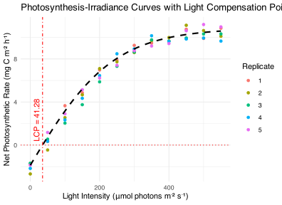](L07a-pigments_photosynthesis_files/figure-html/fig-jassby-platt2-1.svg "Figure 2: Nonlinear regression Jassby and Platt (1976) model fitted to simulated P-I data for a hypothetical kelp. This model includes the effect of the light compensation point.")

Figure 2: Nonlinear regression Jassby and Platt (1976) model fitted to simulated P-I data for a hypothetical kelp. This model includes the effect of the light compensation point.

The model fit to the data is in [Figure 2](#fig-jassby-platt2). The average model fit values of the estimated parameters across all replicates are as follows:

- $P_{\text{max}}$: 13.15 mg C m⁻² h⁻¹
- $\alpha$: 0.05 mg C m⁻² h⁻¹ (μmol photons m⁻² s⁻¹)⁻¹
- $I_c$: 41.28 μmol photons m⁻² s⁻¹

### 7.3 Platt et al. (1980) model with photoinhibition

Let us now look at the model of Platt et al. ([1980](#ref-platt1980photoinhibition)), which incorporates photoinhibition into the photosynthesis-irradiance (P-I) relationship. This model extends the understanding of photosynthesis by accounting for the decrease in photosynthetic efficiency at high light intensities due to photoinhibition, a phenomenon where excessive light damages the photosynthetic apparatus, leading to reduced photosynthetic rates.

The model is expressed mathematically as:

$$P(I) = P_{\text{max}} \left(1 - \exp\left(-\frac{\alpha I}{P_{\text{max}}}\right)\right) \exp\left(-\frac{\beta I}{P_{\text{max}}}\right) - R$$

Where:

- $P_{\text{max}}$ is the maximum photosynthetic rate in the absence of photoinhibition.
- $\alpha$ is the initial slope of the curve, as in the hyperbolic tangent model.
- $\beta$ is the photoinhibition parameter (rate of decrease in photosynthesis at high light).
- $R$ is the dark respiration rate, as in the modified hyperbolic tangent model above, so $P(I)$ is the net photosynthetic rate.
- $\exp$ denotes the exponential function.

This model combines the positive effect of light on photosynthesis at low irradiance with the negative effect of photoinhibition at high irradiance, providing a comprehensive description of the photosynthetic response across a wide range of light intensities.

|     | Replicate | Light (μmol photons m⁻² s⁻¹) | Photosynthesis (mg C m⁻² h⁻¹) |
|:----|----------:|-----------------------------:|------------------------------:|
| 45  |         3 |                         1000 |                         10.05 |
| 76  |         5 |                          700 |                          9.13 |
| 34  |         2 |                         1600 |                         10.16 |
| 52  |         4 |                            0 |                         -2.00 |
| 1   |         1 |                            0 |                         -0.86 |
| 77  |         5 |                          800 |                          9.58 |
| 10  |         1 |                          900 |                         11.26 |
| 13  |         1 |                         1200 |                         11.43 |
| 39  |         3 |                          400 |                          7.98 |

Table 3

[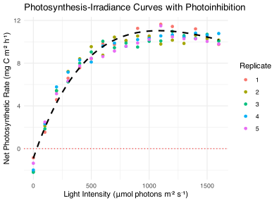](L07a-pigments_photosynthesis_files/figure-html/fig-jassby-1.svg "Figure 3: Nonlinear regression Platt et al. (1980) model fitted to simulated P-I data for a hypothetical kelp. This model includes the effect of photoinhibition.")

Figure 3: Nonlinear regression Platt et al. (1980) model fitted to simulated P-I data for a hypothetical kelp. This model includes the effect of photoinhibition.

## 8 Effects of environmental stress

[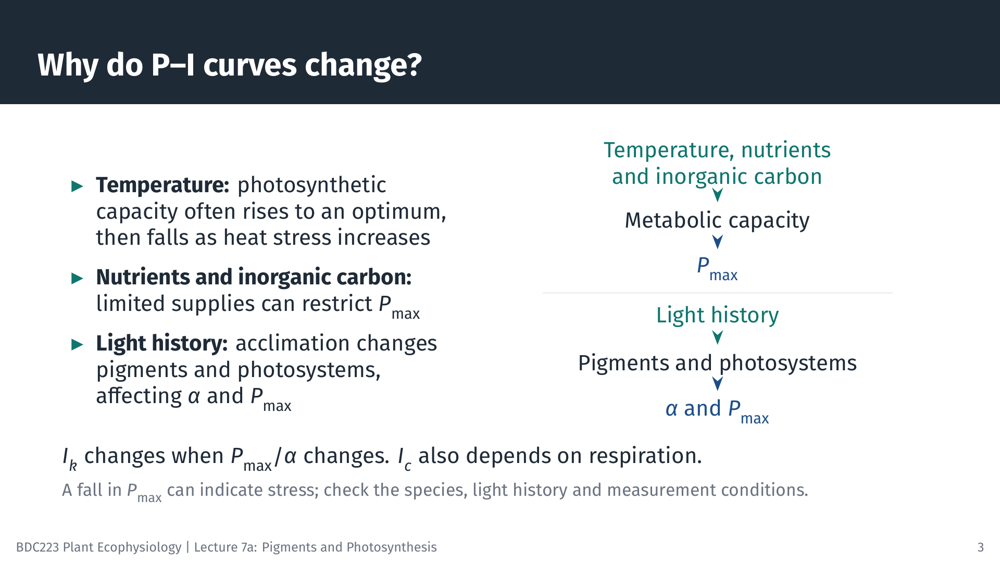](images/L07a/L07a-photosynthesis-slide-3.png)

$P_{max}$ represents the maximum photosynthetic capacity, which is influenced by many stresses, including thermal stress, nutrient stress, and light stress. Any of these can reduce a plant’s capacity to sustain $P_{max}$, and a reduction in this parameter is often the first sign of environmental stress. Measuring these rates gives insights into how and when plants become stressed.

[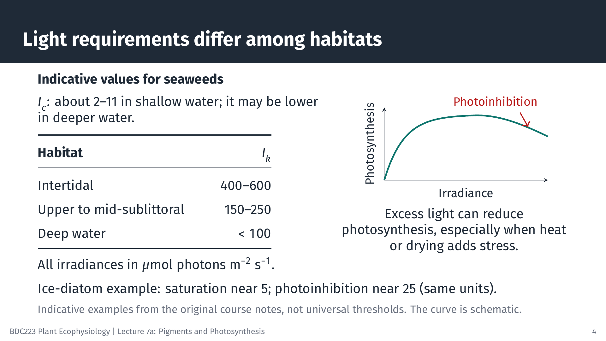](images/L07a/L07a-photosynthesis-slide-4.png)

Some indicative saturation irradiances for seaweeds are listed below.

- Intertidal environments: light saturation might occur at $400$–$600\;\mu\mathrm{mol}\,\mathrm{m}^{-2}\,\mathrm{s}^{-1}$
- Sublittoral species (deeper): saturated at $150$–$250\;\mu\mathrm{mol}\,\mathrm{m}^{-2}\,\mathrm{s}^{-1}$
- As depth increases, saturation occurs at progressively lower irradiances.
- Some deep-water plants can become photoinhibited at what would seem to us like relatively dim light.

These values ($I_C$, $I_K$, $P_{max}$, $\alpha$) vary among species, being determined both by environmental adaptation and genetic heritage, and thus serve as good indicators of a plant’s typical habitat and stress response.

## 9 Absorption spectrum vs action spectrum

[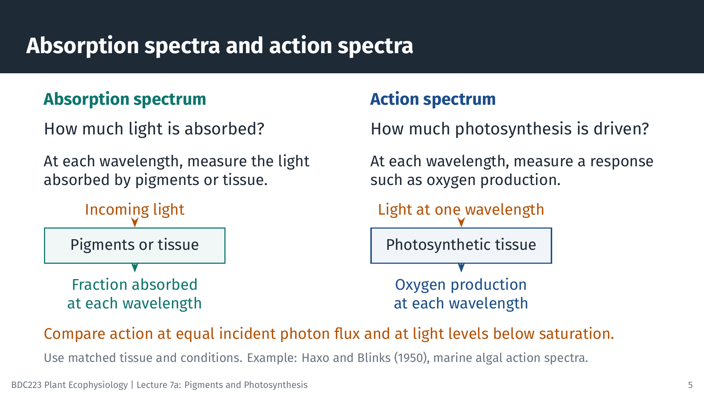](images/L07a/L07a-photosynthesis-slide-5.png)

Before moving on, we need to distinguish the absorption spectrum from the action spectrum.

- **Absorption spectrum**: Measures the amount of light absorbed by all pigments at every wavelength; essentially, how much light is not reflected or transmitted.
- **Action spectrum**: For each wavelength, measures the biological effect (here, the rate of oxygen evolution). Compare wavelengths at equal incident photon flux and at light levels below saturation.

[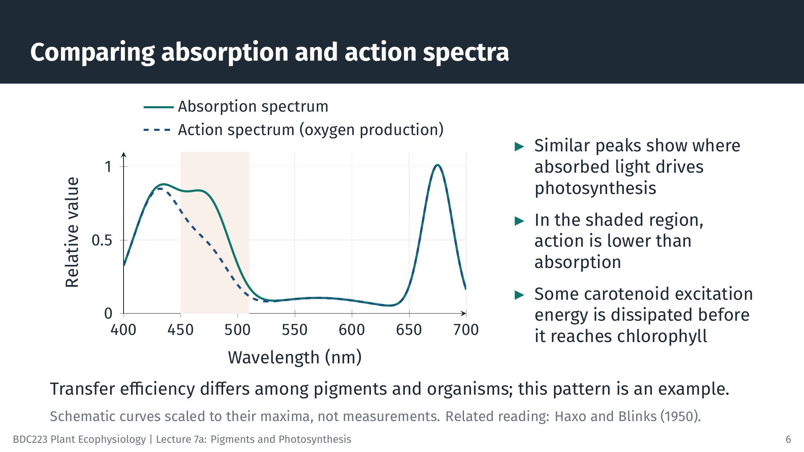](images/L07a/L07a-photosynthesis-slide-6.png)

In the schematic example above, the action and absorption spectra match well, but not perfectly. Between about $450$ and $500$ nm, the action curve is lower than the absorption curve. Carotenoids absorb in this region, but some of their excitation energy is dissipated before it reaches chlorophyll-*a* for photochemistry. Transfer efficiency varies among pigments and organisms, so this particular mismatch is an example rather than a universal pattern.

This demonstrates that the ability of accessory pigments to pass energy to chlorophyll-*a* is not perfectly efficient; some energy is lost in the process. Nonetheless, the presence of carotenoids extends the range in which photosynthesis can be driven by chlorophyll-*a*.

In summary, accessory pigments are essential in harvesting a broader range of light and making photosynthesis effective under varied light environments, even if energy transfer from accessory to primary pigments is not perfectly efficient.

## 10 Summary

- Chlorophyll *a* is the pigment that converts light energy into chemical energy in all plants, algae and cyanobacteria; it absorbs mainly blue and red light.
- Accessory pigments (chlorophylls *b* and *c*, carotenoids and phycobilins) absorb at other wavelengths, including the green gap, and pass the energy to chlorophyll *a* by resonance energy transfer within the light-harvesting complexes.
- Leaves look green because chlorophylls *a* and *b* absorb little green light, which is reflected or transmitted.
- The gross P–I curve rises approximately linearly at low irradiance with slope α, gradually approaches P_(max) as light increases, and may decline at high irradiance because of photoinhibition. I_(k) = P_(max)/α is defined by the initial tangent, rather than by the curve reaching P_(max).
- Respiration continues in the light, so net photosynthesis is negative below the light compensation point and gross photosynthesis is net photosynthesis plus respiration.
- The hyperbolic tangent model of Jassby and Platt describes the P–I curve with P_(max) and α, a respiration term allows the compensation point to be estimated, and the model of Platt and colleagues adds a photoinhibition parameter, β. All are fitted to data by non-linear regression.
- P–I parameters differ among species and habitats: intertidal seaweeds saturate at higher irradiances than subtidal species, and a fall in P_(max) is often an early sign of environmental stress.
- Absorption and action spectra can differ because some absorbed energy does not reach photochemistry. The carotenoid-region mismatch shown here is one example; its size and position vary among organisms.

## 11 Self-test questions

> **NOTE:**
>
> Chlorophylls *a* and *b* absorb strongly in the blue and the red but absorb little light in the middle of the visible spectrum, the green gap. The green light that is not absorbed is reflected or transmitted, and this is the light that reaches our eyes.

> **NOTE:**
>
> Accessory pigments (chlorophylls *b* and *c*, carotenoids and phycobilins) absorb light at wavelengths where chlorophyll *a* absorbs poorly, which broadens the range of light used in photosynthesis. They do not drive photochemistry themselves. The energy passes to chlorophyll *a* by resonance energy transfer, a non-radiative process that requires the pigments to lie close together (usually within 2–6 nm) in the protein scaffolds of the light-harvesting complexes. Energy moves from pigment to pigment towards the reaction centre chlorophyll *a*, where electron transfer occurs.

> **NOTE:**
>
> I_(k) is the irradiance at which the initial linear slope meets the level of P_(max), so I_(k) = P_(max)/α = 13.05/0.05 = 261 µmol photons m⁻² s⁻¹. This is below the range of 400–600 µmol photons m⁻² s⁻¹ given for intertidal seaweeds and just above the range of 150–250 µmol photons m⁻² s⁻¹ given for sublittoral species, so the simulated kelp resembles a plant from shallow subtidal water.

> **NOTE:**
>
> Without a respiration term, $P(I) = P_{max} \tanh(\alpha I / P_{max})$ is zero only at $I = 0$, so the curve passes through the origin and cannot show a compensation point. Respiration consumes oxygen at all times, so at low irradiance net photosynthesis is negative. Subtracting the dark respiration rate gives $P(I) = P_{max} \tanh(\alpha I / P_{max}) - R$, and the light compensation point I_(c) is the irradiance at which this net rate equals zero: I_(c) = (P_(max)/α) artanh(R/P_(max)), or found numerically from the fitted parameters.

> **NOTE:**
>
> When the measured rates decline at high irradiance. The hyperbolic tangent model rises to P_(max) and then stays level, so it cannot describe photoinhibition. The model of Platt and colleagues multiplies the light-limited rise by a term containing the photoinhibition parameter β, which makes the predicted rate fall at high irradiance.

> **NOTE:**
>
> An absorption spectrum shows the amount of light absorbed by all the pigments at each wavelength. An action spectrum shows the biological effect, here the rate of oxygen evolution, produced by light of each wavelength at equal incident photon flux below saturation. In this example, carotenoids absorb between about 450 and 500 nm, but some excitation energy is dissipated before it reaches chlorophyll *a*, so the relative action curve lies below the absorption curve there. The pattern varies among pigments and organisms.

## 12 Multiple-choice questions

Click an option to check your answer. A green tick marks the correct option, and its explanation then appears below the options.

**1.** Chlorophyll a extracted into an organic solvent absorbs most strongly near 430 and 663 nm, but in living cells the peaks lie near 435 and 675 nm. Which explanation is most correct?

- In the cell the chlorophyll is converted into chlorophyll b, whose peaks lie at longer wavelengths.
- In the cell the chlorophyll is bound to proteins, which shifts both peaks to slightly longer wavelengths.
- In the cell the chlorophyll absorbs only light reflected by the leaf, which shifts both peaks towards red.
- In the cell the chlorophyll is mixed with carotenoids, which add their own peaks to those of chlorophyll.

The lecture attributes the shift to the binding of chlorophyll to proteins in the living cell. Chlorophyll b is a different molecule with its own spectrum, and its blue peak lies nearer 460 nm.

**2.** Which statement about the saturation irradiance, Ik, of a P–I curve is most correct?

- It is where the curve first reaches Pmax, so any further light gives no increase in the modelled rate.
- It is where the rate starts to decline, so irradiance above it damages the reaction centre of PSII.
- It is where the extended initial slope meets the Pmax level, so the modelled rate there is below Pmax.
- It is where net photosynthesis equals zero, so photosynthesis there just balances the respiration rate.

Ik = Pmax/α is the intersection of the initial linear slope with the horizontal line at Pmax. In the hyperbolic tangent model the rate at Ik is only about 76% of Pmax, because tanh(1) ≈ 0.76. The zero-net point is Ic, and the decline is photoinhibition.

**3.** Two seaweeds have the same Pmax, but seaweed A has a steeper initial slope α than seaweed B. Which statement is best supported?

- A reaches a higher maximum rate in bright light, and saturates at the same irradiance as seaweed B.
- A gains more photosynthesis per unit of added light at high irradiance, and saturates at a higher irradiance.
- A is less sensitive to small changes in dim light, and needs more light before it starts to saturate.
- A gains more photosynthesis per unit of added light at low irradiance, and saturates at a lower irradiance.

α is the slope of the light-limited part of the curve, so a steeper α means a larger response to small changes in dim light. With equal Pmax, Ik = Pmax/α is lower for A.

**4.** At the light compensation point of a seaweed, which statement is least wrong?

- Gross photosynthesis is positive and equals respiration, so the net rate is zero.
- Gross photosynthesis is zero and respiration is also zero, so the net rate is zero.
- Gross photosynthesis is at its maximum and equals Pmax, so net rate is zero.
- Gross photosynthesis is positive but respiration stops, so net rate is zero.

Respiration continues at all times. At Ic, photosynthetic O₂ production is still positive but is exactly matched by respiratory consumption, so net O₂ exchange is zero.

**5.** Which grouping of photosynthetic pigments into their classes is correct?

- Chlorophyll c is a chlorophyll; β-carotene is a carotenoid; phycocyanin is a phycobilin.
- Chlorophyll c is a phycobilin; β-carotene is a carotenoid; phycocyanin is a chlorophyll.
- Chlorophyll c is a carotenoid; β-carotene is a chlorophyll; phycoerythrin is a phycobilin.
- Chlorophyll c is a chlorophyll; β-carotene is a phycobilin; phycoerythrin is a carotenoid.

The three classes are the chlorophylls (a, b and c), the carotenoids (β-carotene and the xanthophylls), and the phycobilins (phycocyanin and phycoerythrin).

**6.** Accessory pigments pass absorbed energy to chlorophyll a by resonance energy transfer. Which statement about this process is most correct?

- It is radiative, with the accessory pigment emitting light that chlorophyll a then reabsorbs nearby.
- It is non-radiative and needs the pigments within a few nanometres of each other, held by proteins.
- It is radiative and needs the pigments to be separated by micrometres, so that the light can spread out.
- It is non-radiative and works over any distance within the chloroplast, so pigment position is unimportant.

Resonance (Förster) energy transfer passes energy directly between excited states without emitting light. It requires close spacing, usually within 2 to 6 nm, and suitable alignment, which the light-harvesting proteins provide.

**7.** Which statement about carotenoids in animals is most correct?

- All animals obtain them from food, and none can modify them chemically once they have been eaten.
- Most animals obtain them from food, but some insects and mites carry synthesis genes acquired from fungi.
- Most animals synthesise them from scratch, but birds must obtain red forms from the food they eat.
- All animals synthesise them from scratch, and use them only for colour rather than for antioxidant roles.

Animals generally cannot make carotenoids and obtain them from their diet, often modifying them (birds convert yellow forms to red ketocarotenoids). Pea aphids, spider mites and gall midges are exceptions, with genes acquired from fungi by lateral gene transfer.

**8.** Excessive irradiance can lower photosynthesis. Which description of photoinhibition is most correct?

- The rate levels off below saturation, because carotenoids absorb the light before it can reach chlorophyll.
- The rate declines above saturation, through damage to PSII or through dissipation of excess energy as heat.
- The rate levels off above saturation, because chlorophyll a can no longer absorb photons at high irradiance.
- The rate declines below compensation, because respiration then consumes more O₂ than photosynthesis makes.

Photoinhibition is a decline in rate at high irradiance, caused by damage to the photosynthetic apparatus (especially the PSII reaction centre) or by protective dissipation of excess absorbed energy as heat. A plateau is saturation, not photoinhibition.

**9.** P–I curves are measured for two seaweeds in the same chamber at the same temperature and nutrient supply. Seaweed A, collected from a rock pool high on the shore, has Ik = 520 µmol photons m⁻² s⁻¹ and shows no decline up to 1,600 µmol photons m⁻² s⁻¹. Seaweed B, collected at 12 m depth, has Ik = 190 µmol photons m⁻² s⁻¹, and its net rate falls steadily above 700 µmol photons m⁻² s⁻¹. Which interpretation and analysis is best supported?

- A fits the intertidal range and B the sublittoral range; B’s data are therefore fitted adequately by the hyperbolic tangent model without any extra term.
- A fits the sublittoral range and B the intertidal range; B’s data therefore call for a model with a photoinhibition term such as that of Platt and colleagues.
- A fits the intertidal range and B the sublittoral range; A’s data therefore call for a model with a photoinhibition term such as that of Platt and colleagues.
- A fits the intertidal range and B the sublittoral range; B’s data therefore call for a model with a photoinhibition term such as that of Platt and colleagues.

The lecture gives saturation at 400 to 600 for intertidal and 150 to 250 µmol photons m⁻² s⁻¹ for sublittoral seaweeds, so A and B match those habitats. Only B declines at high light, and the tanh model cannot fall, so B needs the model with β.

**10.** Fragments of a kelp are held for five days at 24 °C, while matched controls are held at 16 °C. P–I curves are then measured at 16 °C. The initial slope α is the same in both groups, but Pmax of the heated fragments is 40% lower. Respiration and thallus mass do not differ, and no tissue damage is visible. Which interpretation is best supported?

- Light harvesting at low irradiance is unaffected but the capacity to process energy at saturation has fallen; Ik is therefore higher, and the fall in Pmax signals stress.
- Light harvesting at low irradiance is unaffected but the capacity to process energy at saturation has fallen; Ik is therefore lower, and the fall in Pmax signals stress.
- Light harvesting at low irradiance is unaffected and the capacity to process energy at saturation is unaffected; Ik is therefore unchanged, and no stress is indicated.
- Light harvesting at low irradiance has fallen but the capacity to process energy at saturation is unaffected; Ik is therefore higher, and the fall in Pmax signals stress.

An unchanged α means low-light efficiency is intact; a lower Pmax means the steps that set the saturated rate (electron transport and carbon fixation) are impaired. Because Ik = Pmax/α, Ik falls by the same 40%. A fall in Pmax is often the first sign of stress.

**11.** A student measures net O₂ evolution by a seaweed at 0 to 1,500 µmol photons m⁻² s⁻¹. The rate rises to a peak near 500 µmol photons m⁻² s⁻¹ and then falls by about a third at the highest irradiance. Replicates agree closely, and temperature and carbon supply are held constant. The student fits P(I) = Pmax tanh(αI/Pmax) − R and reports the fitted Pmax as the seaweed’s photosynthetic capacity. Which assessment is most correct?

- The model can only rise and then level off; its residuals will therefore be systematic at high light, and the fitted Pmax will be pulled away from the true peak.
- The model can only rise and then level off; its residuals will therefore be random at high light, because the respiration term absorbs the observed decline.
- The model can rise and then decline as well; its residuals will therefore be random at high light, and the fitted Pmax will match the true peak of the data.
- The model can only rise and then level off; its residuals will therefore be systematic at low light, while the fitted Pmax will match the true peak of all the data.

The hyperbolic tangent function cannot decrease, so a compromise curve passes below the peak and above the highest-light points, leaving patterned residuals and a biased Pmax. A constant R shifts the whole curve and cannot represent a decline with irradiance.

**12.** Sea slugs (*Elysia chlorotica*) that have fed on *Vaucheria litorea* are kept for several months in filtered seawater under light, with no algae available. They survive and their chloroplasts continue to photosynthesise. Their eggs hatch into young slugs that contain no chloroplasts. Young slugs kept with *Vaucheria* become green. Which interpretation is best supported?

- The slugs keep whole algal cells that remain functional for months; the absence of chloroplasts in the young therefore shows that each generation must take up its own.
- The slugs keep stolen chloroplasts that remain functional for months; the absence of chloroplasts in the young therefore shows that algal genes were moved into the slug genome.
- The slugs keep stolen chloroplasts that remain functional for months; the absence of chloroplasts in the young therefore shows that each generation must take up its own.
- The slugs keep stolen chloroplasts that divide inside their cells for months; the absence of chloroplasts in the young therefore shows that each generation must take up its own.

Kleptoplasts keep photosynthesising for much of the slug’s life, but they do not divide and are not passed to the eggs. The observations say nothing about gene transfer, for which the lecture notes there is no clear evidence.

**13.** In an experiment with blue-footed boobies, the feet of some males are made duller with make-up, while control males are handled in the same way without any colour change. Females paired with dulled males lay smaller second eggs than females paired with control males. The diet of all birds is the same. Which interpretation is best supported?

- Females respond to the diet of their mate; this is consistent with carotenoid colour acting as a signal of condition, and proves a display–health trade-off.
- Females respond to the foot colour of their mate; this shows that the dulled males had lower blood carotenoid levels and therefore a weaker immune response.
- Females respond to the foot colour of their mate; this is consistent with carotenoid colour acting as a signal of condition, without proving a display–health trade-off.
- Females respond to the handling of their mate; this shows that carotenoid colour carries no information at all about the condition of the male bird.

Only foot colour differed between treatments, so the females’ reduced investment is a response to the colour itself. This fits the honest-signal idea, but the mechanism (a trade-off between display and health) remains debated, and the males’ carotenoid status was not altered.

**14.** A researcher measures, for a green alga, the fraction of light absorbed and the rate of O₂ evolution at each wavelength, scaling both to 1.0 at 675 nm. At 675 nm both values are 1.0. At 480 nm absorption is 0.95 but relative O₂ evolution is only 0.70. At 550 nm both values are low. Equal photon fluxes are supplied at every wavelength. Which interpretation is best supported?

- The action spectrum lies below the absorption spectrum at 550 nm; energy absorbed there by phycobilins therefore reaches chlorophyll a less efficiently.
- The action spectrum lies above the absorption spectrum at 480 nm; energy absorbed there by carotenoids therefore reaches chlorophyll a more efficiently.
- The action spectrum lies below the absorption spectrum at 480 nm; light absorbed there by chlorophyll a therefore cannot drive any photochemistry at all.
- The action spectrum lies below the absorption spectrum at 480 nm; energy absorbed there by carotenoids therefore reaches chlorophyll a less efficiently.

Between about 450 and 500 nm carotenoids absorb much of the light but pass the energy to chlorophyll a less efficiently, so action falls below absorption. At 550 nm (the green gap) both are low, and a green alga is not expected to rely on phycobilins.

**15.** A seaweed has Pmax = 24 µmol O₂ g⁻¹ h⁻¹ and α = 0.12 µmol O₂ g⁻¹ h⁻¹ (µmol photons m⁻² s⁻¹)⁻¹. Using the indicative ranges of 400 to 600 (intertidal) and 150 to 250 (sublittoral) µmol photons m⁻² s⁻¹, what is its Ik and which habitat does it match?

- 0.005 µmol photons m⁻² s⁻¹, far below the range for any seaweed.
- 200 µmol photons m⁻² s⁻¹, within the range for intertidal seaweeds.
- 2.9 µmol photons m⁻² s⁻¹, far below the range for sublittoral seaweeds.
- 200 µmol photons m⁻² s⁻¹, within the range for sublittoral seaweeds.

Ik = Pmax/α = 24/0.12 = 200 µmol photons m⁻² s⁻¹, inside the sublittoral range of 150 to 250. Multiplying gives 2.9 and inverting the ratio gives 0.005.

**16.** A kelp follows P(I) = Pmax tanh(αI/Pmax) with Pmax = 20 mg C m⁻² h⁻¹ and α = 0.10 mg C m⁻² h⁻¹ (µmol photons m⁻² s⁻¹)⁻¹. Given tanh(1) = 0.762 and tanh(2) = 0.964, what is P at I = 400 µmol photons m⁻² s⁻¹?

- 40.0 mg C m⁻² h⁻¹, because P = αI along the initial slope.
- 20.0 mg C m⁻² h⁻¹, because P = Pmax at any I above Ik.
- 19.3 mg C m⁻² h⁻¹, since αI/Pmax = 2 at this irradiance.
- 15.2 mg C m⁻² h⁻¹, because αI/Pmax = 1 at this irradiance.

αI/Pmax = 0.10 × 400/20 = 2, so P = 20 × 0.964 = 19.3 mg C m⁻² h⁻¹. The linear slope (40) ignores saturation, and Pmax is approached but never reached.

**17.** A seaweed has Pmax = 15 µmol O₂ g⁻¹ h⁻¹, α = 0.06 µmol O₂ g⁻¹ h⁻¹ (µmol photons m⁻² s⁻¹)⁻¹ and R = 6 µmol O₂ g⁻¹ h⁻¹. Using Ic = (Pmax/α) artanh(R/Pmax), and given artanh(0.4) = 0.424, what is its light compensation point?

- About 106 µmol photons m⁻² s⁻¹
- About 250 µmol photons m⁻² s⁻¹
- About 6.4 µmol photons m⁻² s⁻¹
- About 0.42 µmol photons m⁻² s⁻¹

Pmax/α = 15/0.06 = 250 and R/Pmax = 0.4, so Ic = 250 × 0.424 = 106 µmol photons m⁻² s⁻¹. The value 250 is Ik; 6.4 omits the division by α; 0.42 is artanh alone.

**18.** The model of Platt and colleagues, without respiration, is P = Pmax (1 − exp(−αI/Pmax)) exp(−βI/Pmax). With Pmax = 20, α = 0.10 and β = 0.010 (consistent units), what is P at I = 1,000 µmol photons m⁻² s⁻¹? Use exp(−5) = 0.0067 and exp(−0.5) = 0.607.

- 19.9, because the light-limited term alone sets the rate at this irradiance.
- 7.7, because the inhibition term is subtracted from the light-limited term.
- 0.08, because the inhibition term is multiplied by exp(−αI/Pmax) directly.
- 12.1, because the light-limited term is multiplied by the inhibition term.

αI/Pmax = 5 and βI/Pmax = 0.5. P = 20 × (1 − 0.0067) × 0.607 = 12.1. Ignoring β gives 19.9; subtracting the terms gives 7.7; omitting the ‘1 −’ gives 0.08.

**19.** A seaweed follows P = Pmax tanh(αI/Pmax) − R, with Pmax = 28, α = 0.14 and R = 3.5 (rates in µmol O₂ g⁻¹ h⁻¹). Given tanh(1) = 0.762, what is the net rate at I = 200 µmol photons m⁻² s⁻¹?

- 24.5 µmol O₂ g⁻¹ h⁻¹
- 21.3 µmol O₂ g⁻¹ h⁻¹
- 17.8 µmol O₂ g⁻¹ h⁻¹
- 31.5 µmol O₂ g⁻¹ h⁻¹

αI/Pmax = 0.14 × 200/28 = 1, so gross P = 28 × 0.762 = 21.3 and net P = 21.3 − 3.5 = 17.8. 21.3 omits respiration; 24.5 uses αI − R and ignores saturation; 31.5 adds R.

**20.** A seaweed has Pmax = 25 mg C m⁻² h⁻¹ and α = 0.10 mg C m⁻² h⁻¹ (µmol photons m⁻² s⁻¹)⁻¹. After a heatwave its Pmax falls by 40%, while α is unchanged. What happens to Ik?

- It falls from 250 to 150 µmol photons m⁻² s⁻¹.
- It stays at 250 µmol photons m⁻² s⁻¹ throughout.
- It falls from 250 to 100 µmol photons m⁻² s⁻¹.
- It rises from 250 to 350 µmol photons m⁻² s⁻¹.

Before: 25/0.10 = 250. After: Pmax = 25 × 0.6 = 15, so Ik = 15/0.10 = 150 µmol photons m⁻² s⁻¹. Ik falls in proportion to Pmax when α is constant; 100 would follow from taking 40% rather than 60% of Pmax.

## 13 References

Allard CAH, others (2025) A host organelle integrates stolen chloroplasts for animal photosynthesis.

Altincicek B, Kovacs JL, Gerardo NM (2012) Horizontally transferred fungal carotenoid genes in the two-spotted spider mite *tetranychus urticae*. Biology Letters 8:253–257.

Androuin T, others (2020) Better off alone? New insights in the symbiotic relationship between the flatworm *symsagittifera roscoffensis* and the microalgae *tetraselmis convolutae*.

Bailly X, others (2014) The chimerical and multifaceted marine acoel *symsagittifera roscoffensis*: From photosymbiosis to brain regeneration.

Cobbs C, others (2013) Carotenoids in unexpected places: Gall midges, lateral gene transfer, and carotenoid biosynthesis in animals.

Cruz S, Cartaxana P (2022) Kleptoplasty: Getting away with stolen chloroplasts.

Dentressangle F, others (2008) Maternal investment in eggs is affected by male feet colour and breeding conditions in the blue-footed booby, *sula nebouxii*.

Engelmann TW (1883) Farbe und assimilation. Botanische Zeitung 41:1–13, 17–29.

Händeler K, others (2009) Functional chloroplasts in metazoan cells: A unique evolutionary strategy in animal life.

Haxo FT, Blinks LR (1950) Photosynthetic action spectra of marine algae. Journal of General Physiology 33:389–422. doi: [10.1085/jgp.33.4.389](https://doi.org/10.1085/jgp.33.4.389)

Jassby AD, Platt T (1976) Mathematical formulation of the relationship between photosynthesis and light for phytoplankton. Limnology and Oceanography 21:540–547.

Koch RE, Hill GE (2018) Do carotenoid-based ornaments entail resource trade-offs? An evaluation of theory and data.

Lopes RJ, others (2016) Genetic basis for red coloration in birds. Current Biology 26:1427–1434.

Maoka T (2019) Carotenoids as natural functional pigments.

Moran NA, Jarvik T (2010) Lateral transfer of genes from fungi underlies carotenoid production in aphids. Science 328:624–627.

Mundy NI, others (2016) Red carotenoid coloration in the zebra finch is controlled by a cytochrome P450 gene cluster. Current Biology 26:1435–1440.

Platt T, Gallegos CL, Harrison WG (1980) Photoinhibition of photosynthesis in natural assemblages of marine phytoplankton. Journal of Marine Research 38:687–701.

Rumpho ME, others (2011) The making of a photosynthetic animal. Journal of Experimental Biology 214:303–311.

Saffo MB (1987) New light on seaweeds. BioScience 37:654–664.

Simons MJP, Cohen AA, Verhulst S (2012) What does carotenoid-dependent coloration tell? Plasma carotenoid level signals immunocompetence and oxidative stress state in birds: A meta-analysis.

Thomas N, others (2022) Environmental constraints on the photosynthetic rate of the marine flatworm *symsagittifera roscoffensis*.

Toomey MB, others (2022) A mechanism for red coloration in vertebrates.

## Reuse

[CC BY-NC-SA 4.0](https://creativecommons.org/licenses/by-nc-sa/4.0/)

## Citation

BibTeX citation:

``` quarto-appendix-bibtex
@online{smit2026,
  author = {Smit, A. J. and J. Smit, A.},
  title = {Lecture 7a: {Pigments} \& Photosynthesis},
  date = {2026-11-06},
  url = {https://tangledbank.netlify.app/BDC223/L07a-pigments_photosynthesis.html},
  langid = {en}
}
```

For attribution, please cite this work as:

Smit AJ, J. Smit A (2026) Lecture 7a: Pigments & photosynthesis. [https://tangledbank.netlify.app/BDC223/L07a-pigments_photosynthesis.html.](https://tangledbank.netlify.app/BDC223/L07a-pigments_photosynthesis.html)
