 

# Preface

This book contains the transcripts from the BDC334 lectures that I gave during the COVID-19 year of 2020. The lectures were recorded and made available to students online, and the transcripts were created to accompany those video recordings. The content of these lectures is still relevant today (in fact, the content has not changed much), and I hope that they will be useful for students studying macroecology.

> **IMPORTANT:**
>
> These transcripts preserve historical lecture explanations, but they do not provide the 2026 timetable or assessment instructions. No video lectures are provided in 2026. Follow the [2026 BDC334 syllabus](../BDC334/BDC334_syllabus.llms.md) for all lecture and Lab dates, submission deadlines, assessment formats, and class-test times.

The transcripts were created using the [SuperWhisper](https://superwhisper.com) AI tool, which uses a combination of machine learning and natural language processing techniques (GPT-4.1 + the Ulta voice model) to transcribe the audio recordings into text. The transcripts were then edited for clarity and accuracy. The prompt I used to convert the audio is:

    GENERAL:
    - Use British English consistently and religiously.
    - Please transcribe the video or sound file, keeping more or
      less my mode and style of speaking intact. 
    - The intention is to maintain a style of writing that
      closely mirrors my natural way of speaking.
    - Apply corrections to ensure my grammar and language are
      clear and correct after translation to text. 
    - Use proper paragraphs, and apply punctuation liberally.
    - Apply strict fact-checking. Indicate, where necessary,
      where the factual material that I talk about is clearly
      incorrect. Insert a pointer such as 'attention' in square
      brackets next to the statement that has some doubt
      associated with it.
    - The audience is the undergraduate university class who sits
      in my lectures. 
    - The intended use of the material will be to serve as a
      faithful reproduction of my lecture content as presented in
      the voice or video material that I supply.
    - Translate any numbers with units or math to LaTeX math and
      wrap the command in $ … $ for use in Quarto. E.g.,
      2,500–3,000 μmol m⁻² s⁻¹ becomes
      $\(2{,}500\text{--}3{,}000\;\mu\mathrm{mol}\,
      \mathrm{m}^{-2}\, \mathrm{s}^{-1}\)$.

    NOTES ON FORMATTING:
    - Please start with the highest-level heading (#) that has
      the name of the transcribed file, such as “# Lecture
      Transcript: Plant Stresses”, omitting any reference to the
      module name or lecture number.
    - Insert deeper level headings (## and ###) as necessary to
      add some structure to the textual content. 
    - If you are able to reference the transcribed text to a
      slide number, please do so.
     
    IMPORTANT:
    - Don't add any embellishments, such as acknowledging my
      request or conclusion statement. Simply return the
      transcribed text.

# 1 Background and expectations

## 1.1 Lecture 1

### 1.1.1 The core material

Please consider the lecture transcripts in this book as the core material for your BDC334 module — an online version of this same material is provided on my [Tangled Bank website](https://tangledbank.netlify.app/), specifically the [web pages about BDC334](https://tangledbank.netlify.app/BDC334/BDC334_syllabus.html). Have a look there for further information. Those materials provide supplementary information and should be read alongside the content contained within this book. Everything there is examinable.

On the Tangled Bank, you will also find links to the various practical sessions (the Labs). In addition, some data necessary for completing the various laboratory exercises can be downloaded from there. A range of other information is available as well.

On the [About](https://tangledbank.netlify.app/BDC334/BDC334_syllabus.html) page, on the left-hand side under the BDC334 website link on Tangled Bank, you will find details about the lecture schedule, when the practical sessions occur, and a collection of other necessary information you will need throughout this module. I will also list the dates and times of the two class tests that you are expected to complete during the module of this module.

### 1.1.2 The importance of reading in scientific training

A point I want to emphasise — perhaps at the risk of sounding old-fashioned — is the necessity of reading detailed, long-form scientific literature. Many students, nowadays, prefer consuming information in bite-sized chunks that fit onto a mobile phone screen; however, scientific knowledge and argumentation require sustained engagement with complete texts. This is the mode of teaching that informed my own education 20 or 30 years ago, and it remains indispensable for your intellectual development. The technical expertise in this module is largely around matrix interpretation, not computation; your focus should be on synthesising qualitative knowledge across sources.

Your assessments will require you to integrate your understanding from several readings with the lecture material into cohesive responses. This kind of applied knowledge is necessary not only for assessments but also for professional scientific communication. The current assessment components and weightings are listed in the [2026 BDC334 syllabus](../BDC334/BDC334_syllabus.llms.md#sec-policy).

Therefore, online, alongside the lecture material and accompanying slides, I’ll be providing various papers for you to read. Direct links to the papers are provided — follow those links to download them. I expect you to read and understand all these papers. If there’s anything you don’t grasp, please discuss it with your classmates or arrange an appointment with me. The current lecture, Lab, and on-request Wednesday periods are listed in the [2026 BDC334 syllabus](../BDC334/BDC334_syllabus.llms.md#timetable).

The following papers are *expected* to be read as part of many of the upcoming lectures. Please keep an eye out in the lectures for specific mention of these papers and make sure that you read them well in advance of attending my lectures. Everything in these papers is examinable and you are expected to read all of it and know all of it. The expected additional reading includes the following (their full titles are in the References section at the end):

Week 1:

- Keith et al. ([2012](#ref-keith2012macroecology))
- Shade et al. ([2018](#ref-shade2018macroecology))
- McGill ([2019](#ref-mcgill2019and))

Week 2:

- Nekola and White ([1999](#ref-nekola1999distance))
- Smit et al. ([2017](#ref-smit2017seaweeds))
- Tittensor et al. ([2010](#ref-tittensor2010global))

Week 3:

- Shade et al. ([2018](#ref-shade2018macroecology))

Week 4:

- Chapin III et al. ([2000](#ref-chapin2000consequences))
- Maxwell et al. ([2016](#ref-maxwell2016biodiversity))
- Tilman et al. ([2017](#ref-tilman2017future))

Week 5:

- Burger et al. ([2012](#ref-burger2012macroecology))
- Costanza et al. ([1997](#ref-costanza1997value))
- Costanza et al. ([2014](#ref-costanza2014changes))

There are also several other papers that I mention throughout all the lectures. These are intended to provide background information that will assist you in understanding the lecture content a bit better. Unlike the papers mentioned above, it is not expected that you read, know, and fully understand them; however, they are important for providing additional context that will facilitate your understanding of specific issues raised in some of the labs and certain lectures.

### 1.1.3 Developing your own study framework and academic integrity

If you feel, after reading these assigned papers, that your comprehension is inadequate, take the initiative to seek further information in the primary scientific literature. It is not sufficient to rely solely on the specific documents I have distributed; critical engagement with broader literature is a core expectation at university level.

In terms of referencing, please note: websites are generally not accepted as valid sources. Peer-reviewed publications, indicated in the reference lists of your readings, are the standard. This is the academic protocol you should follow—building up your knowledge from scientifically credible sources.

Some of you have enquired about the need for textbooks. While textbooks can be helpful, they are ultimately compilations of information available in the primary literature. The expectation is that, as mature university students, you will be able to navigate primary sources as needed.

As always, if you have questions or are struggling with particular concepts, you are welcome to reach out to me on WhatsApp, by email, during scheduled classes, or during a Wednesday period arranged on request.

### 1.1.4 Labs

The 2026 programme begins with Lab 0, a lecture on AI with no submission, followed by five practical sessions. These sessions take place in the fifth-floor computer lab of the Biodiversity and Conservation Biology Department building. It is expected that you attend all of them. See the [2026 Lab timetable](../BDC334/BDC334_syllabus.llms.md#labs) for dates and deadlines.

For those of you who have your own personal computers or laptops, please bring them with you. It will probably help you a great deal if you get the necessary software set up on your own computers. The demonstrator and I will guide you through the installation processes and ensure that you have the required software, R and RStudio, installed on your laptops.

If you do not have a laptop, you are welcome to use the facilities in the computer lab. All of the workstations there have the necessary software installed.

During the first week, we will do some exercises in Excel. Thereafter, in the following week, we will provide a brief introduction to the software R, running within RStudio.

For those of you who are apprehensive about using scripting or coding languages, please note it is a necessary component of modern ecological research. So, the intention of these next few weeks is to give you a brief, introductory background into scripting languages, with the aim of solving some ecologically relevant problems.

Throughout all of these exercises, both myself and the demonstrator will be available, walking around the floor to assist you with any questions that you might have. Thank you.

#### Lab 1

This Lab accompanies the following lectures:

- [Chapter 5](#sec-lect5) on Multivariate Data and the rest of this page.

The data for this Lab pertains to the Doubs River ([Verneaux 1973](#ref-verneaux1973cours); [Borcard et al. 2011](#ref-borcard2011numerical)) study and some toy data, which may be found at the links below:

- The environmental data – [`DoubsEnv.csv`](../data/BCB743/DoubsEnv.csv)
- The species data – [`DoubsSpe.csv`](../data/BCB743/DoubsSpe.csv)
- The spatial data – [`DoubsSpa.csv`](../data/BCB743/DoubsSpa.csv)
- Example xyz data – [`Euclidean_distance_demo_data_xyz.csv`](../data/BDC334/Euclidean_distance_demo_data_xyz.csv)

#### Lab 2

Labs 2a and 2b accompany the following lecture:

- [Chapter 5](#sec-lect5) (in this book) on Multivariate Data and the rest of this page.

Lab 2b uses these data:

- Example xyz data – [`Euclidean_distance_demo_data_xyz.csv`](../data/BDC334/Euclidean_distance_demo_data_xyz.csv)
- Example env data – [`Euclidean_distance_demo_data_env.csv`](../data/BDC334/Euclidean_distance_demo_data_env.csv)
- The seaweed environmental data ([Smit et al. 2017](#ref-smit2017seaweeds)) – [`SeaweedEnv.RData`](../data/BCB743/seaweed/SeaweedEnv.RData)
- The seaweed coastal sections (sites) – [`SeaweedSites.csv`](../data/BCB743/seaweed/SeaweedSites.csv)
- The Doubs River environmental data – [`DoubsEnv.csv`](../data/BCB743/DoubsEnv.csv)

#### Lab 3

This Lab accompanies the following lecture:

- [Lecture 4: Biodiversity Concepts](Lec-04-biodiversity.llms.md)

The data for this Lab are the seaweed ([Smit et al. 2017](#ref-smit2017seaweeds)) as well as some toy data at the links below:

- The seaweed species data – [`SeaweedSpp.csv`](../data/BCB743/seaweed/SeaweedSpp.csv)
- The seaweed environmental data – [`SeaweedEnv.csv`](../data/BCB743/seaweed/SeaweedEnv.csv)
- The seaweed coastal sections – [`SeaweedSites.csv`](../data/BCB743/seaweed/SeaweedSites.csv)
- The fictitious light data [`light_levels.csv`](../data/BDC334/light_levels.csv)

#### Lab 4

Finally, this Lab accompanies:

- [Lecture 6: Unified Ecology](Lec-06-unified-ecology.llms.md)

The data for this Lab include:

- The Barro Colorado Island Tree Counts data ([Condit et al. 2002](#ref-condit2002beta)) – load **vegan** and load the data with `data(BCI)`
- The Oribatid mite data ([Borcard et al. 1992](#ref-borcard1992partialling); [Borcard and Legendre 1994](#ref-borcard1994environmental)) – load **vegan** and load the data with `data(mite)`
- The seaweed species data ([Smit et al. 2017](#ref-smit2017seaweeds)) – [`SeaweedSpp.csv`](../data/BCB743/seaweed/SeaweedSpp.csv)
- The Doubs River species data ([Verneaux 1973](#ref-verneaux1973cours); [Borcard et al. 2011](#ref-borcard2011numerical)) – [`DoubsSpe.csv`](../data/BCB743/DoubsSpe.csv)

### 1.1.5 2026 assessment context

There is no essay assessment in 2026. The current mark-carrying components are the assignment, practical, class tests, and quiz listed in the [2026 assessment policy](../BDC334/BDC334_syllabus.llms.md#sec-policy). Follow the instructions and deadlines on the syllabus and the relevant Lab pages.

Clear scientific writing and careful adherence to submission instructions remain important professional skills. Focus on the quality of your reasoning, follow the specified file-format and naming conventions, and submit all required work through iKamva.

### 1.1.6 Questions & answers

Before you approach me with questions about the coursework, I’d like you to do one thing: explain your thought processes up to the point where you get stuck. So, for example, if you have a question about some aspect of, say for argument’s sake, $\beta$-diversity, then before I answer your question, I want you to explain what you’ve thought about $\beta$-diversity thus far and where you become stuck — where your thinking could not proceed. Once you can demonstrate your reasoning process up until that point, I’ll be happy to take over from there. I do need some evidence from you that you’ve honestly tried — either individually or in collaboration with others in the class — to develop an explanation for the area you’re finding difficult.

Okay. Let’s start with the lectures.

# 2 Overview of ecosystems

> **NOTE:**
>
> This material must be reviewed by BCB743 students in Week 1 of Quantitative Ecology.

## 2.1 Lecture 2a

### 2.1.1 Papers to read

The first very important paper that you need to read discusses the whole concept of macroecology. The paper was written by Sally Keith and her colleagues, and it was published in $2012$. What is macroecology? It deals with the development of the field over the past $30\text{--}35$ years or so, since the coining of the term by Brown and Maurer ([1989](#ref-brown1989macroecology)). The paper highlights the necessity of understanding the processes that are linked to the development of structure in biodiversity across the face of Earth. Additionally, it addresses the breaking down of barriers that existed between “old-fashioned” population and community ecology, moving instead towards a far more comprehensive and integrated view of ecology. This integrated perspective brings together knowledge acquired from a wide variety of new applications.

Please read that paper, as it is quite foundational to the development of your understanding of the concept of macroecology.

The second foundational paper for this week is by Ashley Shade and colleagues published in 2018. It is going to emerge several times during the module of this module, such as in Lecture 3 and Lecture 5. This is essentially a review detailing the core principles of macroecology. It aims to unite ecological understanding across various scales, ranging from the very small to the very large, and spanning local spatial interactions through to global patterns.

Particularly notable within this paper are what can almost be called ‘laws’ of biodiversity. These are general patterns and principles that recur consistently, whether in microbes like bacteria and archaea, or in much larger organisms such as blue whales. The population dynamics that apply to small organisms also scale to larger ones, reinforcing the universality of certain ecological dynamics.

However, you must not study the material from this paper in isolation from its broader context. The definitions and key ideas—some of which I have highlighted for you—are crucial, but they must be considered within the flow of the entire document.

### 2.1.2 Introduction to ecosystems

[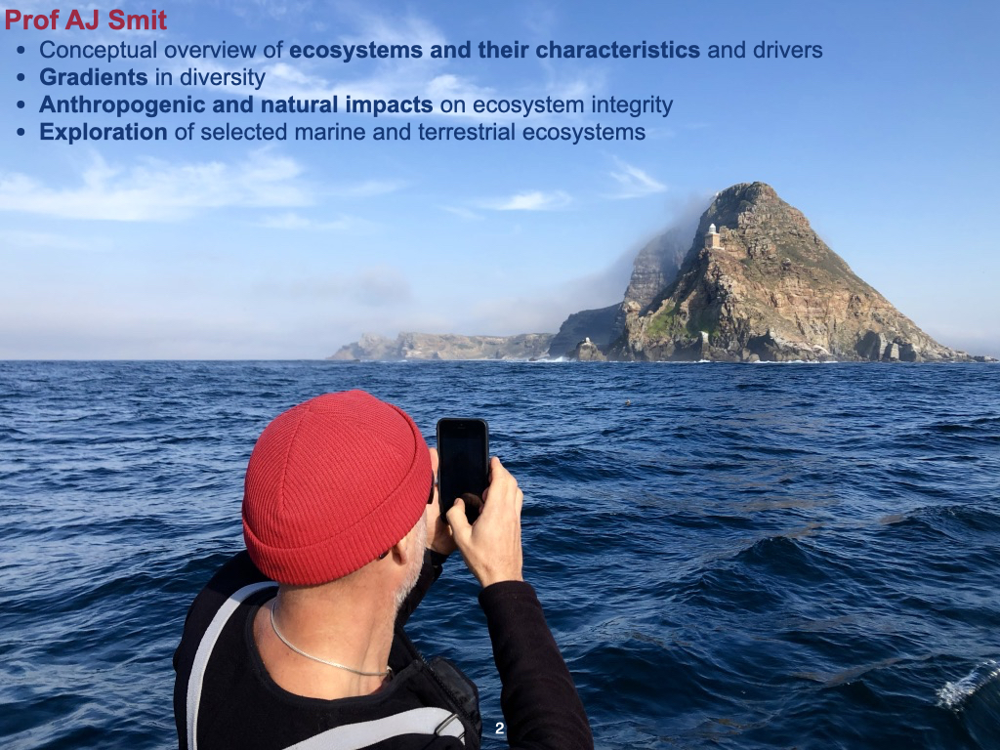](images/BDC334-002.jpeg "Slide 2")

Slide 2

So, we’re going to look at a broad overview of what ecosystems are, their characteristics, and what makes ecosystems work (Slide 2). An ecosystem is easy to observe when you go out into nature; what you see is, indeed, an ecosystem. However, they’re present because something explains their existence at a particular place and time. These are the environmental factors that drive them, support their operation, and allow them to function.

### 2.1.3 Environmental gradients and biodiversity

We’ll discuss the broad concept of gradients in biodiversity, which is important for you to consider. You need to think about all the gradients in abiotic variables that exist across the surface of the planet. An obvious example of a gradient is the one that exists from the tropical regions at low latitudes to the high latitudes, the polar regions.

As we move from the tropical regions towards the polar regions, it becomes progressively colder. The day length, or the ratio between day and night, changes significantly, and the seasonal effect becomes more pronounced. The amount of light decreases, and so on. There are many different factors that vary along these large gradients from tropical to polar regions.

There are also similarly strong gradients that exist on local scales. For example, looking at Cape Point, there’s a very strong gradient in temperature as we move from the western side of Cape Point, around Cape Point, and into False Bay; as you move, the temperatures become increasingly warmer. That’s a gradient that exists on a small spatial scale, but you also have global scale gradients.

The intention of macroecology is to understand how ecosystems are structured along these gradients.

### 2.1.4 Ecosystem structure and human influences

We’ll also discuss what it means for an ecosystem to have structure. As we’ve just spoken about gradients, most of these are natural gradients. However, there are also anthropogenic gradients — human impacts or factors. These are things that people do which cause ecosystems to change, affecting how they function and how they’re structured.

To demonstrate these various principles, we’ll explore a selection of the more interesting and important ecosystems on the planet, and I’ll leave it to you to decide which ones you find most interesting. You’ll have the opportunity to explore some of your own ecosystems, looking at them in terms of both anthropogenic impacts and the natural influences that make them different from other ecosystems. We’ll investigate some of the more important gradients responsible for structuring ecosystems and examine their characteristics in terms of biodiversity, structure, form, and so on.

### 2.1.5 Module structure: professor Boatwright

[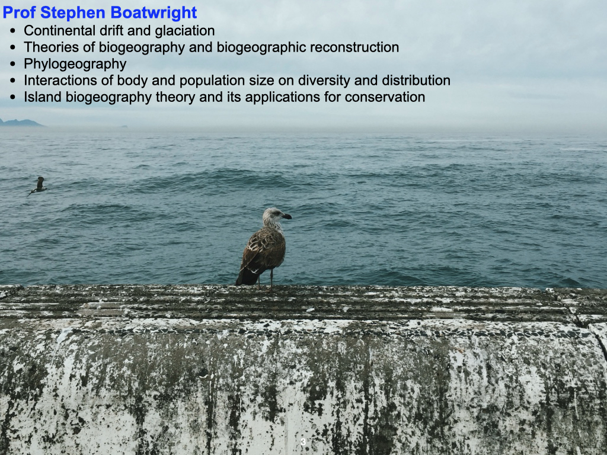](images/BDC334-003.jpeg "Slide 3")

Slide 3

Professor Boatwright will take over in the fourth term. He will cover other aspects of macroecology and global ecology, including subjects like continental drift and glaciation (Slide 3). This will involve looking back into the palaeohistories of Earth, so his emphasis will be more historical, whereas my emphasis will be on contemporary processes and those we anticipate in the future. In fact, we can state with a great deal of confidence — up to perhaps about $100$ years, possibly $150$ years — what the future climate, temperature, and other variables on Earth will likely be. Because ecosystems respond to changes in these factors over such time scales, we can also infer the future biogeography and macroecology of systems.

Professor Boatwright will also delve into phylogeography, which deals with the genetic lineages of different forms of life across Earth’s surface, and how these are structured as a consequence of continental drift and glaciation. He will further explore current patterns in body size and population size as related to biodiversity and distribution. Lastly, he will cover the theory of island biogeography.

### 2.1.6 Gradients beyond Earth

[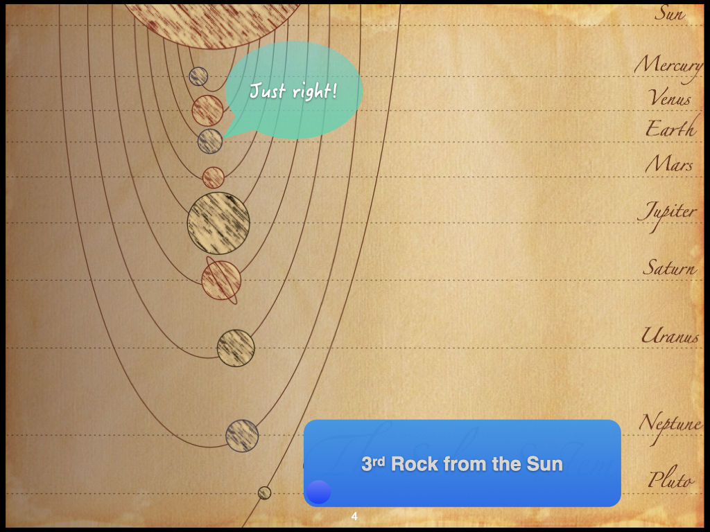](images/BDC334-004.jpeg "Slide 4")

Slide 4

Those gradients I mentioned also exist on much larger scales — outside of Earth itself (Slide 4). For instance, consider the arrangement of all the various planets from Mercury, Venus, Earth, Mars, and so on. As you move farther away from the Sun, it’s not necessarily that it becomes colder immediately, but the amount of heat available becomes less and less. At a certain distance from the Sun, we find Earth, where the conditions are just right for water to exist as a liquid, as ice, and as vapour in clouds.

Go closer to the Sun and you come to Venus, which is the second planet from the Sun. There, it’s too warm and no water is available at all. Move a little further away and you reach Mars, the fourth planet from the Sun, where it’s a bit too cold, so most of the available water occurs as ice. Progress even further and, on the distant planets, even some elements typically gaseous on Earth exist as ice. This gradient in the solar system — a function of distance from the Sun — is what creates Earth’s unique set of conditions that permit life, as it depends on the presence of liquid water, ice, and vapour.

### 2.1.7 Outline of topics for this module

[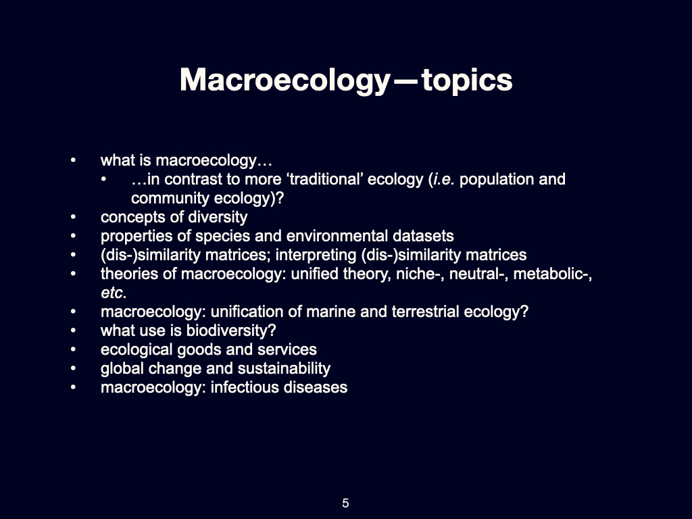](images/BDC334-005.jpeg "Slide 5")

Slide 5

In my section of the module, we will start by explaining what macroecology is, contrasting it with more traditional approaches to ecology (Slide 5). We will explore various concepts related to diversity. Then, we will discuss how to do macroecology, which will require us to examine some data and look at the properties of datasets from which we can extract knowledge about how ecosystems are structured in space and time, and how they function. To do this, we’ll need to understand some slightly mathematical concepts, including similarity and dissimilarity matrices.

Later, we’ll consider some unifying theories of macroecology. In recent years, there has been a movement toward finding unifying explanations for ecological patterns and processes on Earth. In the past, there were collections of hypotheses for different situations, varying according to organism size, the nature of the ecosystem, and so forth — separate theories for marine, aquatic, soil, terrestrial environments, etc. But today, there is an interest in looking at all these aspects in an integrated way.

Then, we will examine what biodiversity is, why it’s important, and what differentiates ecosystems with high biodiversity from those with reduced diversity. We’ll also look at the principles of biodiversity’s value — the “so what” question — by considering ecological goods and services. What benefits do people derive from nature? Why does biodiversity matter for us? Even if you do not live in a natural ecological system — because it’s been transformed into, say, a residential area — you are still dependent on the wellbeing of natural portions of Earth. If those landscapes lack biodiversity, people would be far worse off.

### 2.1.8 Looking into the future and broader applications

We will then look to the future by considering global change and sustainability. We will also see if we can find some parallels between macroecology and infectious diseases, perhaps even try to understand whether the COVID epidemic makes more sense given our knowledge of macroecology.

## 2.2 Lecture 2b

### 2.2.1 Definition of macroecology

[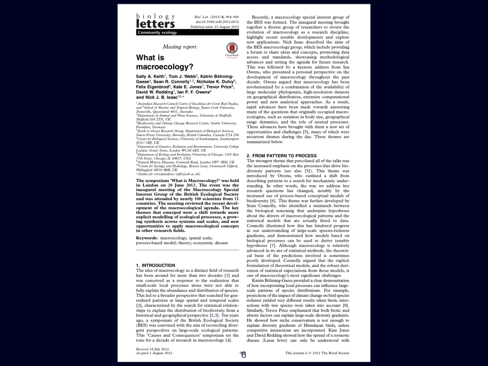](images/BDC334-006.jpeg "Slide 6")

Slide 6

[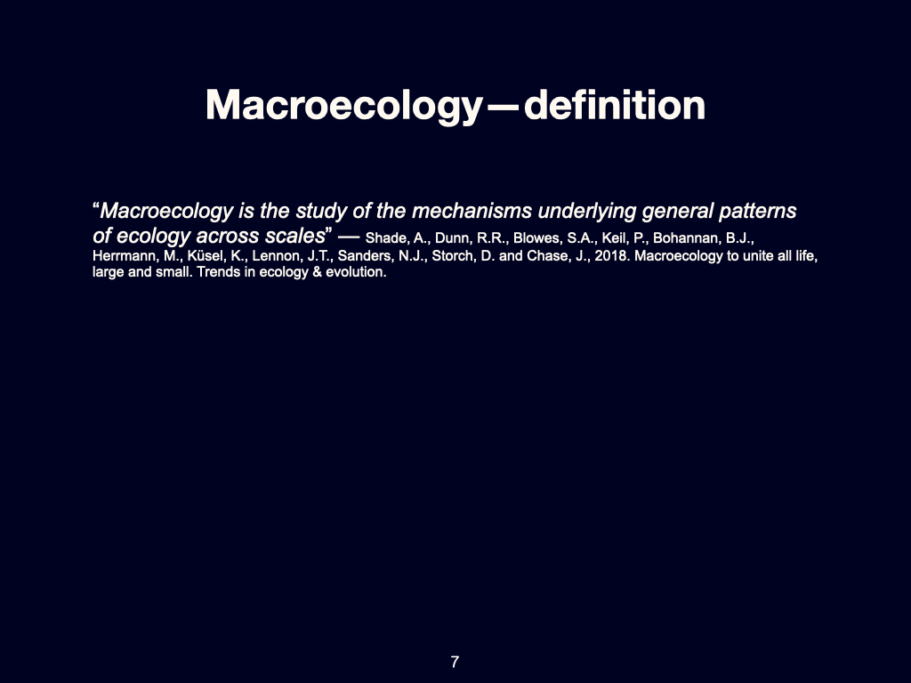](images/BDC334-007.jpeg "Slide 7")

Slide 7

I have already spoken a bit about this, but let me say a bit more. What is macroecology (Slides 6-7)? If you were to summarise it in a sentence or two, it is the study of the mechanisms underlying general patterns in ecology, across scales. There are words there worth unpacking — ‘patterns’ is probably one, and patterns in ecology across scales. The two important ideas — patterns and scales — we’ll be unpacking further, if not today then in due module. I’ll show you what “patterns” in ecological space can look like. But that’s the essence of macroecology.

Let’s examine the definition in a little more detail.

### 2.2.2 Traditional approaches in ecology

[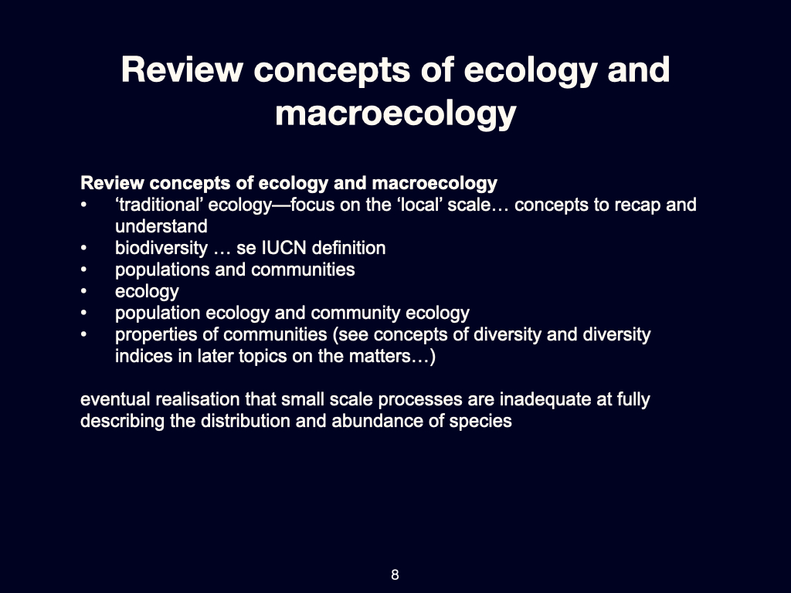](images/BDC334-008.jpeg "Slide 8")

Slide 8

To understand macroecology, you first need to understand how ecology has traditionally been practised (Slide 8). Going back perhaps a hundred years or more, even to Darwin’s era, ecology was about observing and investigating individual species. That is, the study of populations — a collection of individuals of the same species, occupying a specific space and time. The focus was to examine the dynamics of a species within a population: how it is affected by the environment, by other species sharing the same space, and so on. Traditional ecology, then, was very local in scale — limited to what you could see, for instance, standing at Cape Point and surveying the kelp forest before you. The boundaries of that study would be as far as your eye could discern the kelp — very much a local scale.

But this ignores that kelp occurs not only at Cape Point, but also in Norway, Iceland, and elsewhere worldwide. Macroecology would look at kelp not only in South Africa, but also Norway, Iceland, the United States, Canada, and everywhere kelp occurs. The aim is an integrated understanding of the processes that make kelp forests work, regardless of whether they are found in South Africa or New Zealand. Traditional ecology, by contrast, kept its focus strictly local.

Now, due to advances in technology, data processing, and the sorts of questions we’re able to ask, the scope — the scale — of our enquiry has greatly expanded. Today, macroecology can examine patterns at the global level. Darwin embarked on a voyage round the world in the Beagle, observing numerous locales — it took him two, perhaps three years. Today, in just $24$ hours, we can obtain a ‘snapshot’ of the entire Earth and collect sufficient ecological data world-wide, something previously unimaginable \[attention: Darwin’s ability to analyse global ecology in a single synthesis was much more limited than described here\]. Thus, new technologies have altered our perspective.

### 2.2.3 Biodiversity: definitions and scales

[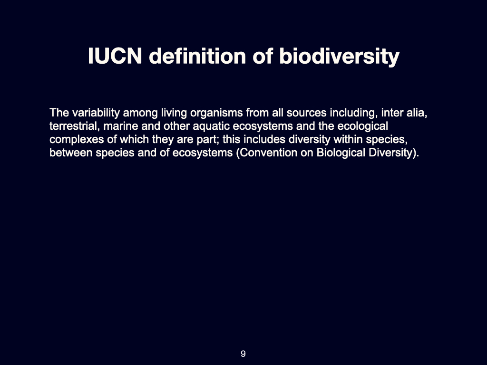](images/BDC334-009.jpeg "Slide 9")

Slide 9

Biodiversity is another key concept — it appears throughout this module, including in its very name. The traditional definition, as described by the International Union for Conservation of Nature (IUCN; Slide 9), defines biodiversity as “*the variability among living organisms from all sources, including terrestrial, marine and other aquatic ecosystems and the ecological complexes of which they are a part. This includes diversity within species, between species, and of ecosystems.*”

Again, the question of scale becomes evident — diversity within species, for example, means taking humans: within *Homo sapiens* there is great diversity, all the way down to genetic differences. That’s a scale we can go down to — though Prof Boatwright will cover genetics; I won’t get into that aspect here.

Diversity also exists between species — species occupying the same ecosystem. In a kelp forest you might have *Ecklonia maxima*, *Laminaria pallida*, *Macrocystis pyrifera*, various red baits, fish, sharks, and so on — all interacting within the kelp forest. Then, there is diversity at the ecosystem level — kelp forests interact with pelagic ecosystems nearby, with the rocky shore, with coastal dunes on the land, and so forth. Globally, a diversity of ecosystems exists, each with its own species assemblages and modes of environmental interaction.

So, biodiversity is essentially all life on Earth, at all the various scales in which we observe it, and in all the different configurations, forming habitats or ecosystems regardless of location — from $11,000\,\mathrm{m}$ below the ocean surface to the summit of Mount Everest.

### 2.2.4 Populations, communities, and the move to macroecology

So, we’ve mentioned populations (collections of one species) and communities (collections of multiple species). Ecology studies the processes by which species relate to their environment, to each other, and how the environment influences both populations and communities.

Macroecology naturally starts from population and community ecology: it makes sense to move from the local scale, to groups of communities, and then ultimately to encompass the whole Earth, which is the domain of global ecology and macroecology.

A proper understanding of the effects of scale, and of various scaling processes and gradients — as they occur from local to global levels — is absolutely crucial. This knowledge helps explain why certain species exist in particular locales but not in others. For example, why do kelp forests thrive in Cape Town, but not off Durban in KwaZulu-Natal? It’s because the environmental conditions differ: Cape Town’s seawater is much colder throughout the year, making it suitable for kelp, while Durban’s warmer temperatures exclude kelp from surviving there.

Some organisms actually require kelp forests to survive or to reach their full productivity — certain species can only occur within kelp forests. So, the presence of kelp creates an environment that supports many other species. Thus, if kelp is absent (as off Durban), these organisms are also absent.

In short, global ecology seeks to understand how variations in temperature, light, soil characteristics, air quality, snow, rainfall, drought, humidity — all these environmental variables — combine to create a patchwork of suitable conditions for some species, but not others. Ecology, and especially macroecology, attempts to find global explanations for these broad patterns.

### 2.2.5 The three axes of scaling

The study of macroecology represents a development from more traditional ecological approaches — those rooted initially in population ecology and later in community ecology — towards a framework that can be applied across a vast range of scales. This shift allows ecologists not only to study small, bounded systems, but also to infer and interpret patterns that extend far beyond the limits of individual populations or communities.

#### Spatial scaling

When we talk about scale in macroecology, one of the principal axes is space. This spatial dimension can begin with extremely localised insights—data from individual quadrats or transects, for example—and scale up to isolated ecosystems such as a single nature reserve. From there, one can compare across multiple reserves, distributed across a broader regional scale.

We can then extend these comparisons to assess differences in biodiversity between countries, further scaling up to patterns observed at the continental level, among continents, across hemispheres, and finally encompassing the entire Earth. This spatial scaling allows macroecologists to interpret both fine-grained variability and broad-scale biogeographic patterns within a coherent analytical framework.

#### Temporal scaling

Macroecology also permits inquiry across scales of time. At the shorter end of the spectrum, we can examine changes that occur between seasons or years—what one might refer to as inter-annual variability. This can be extended to longer-term phenomena such as inter-decadal variation.

Importantly, macroecology has access to tools that allow us to look both backward and forward in time. Historical data — drawn from archives, paleoecological records, and related sources — permits reconstructions extending back 100 years, 1,000 years, or more. These long timeframes allow us to interrogate the processes responsible for the biogeographical patterns currently observed across the globe.

At the other end, through the use of Earth system models — climate models, atmospheric models, and so on — we can look forward into the future. Currently, these predictive models typically extend out to timeframes such as 50 or even 200 years from the present. These projected conditions can, in turn, be coupled to likely ecological outcomes—how ecosystems may respond to shifts in climate, land use, or biogeochemical cycles over such intervals.

#### Biological scaling

The third axis along which macroecology engages is that of biological size or organisational scale. This includes scaling relationships among organisms of vastly different sizes. At one end of the continuum, we might consider viruses and bacteria, which are measured in the pico- to nanometre range.

We can then move up to interstitial meiofauna, typically fractions of a millimetre to a few millimetres in size. Beyond this, we encounter small-bodied macro-organisms — such as annual plants or small mammals — ranging in size from a few centimetres to perhaps a metre. At the other extreme lie the large-bodied megafauna and mature trees, often key components of the ecosystems they inhabit.

Macroecology is thus not defined by any single scale, but by its capacity to consider all these dimensions — spatial, temporal, and biological — simultaneously. It offers a mode of ecological thinking where pattern and process are interpreted as functions of scale, connectivity, and context. This multiscalar orientation distinguishes it from the narrower lenses of traditional ecology and allows for the comparative, often statistical, treatment of ecological regularities at planetary scale.

### 2.2.6 Questions and answers

[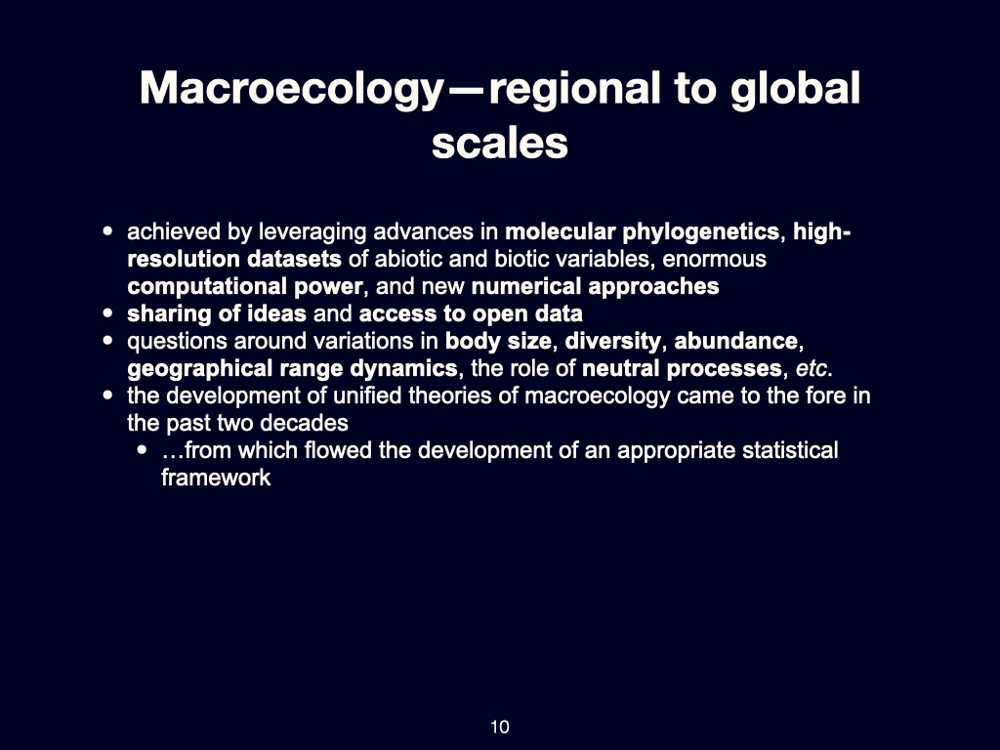](images/BDC334-010.jpeg "Slide 10")

Slide 10

A question arose: when referring to patterns and processes in traditional ecology, is there such a thing as modern ecology? Yes, this module is very much about modern ecology. Traditional ecological approaches would focus on surveys at a local scale, such as conducting a transect survey in a nearby nature reserve, limited by what can be physically accessed.

Today, with computers and satellite remote sensing, we can examine large-scale patterns — across countries, continents, or even globally — often using satellite data (Slide 10). Not only can we synthesise many small-scale surveys collected by different people over time, but we can also employ advanced numerical analyses to make sense of very large data sets — ones so substantial, they can no longer fit within Excel.

Modern ecologists now collaborate across the globe, pool significant data sets, and use advanced methods to reveal broad-scale patterns in biodiversity, species composition, and ecological functioning. Whereas traditional studies looked at the local, modern ecology can rigorously address processes at global, continental, or deep historical time scales.

#### Example from south africa

The earliest botanical research conducted in South Africa dates back to 1772 – 1774, when a Swedish botanist named [Carl Peter Thunberg (1743 – 1828)](https://hipsa.org.za/publication/carl-peter-thunberg-travels-at-the-cape-of-good-hope-1772-1775/), who had trained under Carl von Linné (Linnaeus) (1707 – 1778), travelled to South Africa to explore the Western Cape and parts of the Southern Cape region as far east as Addo. Most of his journeys were made on horseback, and each of his three expeditions lasted several months at a time.

During this period, his primary focus was the collection of plant and insect specimens. These he subsequently sent back to Europe, with the intention of classifying them according to the taxonomical system developed by Carl Linnaeus.

Fast-forward almost two centuries to the 1940s. This time the botanist [John Acocks](https://en.wikipedia.org/wiki/John_Phillip_Harison_Acocks) (7 April 1911 – 20 May 1979), again undertook a major botanical survey, but with the intention to classify all of South Africa’s vegetation. He travelled by train, classifying the habitats he saw through the window, and his classification became known as the *Veld Types of South Africa*. Even this method was constrained compared to the view we now have through remote sensing satellites.

Now, we can “stand” $80\,\mathrm{km}$ above Earth and map entire landscapes from above, unconstrained by natural or political boundaries. This is in fact what the recent [BioScape](https://www.bioscape.io/science) programme has accomplished. BioScape is a programme that was implemented, run, and funded by the United States government. A significant portion of the funding was allocated to NASA, and in 2023, NASA, in collaboration with a group of South African scientists — of which I was a tiny part — brought a series of high-tech instruments all mounted on aeroplanes to South Africa. The intention was to survey the Cape Floristic Region during that period.

The instruments used included a range of ultraviolet, visible, and shortwave infrared imaging spectroscopy instruments; laser altimetry instruments known as LiDAR; as well as various other sensors, some of which were also mounted on satellites and other platforms. They surveyed much of the Fynbos region in the Cape, as well as some of the kelp forests around South Africa.

The examples above, spanning almost 3 centuries, offer an illustration of how the field of ecology has evolved over time. Initially, surveys were conducted on horseback, with the prime interest being the naming of various species. Two centuries later the focus shifted more towards classifying different vegetation types. In the present day, around two years ago, this endeavour culminated in the deployment of a comprehensive suite of extremely high-tech instruments, all functioning in concert to elucidate both the patterns observable at the landscape scale and the processes that structure these systems across space.

#### Broader shifts in approach

Traditional ecological studies focused on what happens in places within easy reach — a single nature reserve, for example. Modern studies look for patterns across nations or hemispheres, and also explore new levels of taxonomic detail, such as genetic variation and subspecies.

‘Scale’ can refer both to spatial scale — local to global — as well as temporal scale: considering recent changes versus millennia or longer time spans. Modern approaches allow us to examine ecological phenomena and biogeographic patterns at both these broader spatial and longer temporal dimensions.

Collaboration is increasingly important. Where once ecological studies might have one or two authors focused on a single location, it’s now common to find large teams of co-authors bringing together expertise and data from multiple sites or even continents in pursuit of broader ecological generalities.

#### The value of global approaches

The aim of global ecology is to derive general ecological ‘laws’ or repeatable principles that apply across the full diversity of ecosystems — from Russian tundra to Amazonian rainforest to the Australian outback. Though these systems may look entirely different, we seek to identify commonalities in their fundamental processes.

Thirty years ago, when I was a student, almost all work was at a very local scale and typically on one’s nearest nature reserve. Today, with advances in technology and computational power, questions can be more complex and less parochial. The questions themselves have evolved and broadened: “What can South Africa’s biodiversity teach Patagonian ecologists?” Global-scale studies provide answers of relevance far beyond one region or ecosystem.

#### Closing and summary

If you have further questions — about the module structure, assessments, or the content of the introductory material — please ask, either now or later via the chat or WhatsApp group.

If there are no more questions, I’ll post this video online for you to access within the next half an hour or so. Thank you.

## 2.3 Lecture 2c

### 2.3.1 Revisiting definitions and scales

Regional to global scales — I’ve spoken about all of this already, so I don’t need to go into regional to global scales again. You’ll understand this in a little bit more detail once you read that paper that I’ve given you. There are going to be two other papers now which you’re expected to read as well.

### 2.3.2 Patterns and processes

[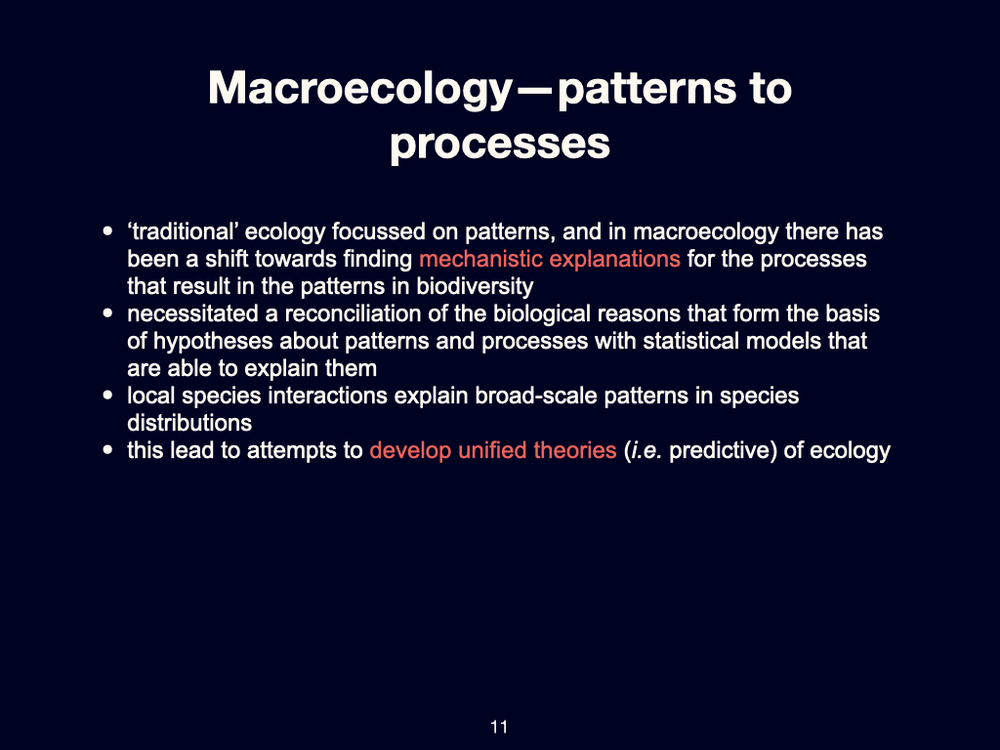](images/BDC334-011.jpeg "Slide 11")

Slide 11

Okay, patterns and processes (Slide 11). Traditional ecology essentially focused on patterns. It looked at the world and observed that there is a patchwork of different kinds of ecosystems, even on local scales and then regional scales. It noted that this ecosystem often appears different from the one next door, and described how it is different in terms of species present there, and in terms of the structure of the community. However, it didn’t really attempt to explain the mechanism that created those differences in the first place.

In contrast, macroecology tries to add a mechanistic explanation for why and how things differ across the surface of Earth. To do this, we need to start treating ecology as a proper science, not merely as a form of natural history as it had been approached in the past. We need to ask questions about nature, to form hypotheses about nature that can be tested statistically, so that we can have a cause–effect explanation for why things are the way they are, or how things came to be as we observe them now.

This is, in fact, a very critical feature of modern-day ecology, particularly in macroecology, but also in contemporary population and community ecology at the local scale. We must ask testable hypotheses about nature — questions that we can actually go and test experimentally. Experimental assessment, experimental science, is the true test for whether something is so, or is not so. The necessity to measure things, and the necessity to have a statistical model or hypothesis, requires that we have data — that we go out into the world and measure things in specific ways, in order to have data that can be tested in a hypothesis setting via statistical models.

This is a very key part of modern ecology, and it’s only something that has become feasible since about the 1970s. Before that, people did not look at ecosystems with the intention of asking hypotheses of them. They mostly described how things are, rather than why things became the way we observe them to be now.

### 2.3.3 Local interactions to global theories

We’re going to examine local species interactions all the way up to global species distributions. Hence the necessity, once we have the entire earth in view, to develop unified theories. There are, of course, various applications.

### 2.3.4 So What?

[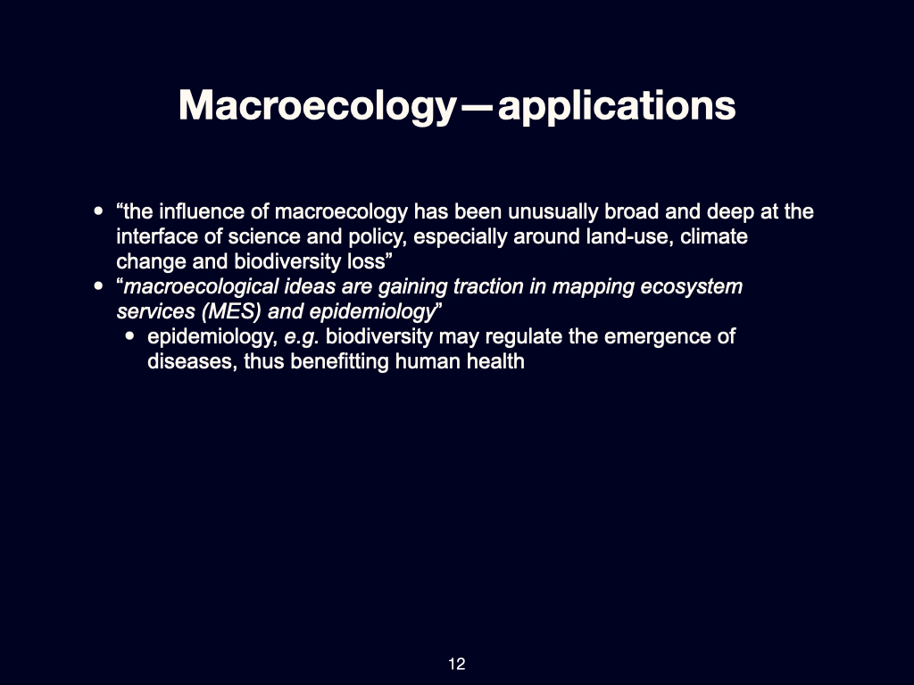](images/BDC334-012.jpeg "Slide 12")

Slide 12

Why do we want to do macroecology (Slide 12)? Because we want to create something for policymakers to help them understand the world better; to identify that certain regions of the world are of great importance, both strategically and ecologically, and for the benefit of people. It may be better not to have developments in such areas, or instead to conserve portions of biodiversity, to plan land use accordingly, and to understand what the future world is likely to be like as biodiversity is lost to an ever-greater extent.

So, understanding macroecological processes influences the way that policies unfold. One of the major visible policies in the world today is the tendency for nations to move away from fossil fuels towards renewable energy, because we know that fossil fuels cause climate change, and we know that climate change is having an effect on species globally. We want to minimise this effect, because if we do, the consequences for people will also be reduced, since humans are so strongly linked to the environment.

Additionally, explanations of epidemiology also become possible: understanding the ways in which diseases spread and operate around the world, their origins, and so forth. There are many reasons why macroecology is interesting and important. For me, it is important because people are making a living from the world around us, and we want to ensure that the way people are making a living from the world today will still be viable a century from now — for your children, perhaps, to make a similar kind of living from the world, if you indeed directly rely on natural systems. Even if you don’t directly depend on ecosystems, you are indirectly supported by ecological goods and services.

### 2.3.5 Self-study and assignments

[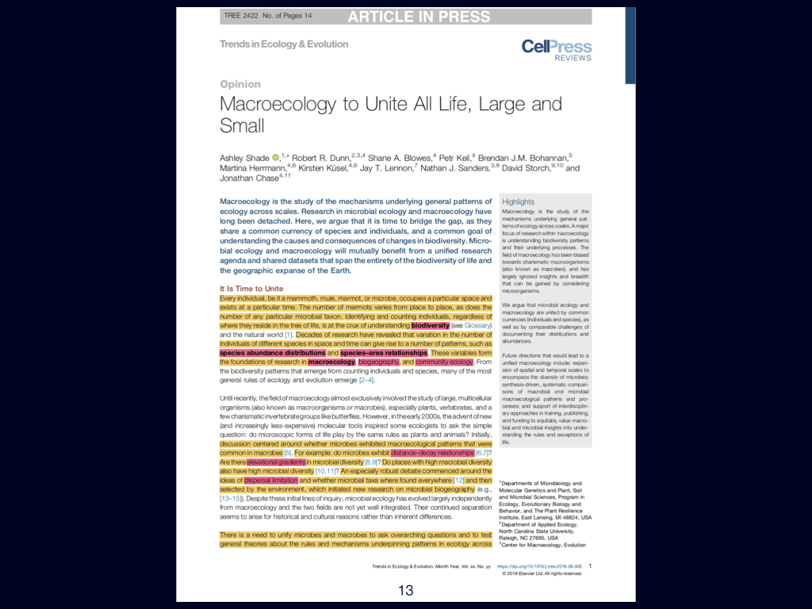](images/BDC334-013.jpeg "Slide 13")

Slide 13

[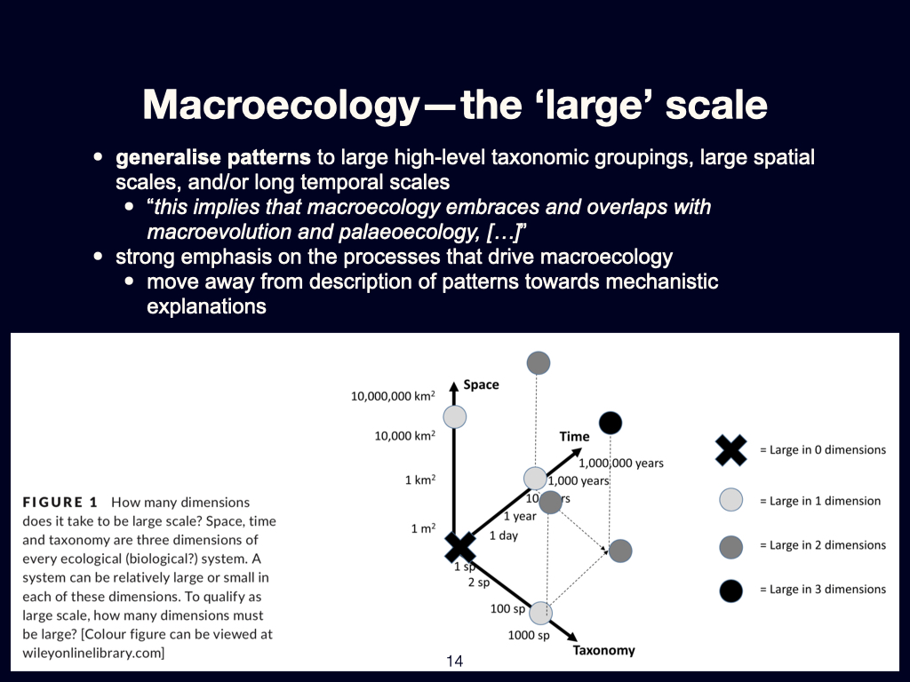](images/BDC334-014.jpeg "Slide 14")

Slide 14

Anyway, that brings me to the end of what I needed to say today. There are two papers — or rather, one paper and one additional paper (Slides 13-14). There’s the one you saw before, and another one, which is also available to download from Tangled Bank. I would like you to read them both by the end of this week, so that by Friday afternoon, if you have questions about them, you can ask me. I’ll be available on Google Meet if you make an appointment to see me in groups of more than three.

So that’s your self-study. Your assignments will also require that you understand these topics in quite a bit of detail.

### 2.3.6 Looking ahead

During the next lecture, we shall move on to topic number two, and we’re going to look at some of the questions that we can ask within the framework of macroecology.

# 3 Ecological gradients

> **NOTE:**
>
> This material must be reviewed by BCB743 students in Week 1 of Quantitative Ecology.

## 3.1 Lecture 3a

### 3.1.1 Papers to read

The next paper you need to be familiar with addresses the ‘distance decay’ phenomenon. It is by Nekola and White (1999). This paper links directly to concepts introduced in the previous Ashley Shade paper, but here it is explored in greater detail.

The distance decay relationship fundamentally explains how ecological similarity decreases with geographical or environmental distance. In my view, gradients—particularly environmental gradients—are the major structuring agents of life on Earth, and distance decay is the pattern that emerges when we observe biodiversity at broad, often global, scales.

Zooming in to finer spatial scales, randomness or stochasticity becomes more influential, and the structure of $\beta$-diversity becomes more complex. Specifically, the paper introduces concepts such as turnover $\beta$-diversity and nestedness resultant $\beta$-diversity. If you find these terms challenging or require deeper understanding, you should consult foundational works by Whittaker and Baselga, who have written extensively on these topics. Understanding both nestedness resultant and turnover $\beta$-diversity is essential for your overall grasp of the subject.

This paper by David Tilman (2017) explores global-scale environmental gradients and their explanatory power in patterns of biodiversity. It specifically delves into the mechanisms underlying global patterns, focusing on the marine environment.

You are expected to understand the unimodal species distribution model, as it underpins the interpretation of distance decay across environmental gradients. While one group will further explore terrestrial patterns of biodiversity as part of the wiki assignment, this particular paper gives a clear overview for marine systems. Pay special attention to the graphs presented, as these summarise the major explanatory patterns in a digestible format.

### 3.1.2 Macroecology and environmental gradients

[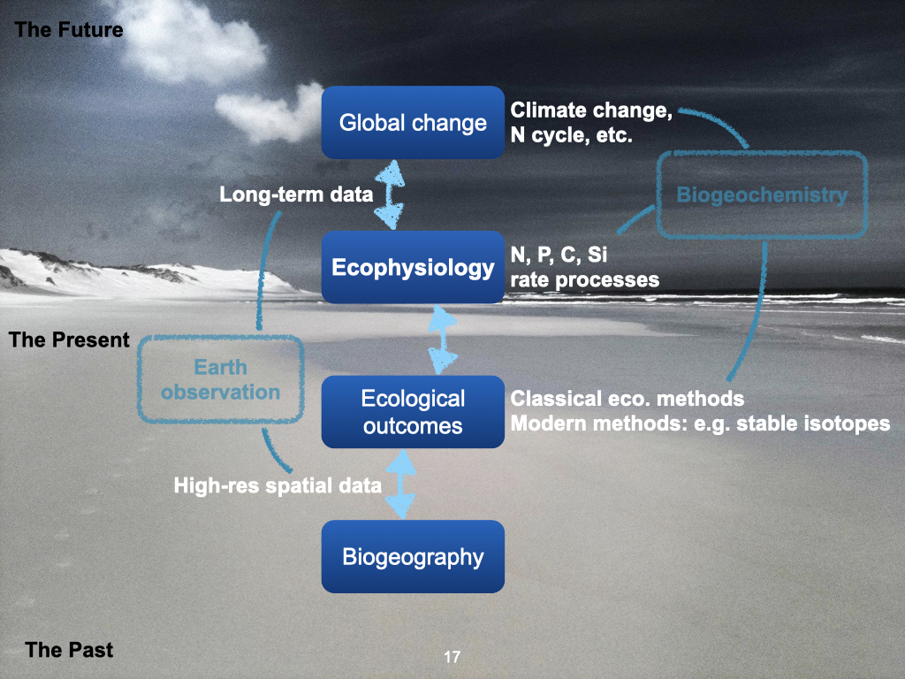](images/BDC334-017.jpeg "Slide 17")

Slide 17

We are starting with topic number two in biogeography and global ecology. Today, our discussion focuses on the effect that gradients — specifically, environmental gradients — have on the distribution of life across the planet (Slide 17).

To remind you what macroecology is concerned with, we can use it to ask almost any question about the biodiversity of life on Earth. More specifically, we explore how biodiversity is arranged according to geographical location. This pertains to differences between continents, across continents, and indeed, across the entire Earth. Our scope is broad: we consider patterns found on very small, local scales right here around us, scaling up to global patterns that encompass the whole planet.

Moreover, macroecology allows us to look deep into the past, using palaeorecords to explore the distribution of plants, animals, and also organisms that are neither plant nor animal. Equally, it grants us tools to study what is happening right now, in the present day. Looking to the future is also now possible due to technological advancements, such as computational modelling and remote sensing.

For my particular section of the module, as I mentioned yesterday, we are focusing mainly on contemporary processes. We will also look, albeit briefly, at methodologies for measuring these distributions and at how we establish the patterns of distribution for both plants, animals, and other organisms globally.

### 3.1.3 Drivers of biogeographical patterns

Let’s firstly examine the processes present around us that structure the global distribution of life. The way we currently observe life arranged at the global scale is termed ‘biogeography’.

Generally speaking, biogeography and the biodiversity patterns associated with different continents and regions depend largely upon the underlying geographical character of those regions. Climate is an important factor here — it has a substantial, direct influence on these patterns.

However, it is crucial to appreciate that the deeper history, or palaeohistory, of Earth also matters. The original evolution of life, and, long ago, the manner in which today’s continents were previously joined into supercontinents — initially Pangaea and, subsequently, Gondwana — are instrumental in explaining our current patterns. The break-up of these supercontinents, driven by plate tectonics, has critically shaped the biological structures we observe across the planet’s surface today.

### 3.1.4 Remote sensing and modern observation

These processes are not just theoretical; we can observe and quantify them. We have access to high-resolution spatial data, much of it obtained from satellites that orbit Earth daily. Since roughly $1981$ — the beginning of what we call the satellite era — we have been able to compile global images of Earth’s surface. This has enabled an unprecedented understanding of patterns and processes relating to terrestrial life.

Environmental differences across Earth’s surface produce varying ecological structures and outcomes. These outcomes, meaning both the structure and function of ecosystems, depend on — and can be measured across — different places and environments on our planet.

### 3.1.5 Classical and modern ecological methods

Classical ecological approaches — such as population and community ecology — have, for the last hundred years or so, helped elucidate how such ecological patterns develop and persist. These approaches include basic methods such as sampling using quadrats or transects, with researchers counting the number of different species co-existing in defined areas, and then tracking how these assemblages vary both spatially and temporally.

You should recall from your earlier studies the relationship between plants, animals, and their environment, particularly regarding how the environment acts upon the physiology of specific organisms.

### 3.1.6 Linking environment, physiology, and ecology

Furthermore, macroecological questions encompass the many rate processes that move major nutrients — such as nitrogen, phosphorus, and carbon — as well as both micronutrients and macronutrients, into and away from plants and animals. These environmental influences on living organisms can be measured in a field known as ecophysiology. This discipline examines the rate processes affecting both plants and animals: for plants, things like nutrient uptake, and for animals, factors such as prey capture or their movement capabilities, as discussed previously by Prof Maritz All these variables are studied within ecophysiology.

Importantly, outcomes from ecophysiological processes can have broad ecological consequences. That is, changes at the level of organismal physiology often scale up to influence community structure and even biogeographical patterns.

### 3.1.7 Global change: past, present, and future

Finally, we must recognise that the world, at all levels, is being transformed by global changes, including shifts in climate, and in nutrient cycles — such as those for nitrogen and phosphorus. This revisits topics from your Planetary Boundaries lectures in second year. Global change will influence — and in many cases, is already influencing — the outcomes of ecophysiological processes, which translate upstream to affect ecological patterns and, eventually, broad-scale biogeographical distributions.

To summarise, all these various processes — ranging from global change, through ecophysiology and ecological outcomes, to biogeography — occur across a huge variety of scales, both spatially (from the entire Earth down to highly local settings) and temporally (from the deep past, through the present, and projecting into the far future).

These are the foundational perspectives you should keep in mind as we proceed.

## 3.2 Lecture 3b

### 3.2.1 Environmental gradients

We have previously discussed gradients, particularly environmental gradients. When I refer to gradients, I mean the changes in an environmental variable, such as temperature or rainfall, as you move from one place to another. For example, consider the temperature difference between Johannesburg and Cape Town, or the rainfall difference as you move from Durban to Cape Town. As you travel across the land surface, you experience a gradient.

A prominent example is the rainfall gradient as one moves from east to west across South Africa. KwaZulu-Natal, on the eastern side, is very wet, with high rainfall and high humidity. However, as you move westwards, into the Western Cape, the Northern Cape, and even further towards Namibia, the environment becomes increasingly dry and desert-like.

On the eastern side of the country, the climate is very wet, and thus we find plants and animals that are adapted to, and require, very wet and moist conditions — examples include tropical or subtropical forests and coastal forests. However, if you think back to the last time you drove from Durban into the Northern Cape, you would have noticed how the landscape became increasingly dry. As you continue across the landscape, the vegetation also changes. It shifts towards types of vegetation that are able to persist and thrive under quite dry conditions.

In the Northern Cape and further west towards the South African coast, vegetation becomes increasingly sparse. There are fewer plants present — not necessarily fewer species, but rather, the individuals are far more separated from each other in space. They are less dense, in other words. This provides an example of a gradient related to rainfall, or water availability.

### 3.2.2 Environmental gradients

Each different environmental variable can constitute a gradient. Gradients occur for temperature, humidity, soil nutrients, soil characteristics, cloud cover — essentially, anything you can think of regarding the environment. All these gradients operate across Earth’s surface.

Let us focus, for instance, on plant species. An individual species of plant will often be well-adapted to a particular, relatively narrow, range of environmental conditions — such as temperature. Most individuals of a given species tend to occur around a ‘sweet spot’ where conditions, such as temperature, are most comfortable for them.

To put this in more relatable terms, if you are in Cape Town on a sunny summer’s day, you will naturally gravitate towards the spot that is most comfortable, perhaps choosing to sit in the shade rather than the direct sun. Plants, of course, lack the ability to move from place to place as we do. They are fixed in position, but over evolutionary timescales, both plants and animals become most abundant where environmental conditions are the most suitable for them.

### 3.2.3 The unimodal response

[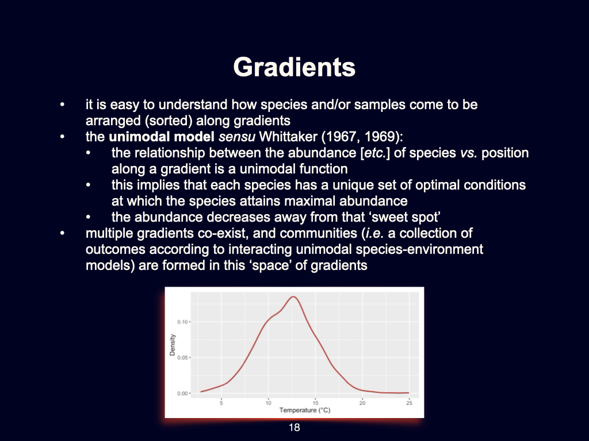](images/BDC334-018.jpeg "Slide 18")

Slide 18

Consider the example of a graph displaying the abundance of a particular species in relation to temperature (Slide 18). For instance, the majority of a species’ individuals may be found where the temperature is around $12.5~^\circ\text{C}$, as that is the most suitable value for them. As you move away from that optimal temperature, the abundance of individuals decreases. This general pattern of abundance along an environmental gradient is known as a ‘unimodal’ species distribution.

You may read more about the origins of this concept in the work of Roger Wittig \[attention: likely incorrect, please verify author and publication details\] from 1967 or 1969, where this idea of the unimodal species distribution was first discussed.

of course, this applies only to one particular species. A different species may have an optimal temperature around $20~^\circ\text{C}$, others at $5~^\circ\text{C}$; some will prefer lower, some higher, and so on. These preference curves exist for every single environmental gradient and for all species present.

### 3.2.4 Gradients beyond temperature

It is important to recognise that this pattern is not restricted to temperature. The same kind of unimodal distribution occurs for gradients in humidity, water availability, soil type, nutrient concentration, and other factors that have ecological or physiological consequences for species.

When those factors operate simultaneously, they result in complex patterns known as coenoclines.

### 3.2.5 Coenoclines, coenoplanes, and coenospaces

[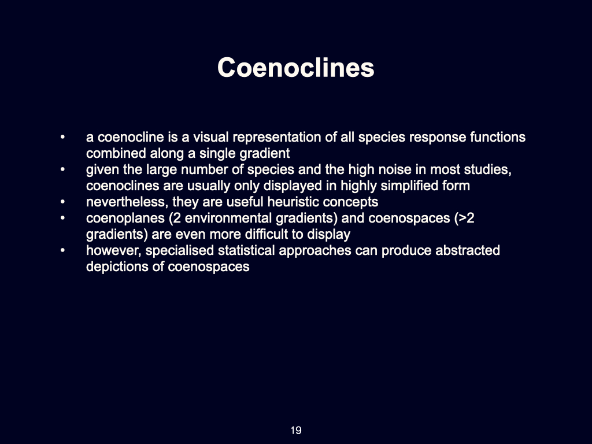](images/BDC334-019.jpeg "Slide 19")

Slide 19

[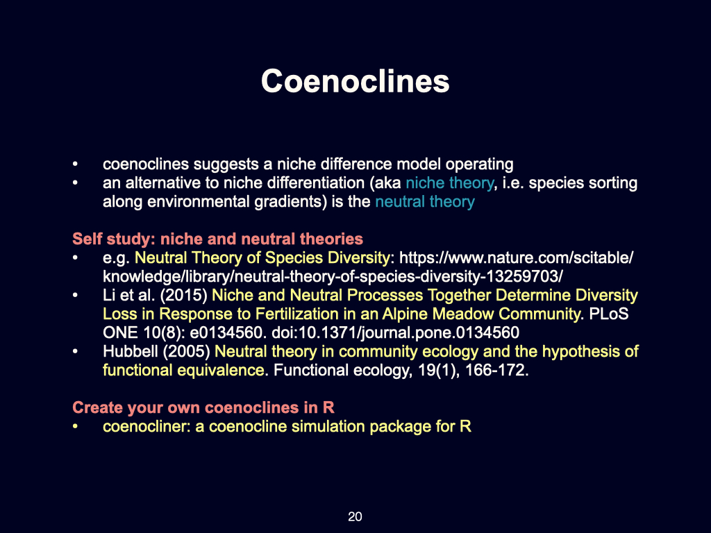](images/BDC334-020.jpeg "Slide 20")

Slide 20

A coenocline is essentially a more complex representation of species distributions, where the response to every environmental variable and every species on earth is superimposed to obtain a composite visualisation (Slides 19-20). This is, as you can imagine, extremely difficult to visualise directly, as it essentially combines all these different gradients into one highly complex picture. A coenocline represents the ‘sweet spot’ or the shift in landscape associated with changing environmental conditions and the location where particular types of populations will peak in abundance.

Instead of just thinking of a gradient and a unimodal distribution for one species, imagine a unimodal distribution for every species, across every environmental condition that influences growth and fitness. When you superimpose the outcomes, you produce what is called a coenocline.

If you examine two environmental dimensions together — for example, temperature and humidity — this produces a two-dimensional plane called a coenoplane. If you add additional variables, such as soil characteristics, it becomes a multi-dimensional space called a coenospace. A coenospace is, therefore, a multi-dimensional representation of the best locations for collections of species given all relevant environmental gradients.

This move from thinking about a single gradient to a complex coenocline reflects a major step in understanding the ecology of species distributions.

### 3.2.6 Statistical approaches

We have fairly specialised statistical methodologies for studying coenoclines and related phenomena. We will touch briefly on some of these in this module, though there may be challenges due to the need for suitable computer lab access. Those of you progressing to honours will take an entire module in Quantitative Ecology, which lasts six or seven weeks and covers these statistical methods in greater depth — specifically targeting coenoclines, coenospaces, coenoplanes, and associated analytical approaches.

## 3.3 Lecture 3c

### 3.3.1 The Earth system and global change

[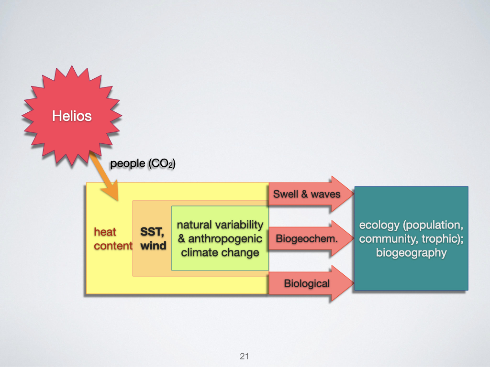](images/BDC334-021.jpeg "Slide 21")

Slide 21

Let us examine all the processes currently impacting Earth. In the age we live in today, there is a particular need to be concerned with global change, which encompasses a variety of components. The most obvious, and certainly the most widely discussed in the popular media, is climate change (Slide 21).

Climate change fundamentally arises due to the release of carbon dioxide ($\mathrm{CO}_2$) into the atmosphere by human activity, particularly through the burning of fossil fuels. This $\mathrm{CO}_2$ does not originate from the sun, but rather acts to trap the sun’s energy within our atmosphere, preventing it from escaping back into space. This process leads to an accumulation of heat on Earth, which we observe as an increase in the general heat content — measured as a higher temperature — across the globe.

As more heat builds up, it causes changes in atmospheric pressure systems. Regions warming up more than others develop areas of low pressure, where air rises and circulates. As air rises, it contributes to the formation of winds, and these changes in heat content are not limited to the atmosphere alone. A significant proportion of this heat is absorbed by the surface of the oceans, referred to as the sea surface temperature (SST). As the ocean’s surface absorbs this additional heat, we see a rise in sea surface temperature.

### 3.3.2 Atmospheric and oceanic responses

One of the most measurable atmospheric responses to increased heat content is an increase in global wind activity. of course, the real-world system is much more complex than this simple description, but it provides a useful starting point. In the case of the ocean, the most noticeable change is the rise in sea surface temperature. Both the atmosphere and the oceans experience this rise in temperature, which manifests as what we term anthropogenic climate change.

The implications of these temperature changes are profound. Many species have evolved to thrive in relatively narrow environmental conditions — what we might refer to as “sweet spots” (not a technical term, so don’t use it when you communicate professionally). A particular plant, for example, may be optimally adapted to the current temperature of Cape Town. If Cape Town warms by $2\,^\circ\mathrm{C}$, this plant finds itself outside of its optimal range. At that point, it faces a choice: it must either die out or, if its biological processes enable a sufficiently rapid response, it can shift geographically to remain within its preferred temperature range. This would require the plant to “move” towards the area where the climatic conditions mirror what used to be present in Cape Town — possibly to the west — as the climate envelope shifts.

So, climate change is already influencing the distribution of biota on Earth. We must therefore be aware of climate change as a new, critical process, and work to understand how it is likely to affect all aspects of the environment — particularly from both an ecophysiological and ecological perspective. For marine systems, this includes not only changes to swells and waves but also to the biogeochemistry of key nutrients such as nitrogen, phosphorus, and carbon. Biological interactions will change as well, exerting a profound influence on population ecology, among other fields.

This means that all modern biologists must grapple with climate change as an additional source of variation layered atop the myriad other processes already operating within Earth’s systems. Fully understanding climate change — and projecting its effects into the next $100$ to $150$ years — is critically important for anticipating how the biogeography of the future world will differ from that of today.

### 3.3.3 Regional gradients: focus on the ocean

#### The role of the agulhas current

[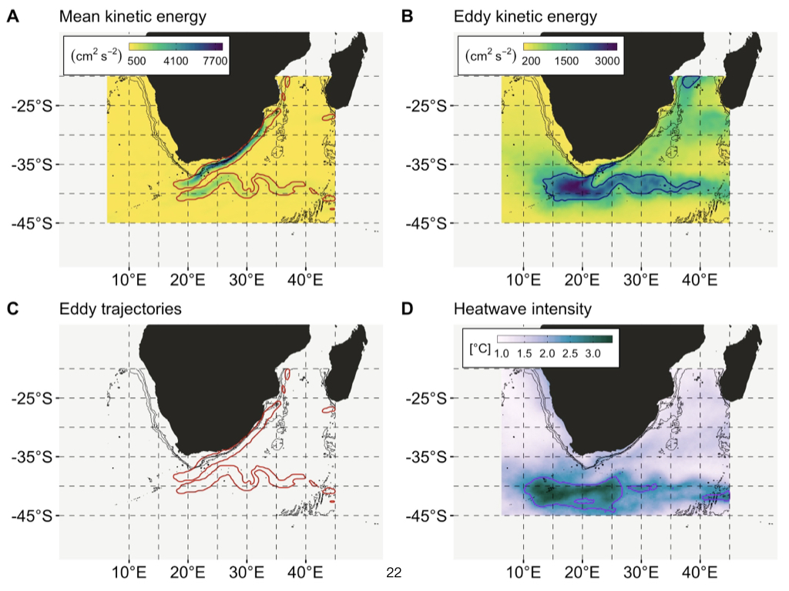](images/BDC334-022.jpeg "Slide 22")

Slide 22

Let me now focus more specifically on the ocean, as this is where much of my research is conducted. One of the most influential systems impacting South Africa — as well as many other coastal regions worldwide — is the large ocean current running along our coast. Although it appears snake-like on maps and diagrams, this is in fact the Agulhas Current (Slide 22).

The Agulhas Current flows from the north, past South Africa’s east coast, moving southwards before looping back into the South Indian Ocean. The water it transports from the north is warm, as it originates close to the equator. Regions nearer the equator experience greater day length and are closer to the sun, leading to higher heat absorption. Therefore, both the ocean and the overlying atmosphere are warmer in tropical regions.

This warm tropical water is carried southwards along the east coast of South Africa, bringing it into regions that would otherwise be significantly cooler. The presence of this warm water not only raises the temperature of the overlying atmosphere, but also drives greater rates of evaporation. As warm water evaporates, it injects moisture into the atmosphere, which then becomes available for rainfall.

Within this system, the rising warm air over the ocean creates a low-pressure area, while the relatively cooler land retains higher pressure. This pressure differential drives winds from the ocean towards the land, carrying with them moisture-laden air — and, as a consequence, there is considerable rainfall along South Africa’s eastern coastline.

If you recall the east-to-west rainfall gradient in South Africa — with KwaZulu-Natal in the east being particularly wet and moving towards increasing aridity as you travel westward — the Agulhas Current is largely responsible. The abundance of moisture and rainfall along the east coast owes much to the warmth of this current, which brings water from the tropics and sustains the region’s lush vegetation.

However, as you move away from the direct influence of the Agulhas Current, further west towards central South Africa, the oceanic influence diminishes. The water becomes colder, less moisture evaporates from the surface, and significantly less rainfall occurs. This renders the central and western regions of South Africa considerably drier and more arid, with less vegetation and runoff.

#### Western boundary currents around the world

This pattern is not unique to South Africa. Similar warm ocean currents flow along the eastern margins of major continents and are collectively known as western boundary currents. Examples include:

- The Brazil Current along the east coast of South America
- The Gulf Stream along the east coast of North America
- The Kuroshio Current off the east coast of Japan
- The East Australian Current alongside eastern Australia

These currents, known as western boundary currents because they flow along the western edge of their respective ocean basins, carry warm water from the tropics into the mid-latitudes, depositing moisture-rich air and promoting rainfall across large coastal regions.

As a general rule, continents influenced by these warm currents display a moisture gradient from east to west. For example, in Brazil, the region affected by the Brazil Current is warm and moist, but as one travels westwards into the interior — and especially into Chile and Peru \[attention: Chile and Peru are west of Brazil, but separated by the Andes and not on the same cross-sectional gradient; this is an oversimplification\] — the climate becomes progressively more arid. Similar principles applies to North America and Australia.

#### The importance of ocean currents for regional climatic gradients

Ocean currents play an absolutely critical role in establishing these large-scale regional gradients, which then determine how vegetation and associated biota are distributed. The moisture content of the environment is the primary driver shaping these patterns, though other factors become increasingly important as one moves further from the influence of warm currents.

It is important to appreciate the significance of the Agulhas Current in shaping South African climate and ecology. If you were to “switch off” the Agulhas Current and replace it with a cold current \[attention: not physically possible, but a useful thought experiment\], the entire east of South Africa would resemble the arid, desert-like conditions currently found along the west coast. Therefore, the ocean — specifically, these powerful currents — is fundamental to the regional climate patterns that support life as we know it on land.

If you wish to deepen your understanding, I suggest reading further about the Agulhas Current and its effects. Its presence is precisely what makes South Africa’s eastern seaboard lush and habitable, in stark contrast to the much drier west.

## 3.4 Lecture 3d

### 3.4.1 The role of the Agulhas Current in setting gradients

Another aspect that occurs due to the Agulhas Current is that, as the current moves — recall, as we travel from north to south, moving progressively away from the tropical regions into the subtropics and then into temperate regions — evaporation happens along this journey. The residual water in the ocean becomes increasingly cooler and cooler. This cooling occurs because the heat that was originally in the ocean is now being transferred into the atmosphere, warming the land adjacent to it. Thus, as we head further south, the seawater temperature drops as the heat from further north has dissipated and now resides in the atmosphere and over the land.

[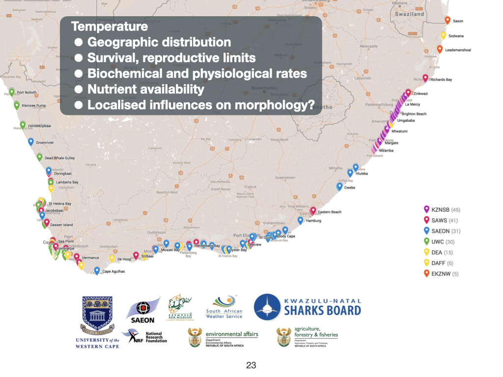](images/BDC334-023.jpeg "Slide 23")

Slide 23

Seawater in the southern regions is substantially colder compared to somewhere like Durban (Slide 23). You can actually feel the difference. By the time you reach Cape Town, the seawater is even colder, owing to the presence of a different ocean current, which brings about a process called upwelling rather than the warming effect of the Agulhas. So, in addition to setting up a gradient over the land in terms of various factors such as moisture, temperature, and erosion — all processes linked to rainfall — the Agulhas Current also sets up a strong temperature gradient along the coastline. At the northern border, north of Sodwana Bay with Mozambique, sea temperatures are at their highest, and as you progress down the coast, the temperature decreases consistently, becoming coldest at Cape Town. Therefore, there is a clear, almost linear, gradient in decreasing temperature from north to south along the coast of South Africa. Again, this gradient is a direct consequence of the Agulhas Current.

### 3.4.2 Examples of environmental gradients in False Bay

[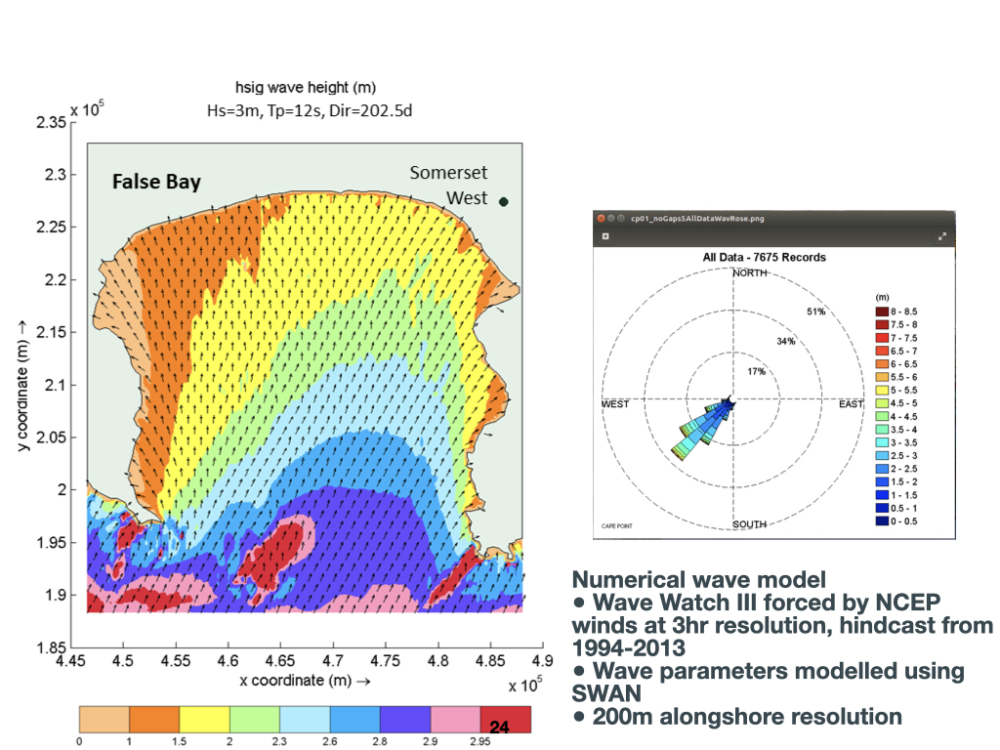](images/BDC334-024.jpeg "Slide 24")

Slide 24

Here is a figure illustrating waves — this is False Bay (Slide 24). This bay is where many of you find yourselves; Cape Town is in this region. In the Southern Ocean, far south of South Africa, there are strong prevailing winds that generate large swells, sometimes originating $1{,}000$–$2{,}000$ kilometres away. These waves eventually propagate and arrive at the shores of False Bay as swells.

This is just one more example of a regionally important environmental gradient. The spatial scale here is more restricted — we are now considering False Bay, which is about $50$–$60$ kilometres across. Even across such a small distance, you can observe a gradient: from the sheltered western sides of False Bay, such as Muizenberg, which experiences very low winds and small waves, moving south and east into more exposed sections, the wave height increases substantially. Within False Bay, there is a gradient in wave energy: lower in the west, higher in the east, and peaking further south. On the other side of the Cape Peninsula, exposed to the Atlantic, waves are higher still, as they directly intercept swells from the South Atlantic Ocean.

Wave gradients, such as those found in False Bay, influence the distribution of kelp and other marine organisms. Simultaneously, there is a recognised temperature gradient across False Bay, as well as a depth gradient: moving from the coastline towards central False Bay, the water depth transitions from only $1$–$3$ metres near the shore to around $70$ metres in the centre.

Remember from your BDC223 module: as we go deeper into the ocean, there is a vertical light gradient — the deeper you go, the less light is available. Thus, environmental gradients exist at multiple dimensions: horizontal gradients such as temperature, waves or salinity, and vertical ones like light with depth.

### 3.4.3 Gradients across scales: from regional to global

These environmental gradients operate at multiple spatial scales — from gradients at the southern hemisphere or continental scale, to those across a bay only a few dozen kilometres wide, right down to vertical gradients in the ocean. On a planetary scale, gradients extend from the tropics to the poles. All of these gradients, at every scale, are responsible for allowing certain organisms to persist in particular environments, while excluding others.

The work of ecologists, especially macroecologists, is to investigate how these gradients structure the organisation of life across Earth’s surface.

### 3.4.4 Remote sensing and observing patterns

[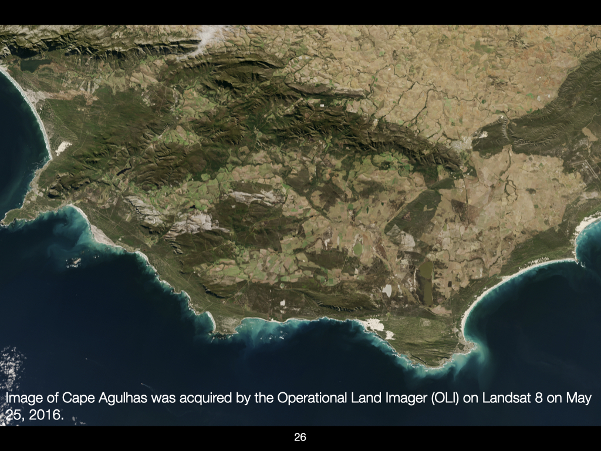](images/BDC334-026.jpeg "Slide 26")

Slide 26

Let us now look at an image of Earth’s surface. Ecology, in essence, is the study of patterns. Here, you can observe a patchwork of different colours — dark green, brown, grey — each representing distinct surface properties or vegetation cover (Slide 26).

For instance, the regions with dark green typically indicate dense, healthy vegetation — vast patches of green associated with the Western Cape. In other areas, browner patches mean the vegetation is more scrubby, sparse, or replaced with barren sand.

Macroecologists would ask: why is this patch green and that patch brown, sometimes only a few kilometres apart? Looking closely, greenness is often associated with coastal zones, particularly along the Garden Route and Western Cape. This is a function of atmospheric and oceanic patterns, especially the influence of the Agulhas Current. However, in some regions, especially inland, apparent greenness in satellite images may be attributable to intensive farming and land transformation, rather than natural processes. \[attention: Not every green patch is natural vegetation; some are vineyards, canola, or other agricultural fields.\]

If you zoom in, you can see a clear patchwork reflective of agricultural practices such as viticulture and other crops. Remaining tracts of natural fynbos are also visible, structured according to elevation: lush and green in valleys, but sparse and grey at higher altitudes — demonstrating how temperature and exposure control plant community composition even at relatively small spatial scales.

### 3.4.5 Using temporal data to track environmental change

Satellite data have been available daily since 1981. Comparing present-day maps to those from one decade ago, or two decades ago, reveals changes in landscape patterns. These shifts are mostly consequences of anthropogenic environmental modification: farming, deforestation, urbanisation, and fire. In some places, you can also observe temporary or seasonal phenomena like snow cover.

### 3.4.6 Integrating multiple types of environmental information

From a single remote sensing image, you can extract vast quantities of information — vegetation type, land use, altitude and topography, river catchments, coastal processes, and more. For example, wave action stirs up sand in the water, which appears milky blue or white from space, especially where long sandy beaches are present. Rocky areas have less suspended sediment, and thus appear darker in satellite imagery. Visible drainage lines indicate the position of rivers and the amount of water they transport.

At even finer scales, satellite imagery can be used to monitor fire scars and the impact of wildfire, as fires appear starkly in the imagery.

### 3.4.7 Biological productivity and the Agulhas bank

[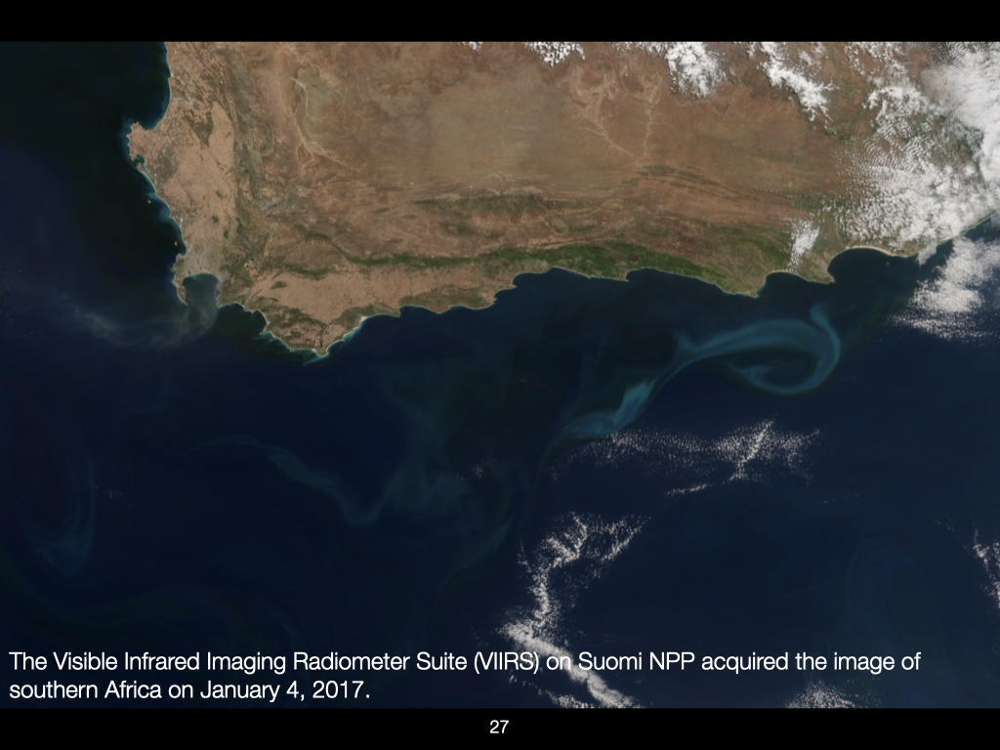](images/BDC334-027.jpeg "Slide 27")

Slide 27

Here’s another satellite image of South Africa. Again, there’s False Bay, and some white regions here are clouds, but look at these pale blue swirls in the ocean — these are areas of phytoplankton bloom. Interestingly, these blooms are restricted in location due to the dynamics of the Agulhas Current. Phytoplankton that drift into the Agulhas Current quickly get swept away, so their retention above the Agulhas Bank (Slide 27) — a region extending up to $200$ kilometres offshore but with a maximum depth of about $150$ metres — is especially significant for local productivity.

### 3.4.8 Infrared imagery and vegetation detection

[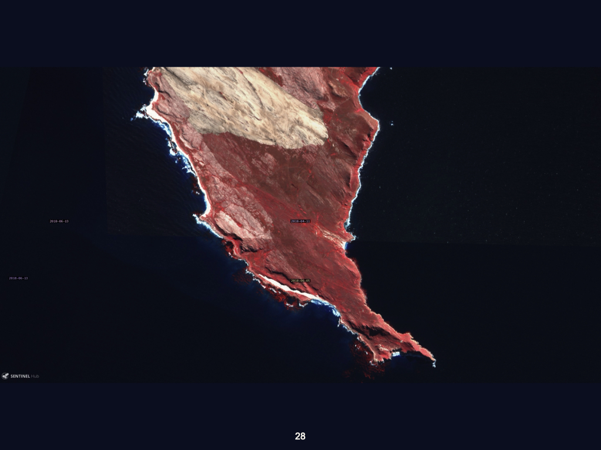](images/BDC334-028.jpeg "Slide 28")

Slide 28

Here, in an infrared image of the tip of the Cape Peninsula (Slide 28), you can clearly distinguish natural vegetation, which appears in red, from exposed bedrock and sand, which appear white. Off the coast, red patches indicate the presence of kelp beds and kelp forests, which are so large and dense they can be detected from space.

### 3.4.9 The macroecologist’s challenge

All of this information — vegetation types, land use, altitudinal patterns, wave exposure, kelp forests, riverine systems, and even the presence of fire — can now be accessed and analysed by macroecologists. Our task in this module is to understand how to use such data, and thereby to interpret how the physical environment structures patterns of life at a range of scales.

### 3.4.10 Assignment instructions

[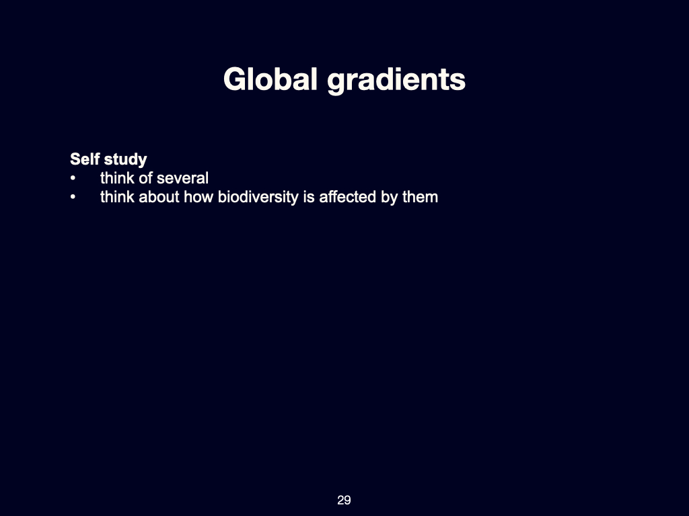](images/BDC334-029.jpeg "Slide 29")

Slide 29

To consolidate this material, select two or three examples of environmental gradients — some operating at local, others at regional, and others at global scales — and explain how they can structure biodiversity (Slide 29). Use this as preparation for the current assessment tasks listed in the [2026 BDC334 syllabus](../BDC334/BDC334_syllabus.llms.md#sec-policy); there is no essay assessment in 2026.

# 4 Biodiversity concepts

> **NOTE:**
>
> This material must be reviewed by BCB743 students in Week 1 of Quantitative Ecology.

> **NOTE:**
>
> It is important that you accompany your reading of this chapter with the material presented in [Lab 3](Lab-03-biodiversity.llms.md) and the online content on [Tangled Bank](Lec-04-biodiversity.llms.md).

## 4.1 Lecture 4a

### 4.1.1 Introduction to biodiversity

Today, we’ll be discussing the various concepts of biodiversity. This concerns how we quantify diversity, both in terms of which species are present and the proportions of those species existing within a particular habitat, environment, or ecosystem. The key concepts to focus on include $\alpha$-, $\beta$-, and $\gamma$-diversity — those are the three Greek-lettered types.

At its most basic, we use what are called univariate measures. That is, all the variety of plants, animals, and things that are neither plant nor animal can be condensed into a single measurement — one variable. That’s essentially what “univariate” means: one variable.

### 4.1.2 Univariate indices and overview

To make this clearer, let’s consider the UWC Nature Reserve — you know where it is. It contains a wide array of plants and animals, but all of that complexity can be reduced to a single measurement for alpha, beta, or $\gamma$-diversity.

Focusing specifically on alpha and $\gamma$-diversity, the univariate measurements commonly used are the Shannon and Simpson indices. These are the two most typical ways you’ll see alpha and $\gamma$-diversity quantified, and I’ll give more detail shortly on what those indices are and how they’re applied.

### 4.1.3 Alpha diversity

#### What is $\alpha$-diversity?

[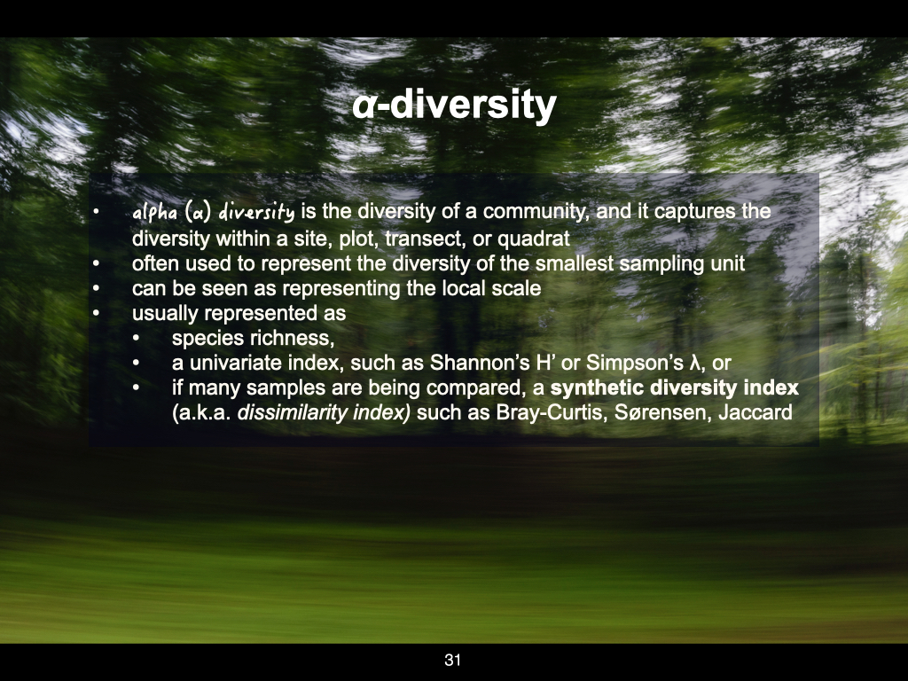](images/BDC334-031.jpeg "Slide 31")

Slide 31

Let’s look first in more detail at $\alpha$-diversity (Slide 31). $\alpha$-diversity is the diversity of a community, plot, habitat, or ecosystem at the smallest scale at which we measure. Returning to the UWC Nature Reserve example, if we wish to know what plants and animals are present, the standard approach in ecology is to lay down various transects or plots — also called quadrats — across the area.

Quadrats are simply small subsections or representations, essentially samples, of a much larger environment. We use a sufficiently large number of quadrats to try to capture the full range of biodiversity in a given place. $\alpha$-diversity, therefore, accounts for diversity at this very local, smallest scale.

#### How do we measure $\alpha$-diversity?

For example, if you place a single quadrat within the entire UWC Nature Reserve, that quadrat forms the basis for measuring or representing $\alpha$-diversity. $\alpha$-diversity is essentially biodiversity at the local scale, and there are three principal ways to express it:

1.  **Species Richness:**\
    The simplest measure is just counting the number of species present. For example, “There are $15$ species of plants and $12$ species of vertebrates” within the UWC Nature Reserve. At the smallest scale, this involves counting the number of plant and animal species within a single quadrat.

2.  **Indices (Shannon and Simpson’s):**\
    You can also use indices, such as the Shannon or Simpson index. These take into account not only the number of species (species richness) but also the abundance or “how much” of each species is present in your quadrat.

3.  **Dissimilarity Indices:**\
    A more complex way involves looking at all the quadrats placed within an area at once, quantifying differences between them. While species richness or the univariate indices often focus on the individual quadrat, you can compare every quadrat pairwise with every other to create a dissimilarity index. Common dissimilarity indices include Bray–Curtis similarity, Sørensen dissimilarity, and Jaccard dissimilarity.

Bear in mind, I’ll touch more on dissimilarity indices in another lecture. But for now, recognise that the synthetic diversity indices mean comparing every quadrat with every other, using a variety of metrics. Besides Bray–Curtis, Sørensen, or Jaccard, there are at least another $21$ such metrics or more.

#### Interpreting diversity metrics

It’s rather like measuring distance with a ruler. The ruler might be marked in centimetres, and in the same way, indices such as Bray–Curtis, Sørensen, Simpson, or Shannon are the “rulers” you use for biodiversity. The actual value you get is measured in units of that respective index, indicating biodiversity in quantifiable terms.

### 4.1.4 Beta diversity

[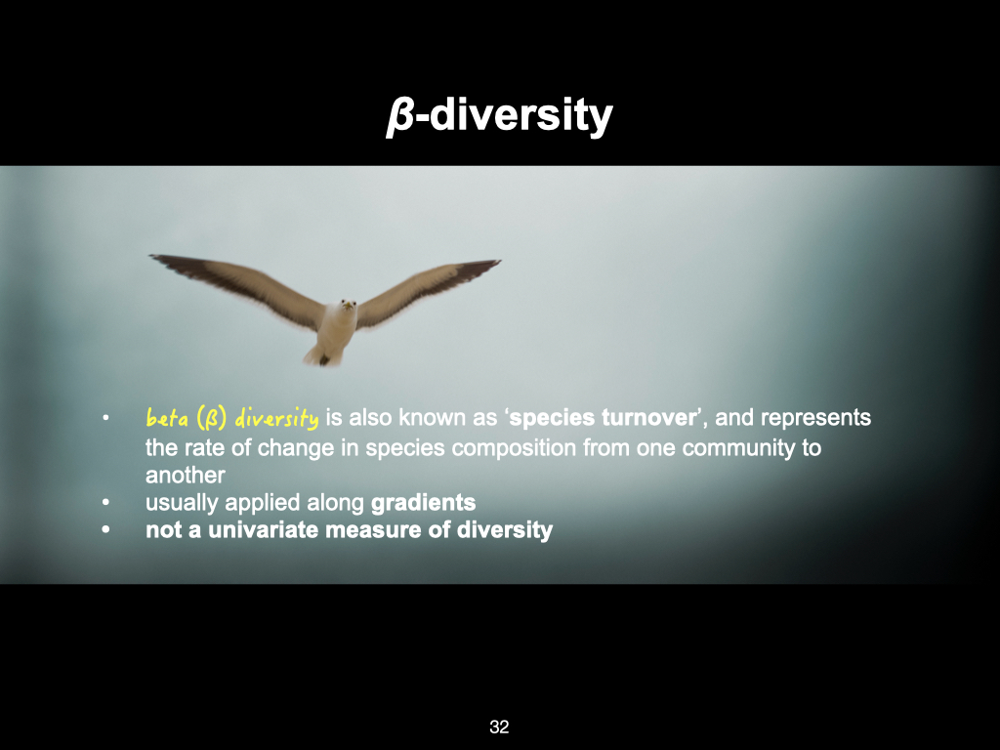](images/BDC334-032.jpeg "Slide 32")

Slide 32

#### What is $\beta$-diversity?

$\beta$-diversity, by contrast, is sometimes referred to as “species turnover.” It measures how different each quadrat placed within a habitat is from every other quadrat — essentially, the variation from place to place across the landscape (Slide 32). In this way, it quantifies heterogeneity — how communities differ from spot to spot.

#### $\beta$-diversity along gradients

To make this real, recall the example from last week: the temperature gradient along the east coast of South Africa. As you move from Sodwana Bay southwards, the temperature changes gradually. The further you go, the more the temperature differs from your starting point. As this physical variable changes, so too does the potential for different types of plants and animals to exist. Thus, species composition shifts along the gradient.

$\beta$-diversity works particularly well in these scenarios, where we measure community structure along environmental gradients. There is a paper I’ve uploaded to iKamva (and another associated one), which provides visual explanations for how environmental gradients influence $\beta$-diversity. Please make sure to look at those.

#### Summary on $\beta$-diversity

$\beta$-diversity is the second major measurement of biodiversity, highly useful for examining how quickly communities change along gradients. As the environment changes — temperature, rainfall, soil type, etc. — so too does the composition of plants and animals, and $\beta$-diversity allows us to quantify that change across the landscape.

## 4.2 Lecture 4b

### 4.2.1 Gamma diversity: the largest scale

[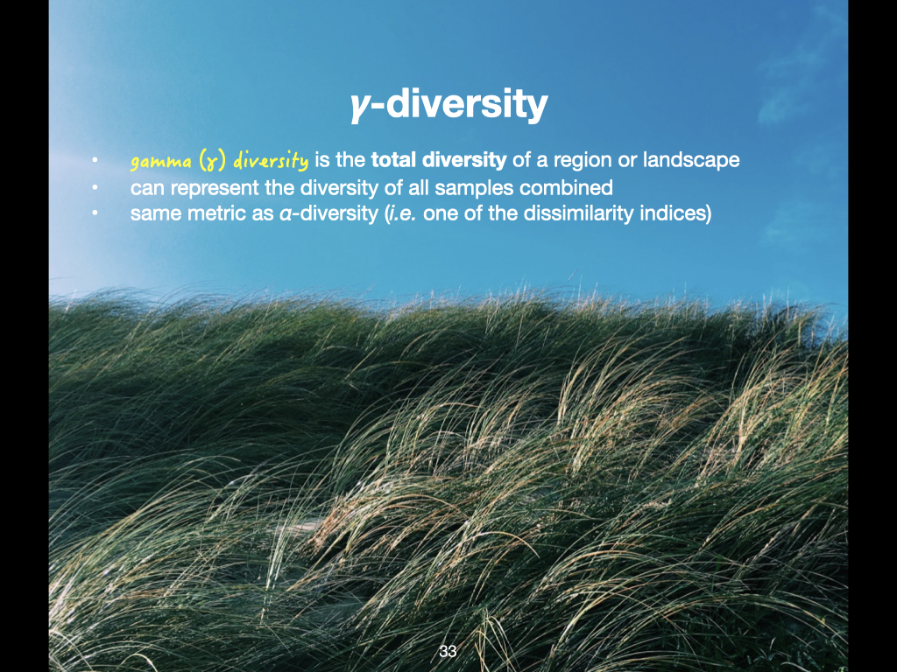](images/BDC334-033.jpeg "Slide 33")

Slide 33

At the very largest scale, the total amount of biodiversity is generally called $\gamma$-diversity (Slide 33). If we go back to our example of the UWC Nature Reserve, let us say we place one quadrat, and within that single quadrat, we find seven species of plants and two species of vertebrates. The total diversity for that quadrat would then be seven.

However, if we place multiple quadrats throughout the UWC Nature Reserve, with each new quadrat, we are likely to encounter new species. The more quadrats we place, the more species we will count, because species are distributed across the landscape. Thus, $\gamma$-diversity examines the diversity of the entire UWC Nature Reserve, and states that there are, for example, 23 species of plants and seven species of vertebrates across the whole reserve.

$\gamma$-diversity can also be considered at even greater scales. It can scale up to the entire planet, to all of Earth, at which point we might say that Earth has $X$ million species of organisms. So, the entire Earth represents the largest possible scale at which we can account for the total number of living organisms, or species of living organisms, present on the planet.

### 4.2.2 Local and regional scales

At smaller scales, a continent could be considered a sampling unit. As an example, Africa might have $X$ hundred thousand species of organisms, and South America another $X$ hundred thousand, depending on definitions and available data. In this context, the “local” scale could be a country, so if we look at species within South Africa, for example, that could be defined as $\alpha$-diversity.

$\alpha$-diversity and $\gamma$-diversity are both measures that can, in principle, apply to a very localised area. The largest possible extent of that localised environment, such as the outer boundaries of the UWC Nature Reserve, would count as $\gamma$-diversity for that smaller study. If the study is instead concerned with the whole planet, then the entire Earth is $\gamma$-diversity, and the continent, country, or region becomes the scale for measuring $\alpha$-diversity.

### 4.2.3 Defining the scales: researcher’s perspective

Whether we use alpha or $\gamma$-diversity depends very much on the research question. These terms are not fixed; as an investigator, it is up to you to define the minimum and maximum extents of your study. For example, if you are interested in the flora of the Western Cape, you would draw a boundary around the Western Cape and define your $\gamma$-diversity as all the species observed within those boundaries.

For $\alpha$-diversity in this context, you might look at the number of species present in Belleville, in Rondebosch, in Worcester, and so forth — each a different locality within your region of study. Hence, the use of alpha and $\gamma$-diversity depends entirely upon your definition and the scale at which your research is taking place. The concept is flexible, and is relative to the extent of your particular study — what is “$\gamma$-diversity” for one study may be “$\alpha$-diversity” for a larger study, and so forth.

### 4.2.4 Species richness

[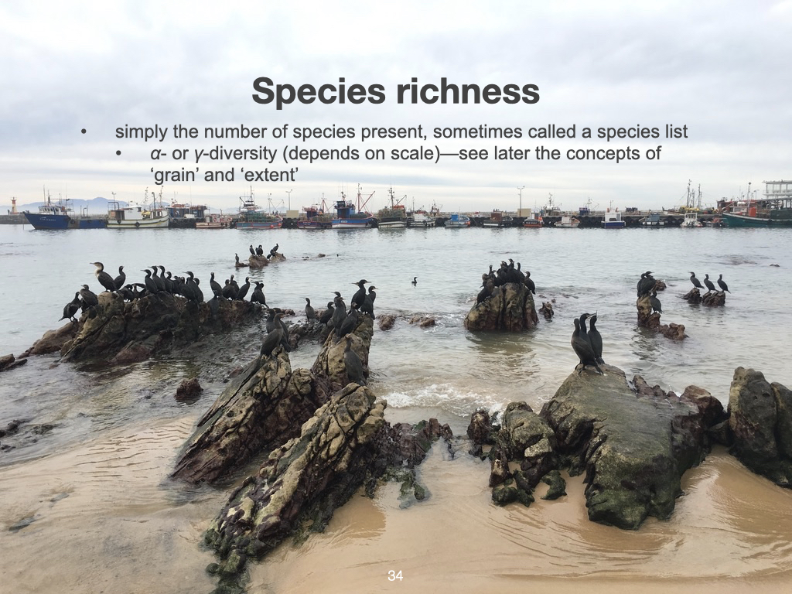](images/BDC334-034.jpeg "Slide 34")

Slide 34

Species richness is a term that brings us back to both alpha and $\gamma$-diversity (Slide 34). As I have mentioned before, species richness is simply the number of different species present. Measured at a small, highly localised scale, species richness gives $\alpha$-diversity. Measured across the full extent of your study region, species richness provides $\gamma$-diversity. Both are ultimately just a count of how many species are present.

[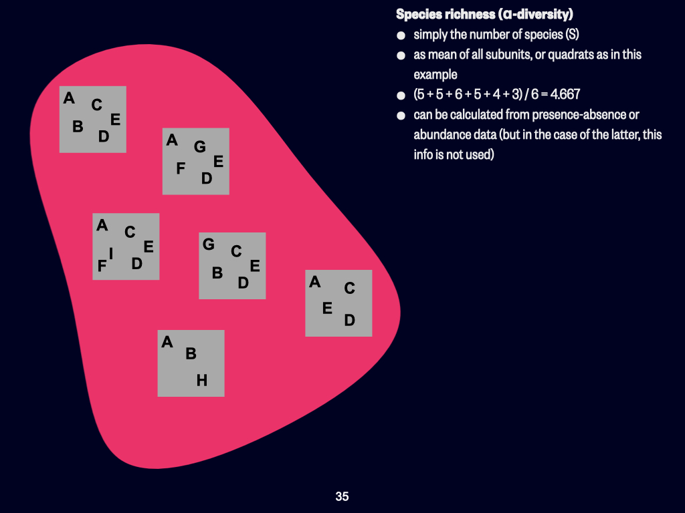](images/BDC334-035.jpeg "Slide 35")

Slide 35

Imagine a pink area, representing your total study habitat — this is your study area (Slide 35). You cannot count every single organism within this space, so you sample by placing quadrats (the grey squares), each representing a subset of the biodiversity present. If you deploy enough quadrats, your sampling will hopefully capture every species present in your study area.

For each quadrat, you tally up the number of different species present. For example, one quadrat might contain five species. Another might contain three. Some quadrats share species, others have unique species. Suppose you have six quadrats, and their species richness values are $5$, $5$, $6$, $5$, $4$, and $3$. To calculate the average species richness for the landscape, you simply find the mean:

$$\frac{5 + 5 + 6 + 5 + 4 + 3}{6} = 4.667$$

[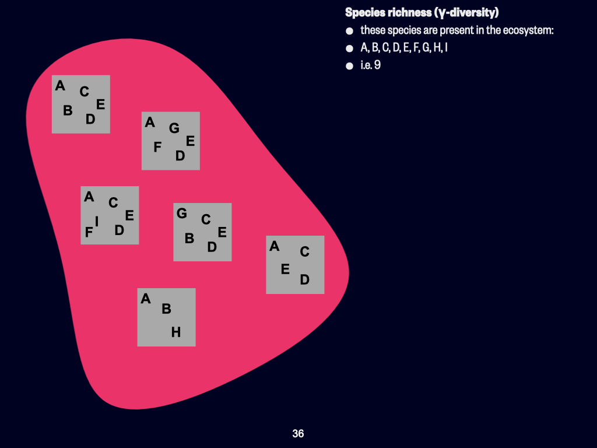](images/BDC334-036.jpeg "Slide 36")

Slide 36

This is your average species richness. At the largest scale, you simply count the unique species present across all quadrats. If, collectively, across all quadrats, there are nine unique species, then the $\gamma$-diversity for that region is $9$ (Slide 36).

### 4.2.5 Beta diversity: measuring variation

[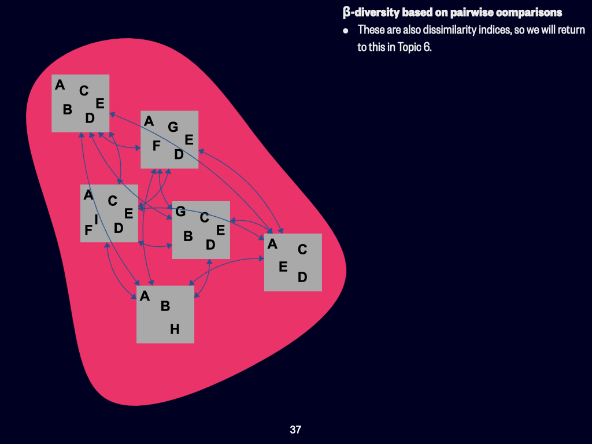](images/BDC334-037.jpeg "Slide 37")

Slide 37

Now let us move to $\beta$-diversity (Slide 37). $\beta$-diversity focuses on how different each quadrat is from every other quadrat; it measures turnover in species composition. For instance, if one quadrat contains species A, D, B, C, and E, and the quadrat next to it contains A, D, F, G, and E, you see that they share two species (A and D), but differ by three species each. Similarly, quadrats below or adjacent to one another can be compared in the same way.

To calculate $\beta$-diversity, you must compare every quadrat to every other quadrat — that is, for every possible pair of quadrats, you calculate the number of shared and unique species. This results in a table of dissimilarity values (a dissimilarity index), where each value shows how different one quadrat is from another.

We will discuss dissimilarity indices and how to interpret them in detail in a later section of the module, where I shall provide some pre-calculated examples for you to practise with.

The important point is that the landscape is almost never perfectly homogeneous. For example, perhaps most quadrats have species A (present in five quadrats) but not all. Species B might be present in three quadrats, not everywhere else, and so on. In general, almost every quadrat will be at least slightly different from the next. $\beta$-diversity captures the amount of this variation, or heterogeneity, in your study landscape.

[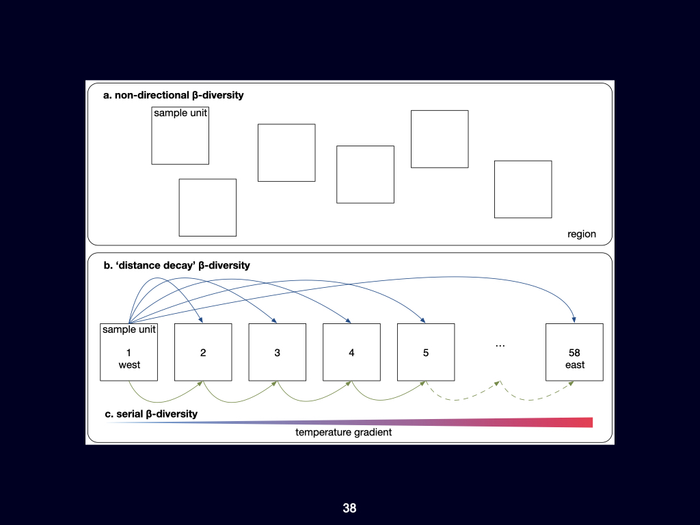](images/BDC334-038.jpeg "Slide 38")

Slide 38

Okay, continuing with our example of $\beta$-diversity, there are two different ways in which we can approach $\beta$-diversity (Slide 38). One is, as shown in the top panel — Slide 38 (a) — we assume that there is no spatial relationship between one sampling unit and the next. So, they are unordered across the landscape. This is the typical inference we can make about biodiversity: we compare every unit to every other unit. This is similar to the previous illustration in the earlier slide we saw.

However, if we take a more structured approach to how we measure $\beta$-diversity across the landscape — looking at the bottom panel, panels (b) and (c) — we see that the sampling units are arranged in a logical order. In this example, they are spatially arranged in increasing distance from the west of the country.

This is the example of the seaweed data in Smit et al. (2017): site number one (sampling unit one) is in the west, and we move all the way to sampling unit number 58, which is situated far to the east.

Now, if we take one sampling unit — for instance, sampling unit number one in the west — and use that as the reference unit (it remains constant, fixed in the west), we can then compare it to sampling unit number two, next to it. We’ll see that the difference in biodiversity between one and two is going to be quite slight, because the spatial distance between those two units is only about $50\mathrm{km}$ or so.

If we compare sampling unit number three to sampling unit number one, the spatial distance increases to about $100;\mathrm{km}$, so there’s a slight increase in the $\beta$-diversity between those two pairs of sites. Next, we compare site number five, which is about $200;\mathrm{km}$ further to the east, to site number one. In this case, the change in dissimilarity between one and five is a bit greater.

So, the larger the distance becomes between a pair of sites, the greater the change in the underlying environmental variables due to the environmental gradient along the coast. Consequently, the species dissimilarity also increases. The greater the distance between a pair of sites, the more dissimilar they become.

By the time we reach section number 58, far to the east, the distance between sites one and 58 is about $2{,}700$ to $2{,}800 \mathrm{km}$. The environmental conditions in the subtropical northeastern part of South Africa are very different from the cold temperate conditions in the western part of the country. Consequently, the species diversity is also vastly different. Virtually no species are in common between sites one and 58. In contrast, when comparing sections one and two, or sections one and three, because they are closer together, the environments are more similar, and more species will be in common.

This approach, which I’ve just explained, is called distance-decay $\beta$-diversity.

Serial $\beta$-diversity takes another approach — shown in portion (c) of the figure. In this approach, we compare section one with section two: the difference in $\beta$-diversity is slight. Then section two to section three — again, a slight difference. Section three to section four — still very small.

If we take the cumulative dissimilarities between every consecutive pair of sites in the sequence from west to east, we find that the overall $\beta$-diversity is the same as the difference between site one and site 58. So, the sum of consecutive pairwise comparisons adds up (more-or-less) to the total $\beta$-diversity measured across the entire distance between sites one and 58.

### 4.2.6 Heterogeneity and homogeneity

Heterogeneity refers to variability or difference — if a landscape is highly heterogeneous, it features a high amount of variation from place to place. The opposite is homogeneity, where conditions or communities are uniform throughout the study area. Very few natural landscapes are perfectly homogeneous; most exhibit moderate heterogeneity, which can be measured and interpreted via $\beta$-diversity.

### 4.2.7 Summary: distinguishing alpha, beta, and gamma diversity

In summary, you should remember the distinctions among $\alpha$-, $\beta$-, and $\gamma$-diversity:

- $\alpha$-diversity is typically measured at the smallest sampling unit within your study area.
- $\gamma$-diversity is the total number of unique species present within your whole study area or landscape.
- $\beta$-diversity is the amount of variation or difference in species composition among the various sampling units (quadrats) within the landscape.

Defining these scales and diversity measures is essential for meaningful biodiversity studies, and the way you decide to structure them will depend upon your research aims and the boundaries you set for your particular study.

## 4.3 Lecture 4c

### 4.3.1 Introduction to selecting diversity measurements

[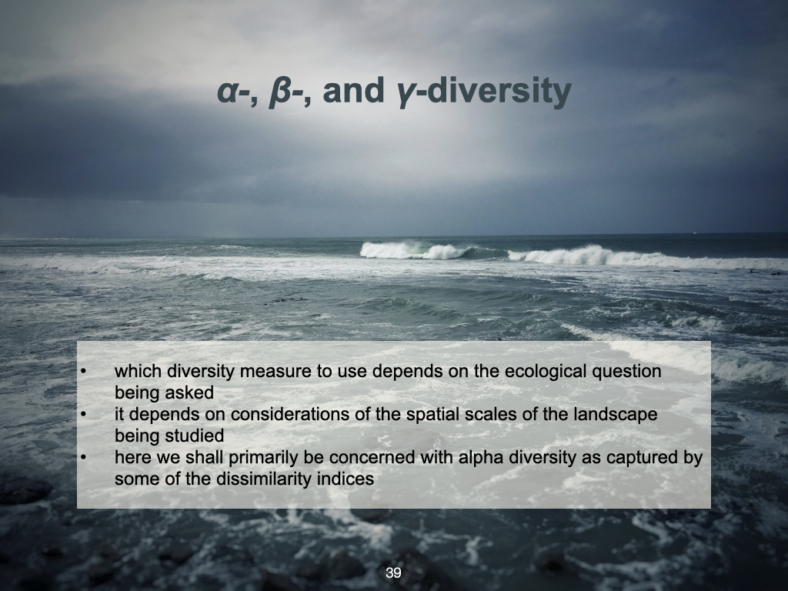](images/BDC334-039.jpeg "Slide 39")

Slide 39

Which of these various different measurements of diversity we use, is going to depend on your specific question (Slide 39). As you are ecologists, or training to become ecologists, it is up to you to decide what the question is that you wish to ask about the landscape you want to study. One day, when you are professional ecologists, you will decide which landscape to study, for what reason, what the total extent will be, and whether a small $2\;\mathrm{m} \times 2\;\mathrm{m}$ quadrat, or a smaller $30\;\mathrm{cm} \times 30\;\mathrm{cm}$ quadrat, would be more appropriate for your sampling.

You will define the scales at which you apply the terms $\alpha$-, $\beta$-, and $\gamma$-diversity, as well as the amount of variation within the total landscape — the area for which you calculate $\gamma$-diversity. The variation within that landscape is $\beta$-diversity, but again, the choice of spatial scale and focus is dependent on you, as researchers.

So, in designing any particular research project, there are many questions around spatial scales that you must consider as part of the experimental design process. This will result in the structure within which you sample the environment — a structured way to obtain the data you need to make a proper assessment of ecological diversity.

### 4.3.2 Overview of diversity indices

[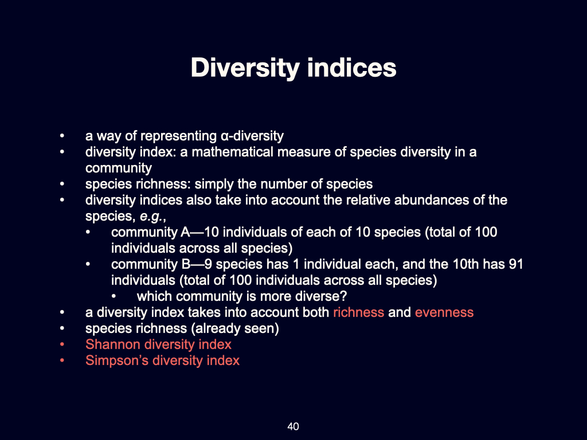](images/BDC334-040.jpeg "Slide 40")

Slide 40

The diversity indices, as I have mentioned before, are simply ways of representing species diversity (Slide 40). Let us return to $\alpha$-diversity as an example. The simplest way to measure $\alpha$-diversity is to calculate species richness — that is, to record how many species are present within a small sampling unit.

However, landscapes are not only defined by a simple list of species. of course, it is important whether a species is present or absent, but another essential consideration is how much of each species is present in the sample. For example, consider two communities, two different habitats. Both have 10 species present, so in terms of species richness, both community A and community B are equal: $10$ and $10$.

But in community A, there are $10$ individuals of every species — an even distribution. In community B, there is only $1$ individual of each species from $1$ to $9$, but species $10$ has $91$ individuals present. So, although both communities have identical lists of species, they differ substantially in terms of the abundances of those species.

This is where diversity indices for $\alpha$-diversity become important. These indices take into account both the number of species (species richness) and the relative abundance, or number of individuals, of each species. The two most common ways we represent or express diversity as a function of species richness and abundance are through diversity indices: the Shannon diversity index and the Simpson’s diversity index. Each of these has a particular equation to calculate their values, but the software we use typically performs the computation for you.

### 4.3.3 Calculating diversity indices

Some exercises require you to calculate these indices by hand so that you understand their components. Other calculations use the software specified in the relevant 2026 Lab.

I shall give you, as an exercise later in the week, some sets of diversity data and ask you to calculate these indices yourselves, by hand.

[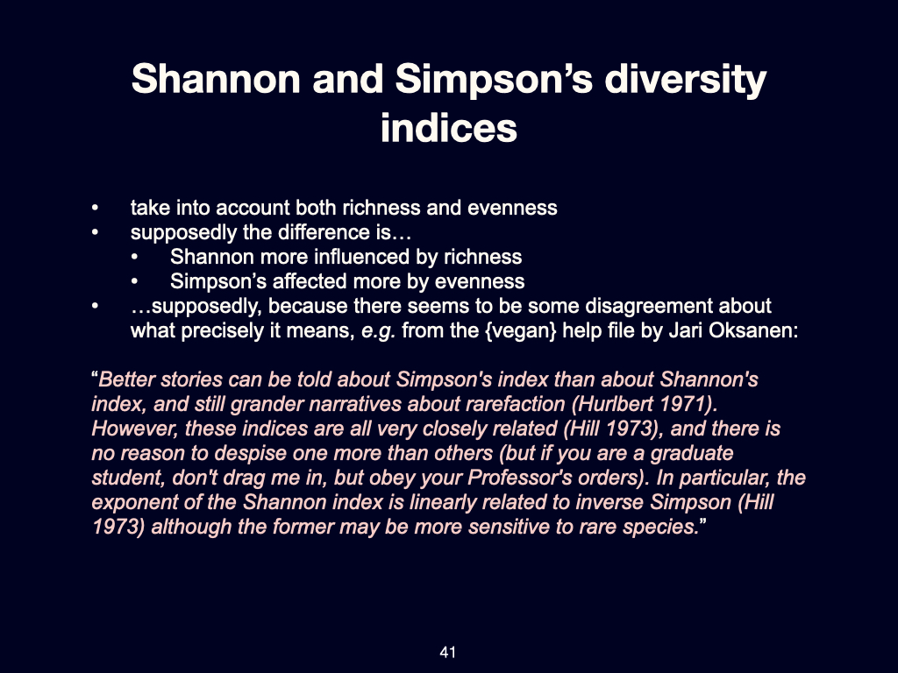](images/BDC334-041.jpeg "Slide 41")

Slide 41

Now, the two indices — Shannon’s and Simpson’s — differ slightly, although there is ongoing debate about precisely how much they differ and in what aspect (Slide 41). Many people say that Shannon’s diversity index favours species richness. That is, it puts more emphasis on place-to-place differences that result from the number of species present. Simpson’s index, by contrast, is said to be more important in contexts where the number of individuals per species varies greatly across the landscape.

But as I noted, there is much debate as to which index is preferable. There is even a slide, or paragraph from the software we use, which states: “Better stories can be told about Simpson’s index than about Shannon’s index, and still grander narratives about rarefaction.” (Rarefaction is yet another way of considering species diversity.) However, all these indices are closely related, and there is no reason to prefer or despise one over the others. The same paragraph, however, gives a word of advice: “If you are a graduate student, do not drag me in, but obey your professor’s order.” So, at the end of the day — whether you use Simpson’s or Shannon — much will depend on the preferences of your future supervisors. Everyone has their own opinions. In my personal view, it makes little difference; they are, in fact, linearly related to one another. Still, please do listen to what your supervisor says.

### 4.3.4 Structure of diversity data

[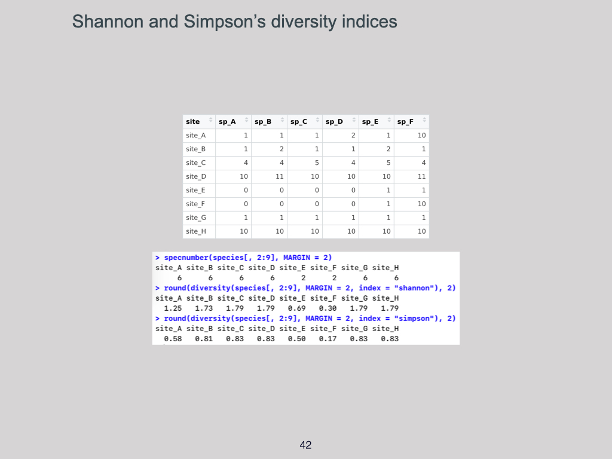](images/BDC334-042.jpeg "Slide 42")

Slide 42

Let us return to the matter of how these indices are calculated. The essential thing to learn now is how your data should be structured when entering it into the computer for analysis.

Typically, we enter all the various places (the sites or quadrats) along the rows, and the species — by name — along the columns (Slide 42). The numbers in the table represent the abundance: for example, species A at site A, there is one; species B at site C, there are four; species B at site D, there are eleven; and so on.

Species richness is easy to calculate using this structure: for any site, simply count how many columns (species) contain a positive number. For instance, site A might have six species present (species richness = $6$), as might site B. Importantly, the abundance — that is, the actual number of individuals per species — is not considered when calculating species richness.

But the Shannon-Wiener index does take these abundances into account, as does the Simpson’s index. For example, the Simpson’s index emphasises sites with higher evenness of abundance between species: if, for an area, only two species are present and the others have zero, you will get a low Simpson’s diversity value. Conversely, if the abundances are more evenly distributed among species, the Simpson index value is higher.

Evenness refers to how similar the abundances of the different species are: a site where all species are represented by roughly equal numbers of individuals has high evenness; a site where one species dominates and the rest are rare has low evenness.

Please familiarise yourselves with the process of working out these indices using sample tables. I will provide some examples for you to work through. Normally, we would use software — “R” in our case — to calculate these indices, but for now, manual calculation will suffice. If you go on to Honours next year, you will have the opportunity to catch up with the R software then.

### 4.3.5 Application to South Africa: example using Simpson’s index

[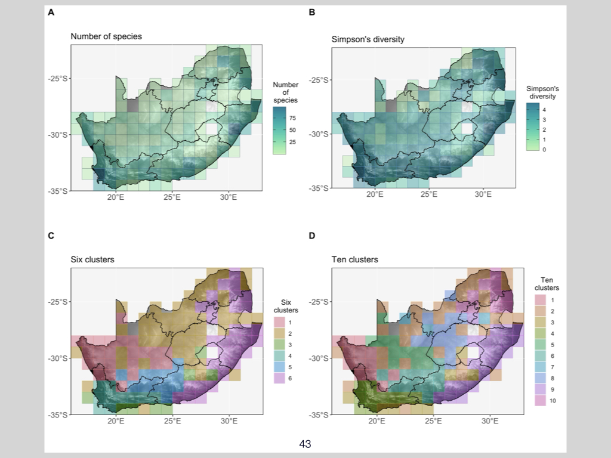](images/BDC334-043.jpeg "Slide 43")

Slide 43

Here is an example where I have applied Simpson’s diversity index to various places in South Africa (Slide 43). If South Africa represents the area for which we define $\gamma$-diversity, then each square or quadrant on the map represents an area where we calculate $\alpha$-diversity.

The number of crickets present per area has been plotted across South Africa, and you can see that dartker colours indicate areas with higher cricket abundance. These numbers — or rather, the diversity indices calculated from them — show substantial variation across the country. The most diverse areas appear in Limpopo and along the coast, particularly in northern KwaZulu-Natal, where evenness is also highest.

Whereas in other areas, especially inland, there are many more locations with low diversity and a few with significantly more individuals of particular species. Along the coast, most species are fairly evenly represented.

With this sort of information, we can begin to classify South Africa into regions that share similar levels or patterns of diversity, in terms of both the type and presence/abundance of species. This is the value of using these diversity indices — a starting point for further analyses. The kind of calculation I have described here is known as clustering analysis. It is not covered in BDC334, but it illustrates a potential future application.

Such analyses can be useful on their own, as they visually reveal the different diversity patterns present across a region.

### 4.3.6 Reading and administrative notes

[](images/BDC334-044.jpeg "Slide 44")

Slide 44

A reminder: I have given you two papers to read — “What is Macroecology?” and “Macroecology to Unite All Life, Large and Small” (Slide 43). You should have read and understood both, as last week was allocated for that reading. The assumption is that you now understand everything covered in those papers, otherwise you would have asked by now. That opportunity has passed.

For this week, you have additional reading around ecological gradients: (1) “Distance, Decay of Similarity in Biogeography and Ecology” by Jeffrey Nicola, and (2) “Seaweeds in Two Oceans: Beta Diversity” by myself. Please read these two papers this afternoon.

You are welcome to make an appointment with me, preferably in groups of three or four or more, if you have questions about these two papers. Use the scheduled classes and on-request Wednesday periods shown in the [2026 timetable](../BDC334/BDC334_syllabus.llms.md#timetable).

# 5 Multivariate data

> **NOTE:**
>
> This material must be reviewed by BCB743 students in Week 1 of Quantitative Ecology.

> **NOTE:**
>
> Accompany your reading of in this chapter with the material in [Lab 1](Lab-01-introduction.llms.md), [Lab 2b](Lab-02b-env_dist.llms.md), and [Lab 3](Lab-03-biodiversity.llms.md).

## 5.1 Lecture 5a

### 5.1.1 Introduction

We’re going to look at the multivariate nature of ecological data. Last week, I spoke about how to go about collecting samples of species from a particular landscape or habitat, using the UWC Nature Reserve as an example.

### 5.1.2 Types of ecological data

[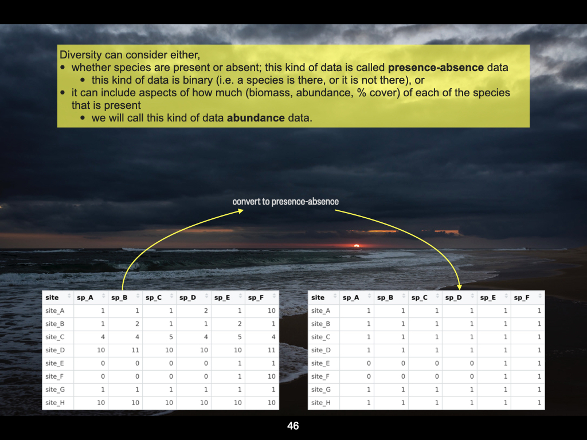](images/BDC334-046.jpeg "Slide 46")

Slide 46

The kinds of data we can obtain from a place like the UWC Nature Reserve include a collection of quadrats, which I’ve labelled here as ‘site A’ to ‘site H’ — so there are eight of them (Slide 46). At each site, for every one of the quadrats we place on the landscape, we count the number of species present.

For instance, in this example, site A has six species present, while site E has only two species present. The zeros indicate that none of those particular species were present.

Now, these two sets of data tables — the one on the left and the one on the right — are more or less identical in that they represent the same samples. The difference is that the table on the left, in addition to indicating whether a species is present (a ‘1’) or absent (a ‘0’), also shows, if a species is present at a particular site, how much of the species is present — for example, its abundance, biomass, percentage cover, and so on. If it is not present, there will be a zero. Wherever there is a ‘1’ on this particular table, on the left, the ones could be any number greater than zero, indicating how much of that species is present.

The table on the right simply shows a ‘1’ to indicate presence and a ‘0’ for absence. This is what we call presence-absence data.

So, the left-hand data type is called abundance data, and the right-hand side is presence-absence data. On the right, we only know whether a species is there or not. On the left, if a species is present, we also know how much of it is present. This is a critical distinction you need to keep in mind.

You’ll encounter both of these data types as we progress through the module.

### 5.1.3 Determining similarity between sites

Today, the goal is to determine how similar various places are to each other, especially regarding their species composition.

Let’s refer back to the earlier slide. We can see that certain sites are more similar to others but in different ways. In the first instance, two sites could be similar because they share the same species. For example, both site A and site B each have species A, B, C, D, E, and F. The difference between site A and site B is primarily due to species F, where site A has much more of species F compared to site B.

So, overall, there are two main reasons why locations can be similar or different. The first is that they share the same species, and the second is that, even if they share species, the abundance of each species is unequal; one place may have more individuals of a species, while another has fewer, and so on.

Another kind of difference comes when, say, comparing site D and site E: site E may have only two species that are also present in site D, whereas site D has four other species present not found in site E. Sites might therefore share some species, differ in others, or have uneven abundances of shared species.

So, as an ecologist, it’s your job to determine i) how some sites differ from other sites (this is called their *structure*, that is, differences in species composition and/or differences in their abundance), and ii) what the explanations are for how particular places differ from one another in terms of community structure — such explanations might be some properties of the environment, various stochastic or other neutral influences, or biological interactions.

### 5.1.4 Reasons for differences in communities

Communities differ from place to place for at least four reasons:

1.  **Environmental differences:** The environment may be different at the two places. For example, one environment may be too warm, excluding species that prefer colder temperatures. Environmental differences may explain why community compositions vary.

2.  **Neutral theories:** If the differences are not due to the environment, they might be due to other factors, such as species’ ability to disperse across the landscape, historical events that shaped the community, or random processes that affect species’ presence and abundance. These are often grouped under neutral theories.

3.  **Unmeasured influences:** If it’s not due to the environment (or not the part we measured) or neutral explanations, there might be other unaccounted or unknown influences. These are unmeasured factors for which we can pose hypotheses for further research and data collection.

4.  **Random noise:** Alternatively, differences may simply be due to random noise, stochastic events, or measurement inaccuracies that obscure genuine patterns.

So, understanding community differences involves asking whether differences are due to measurable environmental factors, unknown influences, or just random variation. Analysing the data helps narrow down which of these is most likely.

In this module we will specifically focus on environmental differences as reasons for why communities are structured differently across space. We call this spatial patterning, and the reasons responsible for generating the spatial patterning are the processes that lead to *community formation*. When we talk about environmental differences as the reasons for explaining those spatial patterns, we are primarily interested in the gradients that are present and ubiquitous all over Earth’s surface.

It is because of the unimodal model that species develop local abundances in regions along the gradient where conditions are most suited to their well-being, their growth, their survival, their reproduction, and their fitness. These kinds of models that use the environment, and specifically environmental gradients, to explain where things are most abundant, and which then result in the patterning across space, are called the *niche differentiation theory*. But there are other explanations too, as we will see below.

In contrast to this niche differentiation theory, we also have *neutral theories*. The neutral theories are an opposing set of hypotheses. People take these types of explanations quite seriously, as a counterpoint to the environmental filtering explanations. Often, these neutral theories include properties of the species in terms of their ability to disperse across landscapes. In other words, whether species are very mobile, or whether they are limited to a small spatial extent over which they are able to disperse. There are various other aspects, too, such as stochastic events, which might come into play, or there may be historical legacy events — historical reasons for why species became abundant at a particular place and not elsewhere. Most of these things are typically grouped under the neutral theories.

In BDC334 and next year when you do Quantitative Ecology, it is mostly the environmental gradients that I find interesting and useful for explaining many of the properties of the environmental and the species data sets that we deal with. of course, we can use those same data sets to extract an understanding about the neutral theories too, but it is just that gradients provide a very convenient, a very graphical explanation for how species become arranged in space. Also, I think it speaks more personally to my own preference, as gradients more readily offer explanations for where species are, and how communities are structured in space.

of course, after we have accounted for the niche differentiation theories or the neutral theories, there will always be a certain amount of unmeasured, unexplained variation that none of the theories, none of the hypotheses, can address — none of them are suitable. This means that there is still some *residual structure* in the data for which we do not have explanations. Often, we ascribe these to random variations from place to place, but it might as well be that we simply do not have an explanation for these things because we have not measured the correct properties of the environment, or the correct properties of species interactions, that may have resulted in this residual patterning.

### 5.1.5 Data representation: distance, similarity, and dissimilarity matrices

In ecological studies, we will use data collected about properties of the environment, as well as data collected about the species within the environment. Typically, what we do when we sample the environment (to understand the structure of ecological communities) is to identify some local areas where we wish to measure environmental properties. At those same locations where we measure these environmental properties, we will also want to record the species composition and abundance.

So, across a landscape, for instance, we might distribute our sampling units at random, or, if our hypothesis requires it, we might structure our sampling units in a much more systematic manner. Regardless of whether sampling is random or systematic, we will use quadrats, transects, photographic surveys, or any of the various available sampling techniques — the critical point is that, wherever we collect environmental data, we must also match those environmental data with species data at the same place.

Our environmental data could include any property of the environment such as soil characteristics, humidity, daytime or night-time temperature, or pH — essentially, any kind of property we suspect may influence the occurrence of species at a given site. We then take these data and enter them into a spreadsheet. For each environmental condition we sample, we assign a column in our spreadsheet. For each place or site we sample, we arrange these down the rows of the spreadsheet. This is called a site × environment data table, where each row corresponds to a location and each column corresponds to an environmental variable.

In parallel with the environmental data, we have the species data. This will be set out in a similar fashion in a new spreadsheet, separate from the environmental table: here, each row again corresponds to a location where species data were collected, and each column represents a species.

Since we have collected environmental data at precisely the same sites where species data were gathered, the number of rows in the species data table will be equal to the number of rows in the environmental data table. I refer to these as raw data tables: **environmental tables** and **species tables**. From these environmental and species tables, we develop new data sets called **matrices**. These matrices will then be used to compare sites across the landscape, assessing how similar or different they are in terms of the species present or the environmental conditions found there.

[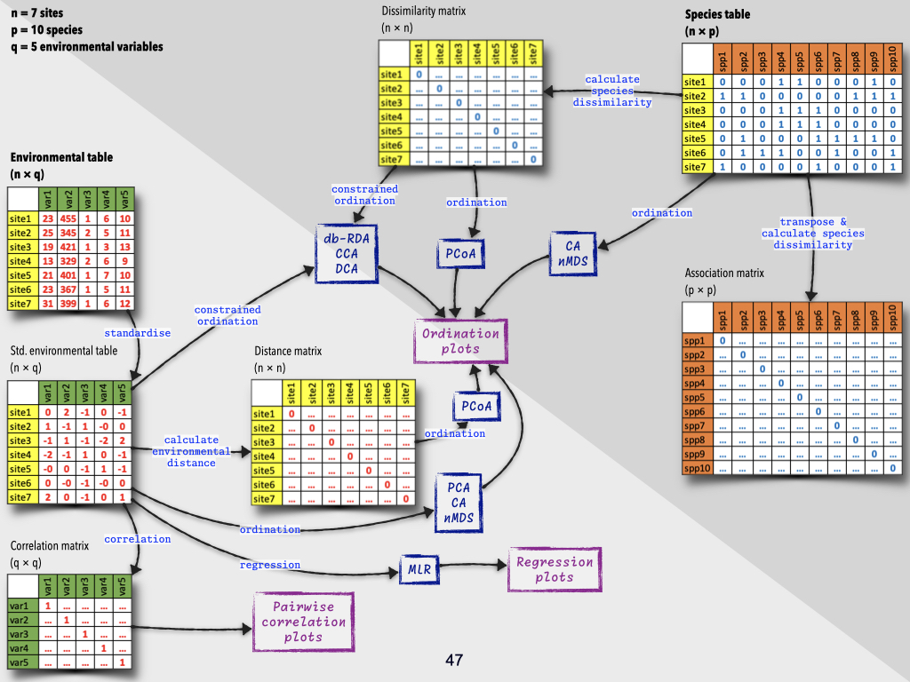](images/BDC334-047.jpeg "Slide 47")

Slide 47

[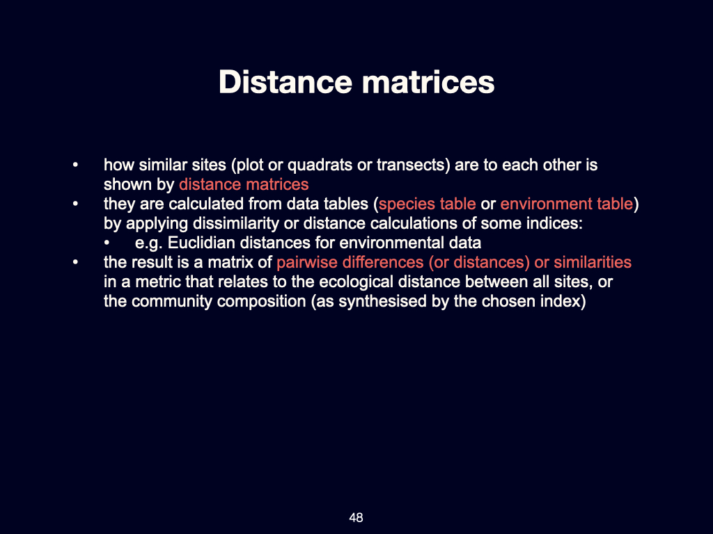](images/BDC334-048.jpeg "Slide 48")

Slide 48

[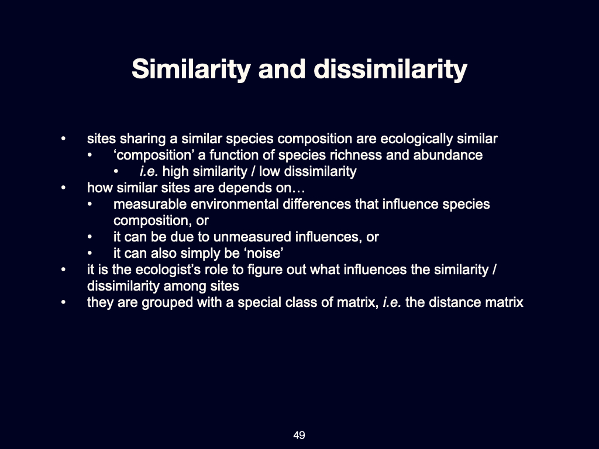](images/BDC334-049.jpeg "Slide 49")

Slide 49

[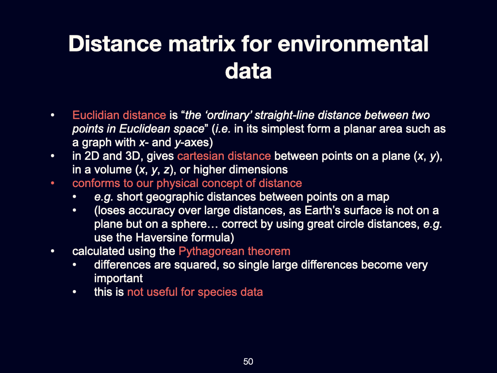](images/BDC334-050.jpeg "Slide 50")

Slide 50

[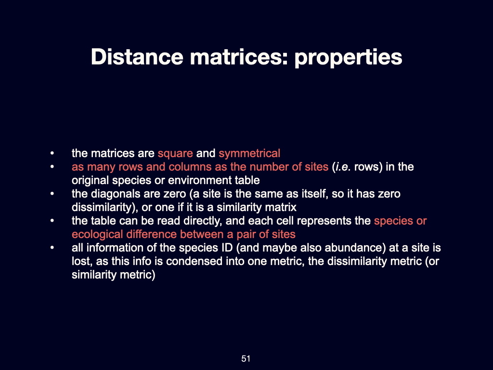](images/BDC334-051.jpeg "Slide 51")

Slide 51

The different kinds of data for comparing places — be that similarities in species presence or differences in environmental variables — can be represented as distance matrices, more specifically, similarity or dissimilarity matrices (Slides 47-51).

When discussing environmental or species differences, we use distinct types of matrices. Broadly, each matrix is a distance matrix, but the way we calculate distance depends on the type of data.

- For **environmental data** (e.g., temperature, humidity, soil type), we use an **actual distance measure**, typically the **Euclidean distance**.
- For **species composition data** (abundance or presence-absence), instead of Euclidean distance, we use similarity/dissimilarity indices such as **Bray-Curtis**, **Sørensen**, or **Jaccard indices**.

So, just to recap: environmental data includes things like temperature, humidity, depth, light intensity, soil and nutrient composition, and so on; all the things we measure about the environment which might explain community differences. Species data is what species are present or absent, and potentially, how much of each species is present.

From both, we can calculate distance matrices:

- Environmental data $\rightarrow$ **Euclidean distance**
- Species data $\rightarrow$ **Bray-Curtis**, **Sørensen**, **Jaccard**, etc.

These matrices represent the pairwise differences between each pair of sites.

### 5.1.6 Pairwise comparisons

By ‘pairwise’, I simply mean comparing every site to every other site.

So, for example, site A is compared to site B, site A is compared to site C, site A is compared to site D, site E to site C, site G to site F, and so forth. For each pair, we calculate how similar or dissimilar they are, for both environmental and species data, using the appropriate metric.

There are many dissimilarity indices you can use for species data, and you’ll see some examples in class. But the principle is always the same: you calculate the similarity or difference for every possible combination of pairs.

The result is a matrix where every entry shows the similarity or difference between one site and another.

### 5.1.7 Calculating Euclidean distance

[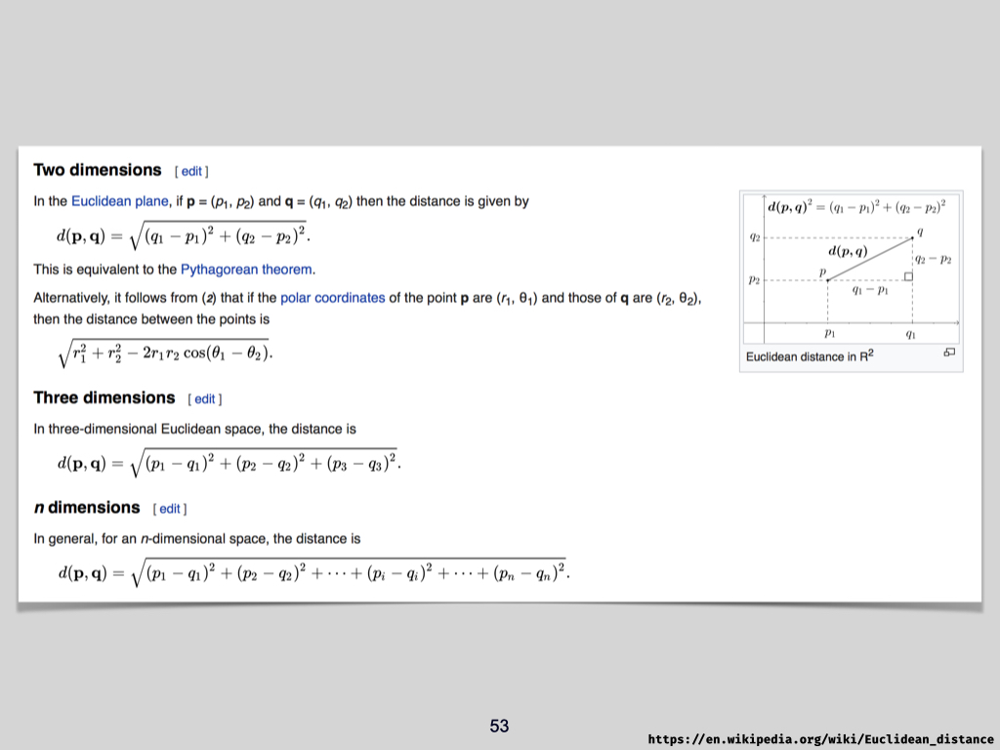](images/BDC334-053.jpeg "Slide 53")

Slide 53

So, how do we actually calculate Euclidean distance, which is the main way we measure how different our environmental samples are from each other (Slide 53)?

Euclidean distance is the direct, straight-line measure between two points. Imagine plotting two points on a coordinate plane with x- and y-axes; each point has an x-coordinate and a y-coordinate. The straight-line, or shortest, distance between the two points is the Euclidean distance. The unit of this distance is the same as the unit used for the axes.

If both the x- and y-axes are measured in centimetres, then the diagonal (shortest) distance between your two points will also be measured in centimetres. This is sometimes called Cartesian distance.

You can extend this idea to three dimensions — for example, x, y, and z — with the Euclidean distance representing the straight line between two points in three-dimensional space.

But you are not limited to two or three dimensions. Ecological data is often ‘multi-dimensional’ because for each site we may have ten, twenty, or even a hundred environmental variables (dimensions) measured. Humans can’t visualise more than three dimensions, but mathematically, calculating the Euclidean distance between points with many dimensions works just the same.

Euclidean distance aligns with our intuitive sense of “distance” when we’re talking about physical or geographic space, but in the context of ecological data, it reflects how different or similar environmental samples are, based on the variables we’ve measured.

### 5.1.8 Applying the Pythagorean theorem

To calculate Euclidean distance, we use the Pythagorean theorem, which you should remember from secondary school mathematics.

Suppose you have a two-dimensional graph (your y-axis is vertical, x-axis is horizontal) and two points, P and Q.

- Point P is at coordinates $(P_1, P_2)$.
- Point Q is at coordinates $(Q_1, Q_2)$.

To calculate the straight-line (Euclidean) distance between P and Q:

1.  Find the difference in $x$ between $Q$ and $P$: $Q_1 - P_1$.
2.  Find the difference in $y$ between $Q$ and $P$: $Q_2 - P_2$.
3.  Square both differences: $(Q_1 - P_1)^2 + (Q_2 - P_2)^2$.
4.  Take the square root: $\sqrt{(Q_1 - P_1)^2 + (Q_2 - P_2)^2}$.

That’s your Euclidean distance.

If you have three dimensions, say $x, y,$ and $z$, you simply extend the equation:

$$\sqrt{(Q_1 - P_1)^2 + (Q_2 - P_2)^2 + (Q_3 - P_3)^2}$$

And for $n$ dimensions, you generalise:

$$\sqrt{\sum_{i=1}^{n} (Q_i - P_i)^2}$$

So, it’s straightforward. For as many variables as you have, just extend the formula, square the differences for each corresponding variable, sum them, and take the root.

### 5.1.9 Worked example

[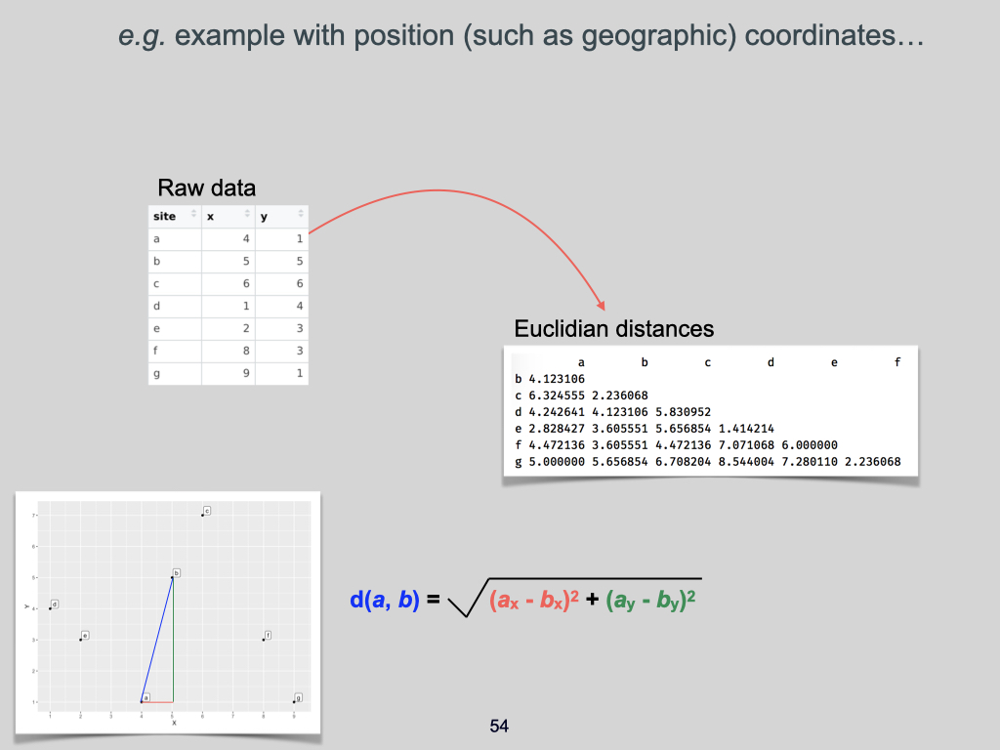](images/BDC334-054.jpeg "Slide 54")

Slide 54

Imagine our sites and their coordinates. Each site has an $x$ and $y$ coordinate (Slide 54). For instance:

- Site A: $(2, 1)$
- Site B: $(3, 5)$

The difference in the $x$ dimension between A and B is $3 - 2 = 1$, and in the $y$ dimension is $5 - 1 = 4$.

So the Euclidean distance between A and B is:

$$\sqrt{1^2 + 4^2} = \sqrt{1 + 16} = \sqrt{17} \approx 4.123$$

You would repeat this process for every pair of sites, filling in the matrix of pairwise distances.

[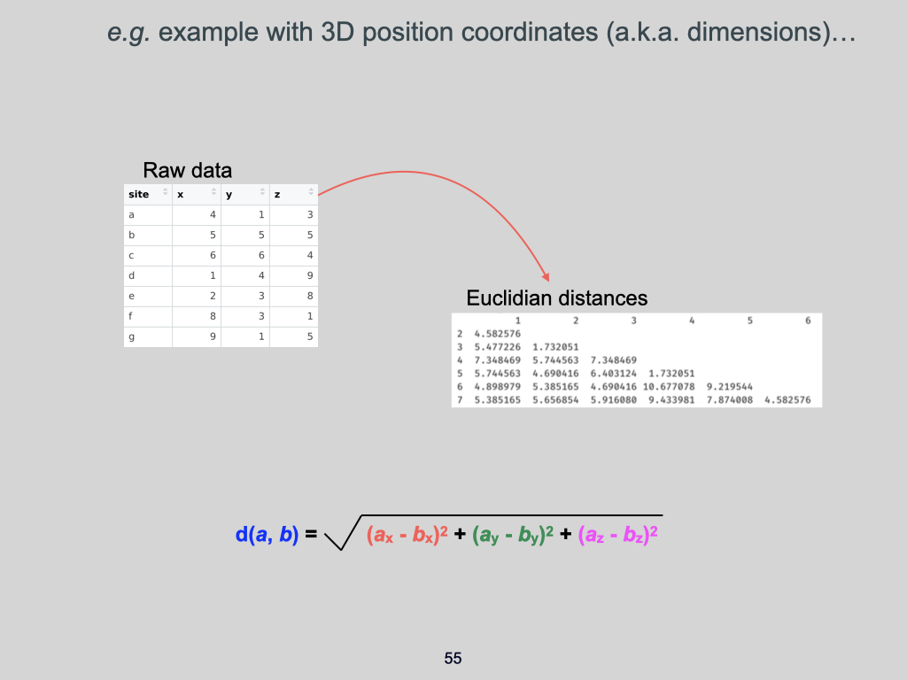](images/BDC334-055.jpeg "Slide 55")

Slide 55

If you had more dimensions, you’d follow the same procedure, adding more squared differences and including them under the square root (Slide 55).

You can see that pairs of points which are close in (two-dimensional) space have small values in the distance matrix, while those farther apart have larger values.

### 5.1.10 Multidimensional ecological distance

[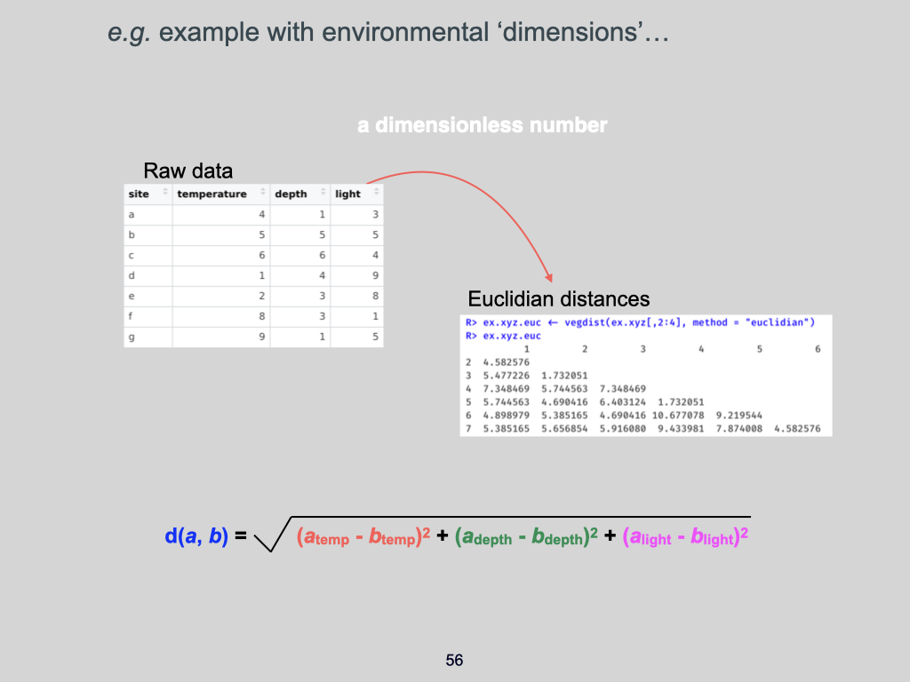](images/BDC334-056.jpeg "Slide 56")

Slide 56

[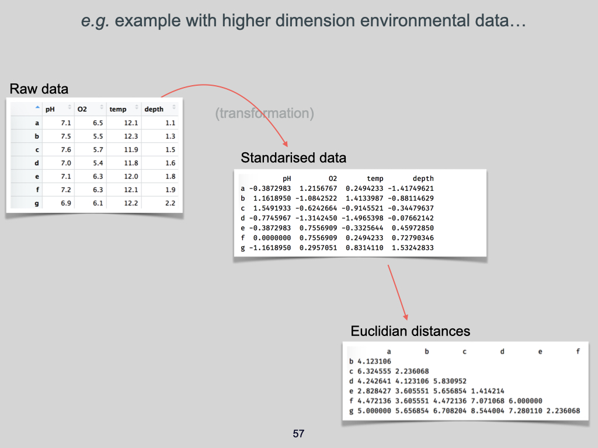](images/BDC334-057.jpeg "Slide 57")

Slide 57

How does this apply to ecological data, which might not be spatial at all? Well, each environmental variable — temperature, depth, light intensity, pH, CO$_2$ content, soil condition, whatever you’re measuring — can be treated as one dimension (Slides 56-57).

So each site becomes a point in this multi-dimensional space, and the environmental distance between two sites is simply calculated using the Euclidean formula: for example, with environmental variables temperature, depth, and light, the ecological distance between site A and site B would be:

$$\sqrt{(T_A - T_B)^2 + (D_A - D_B)^2 + (L_A - L_B)^2}$$

Where $T$ is temperature, $D$ is depth, $L$ is light.

If you add more variables, simply keep extending the formula.

### 5.1.11 Take-home message

This is why we say ecological data has a multivariate or multidimensional nature. Whether we’re using environmental variables or species abundances or presences, we’re working in a space with as many dimensions as we have types of data measured.

For environmental data, we use **Euclidean distance** to build these matrices.

Remember: **Euclidean distance is appropriate for environmental (quantitative) data. Do not apply it to species data — you shouldn’t.** For species data (particularly presence/absence or abundance), use **Bray-Curtis, Sørensen, Jaccard**, or other appropriate indices.

So, in summary, the multivariate nature of ecological data comes from the multiple dimensions contained in our data — each dimension being an environmental characteristic or a species measure. We express the similarity or difference between sites through pairwise comparison, using the appropriate formula to build our distance (or similarity/dissimilarity) matrices. These matrices are the foundation for further analyses you’ll be doing throughout this module.

## 5.2 Lecture 5b

### 5.2.1 Applying Euclidean distances to environmental variables

Right, so you understand now how to use Euclidean distances to calculate for us how different places are in terms of ecological conditions, or more specifically, the environmental conditions present there. We apply the theorem of Pythagoras to environmental data, where each one of the environmental variables becomes a dimension in our analysis. In this instance, think of temperature, depth, and light. Temperature would be dimension one, depth would be dimension two, and light would be dimension three. So, we have three dimensions in our equation.

It does not matter what order they are arranged in; it is completely arbitrary. But because all of these feature together, simultaneously, in some kind of combined measurement of how different the environment is from place to place, the specific units actually fall away. In this calculation, the values in environmental units become meaningless — it becomes just ‘ecological distance’. That is simply how it is.

### 5.2.2 Standardising environmental data

[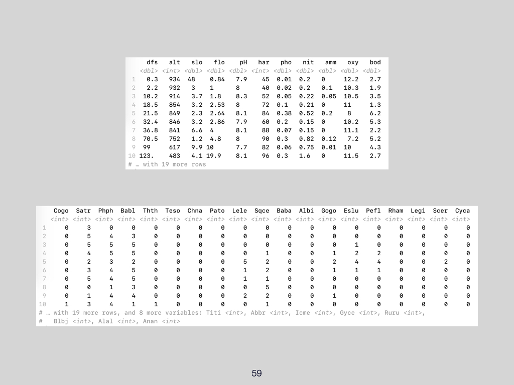](images/BDC334-059.jpeg "Slide 59")

Slide 59

Now, here is another example. It’s a similar kind of example to what we looked at before, but you will notice that there is a new table inside here (Slide 59). The reason we have this new table is because we have standardised the data. It is actually the same data, but the values are now very different. For example, the values for pH are recognisable pH numbers, more or less close to neutral. We have moderately aerated water, fairly moderate temperatures as well, and a very shallow kind of freshwater environment. All of these values look familiar because these are things you have probably come across before, and intuitively, you can understand them.

However, when you look at the standardised data, you’ll see that these numbers almost look — well, not random, they’re definitely not random — but to the untrained eye, if you do not know why the numbers look the way they do, it might as well look random to you. What is important here is that we have standardised the data. We have transformed the raw data into standardised data.

### 5.2.3 Why Standardise?

The reason why we standardise things is this: if we do not, then variables like temperature are going to become far more important in influencing the environmental distances. This is because the units and the values of temperature are much larger than, say, the values for depth.

So, in our previous example, where we had variables like $x$ and $y$, because $x$, $y$, and $z$ were all measured in, say, centimetres, there was no need to transform the data, since the values are comparable in magnitude. But here, the magnitude of values is very different between the variables. Temperature is measured in degrees Celsius, depth is measured in metres. The units cannot be compared to each other because they are entirely different measures.

Therefore, in order to rescale them — so that temperature does not become more important in the calculation than depth or any other variable — we standardise them.

### 5.2.4 How standardisation works

[](images/BDC334-060.jpeg "Slide 60")

Slide 60

[](images/BDC334-061.jpeg "Slide 61")

Slide 61

Standardising the data essentially scales the mean and the standard deviation. If you transform your raw data into standardised data, the property of this data is such that:

- The mean of the standardised data is $0$.
- The standard deviation is $1$.

So, you rescale the data from the raw measurement units into this standardised format. This means that, in your standardised data, the average value of temperature or depth, for example, will be exactly $0$, and all variables are now comparable in magnitude. Temperature will no longer have values with an average of about $12$, and depth will no longer have an average of around $1.6$ or $1.7$, but all means will be $0$ (Slides 60-61).

As a result, temperature does not become the overriding factor in our Euclidean distance calculation. When we calculate the Euclidean distance between sites, all the environmental variables have exactly the same weight in the calculation.

### 5.2.5 Calculating Euclidean distances after standardisation

So, we always standardise raw environmental data so that the units of measurement become comparable, and one variable does not become far more influential in the calculation compared to another. Once standardised, we can then apply the Euclidean distance calculation properly.

I’ll show you the calculation or the equation you will use to standardise your data. It is not very tricky at all; it’s straightforward to do in Excel, or even just with a calculator — nothing complicated there.

### 5.2.6 Species data: a different kind of distance

[](images/BDC334-062.jpeg "Slide 62")

Slide 62

So far, we have spoken about environmental data. But we can also know what the difference is in species composition from place to place. To do that, we no longer use environmental data but data on whether species are present or not, so-called presence–absence data, or abundance data if available (Slide 62).

In this case, we do not use the Euclidean distance calculation. The Euclidean distance relies on the Pythagorean theorem. However, when calculating the distance between sites in terms of which species are present, or their abundance, we must use a different measure.

Here, we use indices such as the Bray–Curtis, Jaccard, or Sørensen index. These are used instead of Euclidean distance to calculate how different the species assemblages are from one another.

### 5.2.7 Applying the indices to species data

Here you would have species data. So, suppose we have sites, let’s say sites $1$ to $10$. These are the same sites as before. As I said in an earlier lecture, the rows always tell you which places you have sampled (Slides 63-66). So, for example, ten replicates within the UWC Nature Reserve, each one identified by an integer — quadrat $1$, $2$, $3$, and so on, up to $10$.

[](images/BDC334-063.jpeg "Slide 63")

Slide 63

[](images/BDC334-064.jpeg "Slide 64")

Slide 64

[](images/BDC334-065.jpeg "Slide 65")

Slide 65

[](images/BDC334-066.jpeg "Slide 66")

Slide 66

Within that first quadrat, you would measure all the different environmental conditions, and, in the same place, you would also record which species are present and, if they are present, how many of them there are.

You would use environmental data, after standardising (for example, to bring water hardness to a comparable range with altitude), to calculate the Euclidean distance between every pair of sites. In this table, there are $11$ dimensions — that is, $11$ environmental variables.

For every one of the sites, you would compare every possible pair of sites within the collection. For the species data, you then apply the Bray–Curtis, Jaccard, or Sørensen index. I have uploaded onto iKamva a paper which you should read. That will explain how to calculate pairwise differences, and what the relevant index is that you should use to compare (for example) site $1$ to site $2$, or site $1$ to site $3$, and so on. You will need to figure that out by reading the paper.

It is a very simple procedure, which you can do by hand with a calculator if you wish, or in Excel. That is your task.

### 5.2.8 Preview: properties of your data

So, I will show you what some of the data you produce will look like. First, let’s look at some of the properties of the data that are generated.

## 5.3 Lecture 5c

### 5.3.1 Introduction

This is a proper set of data taken from South Africa. This relates to that paper you read by me, which I wrote in 2017 or so. These are the temperature and various other data collected at different places along our shoreline — specifically, at $58$ locations.

### 5.3.2 Constructing distance matrices

So, if you consider that there are $58$ sites, you can imagine just how many different pairs of sites there would be if you paired every one with every other one. If you apply that Euclidean distance calculation to this, you end up with a big thing that looks like that. Let me put it up in full screen and make it a bit bigger for you. This is what it is going to look like. If you apply the calculation to the environmental data from the $58$ places — applying Euclidean distance to every possible pair — this is the outcome: a large, dense matrix, which is, obviously, not something you can do by hand. It would take you weeks.

An important aspect to note is that, when you do this for a species or environment table — a table with all the sites along the rows, and all the environmental variables along the columns — when you calculate the Euclidean distance for every site, what you create is a square distance matrix.

### 5.3.3 Understanding the distance matrix

[](images/BDC334-061.jpeg "Slide 61")

Slide 61

This is a distance matrix, and it is square (Slide 61). Why do I say it is square? There are $58$ rows and $58$ columns, running from $1$ up to $58$. That is why it is a square matrix.

There is also another interesting feature — a diagonal line running from top left to bottom right, filled with zeros. The reason for this is, if you compare site $1$ with site $1$, in terms of how different they are, the ecological distance is zero — because it’s the same site. Site $1$ is site $1$; thus, the difference in ecological space between them is zero.

The bigger the number in the matrix entry, the more different those two sites will be. So, if we compare site $1$ on the $1$st column and $1$st row, that is the diagonal. If you then compare, for instance, the entry at column $2$, row $1$ — that is the pair site $1$ and site $2$. That value is the same as the value at column $1$, row $2$. The matrix is symmetrical.

So, the upper right triangle (above the diagonal of zeros) will contain exactly the same numbers as the lower left triangle (below the diagonal). Typically, when we display these calculations, it is only really interesting to display the lower left triangle.

### 5.3.4 Key properties of distance matrices

There are three interesting things about a distance or dissimilarity matrix, as used for species data:

1.  **It is square.** There are as many columns as rows — $58$ in this example.
2.  **It is symmetrical.** The upper triangle is a mirror image of the lower triangle.
3.  **There is a zero diagonal.** Each site compared to itself contains a zero, because there is no difference.

Additionally, as you move further from site $1$ along your environmental gradient, these numbers increase, reflecting how different the sites are. For example, site $1$ compared to site $2$ (adjacent sites) will have a small ecological distance. Site $1$ compared to site $4$ is a little bit bigger; site $1$ compared to site $18$ is even bigger, and so forth, until you reach site $1$ compared to site $58$, which would be at the opposite end of the gradient and will provide the largest difference.

All these numbers tell you, for every possible pair of sites, how different they are in ecological space.

[](images/BDC334-067.jpeg "Slide 67")

Slide 67

Your assignment is to calculate these matrices for yourselves (Slide 67).

# 6 Unified ecology

> **NOTE:**
>
> Accompany your reading of this chapter with the material presented in [Lab 4](../BDC334/Lab-04-biodiversity.llms.md).

## 6.1 Lecture 6a

### 6.1.1 Introduction

Today we are just going to quickly review those few papers that I handed out to you over the previous weeks, particularly with the aim of arriving at a unified accounting of what macroecology truly is. The drive to achieve such a unified view arises because, in recent years — especially since the 2000s — technologies have come on stream that allow us to apply ecological thinking to microbial communities. Lessons that had, for decades, been learned through studying large, visible multicellular organisms are now actively being adapted and tested on microbes.

Moreover, it is now possible to pose the question: do the same ecological patterns and explanations that have been identified in multicellular organisms, also hold true for microbial life? Historically, microbes and multicellular organisms have been investigated by largely separate groups of people, with their respective fields developing quite independently. Macroecology, however, seeks to bridge these divides and, as that notable study by Shade et al. (2018) puts it, to examine life across all scales — from mammoths and mules to marmots and microbes.

### 6.1.2 The scope and aim of unified macroecology

[](images/BDC334-069.jpeg "Slide 69")

Slide 69

Let us situate our discussion with the opening of Shade et al. (2018), which frames the intention to unify our understanding of ecological patterns that exist across the full spectrum of living organisms, big and small (Slide 69). As I have stressed in earlier lectures, the most direct way to describe community patterns is by examining which species are present (their identity), whether they are present or absent, and the relative abundance of each. These metrics, quite naturally, fluctuate both spatially and temporally.

[](images/BDC334-070.jpeg "Slide 70")

Slide 70

Many of you will already have encountered examples of such spatial patterns in the work by Nicola and White, and also in my own paper that dealt with seaweed distribution along the South African coastline. If you recall, as environmental gradients shift, so does community composition — altering which species are present and in what abundance. Our current task is to review how these ideas scale — whether similar patterns unite community structure for all life forms, from microbes right through to the largest multicellular animals (Slide 70).

### 6.1.3 New technologies and sampling in microbial communities

[](images/BDC334-071.jpeg "Slide 71")

Slide 71

This inquiry into unifying macroecology is possible, particularly for microbes, because of advances in genetic tools. Before the 2000s, most microbial studies focused only on individual species using traditional methods. Now, however, with the development of high-throughput sequencing, one can take a single soil sample or a drop of water, sequence all the genetic material therein, and generate a list of all the taxonomic units (species, or operational taxonomic units) present. Effectively, you can treat each sample as analogous to a quadrat or transect used in large-scale ecological studies of plants and animals, allowing similar methodologies to be applied across kingdoms (Slide 71).

Additionally, increases in computing power have made it feasible to analyse the vast datasets produced by these sequencing methods. As a result, we are now able to compare the structure and dynamics of microbial communities directly to those of macroorganisms.

### 6.1.4 Metabolic scaling across organisms

[](images/BDC334-072.jpeg "Slide 72")

Slide 72

One of the first major insights gained by comparing across these scales is in the realm of metabolic scaling (Slide 72). A classic graph, which some of you may have seen, plots the logarithm of metabolic rate against the logarithm of body mass for different groups of organisms: bacteria, protists, and multicellular forms (the latter shown in blue in the referenced figure).

For multicellular organisms, the relationship follows what is known as the three-quarters power law: for every four-fold ($4$-unit) increase in body mass, metabolic rate increases by three-fold ($3$ units; this is often shown as $R \propto M^{3/4}$). This scaling relationship appears to hold across the diversity of multicellular life.

When we examine protists, the relationship shifts: for every unit increase in body mass, there is a proportional ($1:1$) increase in metabolic rate, or $R \propto M^1$. For bacteria and archaea, the scaling becomes even steeper, with a one-unit increase in body mass corresponding to a doubling of metabolic rate — indicating a different underlying relationship.

The underlying reasons for these disparate scaling laws are rooted in physiology. For bacteria, metabolic rate predominantly scales as a function of the genes and proteins present. Protists’ metabolic rates are influenced primarily by the number of mitochondria per cell. For multicellular organisms, scaling emerges from the surface area to volume ratio — a topic familiar from Prof Maritz’s lectures and our own discussions last year in BDC 223. The efficiency of metabolic processes in large organisms depends fundamentally on their ability to supply nutrients and gases to their tissues, which relates directly to surface area and volume relationships.

This difference in scaling points to significant physiological divergence across life forms, and strongly suggests that, at the ecosystem level, both differences and possible similarities might persist as we scale from bacteria to elephants and blue whales.

### 6.1.5 Key concepts in shade et Al. (2018)

When you read the Shade et al. (2018) paper, there are critical sections and concepts that I would like you to focus on. First, under the heading ‘Unified Currency, Individuals and Species,’ you’ll find discussion about the challenges in defining what exactly constitutes an ‘individual’ or a ‘species,’ particularly in microbes. Unlike animals and many plants, where individuals are generally discrete entities, microbial individuals and even many plants (such as grasses or fungi) pose considerable identification challenges. For instance, in a patch of lawn, each visible tuft of grass may appear physically separate above ground, but may, in fact, be interconnected below the surface via rhizomes, making it very difficult to delineate individual organisms.

There is also an extended glossary within the paper — please ensure you understand these terms, as they are foundational for your comprehension of the subject.

### 6.1.6 Unified accounting: patterns and relationships

In the latter sections of Shade et al., attention turns to the notion of unified accounting — how we might quantitatively relate the number of species (richness), or their abundance, to space, sample size, and similar factors. These relationships are central to macroecology and form the theoretical backbone of the field.

We will discuss a selection of these relationships, as described in the paper, in detail during the remainder of today’s session and in future lectures. For now, I want you to note how new technological and analytical advances are truly allowing us, for the first time, to weigh microbial and macroorganismal communities on the same theoretical and empirical scales.

## 6.2 Lecture 6b

### 6.2.1 Recap: the basis of species by site matrices

In last week’s lectures, we delved into the concept of species by site matrices. Most of you spent time working with these matrices throughout the week, and I noticed there was a particularly lively discussion — mainly driven by two or three individuals — over the weekend regarding certain calculations. That engagement was valuable, and I trust those who did not participate still gained insight from following the discussions. The reason I have emphasised these matrices is that they form the foundation for understanding relationships between community structure and space. We begin with these samples.

[](images/BDC334-073.jpeg "Slide 73")

Slide 73

As an example, if you look at the data set from Shade et al. (2018) — as shown on slide A at the top — you will see exactly the same table repeated below, except that I have transposed it (Slide 73). Species 1 through 6 run along the columns, while sites are arranged in rows. There are six species and six sites. This is how I recommend you work with the data, and it mirrors the requirements of some quantitative ecology software you may use next year, if you choose to take that module. I find it much more intuitive to work with a species-by-environment or species-by-site table where species occupy columns, and sites fill the rows.

So, what I have done here is merely transpose the data set — swapping rows for columns. The underlying data remains unchanged. This is precisely the type of data structure you worked with in the Doubs River data exercise last week. From this structure, you can then calculate either presences and absences or work with abundance data directly.

If you wish to convert abundance data to a presence–absence matrix for site A, for example, you simply recode the abundances as presences ($1$) or absences ($0$). So for site A, it would read $011100$; for site B, $011110$ — and so on. This generates a new matrix next to your abundance data.

[](images/BDC334-074.jpeg "Slide 74")

Slide 74

It is important to understand that whether you are using presence–absence data or abundance data, these are the starting points from which we calculate a range of diversity indices — whether alpha, gamma, or $\beta$-diversity. Often, these lead to measures known as dissimilarity matrices. From there, we can begin to unravel the relationship between community composition and spatial patterns (Slide 74).

### 6.2.2 Species abundance distributions and the rank abundance curve

[](images/BDC334-075.jpeg "Slide 75")

Slide 75

The first key concept is the species abundance distribution, often visualised with a rank abundance curve (Slide 75). The basic idea is this: when you plot the logarithm of the number of species against the rank order of their abundance, you see an interesting pattern. Whether with microbes or macro-organisms, most species tend to have only a few individuals, with just a handful of species being extremely abundant.

A simple example comes from the UWC Nature Reserve. If you look around, you will notice that the vast majority of the vegetation is comprised of perhaps one or two highly abundant species. There may also be only a single individual of a rare species, or a predator present, but the dominant species will each be represented by many individuals.

This fundamental pattern exists regardless of whether we discuss microbes or mammals. There tend to be many rare species, each with few individuals, and a very small number of dominant species containing many individuals. Thus, your rank abundance curve will always reflect this structure: least abundant species on the left, most abundant species on the right.

So, for a particular example — say with moths — the least abundant species is plotted furthest left; as abundance increases, we move to the right along the x-axis. The paper we read explains this process clearly, so please review that section as needed.

### 6.2.3 Occupancy and abundance distributions

[](images/BDC334-076.jpeg "Slide 76")

Slide 76

Next, there is the occupancy–abundance relationship (Slide 76). Occupancy is defined as the number or proportion of sites at which a species is present. Generally, if a species is very abundant, it will likely be found at most, if not all, sampled sites. To visualise this: on a graph with abundance on the x-axis and occupancy (number of quadrats or sites occupied) on the y-axis, species with high abundance tend to have high occupancy.

Conversely, rare species — those found as just a single individual in just one quadrat — will have a much lower occupancy. Thus, a positive relationship exists between abundance and occupancy across sites.

### 6.2.4 The species–area curve

[](images/BDC334-077.jpeg "Slide 77")

Slide 77

The species–area curve is straightforward and highly practical (Slide 77). It underlies the rationale of sampling effort. If you place down a single quadrat and count the number of species (species richness, or $\alpha$-diversity), you might find $10$ species present. With a second quadrat, you may record $15$ species in total (cumulatively). With each additional quadrat, the cumulative tally of species discovered will rise — up to a certain point. Eventually, with the addition of further quadrats — say $20$ or $30$ — the number of new species detected plateaus.

In real-life fieldwork, for example in the UWC Nature Reserve, you might tally the species in one quadrat, then a second, and so forth. Initially, you will add new species with each quadrat, but at some point, adding further quadrats introduces no new species — the curve plateaus. When you reach this point, your sample size is likely sufficient; further sampling does not increase the observed richness.

This approach is commonly used to validate that sampling intensity within a habitat is adequate to capture essentially all the species there. In homogeneous landscapes, this plateau appears quickly; in heterogeneous areas or along environmental gradients, additional sampling continually reveals new species, and the curve flattens more slowly.

### 6.2.5 Distance decay relationships

[](images/BDC334-078.jpeg "Slide 78")

Slide 78

Turning to distance decay relationships — these concepts appeared in the Doubs River data exercise (Slide 78). Here, you calculated the Jaccard similarity (or dissimilarity) between pairs of sites, sometimes confusing the two, but I believe this was clarified over the weekend. These measures capture how similar or different two sites are in terms of species composition.

In a homogeneous landscape, this similarity remains high and quite stable regardless of the spatial distance between sampling points. $\beta$-diversity (the measure of how much communities change from one site to the next) is therefore low. This pattern applies whether examining microbes or larger organisms.

[](images/BDC334-079.jpeg "Slide 79")

Slide 79

However, in heterogeneous landscapes — such as across the South African coastline — if you compare sites with large spatial separation (e.g., from Cape Vidal to Port Shepstone, a distance approaching $770$–$800\;\mathrm{km}$), you would expect low similarity and high $\beta$-diversity (Slide 79). This distance-decay relationship arises because sites that are further apart tend to experience larger differences in environmental conditions, such as temperature, especially when a physical gradient (like the difference in sea temperature along the coast) exists.

Therefore, in landscapes with pronounced environmental gradients, greater spatial separation results in greater community turnover ($\beta$-diversity), while in homogeneous regions, this pattern is far weaker.

### 6.2.6 Environmental gradients

[](images/BDC334-080.jpeg "Slide 80")

Slide 80

[](images/BDC334-081.jpeg "Slide 81")

Slide 81

[](images/BDC334-082.jpeg "Slide 82")

Slide 82

[](images/BDC334-083.jpeg "Slide 83")

Slide 83

[](images/BDC334-084.jpeg "Slide 84")

Slide 84

Closely related are diversity gradients associated with environmental distances rather than merely spatial ones (Slides 80-84). Environmental distance, which some of you calculated using Euclidean distances, quantifies how different two sites are in terms of their physical environment. The greater this distance, the more dissimilar the species composition typically is.

A classic example can be found when looking at elevation gradients. Ascending a mountain, one observes substantial shifts in vegetation and community structure. For instance, ant or microbial diversity decreases as elevation increases. In such cases, plotting $\alpha$-diversity (species richness) against elevation produces a declining trend. Alternatively, one might plot species dissimilarity, Shannon diversity, or any other diversity metric.

The data you produced calculating pairwise dissimilarities and environmental distances can be used to generate these plots: environmental distance along the x-axis, species dissimilarity on the y-axis. Where a strong environmental gradient is present, this yields an inclined (increasing) line. Without an environmental gradient, the relationship is flat.

It is useful to practice producing and interpreting these kinds of plots, as they readily test your comprehension of ecological relationships.

### 6.2.7 Application and broader patterns

This kind of thinking should not be limited just to the examples discussed in class, or within South Africa. These diversity patterns are present — whether in deep oceans, soils, among microbes, or elephants — across a wide range of environments. The Shade et al. (2018) paper and other references, such as Nekula and White, discuss these processes in further detail. Do review those papers for expanded explanations, particularly around concepts like distance decay.

### 6.2.8 Key concepts review

[](images/BDC334-085.jpeg "Slide 85")

Slide 85

[](images/BDC334-086.jpeg "Slide 86")

Slide 86

[](images/BDC334-087.jpeg "Slide 87")

Slide 87

There are some concepts to review (Slides 85-87):

- Alpha, beta, and $\gamma$-diversity: You must clearly understand these.
- $\beta$-diversity can be decomposed into turnover and nestedness components, as discussed in the seaweed paper.
- The relationship between $\beta$-diversity and environmental gradients should be understood.
- Neutral processes (see the seaweed paper) and dispersal limitation often explain observed $\beta$-diversity patterns. While these are not synonymous, dispersal limitation is frequently invoked to explain neutral processes.
- Scale dependence, as discussed by Nekula and White, is linked to species–area relationships, occupancy–abundance distributions, and underpins many ecological patterns.

### 6.2.9 Summary

To consolidate: all the knowledge you have built up this week and last — on how to derive and interpret diversity metrics from species by site or environment by site tables, how to read species–area relationships, occupancy–abundance distributions, distance decay, and environmental gradients — are essential tools in the ecologist’s analytical toolkit.

These concepts allow you to interrogate and explain the vast array of biodiversity patterns seen across the world. Explore and understand the readings, and ensure you master the analytical approaches to diversity that we have discussed, as they underpin all further professional work in ecology and biogeography.

# 7 Threats to biodiversity

## 7.1 Lecture 7

### 7.1.1 Threats to biodiversity (paper by David Tilman)

This paper, which you should have read last week, discusses the variety of global threats to biodiversity. It reviews differences between countries and the driving factors behind declining biodiversity. The paper is accessible, and if you engage carefully with the entire text, you should have no difficulty comprehending its arguments. There is nothing in this reading that requires supplementary technical detail beyond what is provided.

# 8 Nature’s contribution to people

## 8.1 Lecture 8

### 8.1.1 Theme of this week: the value and valuation of ecosystems

Today’s lecture—and associated readings—centres on what humans derive from biodiversity, focusing on the ecosystem services concept and the valuation of these services.

### 8.1.2 Consequences of biodiversity loss

You are now to read work concerning the consequences of declining biodiversity. The key question is: What happens, both to people and to ecosystems, when biodiversity diminishes over time? One of your readings today addresses the ensuing changes and articulates precisely how biodiversity is useful to people—what services it provides, and how we conceptualise this utility.

#### The costanza et al. (1997) paper: monetary valuation of ecosystem services

The classic 1997 paper by Bob Costanza is foundational. It quantifies the value of the world’s major ecosystem services. The central idea here is ‘value’, most commonly communicated in terms of financial or monetary value—how much a hectare of natural habitat is worth in rands, dollars, pounds, and so on.

The paper discusses both market and non-market frameworks for valuation:

- **Market Valuation**: This converts ecosystem services directly into monetary units. For example, how much it would cost to replace the gas regulation function of the ocean if we had to engineer it ourselves.
- **Non-market & Intrinsic Value**: The value derived here is not directly monetary—it often depends on culture, personal attachment, or aesthetic appreciation. This can vary dramatically from place to place, or person to person. For example, some value the ocean primarily for surfing, others for fisheries.

The paper, however, focuses on market-based approaches, such as how much it would cost to engineer breakwaters to replace kelp forests, which naturally protect shorelines from erosion and wave damage. To value such services, one method is to estimate the cost of constructing a substitute infrastructure—for example, if removing kelp would demand construction projects with a price tag of $\text{R}\,84\,\text{million}$ or more. The essential idea is: ecosystems provide free services, and it is only when we lose them that their economic value becomes undeniable.

Similarly, for recreational value, you might ask users directly—how much would they pay to guarantee continued access? This contingent valuation approach translates their willingness to pay into monetary value.

Market-based methods work for many ecosystem services, but intrinsic, spiritual, and cultural values remain difficult to quantify. These will come up again in wiki assignments, but are not a main focus in this module.

The upshot of this paper is a comprehensive estimate of what ecosystem services are worth globally: Table 2 quotes a total value of $\$33$ trillion for global ecosystem services (in 1997), a staggering sum.

#### Updated valuation: costanza et al. (2014)

A subsequent paper, authored roughly $15$ years after the original study, updates these figures. It evidences the decline in ecosystem value as biodiversity is lost or natural land is converted to agriculture or built environments.

Between the initial study and the later one, estimated global ecosystem service value has fallen by between $\$4$ trillion and $\$20$ trillion per year. This is a direct consequence of resource extraction, habitat loss, and other threats. The loss is not abstract; it has clear, quantifiable costs.

An important figure in the 2014 paper illustrates the relationships among various forms of capital:

- **Human capital** (people and communities)
- **Built capital** (infrastructure and human-made environments)
- **Social capital** (institutions, cultural systems)
- **Natural capital** (ecosystem services and natural resources)

Human, built, and social capital all ultimately depend on natural capital. If the latter is eroded too severely, the rest lose their foundation and value.

These readings compel you to consider deeply: Why are ecosystem services valuable? What sorts of value are there, and which are measurable in monetary terms and which are not?

Pay attention to how all these values—market and nonmarket—play out in real life. For instance, when you see litter accumulating in public spaces or natural landscapes, consider how it devalues these environments, both psychologically and economically.

### 8.1.3 This week’s assigned reading and assessment

To summarise the required reading for this week, you are to focus on three specific papers—labelled as numbers $7$, $8$, and $9$ in your list.

Their content is directly relevant to your assessment and your overall disciplinary knowledge. Mastery of these readings may be assessed in the class tests and the final examination. See the [2026 syllabus](../BDC334/BDC334_syllabus.llms.md#class-tests) for the class-test dates and times.

Continue to integrate, synthesise, and critically evaluate what you read. Do not confine yourself to rote memorisation of facts; rather, strive for an understanding of how broad themes relate and interconnect. This will best prepare you for your current and future coursework, and also for real-world scientific reasoning.

------------------------------------------------------------------------

*Slide references would be integrated here if available; please match discussion points to specific slides in your notes as we proceed in class.*

## References

Borcard D, Legendre P (1994) Environmental control and spatial structure in ecological communities: An example using oribatid mites (acari, oribatei). Environmental and Ecological statistics 1:37–61.

Borcard D, Legendre P, Drapeau P (1992) Partialling out the spatial component of ecological variation. Ecology 73:1045–1055.

Borcard D, Gillet F, Legendre P, others (2011) Numerical ecology with R. Springer

Brown JH, Maurer BA (1989) Macroecology: The division of food and space among species on continents. Science 243:1145–1150.

Burger JR, Allen CD, Brown JH, Burnside WR, Davidson AD, Fristoe TS, Hamilton MJ, Mercado-Silva N, Nekola JC, Okie JG, others (2012) The macroecology of sustainability. PLoS biology 10:e1001345.

Chapin III FS, Zavaleta ES, Eviner VT, Naylor RL, Vitousek PM, Reynolds HL, Hooper DU, Lavorel S, Sala OE, Hobbie SE, others (2000) Consequences of changing biodiversity. Nature 405:234–242.

Condit R, Pitman N, Leigh Jr EG, Chave J, Terborgh J, Foster RB, Núnez P, Aguilar S, Valencia R, Villa G, others (2002) Beta-diversity in tropical forest trees. Science 295:666–669.

Costanza R, d’Arge R, De Groot R, Farber S, Grasso M, Hannon B, Limburg K, Naeem S, O’neill RV, Paruelo J, others (1997) The value of the world’s ecosystem services and natural capital. nature 387:253–260.

Costanza R, De Groot R, Sutton P, Van der Ploeg S, Anderson SJ, Kubiszewski I, Farber S, Turner RK (2014) Changes in the global value of ecosystem services. Global environmental change 26:152–158.

Keith SA, Webb TJ, Böhning-Gaese K, Connolly SR, Dulvy NK, Eigenbrod F, Jones KE, Price T, Redding DW, Owens IP, others (2012) What is macroecology?

Maxwell SL, Fuller RA, Brooks TM, Watson JE (2016) Biodiversity: The ravages of guns, nets and bulldozers. Nature 536:143–145.

McGill BJ (2019) The what, how and why of doing macroecology. Global Ecology and Biogeography 28:6–17.

Nekola JC, White PS (1999) The distance decay of similarity in biogeography and ecology. Journal of Biogeography 26:867–878.

Shade A, Dunn RR, Blowes SA, Keil P, Bohannan BJ, Herrmann M, Küsel K, Lennon JT, Sanders NJ, Storch D, others (2018) Macroecology to unite all life, large and small. Trends in ecology & evolution 33:731–744.

Smit AJ, Bolton JJ, Anderson RJ (2017) Seaweeds in two oceans: Beta-diversity. Frontiers in Marine Science 4:404.

Tilman D, Clark M, Williams DR, Kimmel K, Polasky S, Packer C (2017) Future threats to biodiversity and pathways to their prevention. Nature 546:73–81.

Tittensor DP, Mora C, Jetz W, Lotze HK, Ricard D, Berghe EV, Worm B (2010) Global patterns and predictors of marine biodiversity across taxa. Nature 466:1098–1101.

Verneaux J (1973) Cours d’eau de Franche-Comté (Massif du Jura). Recherches écologiques sur le réseau hydrographique du Doubs.

## Reuse

[CC BY-NC-SA 4.0](https://creativecommons.org/licenses/by-nc-sa/4.0/)

## Citation

BibTeX citation:

``` quarto-appendix-bibtex
@online{smit2026,
  author = {Smit, A. J. and J. Smit, A.},
  title = {BDC334 Lecture Transcript},
  date = {2026-11-06},
  url = {https://tangledbank.netlify.app/BDC334/BDC334-Lecture-Transcripts.html},
  langid = {en}
}
```

For attribution, please cite this work as:

Smit AJ, J. Smit A (2026) BDC334 lecture transcript. [https://tangledbank.netlify.app/BDC334/BDC334-Lecture-Transcripts.html.](https://tangledbank.netlify.app/BDC334/BDC334-Lecture-Transcripts.html)
