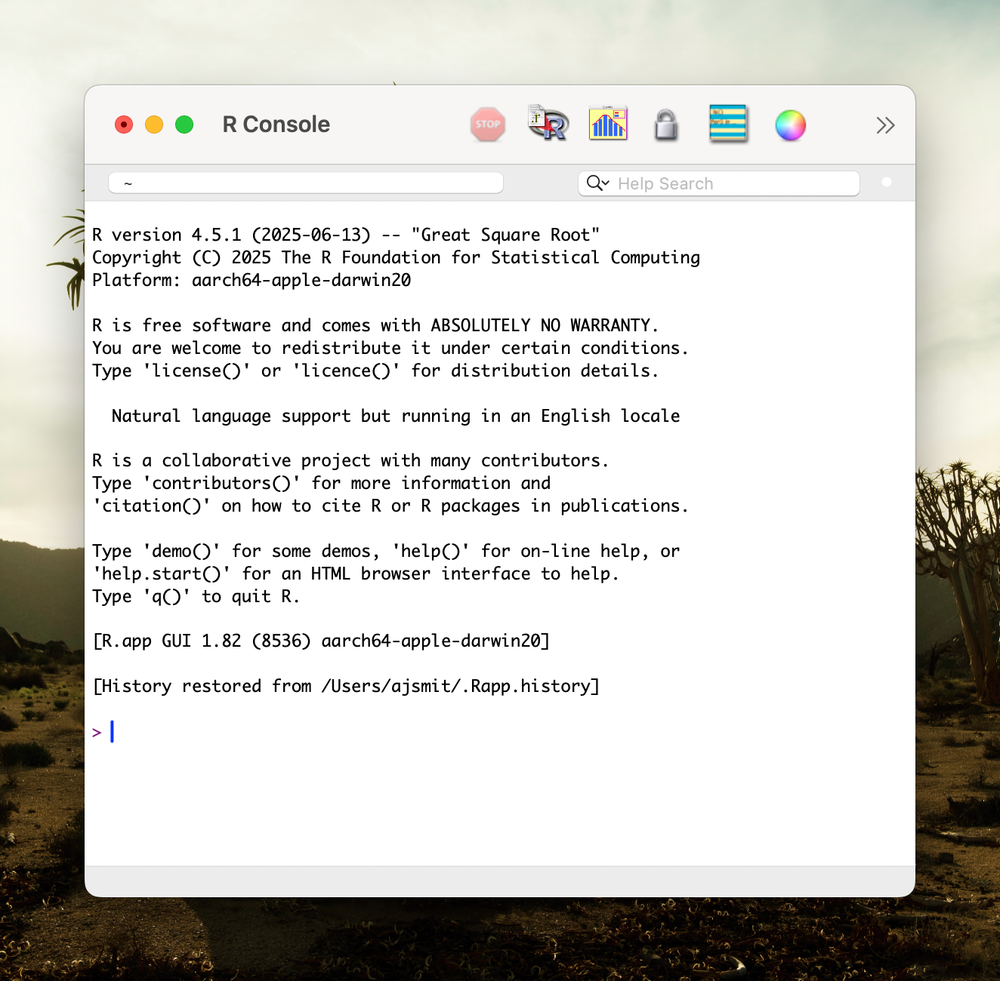
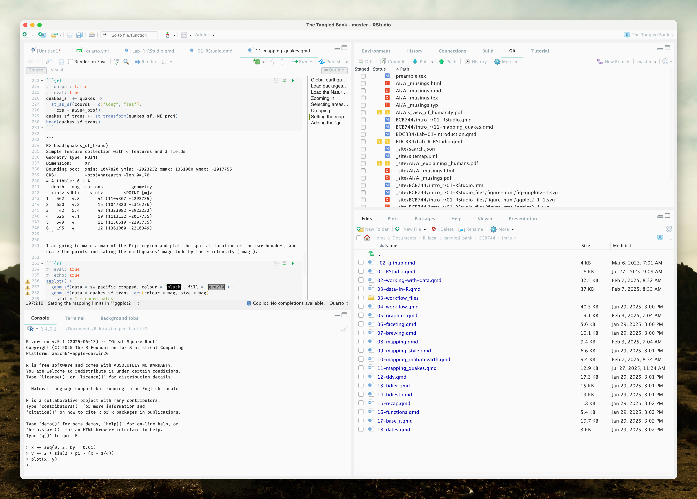
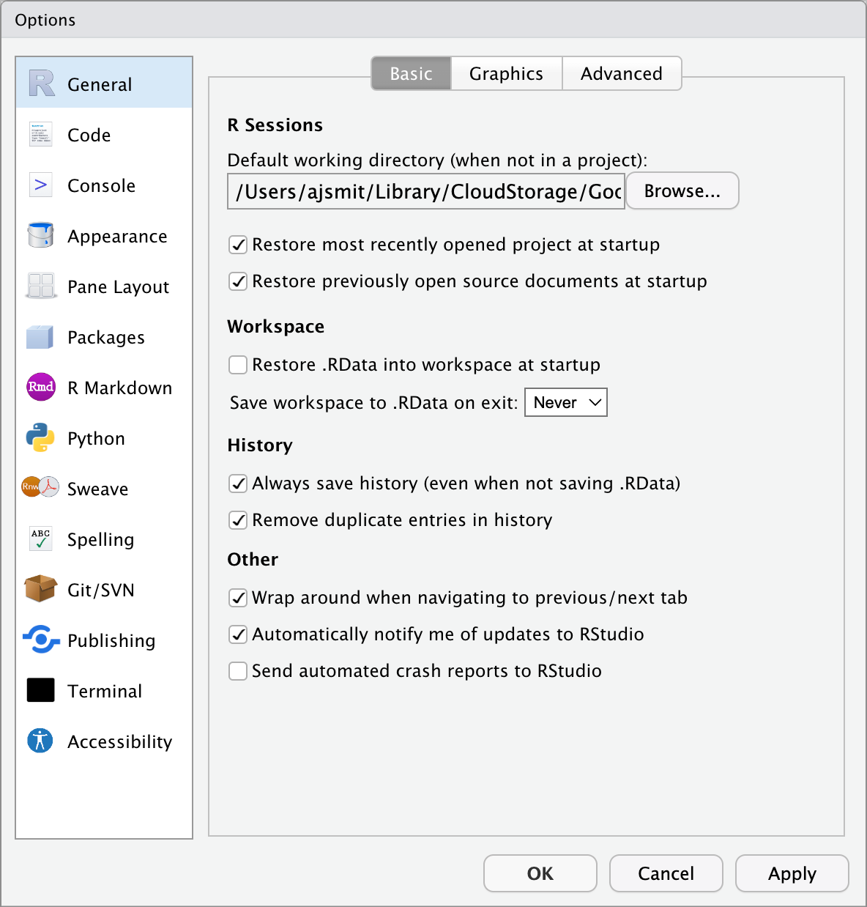
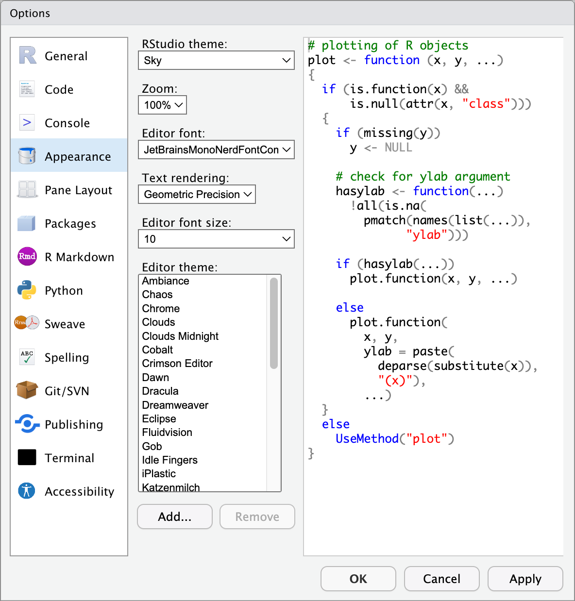
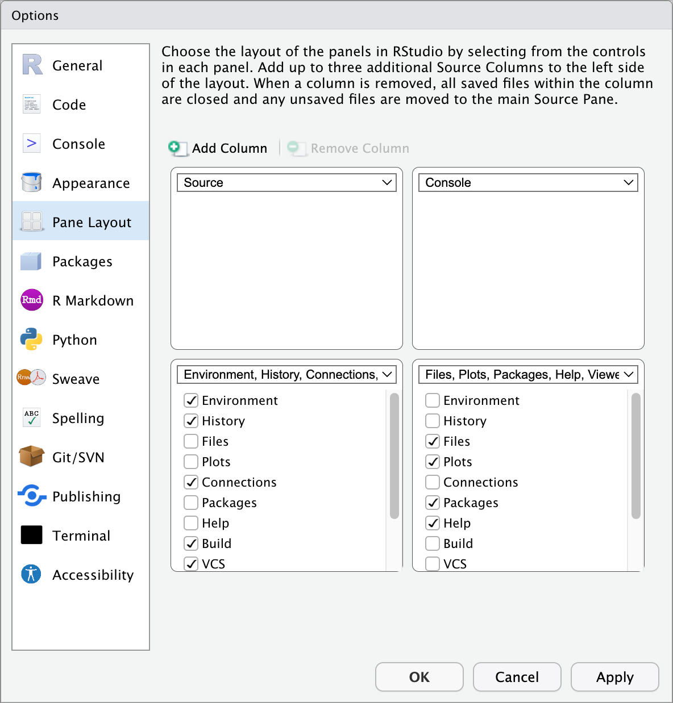
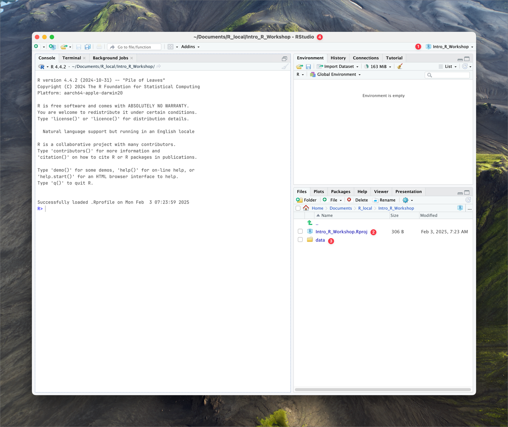
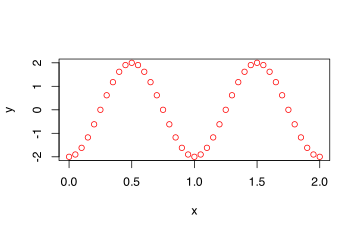

> “*Ignorance more frequently begets confidence than does knowledge.*”
>
> — Charles Darwin

> “*My mind seems to have become a kind of machine for grinding general laws out of large collections of facts.*”
>
> — Charles Darwin

> **TIP:**
>
> All the data needed for BDC334 are at the link below:
>
> - All module data files – [`data folder`](https://drive.google.com/drive/folders/1jwiqLKCo4t4w1kwYAGSRa8UQ_OF9JGaQ?usp=sharing)

# 1 Introduction to R

> **IMPORTANT:**
>
> If you are serious about making R an inseparable part of your scientific life, you’ll want to use Hadley Wickham (and his colleagues) book [R for Data Science (2e)](https://r4ds.hadley.nz) as the core R reference and practice those R concepts on your very own problem.
>
> **A Gentler Comprehensive Introduction:** If Hadley’s book feels like overkill, you are welcome to skip ahead to the [BCB Honours R core module](https://tangledbank.netlify.app/BCB744/intro_r/01-RStudio.html) for a targeted approach to learning R, with a focus on data relevant to biologists and ecologists.

# 2 Getting started

R is a software environment for statistical computation and graphics. It is *free* and *open-source*. It is a programming (or “scripting” or “coding”) language used by research statisticians, academics and their students, and by data “scientists” across a wide array or industries and organisations. To use it, you will need to install two pieces of software, both of which can be downloaded for free:

- [R](http://cran.r-project.org/), which is the actual software that does the computations and graphics.
  - Chose your operating system, and select the most recent version, 4.6.2.
- [RStudio](http://www.rstudio.com/), the Integrated Development Environment (IDE), which is what R runs *within*.

You must have R installed to use RStudio; RStudio by itself cannot do anything, like a car without it engine.

[](../images/R_window.png "The R programme outside of RStudio.")

The R programme outside of RStudio.

[](../images/RStudio_window.png "RStudio with R inside of it.")

RStudio with R inside of it.

# 3 Why R?

R is becoming increasingly popular. It is used, as I mentioned earlier, across academia as well as in industry. In particular, it has become especially popular among biologists and ecologists, since much of the analysis we want to carry out is readily executable within R. This is facilitated by the many add-on packages that ecologists have developed over the years.

Additionally, R is extremely powerful for the creation of graphics and figures, enabling us to visualise all of the data we have analysed. These graphical outputs are essential for effectively communicating our findings in publications.

## 3.1 What you’ll find here

In the following section, I will walk you through the basic use and operation of R. We shall look at several things, such as how the user interface works—in other words, how the RStudio IDE is organised. I will also show you how to set up a new *Rproject*, which is quite an essential step in keeping your work organised, especially as your analyses grow more complex over time.

We will cover how to create scripts, and how to save those scripts so that you can run them again in the future. This means that not only will you be able to reproduce your own analyses, but also modify or expand them as required. I will demonstrate how to create a few basic figures, so you will become familiar with visualising your data.

Quite importantly, for your assignments and research over the coming weeks, you will use R as a system within which you can both write your scripts for data analysis, and also produce the documents required for communicating your findings. This includes output that is suitable for sharing with colleagues, whether in the form of reports, presentations, or publications.

The ability to integrate your code and your written explanation—what is often referred to as ‘reproducible research’—is a particular strength of R and RStudio. You will find that learning these skills is not only essential for your studies here, but also valuable for future scientific work.

# 4 Learning R

Learning R is like learning another language—a spoken language like French or Finnish. R is also a language, and it requires a huge amount of practice and skill to achieve fluency in it. The most important thing when you’re learning R for the first time is to be patient with yourself. Many of the steps will require repeated iterations, working through examples, and, most crucially, solving your own problems. This process will help you become more familiar with R.

You are not expected to become fluent in it straight away, but the intention during this third-year module is that you will no longer feel apprehensive about using R. The key aspect, therefore, is to learn patience and to learn how to help yourself. That really is the only way to learn R: to have your own problem, which you are able to solve using some of the skills that I will teach you.

RStudio has a large number of useful keyboard shortcuts. A list of these can be found using a keyboard shortcut – the keyboard shortcut to rule them all:

- On Windows: `Alt` + `Shift` + `K`
- On Mac: `Option` + `Shift` + `K`

The RStudio team has developed [a number of “cheatsheets”](https://www.rstudio.com/resources/cheatsheets/) for working with both R and RStudio. [This particular cheatsheet for “Base” R](https://github.com/rstudio/cheatsheets/blob/main/base-r.pdf) will summarise many of the concepts in this document. (“Base” R is a name used to differentiate the practice of using built-in R functions, as opposed to using functions from outside packages, in particular, those from the [`tidyverse`](https://www.tidyverse.org/). More on this later.)

# 5 A few words on style

When writing scripts, it is good practice to follow a style guide. For example, where do spaces go? Do I use tabs or spaces? Do I orefer underscores or CamelCase when naming variables? No style guide is “correct,” but it helps to be aware of the general approaches people take. For me, the most important aspect is that you are consistent within your own code. This is something that we will pay a great deal of attention to when we mark your assignments.

- [Hadley Wickham Style Guide](http://adv-r.had.co.nz/Style.html) from [Advanced R](http://adv-r.had.co.nz/)
- [Google Style Guide](https://google.github.io/styleguide/Rguide.xml)

# 6 RStudio

In this section, we will have a look at the RStudio IDE. The IDE is where we are going to spend most of our time when we interact with R. You can think of the IDE as the body of a car: the seats, the steering wheel, all the luxuries, bells and whistles—essentially, all those various things that make up the experience of using the vehicle.

R itself, on the other hand, is the engine. So, just as in a real car, if you take the engine out, all the seats, the bells and whistles, the steering wheel, and all the safety features mean absolutely nothing without that engine to power it. Similarly, with RStudio, you do need the R engine to operate RStudio. The IDE alone cannot run your code; it’s merely the interface and the facilitator, but the actual computations require the presence of R.

## 6.1 General settings

Before we start using RStudio, let’s first set it up properly. Find the ‘Tools’ (‘Preferences’) menu item, navigate to ‘Global Options’ (‘Code Editing’) and select the tick boxes as shown in the figure below.

[](../images/RStudio_general_settings.png "RStudio preferences")

RStudio preferences

## 6.2 Customising appearance

RStudio is highly customisable. Under the **Appearance** tab under ‘Tools’/‘Global Options’ you can see all of the different themes that come with RStudio. We recommend choosing a theme with a black background (*e.g.*, Chaos) as this will be easier on your eyes and your computer. It is also good to choose a theme with a sufficient amount of contrast between the different colours used to denote different types of objects/values in your code.

[](../images/RStudio_appearance.png "Appearance settings")

Appearance settings

## 6.3 Configuring panes

You cannot rearrange panes (see below) in RStudio by dragging them, but you can alter their position via the **Pane Layout** tab in the ‘Tools’/‘Global Options’ (‘RStudio’/‘Preferences’ – for Mac). You may arrange the panes as you would prefer; however, we recommend that during the duration of this workshop you leave them in the default layout.

[](../images/RStudio_panes.png "Rearranging the panes")

Rearranging the panes

## 6.4 The R project

A very nifty way of managing your workflow in RStudio is through the built-in functionality of the R project. We do not need to install any packages or change any settings to use these. Creating a new project is a very simple task, as well. This will prevent a lot of issues by ensuring we are doing things by the same standard. Better yet, an R project integrates seamlessly into version control software (*e.g.*, GitHub) and allows for instant world class collaboration on any research project. We will cover the concepts and benefits of an R project more as we move through the module.

1.  In the RStudio menu, find ‘File’ and then ‘New Project’.
2.  Select ‘New Directory’ and then ‘New Project’.
3.  Name the project ‘BDC334_project’ and save it in a location of your choice (make sure you understand your computer’s file system and where you are saving files).
4.  Click ‘Create Project’.
5.  All data files for this module are available in the main [`data`](https://github.com/ajsmit/tangled_bank/tree/master/data/BDC334) folder. You can access individual files as needed throughout the module.

Your RStudio should now look something like this (with the name BDC334_project displayed in the top right-hand corner of your RStudio window):

[](../images/RStudio_project.png "RStudio project")

RStudio project

Note the key points:

- ❶ The project name is displayed in the top right corner of the RStudio window.
- ❷ The name of the project workspace file is displayed in the **Files** pane.
- ❸ The name of the data folder is displayed in the **Files** pane.
- ❹ The project name is displayed in the title bar of the RStudio window (corresponding to the physical location on your computer).

> **NOTE:**
>
> Here you saw RStudio execute the R code needed to install (using [`install.packages()`](https://rdrr.io/r/utils/install.packages.html)) and load (using [`library()`](https://rdrr.io/r/base/library.html)) the package, so if you want to include these in one of your programs, just copy the text it executes. Note that you need only install the current version of a package once, but it needs to be loaded at the beginning of each R session.

## 6.5 The panes of RStudio

RStudio has four main panes, each occupying a quadrant of your screen: **Source Editor**, **Console**, **Workspace Browser** (and **History**), and **Plots** (and **Files**, **Packages**, **Help**). These can also be adjusted under the ‘Preferences’ menu. Note that there might be subtle differences between RStudio installations on different operating systems. We will discuss each of the panes in turn.

### 6.5.1 Source (script) editor

Generally we will want to write programs longer than a few lines. The **Source Editor** can help you open, edit and execute these programs. Let us open a simple program:

1.  Use Windows Explorer (Finder on Mac) and navigate to the file `BONUS/the_new_age.R`.

2.  Now make RStudio the default application to open `.R` files (right click on the file Name and set RStudio to open it as the default if it isn’t already)

3.  Now double click on the file – this will open it in RStudio in the **Source Editor** in the top left pane.

Note `.R` files are simply standard text files and can be created in any text editor and saved with a `.R` (or `.r`) extension, but the Source editor in RStudio has the advantage of providing syntax highlighting, code completion, and smart indentation. You can see the different colours for numbers and there is also highlighting to help you count brackets (click your cursor next to a bracket and push the right arrow and you will see its partner bracket highlighted). We can execute R code directly from the Source Editor. Try the following (on Macs replace **Ctrl** with **Cmd**):

- Execute a single line (Run icon or **Ctrl+Enter**). Note that the cursor can be anywhere on the line and one does not need to highlight anything — do this for the code on line 2
- Execute multiple lines (Highlight lines with the cursor, then Run icon or **Ctrl+Enter**) — do this for line 3 to 6
- Execute the whole script (Source icon or **Ctrl+Shift+Enter**)

Now, try changing the *x* and/or *y* axis labels on line 18 and re-run the script.

Now let us save the program in the **Source Editor** by clicking on the file symbol (note that the file symbol is greyed out when the file has not been changed since it was last saved).

At this point, it might be worth thinking a bit about what the program is doing. R requires one to think about what you are doing, not simply clicking buttons like in some other software systems which shall remain nameless for now. Scripts execute sequentially from top to bottom. Try and work out what each line of the program is doing and discuss it with your neighbour. Note, if you get stuck, try using R’s help system; accessing the help system is especially easy within RStudio — see if you can figure out how to use that too.

> **NOTE:**
>
> The hash (`#`) tells R not to run any of the text on that line to the right of the symbol. This is the standard way of commenting R code; it is VERY good practice to comment in detail so that you can understand later what you have done.

### 6.5.2 Console

This is where you can type code that executes immediately.

The R console is an integral part of RStudio. In fact, the console is the main component of the software that is visible within R, the programme. In other words, when we use R outside of its integrated development, the console is essentially what we interact with.

Although we can run our entire analysis within the console, we seldom do so. For that purpose, we use the **Source Editor** because our analysis is often comprised of many tens, hundreds, or even thousands of lines of executable code. Typically, in our day-to-day interaction with the R console, we use it to execute small programmes, each of which is usually no longer than about one line at a time. Alternatively, we might use the console to quickly and interactively check various objects stored within the R environment, or to perform small calculations on the fly, and so forth.

Thus, the console is typically reserved for one-off calculations—tasks that we do not need to retain for our future analysis at a later stage.

We will return to the **Console** later in [Section 7](#sec-basic_calcs) when we start practicing running code.

### 6.5.3 Environment and history panes

The **Environment** pane is very useful as it shows you what objects (*i.e.*, dataframes, arrays, values and functions) you have in your environment (workspace). You can see the values for objects with a single value and for those that are longer R will tell you their class. When you have data in your environment that have two dimensions (rows and columns) you may click on them and they will appear in the **Source Editor** pane like a spreadsheet.

You can then go back to your program in the **Source Editor** by clicking its tab or closing the tab for the object you opened. Also in the **Environment** is the History tab, where you can see all of the code executed for the session. If you double-click a line or highlight a block of lines and then double-click those, you can send it to the **Console** (*i.e.*, run them).

Typing the following into the **Console** will list everything you’ve loaded into the Environment:

``` numberSource
ls()
```

    character(0)

What do we have loaded into our environment? Did all of these objects come from one script, or more than one? How can we tell where an object was generated?

### 6.5.4 Files, plots, packages, help, and viewer panes

The last pane has a number of different tabs. The **Files** tab has a navigable file manager, just like the file system on your operating system. The **Help** tab is particularly important as it allows you to search the R documentation for help and is where the help appears when you ask for it from the **Console**. Methods of getting help from the **Console** include will be discussed later in [Section 9](#sec-help). The **Packages** tab shows you the packages that are installed and those that can be installed (see [Section 11](#sec-packages)).

The **Plot** tab is where our figures will typically appear. Here’s a quick taste of what is to come–it shows already some of the things I mentioned above, including the use of the **Console**, loading packages, and so on. To reproduce Figure [Figure 1](#fig-plot) in the **Plot** tab, simply copy and paste the following code into the **Console**:

``` numberSource
x <- seq(0, 2, by = 0.05)
y <- 2 * sin(2 * pi * (x - 1 / 4))
plot(x, y, col = "red")
```

[](Lab-02a-r_rstudio_files/figure-html/fig-plot-1.svg "Figure 1: A plot assembled with the base R plot fuction.")

Figure 1: A plot assembled with the base R plot fuction.

# 7 Basic calculations

> **NOTE:**
>
> Although it may appear that one could copy code from this PDF into the **Console**, you really shouldn’t. The first reason is that you might unwittingly copy invisible PDF formatting codes into R, which will make your script fail. But more importantly, typing code into the **Console** yourself gives you the practice you need, and allows you to make (and correct) your errors. This is an invaluable way of learning and taking shortcuts now will only hurt you in the long run.

To get started, we’ll use R like a simple calculator. You can type the command directly into the R **Console** and press `Enter`, and it will execute and display the result. Alternatively, you may type the command in the **Source Editor**. Making sure that your cursor is anywhere on the line that you want to execute, press `Control + Enter` if you are on a Windows computer, or `Command + Enter` if you are using a Macintosh. In both cases, the command you have typed in the **Source Editor** will be executed in the **Console**, and the output will be displayed there.

## Addition, subtraction, multiplication, and division

In the R **Console**, start your calculation at the command prompt, `>`, like this:

    > 3 + 2

Basic arithmetic is easy:

| Math       | R       | Result |
|------------|---------|--------|
| $3 + 2$    | `3 + 2` | 5      |
| $3 - 2$    | `3 - 2` | 1      |
| $3 \cdot2$ | `3 * 2` | 6      |
| $3 / 2$    | `3 / 2` | 1.5    |

Note that each line of the output for every calculation (*e.g.*, `3 + 2`) is indicated by `[...]`, as we see here:

``` numberSource
3 + 2
```

    [1] 5

Above, the `[1]` indicates that the answer is a vector of one element.

Similarly, the commands for various basic mathematical operations are in the following tables:

## Exponents

| Math         | R               | Result |
|--------------|-----------------|--------|
| $3^2$        | `3 ^ 2`         | 9      |
| $2^{(-3)}$   | `2 ^ (-3)`      | 0.125  |
| $100^{1/2}$  | `100 ^ (1 / 2)` | 10     |
| $\sqrt{100}$ | `sqrt(100)`     | 10     |

## Mathematical constants

| Math  | R        | Result    |
|-------|----------|-----------|
| $\pi$ | `pi`     | 3.1415927 |
| $e$   | `exp(1)` | 2.7182818 |

## Logarithms

Note that we will use $\ln$ and $\log$ interchangeably to mean the natural logarithm. There is no `ln()` in R, instead it uses [`log()`](https://rdrr.io/r/base/Log.html) to mean the natural logarithm.

| Math              | R                   | Result |
|-------------------|---------------------|--------|
| $\log(e)$         | `log(exp(1))`       | 1      |
| $\log_{10}(1000)$ | `log10(1000)`       | 3      |
| $\log_{2}(8)$     | `log2(8)`           | 3      |
| $\log_{4}(16)$    | `log(16, base = 4)` | 2      |

## Trigonometry

| Math            | R             | Result |
|-----------------|---------------|--------|
| $\sin(\pi / 2)$ | `sin(pi / 2)` | 1      |
| $\cos(0)$       | `cos(0)`      | 1      |

## 7.1 The assignment operator

We can also use the assignment operator `<-` to assign any calculation to a variable so we can access it later (the `=` sign would work, too, but it’s bad practice to use it… and we’ll talk about this as we go):

``` numberSource
a <- 2
b <- 7
a + b
```

    [1] 9

To type the assignment operator (`<-`) press the following two keys together: `alt -`. There are many keyboard shortcuts in R and we will introduce them as we go along.

Spaces are also optional around assignment operators. It is good practice to use single spaces in your R scripts, and the `alt -` shortcut will do this for you automagically. Spaces are not only there to make the code more readable to the human eye, but also to the machine. Try this:

``` numberSource
d <- 2
d < -2
```

    [1] FALSE

Note that the first line of code assigns `d` a value of `2`, whereas the second statement asks R whether this variable has a value less than 2. When asked, it responds with `FALSE`. If we hadn’t used spaces, how would R have known what we meant?

Another important question here is, is R case sensitive? Is `A` the same as `a`? Figure out a way to check for yourself.

> **NOTE:**
>
> What are the values after each hashed statement in the following? Use the RStudio **Console** to determine these values:
>
> ``` numberSource
> mass <- 48
> age <- 78
> mass <- mass * 2.0 # mass?
> age <- age - 17 # age? m
> mass_index <- mass / age # mass_index?
> ```

> **NOTE:**
>
> Use R to calculate some simple mathematical expressions. Assign the value of `40` to `x` and assign the value of `23` to `y`. Make `z` the value of `x - y`. Display `z` in the console.

## 7.2 More about the console

RStudio supports the automatic completion of code using the **Tab** key. For example, type the three letters `mas` and then the **Tab** key. What happens?

The code completion feature also provides brief in-line help for functions whenever possible. For example, type [`mean()`](https://rdrr.io/r/base/mean.html) and press the **Tab** key.

The RStudio **Console** automagically maintains a ‘history’ so that you can retrieve previous commands, a bit like your Internet browser or Google. On a blank line in the **Console**, press the up arrow, and see what happens.

If you wish to review a list of your recent commands and then select a command from this list you can use `Ctrl + Up` to review the list (`Cmd + Up` on the Mac). If you prefer a ‘bird’s eye’ overview of the R command history, you may also use the **RStudio History** pane.

The **Console** title bar has a few useful features:

1.  It displays the current R working directory (more on this later)
2.  It provides the ability to interrupt R during a long computation (a stop sign will appear whilst code is running)
3.  It allows you to minimise and maximise the **Console** in relation to the **Source Editor** using the buttons at the top-right or by double-clicking the title bar)

# 8 Built-in R functions

Above we have seen a few basic math functions, such as [`sqrt()`](https://rdrr.io/r/base/MathFun.html), [`log()`](https://rdrr.io/r/base/Log.html), and [`sin()`](https://rdrr.io/r/base/Trig.html). There are many (1000s) others, including commonly-used ones like [`mean()`](https://rdrr.io/r/base/mean.html), [`sd()`](https://rdrr.io/r/stats/sd.html), [`cor()`](https://rdrr.io/r/stats/cor.html), and so on.

A conventional R function obeys a consistent anatomy. You invoke it by name, supply arguments (some with defaults), and receive a return answer (anything fromm a vector of length 1 or a complex summary of a model fit). Under the hood, the formal definition comprises a *usage line* (its signature or name), a *set of arguments* (with default values), and, where visible, a *body* (the code that executes). Let’s unpack this with two ubiquitous functions: [`mean()`](https://rdrr.io/r/base/mean.html) and [`cor()`](https://rdrr.io/r/stats/cor.html).

The function’s name is always immediately followed by a set of matching brackets inside of which are the arguments. For example:

- `mean(x, trim = 0, na.rm = FALSE, ...)`
- `cor(x, y = NULL, use = "everything", method = c("pearson", "kendall", "spearman"))`

If you know the name of a function but not its arguments, you can apply the [`args()`](https://rdrr.io/r/base/args.html) function to a function’s name:

``` numberSource
args(mean)
```

    function (x, ...) 
    NULL

``` numberSource
args(cor)
```

    function (x, y = NULL, use = "everything", method = c("pearson", 
        "kendall", "spearman")) 
    NULL

The first argument in both, `x`, is not followed by a `=` that assigns some value to it. In such cases that argument has no default value and the user must supply something. Here, `x` would be a vector in the case of `mean(x, ...)` or a vector, matrix, or dataframe in the case of `cor(x, ...)`. To run the functions, the user **must** supply that input, but as far as the other arguments are concerned, the function *should* run fine with the default values (but you need to double check that they are appropriate). Sometimes we will also see `...` inside of the function call, which means that other arguments may be provided to satisfy some deeper need of internal functions and so on.

That’s nice, but how do I know what the arguments do, and, if I encounter a new function that I don’t know, how do I learn more about it? Use R’s very powerful help system.

# 9 Getting help

## 9.1 R’S help system

In using R as a calculator, we have seen a number of functions: [`sqrt()`](https://rdrr.io/r/base/MathFun.html), [`exp()`](https://rdrr.io/r/base/Log.html), [`log()`](https://rdrr.io/r/base/Log.html) and [`sin()`](https://rdrr.io/r/base/Trig.html). To get documentation about a function in R, simply put a question mark in front of the function name and RStudio will display the documentation, for example:

``` numberSource
?log
?sin
?mean
?cor
```

This summons a help page in the RStudio **Help** tab divided into sections:

- **Description** – a brief sketch of the function’s purpose;
- **Usage** – the arguments you saw via [`args()`](https://rdrr.io/r/base/args.html);
- **Arguments** – each argument spelled out, its type, and role;
- **Details** – algorithmic notes or warnings;
- **Value** – what the function returns;
- **Examples** – runnable code illustrating common patterns.

If you prefer to search by keyword (“correlation” or “standard deviation”), use:

``` numberSource
help.search("correlation")

# or
??"standard deviation"
```

Finally, to run the examples embedded in a help file:

``` numberSource
example(cor)
# not executed as the output is volumnous
```

## 9.2 What if the R help system is not enough?

Frequently one of the most difficult things to do when learning R is asking for help. First, you need to decide to ask for help, then you need to know *how* to ask for help. Your very first line of defense should be to Google your error message or a short description of your issue. (The ability to solve problems using this method is quickly becoming an extremely valuable skill.) If that fails, and it eventually will, you should ask for help. There are a number of things you should include when emailing an instructor, or posting to a help website such as [Stack Exchange](http://stats.stackexchange.com/).

- Describe what you expect the code to do.
- State the end goal you are trying to achieve. (Sometimes what you expect the code to do, is not what you want to actually do.)
- Provide the full text of any errors you have received.
- Provide enough code to recreate the error. Often for the purpose of this module, you could simply email your entire `.R`, `.Rmd`, `.qmd` file.
- Sometimes it is also helpful to include a screenshot of your entire RStudio window when the error occurs.

If you follow these steps, you will get your issue resolved much quicker, and possibly learn more in the process. Do not be discouraged by running into errors and difficulties when learning R. (Or any technical skill.) It is simply part of the learning process.

# 10 Introducing scripts

Below you’ll find a concise guide to writing your first R scripts. Each section combines exposition, runnable code snippets and brief exercises so you can test your understanding as you go.

Remember the difference between scripts (in the **Source Editor**) and the *ad-hoc* functions run in the **Console**… When you open RStudio (or another editor), you see two ways to work:

1.  *Console:* You type commands interactively. Results appear immediately. Useful for *ad-hoc* calculations.
2.  *Script:* A text file (often with `.R` extension, but `.rmd` and `.qmd` are also very common) where you assemble commands in order. You run chunks or the entire file. Scripts keep analyses reproducible.

In the **Source Editor**, begin a new script file. Save it as `first_script.R` within your **Rproject**. From now on, write code there, then press “Run” (or `Ctrl + Enter`) to execute. (of course you can do all of this in the **Console** too, but that would be silly as you’ll typically not be able to retrieve any of the work done as you work on complex calculations.)

In our new script, we will explore the properties of four common ways to handle data within R: **vectors**, **matrices**, **arrays**, and **dataframes**.

## 10.1 Vectors: one-dimensional data

A vector holds elements of a single type:

``` numberSource
# Body lengths (mm) measured on three frogs
lengths <- c(34.5, 29.8, 31.2)
class(lengths) # "numeric"
```

    [1] "numeric"

Here [`c()`](https://rdrr.io/r/base/c.html) “combines” values into a vector. The name lengths now refers to that object in memory.

We can aply arithmetic to the vectors, or, for more complex statistical calculations, we can apply some built-in statistical functions:

``` numberSource
lengths * 0.001 # convert mm to meters
```

    [1] 0.0345 0.0298 0.0312

``` numberSource
mean(lengths) # average length
```

    [1] 31.83333

``` numberSource
sd(lengths) # standard deviation
```

    [1] 2.413158

Since lengths is numeric, those operations apply to each element (vectorisation in action). No loop needed.

> **NOTE:**
>
> In your script, create a numeric vector `masses` with values `1.2`, `0.9`, `1.5` (grams). Compute its mean and standard deviation.

## 10.2 Matrices: two-dimensional tables

Matrices extend vectors by adding rows and columns. Every element shares the same type:

``` numberSource
# Suppose you measured length (mm) and mass (g) for three frogs
mat <- matrix(c(34.5, 29.8, 31.2, 1.2, 0.9, 1.5),
    nrow = 3, byrow = FALSE
)
colnames(mat) <- c("Length_mm", "Mass_g")
rownames(mat) <- paste0("Frog", 1:3)
```

You’ll see:

``` numberSource
mat
```

          Length_mm Mass_g
    Frog1      34.5    1.2
    Frog2      29.8    0.9
    Frog3      31.2    1.5

To compute column means:

``` numberSource
colMeans(mat)
```

    Length_mm    Mass_g 
     31.83333   1.20000 

Row sums:

``` numberSource
rowSums(mat)
```

    Frog1 Frog2 Frog3 
     35.7  30.7  32.7 

The same may be achieved with the [`apply()`](https://rdrr.io/r/base/apply.html) function. Here, the argument `MARGIN = 1` calculates along the first margin, which in R is always the rows. `MARGIN = 2` applies the function to the columns:

``` numberSource
# Calculate row means
apply(mat, MARGIN = 1, FUN = mean)
```

    Frog1 Frog2 Frog3 
    17.85 15.35 16.35 

``` numberSource
# Calculate column means
apply(mat, MARGIN = 2, FUN = mean)
```

    Length_mm    Mass_g 
     31.83333   1.20000 

Above, we conveniently calculate the statistics all at once across rows and columns. But we can be more granular and access specific rows and columns individually. To do this we use the `[]` notation.

``` numberSource
# Access the rows
mat[1, ] # extract to first row
```

    Length_mm    Mass_g 
         34.5       1.2 

``` numberSource
mean(mat[3, ]) # apply the mean function to the third row
```

    [1] 16.35

``` numberSource
# Access the columns
mat[, 2]
```

    Frog1 Frog2 Frog3 
      1.2   0.9   1.5 

``` numberSource
mean(mat[, 2])
```

    [1] 1.2

> **NOTE:**
>
> Using the example with `mat` above, extract the element in the second row and the second column. In English, how would you describe the use of the `[]` notation?

> **NOTE:**
>
> Build a 2×4 matrix `env` with `temperature` (°C) in column 1–2 and `pH` in column 3–4, for two `sites`. Then compute `rowMeans(env)`.

> **NOTE:**
>
> 1.  In your `first_script.R`, inspect the structure of two additional built-in functions—choose from [`median()`](https://rdrr.io/r/stats/median.html), [`var()`](https://rdrr.io/r/stats/cor.html), or [`quantile()`](https://rdrr.io/r/stats/quantile.html). Write down:
>
> - The name of each argument.
> - Its default value (if any).
> - Note one practical scenario (from the Examples section) where you might apply it in your field of study.
> - Note how missing values are handled by default, and which argument controls that behavior.
>
> 2.  Write a short code block (in your script) that applies your favourite function to a numeric vector of your choice, intentionally including at least one NA. Return the output of the calculation.

## 10.3 Arrays: higher-dimensional data

An array generalises a matrix to three (or more) dimensions:

``` numberSource
# Create a 2×2×2 array of counts: species × site × time
counts <- array(1:8,
    dim = c(2, 2, 2),
    dimnames = list(
        Species = c("SpA", "SpB"),
        Site = c("A", "B"),
        Time = c("T1", "T2")
    )
)
counts
```

    , , Time = T1

           Site
    Species A B
        SpA 1 3
        SpB 2 4

    , , Time = T2

           Site
    Species A B
        SpA 5 7
        SpB 6 8

Arrays prove handy when you track multiple variables across both space and time.

> **NOTE:**
>
> Define a 3×3×2 array representing `chlorophyll` (µg L⁻¹) at three `depths` and three `stations` across two `months`. Use any numeric values. Use [`dimnames()`](https://rdrr.io/r/base/dimnames.html) to label dimensions.

> **NOTE:**
>
> How does the `[]` notation work with arrays? Demonstrate your understanding on your array with chlorophyll data.

## 10.4 Data frames: tabular, mixed-type data

A data frame is like a spreadsheet: each column can be a different type:

``` numberSource
obs <- data.frame(
    SampleID = 1:4,
    Species = c("Ant", "Bee", "Fly", "Wasp"),
    Wings = c(2, 2, 2, 2),
    Mass_mg = c(2.3, 1.8, 0.5, 2.0),
    stringsAsFactors = FALSE
)
str(obs)
```

    'data.frame':   4 obs. of  4 variables:
     $ SampleID: int  1 2 3 4
     $ Species : chr  "Ant" "Bee" "Fly" "Wasp"
     $ Wings   : num  2 2 2 2
     $ Mass_mg : num  2.3 1.8 0.5 2

You can extract the `Mass_mg` vector:

``` numberSource
mean(obs$Mass_mg)
```

    [1] 1.65

Or select rows by condition:

``` numberSource
obs[obs$Mass_mg > 1, ]
```

      SampleID Species Wings Mass_mg
    1        1     Ant     2     2.3
    2        2     Bee     2     1.8
    4        4    Wasp     2     2.0

> **NOTE:**
>
> Construct a data frame plants with columns `Plot` (`A`, `B`, `C`), `SpeciesRichness` (integer), and `Biomass_g`. Compute the overall mean biomass.

## 10.5 Principles of vectorisation

Rather than looping over each element, you apply functions to entire vectors:

``` numberSource
x <- 1:10
sqrt(x) # returns vector of square roots
```

     [1] 1.000000 1.414214 1.732051 2.000000 2.236068 2.449490 2.645751 2.828427
     [9] 3.000000 3.162278

``` numberSource
log(x + 1) # adds 1 to each element, then takes log
```

     [1] 0.6931472 1.0986123 1.3862944 1.6094379 1.7917595 1.9459101 2.0794415
     [8] 2.1972246 2.3025851 2.3978953

Underneath, R’s internals run optimised C code. You write less and your script runs faster.

Contrast with an explicit loop:

``` numberSource
out <- numeric(length(x))
for (i in seq_along(x)) {
    out[i] <- sqrt(x[i])
}
```

Vectorised code tends to be clearer—and, often, shorter.

## 10.6 Organising your script

### 10.6.1 Header comments

Indicate purpose, date, author:

``` numberSource
# first_script.R
# A simple demonstration of base R constructs
# AJ, 2026-08-19
```

### 10.6.2 Logical blocks

Use blank lines or commented titles:

``` numberSource
# --- Vectors and summary stats ---
```

You may use **Ctrl + Shift + R** (**Cmd + Shift + R** on a Mac) to create a dialogue box where you may type your section headings.

### 10.6.3 Save results

Write outputs to disk when needed:

``` numberSource
write.csv(obs, "observations.csv", row.names = FALSE)
```

Later, you’ll learn how to read such files back ([`read.csv()`](https://rdrr.io/r/utils/read.table.html)).

> **NOTE:**
>
> 1.  Simulate 50 random normal body temperatures (mean = 37, sd = 0.5) and compute their summary statistics.
> 2.  Create a matrix of two traits for five individuals; then extract the submatrix for individuals 2–4.
> 3.  Build a data frame of bird counts per site and date; then find the date with highest total count.
>
> Play around with the script. If you execute each block in your script and tweak the parameters, you’ll become more familiar with writing and organising code, and eventually it will become second nature. When you are comfortable, we’ll introduce file input/output and slightly more advanced data manipulation.

# 11 Installing packages

The most common functions used in R are contained within the **base** package; this makes R useful ‘out of the box.’ However, there is extensive additional functionality that is being expanded all the time through the use of packages. Packages are simply collections of code called functions that automate complex mathematical or statistical tasks. One of the most useful features of R is that users are continuously developing new packages and making them available for free. You can find a comprehensive list of available packages on the [CRAN website](https://cran.r-project.org/web/packages/). There are currently (2026-11-04) 25634 packages available for R!

If the thought of searching for and finding R packages is daunting, a good place to start is the [R Task Views](http://cran.r-project.org/web/views/) page. This page curates collections of packages for general tasks you might encounter, such as Experimental Design, Meta-Analysis, or Multivariate Analysis. Go and have a look for yourself, you might be surprised to find a good explanation of what you need.

Let’s install our first package. After clicking ‘Tools’/‘Install Packages’, type in the package name **tidyverse** in the ‘Packages’ text box (note that it is case sensitive) and select the ‘Install’ button. The **Console** will run the code needed to install the package, and then provide some commentary on the installation of the package and any of its dependencies (*i.e.*, other R packages needed to run the required package).

The installation process makes sure that the functions within the packages contained within the **tidyverse** are now available on your computer, but to avoid potential conflicts in the names of functions, it will not load these automatically. To make R ‘know’ about these functions in a particular session, you need either to load the package via ticking the checkbox for that package in the **Packages** tab, or execute:

``` numberSource
library(tidyverse)
```

To prepare ourselves for the week ahead, let us also install the following packages. Here I demonstate the command line approach to achieve the same thing that can be done via the menu:

``` numberSource
install.packages(rmarkdown)
install.packages(tidyverse)
```

Since we will develop the habit of doing all of our analyses from R scripts, it is best practice to simply list all of the libraries to be loaded right at the start of your script. Comments may be used to remind your future-self (to quote Hadley Wickham) what those packages are for.

Once you close R, all the packages are closed and put back on the imaginary shelf. The next time you open R, you do not have to install the package again, but you do have to load any packages you intend to use by invoking [`library()`](https://rdrr.io/r/base/library.html).

# 12 Rmarkdown and Quarto

Please see [2. Rmarkdown and Quarto](../BCB744/intro_r/03-quarto.llms.md) in BCB744.

# 13 The end

So, this was just a very brief introduction to R. There is obviously a lot more to learn, but the introduction provided here should be sufficient to get you started and to make next week’s practical, Lab 2b, a great deal easier for you. You will need to spend some time learning R independently. As I mentioned during the lectures, R has become an indispensable part of research, especially in biology, since most of the statistical analyses that you will need to perform will be done within R.

The key message I want to leave you with is that many of the things that you can know and that you can learn do not necessarily have to be taught to you. You are more than capable of acquiring the knowledge you need by yourself.

If you want something, work for it.

> **IMPORTANT:**
>
> The Lab 2a assignment is due at **08:00 on Monday, 7 September 2026**.
>
> Upload your completed Lab 2a work to iKamva by the stated deadline. This requirement applies to both pre-assessed and self-assessed submissions. If this Lab is self-assessed, complete and upload the self-assessment to iKamva by 23:59 on the same day. See the [Lab submission and self-assessment policy](../BDC334/BDC334_syllabus.llms.md#sec-lab-self-assessment) for the checking and penalty rules.

## Reuse

[CC BY-NC-SA 4.0](https://creativecommons.org/licenses/by-nc-sa/4.0/)

## Citation

BibTeX citation:

``` quarto-appendix-bibtex
@online{smit2026,
  author = {Smit, A. J. and J. Smit, A.},
  title = {Lab 2a: {Introduction} to {R} and {RStudio}},
  date = {2026-08-19},
  url = {https://tangledbank.netlify.app/BDC334/Lab-02a-r_rstudio.html},
  langid = {en}
}
```

For attribution, please cite this work as:

Smit AJ, J. Smit A (2026) Lab 2a: Introduction to R and RStudio. [https://tangledbank.netlify.app/BDC334/Lab-02a-r_rstudio.html.](https://tangledbank.netlify.app/BDC334/Lab-02a-r_rstudio.html)
