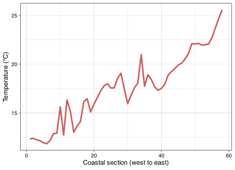
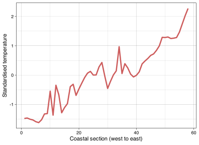
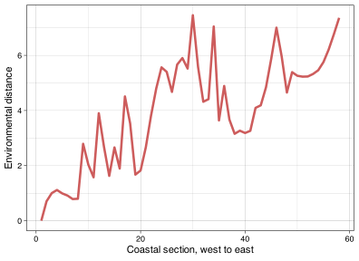
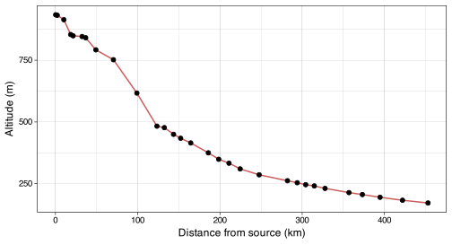
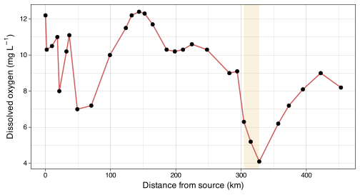
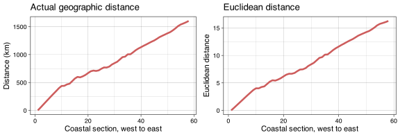

> **NOTE:**
>
> **This material must be reviewed by BCB743 students in Week 1 of Quantitative Ecology.**

> **TIP:**
>
> - [Lecture 4: Biodiversity Concepts](../BDC334/Lec-04-biodiversity.llms.md)

> **TIP:**
>
> - Example xyz data – [`Euclidean_distance_demo_data_xyz.csv`](../data/BDC334/Euclidean_distance_demo_data_xyz.csv)
> - Example env data – [`Euclidean_distance_demo_data_env.csv`](../data/BDC334/Euclidean_distance_demo_data_env.csv)
> - The seaweed environmental data ([Smit et al. 2017](#ref-smit2017seaweeds)) – [`SeaweedEnv.RData`](../data/BCB743/seaweed/SeaweedEnv.RData)
> - The seaweed coastal sections (sites) – [`SeaweedSites.csv`](../data/BCB743/seaweed/SeaweedSites.csv)
> - The Doubs River environmental data – [`DoubsEnv.csv`](../data/BCB743/DoubsEnv.csv)

> “It’s not that I’m so smart, it’s just that I stay with problems longer.”
>
> — Albert Einstein

Table 1

# 1 Set up the analysis environment

``` numberSource
library(vegan)
library(ggplot2)
library(geodist) # to calculate geographic distances between lats/lons
library(ggpubr) # to arrange the multipanel graphs
```

# 2 Revisiting Euclidean distance

The toy data have arbitrary columns to demonstrate the Euclidean distance calculation:

$$d(a,b) = \sqrt{(a_x - b_x)^2 + (a_y - b_y)^2 + (a_z - b_z)^2}$$

The distance is found between every pair of sites named ***a*** to ***g*** whose locations are marked by the ‘coordinates’ $x$, $y$, and $z$—i.e. this is an example of 3-dimensional data (a space or volume, as opposed to 2D data situated on a $x$, $y$ place). We might also call each coordinate a ‘variable’ (sometimes called a ‘dimension’) and hence we have multivariate or multidimensional data.

Let’s load the dataset and find the size of the dataframe:

``` numberSource
# xyz <- read.csv("../data/BDC334/Euclidean_distance_demo_data_xyz.csv")
xyz <- read.csv(here::here("data", "BDC334", "Euclidean_distance_demo_data_xyz.csv"))
dim(xyz)
```

    [1] 7 4

There are seven rows and four columns.

The data look like:

``` numberSource
xyz
```

      site x y z
    1    a 4 1 3
    2    b 5 5 5
    3    c 6 6 4
    4    d 1 4 9
    5    e 2 3 8
    6    f 8 3 1
    7    g 9 1 5

The first column contains the site names and it must be excluded from subsequent calculations. The remaining three columns will be used below.

Calculate the Euclidean distance using **vegan**’s `vegdist()` function and view the lower triangle with the diagonal:

``` numberSource
xyz_euc <- round(
    vegdist(xyz[, 2:4], method = "euclidian", upper = FALSE, diag = TRUE),
    4
)
# selected only cols 2, 3 and 4
xyz_euc
```

            1       2       3       4       5       6       7
    1  0.0000                                                
    2  4.5826  0.0000                                        
    3  5.4772  1.7321  0.0000                                
    4  7.3485  5.7446  7.3485  0.0000                        
    5  5.7446  4.6904  6.4031  1.7321  0.0000                
    6  4.8990  5.3852  4.6904 10.6771  9.2195  0.0000        
    7  5.3852  5.6569  5.9161  9.4340  7.8740  4.5826  0.0000

Convert to a dataframe and view it:

``` numberSource
xyz_df <- as.data.frame(as.matrix(xyz_euc))
xyz_df
```

           1      2      3       4      5       6      7
    1 0.0000 4.5826 5.4772  7.3485 5.7446  4.8990 5.3852
    2 4.5826 0.0000 1.7321  5.7446 4.6904  5.3852 5.6569
    3 5.4772 1.7321 0.0000  7.3485 6.4031  4.6904 5.9161
    4 7.3485 5.7446 7.3485  0.0000 1.7321 10.6771 9.4340
    5 5.7446 4.6904 6.4031  1.7321 0.0000  9.2195 7.8740
    6 4.8990 5.3852 4.6904 10.6771 9.2195  0.0000 4.5826
    7 5.3852 5.6569 5.9161  9.4340 7.8740  4.5826 0.0000

Distance matrices have the same properties as dissimilarity matrices, i.e.:

1.  The distance matrix is square (number rows = number columns).

2.  The diagonal is filled with 0.

3.  The matrix is symmetrical—it is comprised of symmetrical upper and lower triangles.

In terms of the meaning of the cell values, their interpretation is also analogous with that of the species dissimilarities. A value of 0 means the properties of the sites (or sections, plots, transects, quadrats, etc.) in terms of their environmental conditions are identical (this is always the case the the diagonal). The larger the number (which may be \>1) the more different sites are in terms of their environmental conditions.

Since each column, $x$, $y$, and $z$, is a variable, we can substitute them for *actual* variables or properties of the environment within which species are present. Let’s load such data (again fictitious):

``` numberSource
env_fict <- read.csv(here::here("data", "BDC334", "Euclidean_distance_demo_data_env.csv"))
head(env_fict, 2) # print first two rows only
```

      site temperature depth light
    1    a           4     1     3
    2    b           5     5     5

These are the same data as in `Euclidean_distance_demo_data_xyz.csv` but I simply renamed the columns to names of the variables temperature, depth, and light intensity. I won’t repeat the analysis here as the output remains the same.

Now apply `vegdist()` as before. The resultant distances are called ‘environmental distances’.

Let us now use some real data.

# 3 A look at the seaweed environmental data

These data accompany the analysis of the South African seaweed flora ([Smit et al. 2017](#ref-smit2017seaweeds)).

``` numberSource
load(here::here("data", "BCB743", "seaweed", "SeaweedEnv.RData"))

# lets look at the data
dim(env)
```

    [1] 58 18

We see that the data have 58 rows and 18 columns… the same number of rows as the `seaweed.csv` data. What is in the first five rows?

``` numberSource
round(env[1:5, 1:5], 4)
```

      febMean  febMax  febMed  febX95 febRange
    1 13.0012 18.7204 12.6600 16.8097   6.0703
    2 13.3795 18.6190 13.1839 17.0724   5.8893
    3 13.3616 17.8646 13.2319 16.6111   5.4314
    4 13.2897 17.1207 13.1028 16.1214   5.0490
    5 12.8113 16.3783 12.4003 15.5324   4.9779

And the last five rows?

``` numberSource
round(env[(nrow(env) - 5):nrow(env), (ncol(env) - 5):ncol(env)], 4)
```

       annRange  febSD  augSD annChl augChl febChl
    53   4.3707 1.0423 0.7735 4.3420 4.3923 4.6902
    54   4.3358 1.1556 0.9104 1.6469 2.2654 1.6930
    55   4.4104 1.1988 0.8427 0.2325 0.6001 0.5422
    56   4.6089 1.1909 0.6631 0.1321 0.4766 0.3464
    57   4.9693 1.1429 0.4994 0.1339 0.5845 0.3185
    58   5.5743 1.0000 0.3494 0.1486 0.7363 0.4165

So, each of the rows corresponds to a site (i.e. each of the coastal sections), and the columns each contains an environmental variable. The names of the environmental variables are:

``` numberSource
colnames(env)
```

     [1] "febMean"  "febMax"   "febMed"   "febX95"   "febRange" "augMean" 
     [7] "augMin"   "augMed"   "augX5"    "augRange" "annMean"  "annSD"   
    [13] "annRange" "febSD"    "augSD"    "annChl"   "augChl"   "febChl"  

As we have seen, there are 18 variables (or dimensions). These data are truly multidimensional in a way that far exceeds our brains’ limited ability to spatially visualise. For mathematicians these data define an 18-dimensional space, but all we can do is visualise 3-dimensions.

We select only some of the thermal variables; the rest are collinear with some of the ones I import:

``` numberSource
env1 <- dplyr::select(
    env,
    febMean,
    febRange,
    febSD,
    augMean,
    augRange,
    augSD,
    annMean,
    annRange,
    annSD
)
```

Let us make a quick graph of `annMean` as a function of distance along the coast ([Figure 1](#fig-seawater-temp)).

``` numberSource
ggplot(env1, aes(x = 1:58, y = annMean)) +
    geom_line(colour = "indianred", size = 1.2) +
    labs(x = "Coastal section (west to east)", y = "Temperature (°C)") +
    theme_linedraw()
```

[](Lab-02b-env_dist_files/figure-html/fig-seawater-temp-1.svg "Figure 1: Line plot showing the trend in the mean annual seawater temperature along the coast from the west at Section 1 to Section 58 in the East.")

Figure 1: Line plot showing the trend in the mean annual seawater temperature along the coast from the west at Section 1 to Section 58 in the East.

# 4 *z*-scores

Here we need to do something new that was not necessary with the toy data. We calculate *z*-scores, and the process is called ‘standardisation’. Standardisation is necessary when the variables are measured in different units—e.g. the unit for temperature is °C whereas Ch-*a* is measured in mg Chl-*a*/m³.

``` numberSource
E1 <- round(decostand(env1, method = "standardize"), 4)
E1[1:5, 1:5]
```

      febMean febRange   febSD augMean augRange
    1 -1.4915  -0.0443 -0.2713 -1.3765  -0.4735
    2 -1.4014  -0.1432 -0.1084 -1.4339  -0.0700
    3 -1.4057  -0.3932 -0.1720 -1.5269   0.0248
    4 -1.4228  -0.6020 -0.3121 -1.5797  -0.0508
    5 -1.5368  -0.6408 -0.4096 -1.5464  -0.0983

For comparison with the previous plot showing the raw data, let us now plot the standardised `annMean` data ([Figure 2](#fig-std-ann-mean)).

``` numberSource
ggplot(E1, aes(x = 1:58, y = annMean)) +
    geom_line(colour = "indianred", size = 1.2) +
    labs(x = "Coastal section (west to east)", y = "Standardised temperature") +
    theme_linedraw()
```

[](Lab-02b-env_dist_files/figure-html/fig-std-ann-mean-1.svg "Figure 2: Line plot showing the trend in the standardised mean annual seawater temperature along the coast from the west at Section 1 to Section 58 in the East.")

Figure 2: Line plot showing the trend in the standardised mean annual seawater temperature along the coast from the west at Section 1 to Section 58 in the East.

# 5 Euclidean distance

``` numberSource
E1_euc <- round(vegdist(E1, method = "euclidian", upper = TRUE), 4)
E1_df <- as.data.frame(as.matrix(E1_euc))
E1_df[1:10, 1:10]
```

            1      2      3      4      5      6      7      8      9     10
    1  0.0000 0.7040 1.0006 1.1132 0.9902 0.9124 0.7849 0.7957 2.7901 2.0327
    2  0.7040 0.0000 0.3769 0.6126 0.6553 0.7726 0.6291 0.5565 2.2733 1.7509
    3  1.0006 0.3769 0.0000 0.2818 0.4729 0.7594 0.7164 0.7939 2.2692 1.8055
    4  1.1132 0.6126 0.2818 0.0000 0.3662 0.7566 0.7911 0.9708 2.4523 1.9019
    5  0.9902 0.6553 0.4729 0.3662 0.0000 0.4094 0.5261 0.9860 2.4847 2.1376
    6  0.9124 0.7726 0.7594 0.7566 0.4094 0.0000 0.2862 1.0129 2.4449 2.3483
    7  0.7849 0.6291 0.7164 0.7911 0.5261 0.2862 0.0000 0.7678 2.3035 2.1656
    8  0.7957 0.5565 0.7939 0.9708 0.9860 1.0129 0.7678 0.0000 2.2251 1.5609
    9  2.7901 2.2733 2.2692 2.4523 2.4847 2.4449 2.3035 2.2251 0.0000 2.8476
    10 2.0327 1.7509 1.8055 1.9019 2.1376 2.3483 2.1656 1.5609 2.8476 0.0000

We already know how to read this matrix. Let’s plot it as a function of the coastal section’s number ([Figure 3](#fig-env-dist)).

``` numberSource
ggplot(data = E1_df, (aes(x = 1:58, y = `1`))) +
    geom_line(colour = "indianred", size = 1.2) +
    xlab("Coastal section, west to east") +
    ylab("Environmental distance") +
    theme_linedraw()
```

[](Lab-02b-env_dist_files/figure-html/fig-env-dist-1.svg "Figure 3: Line plot showing the trend in environmental distance along the coast from the west at Section 1 to Section 58 in the East.")

Figure 3: Line plot showing the trend in environmental distance along the coast from the west at Section 1 to Section 58 in the East.

> **IMPORTANT:**
>
> (To be reviewed by BCB743 student but not for marks)
>
> Use the Doubs River environmental data for this exercise.
>
> **Total: 14 marks for BDC334 students.** Marks are assigned only to the components listed below and under Question 8.
>
> 1.  **(/ 2)** Standardise these data using R and display a portion of the resultant standardised data file.
>     - **Mark allocation:** 1 mark for the correct code; 1 mark for the correct portion of output.
> 2.  **(/ no marks)** Discuss why standardisation was necessary for these data. Use the content of the actual ‘raw’ data file in your discussion.
> 3.  **(/ 2)** Using R, calculate the Euclidean distances for these data and display a portion of the resultant distance matrix.
>     - **Mark allocation:** 1 mark for the correct code; 1 mark for the correct portion of output.
> 4.  **(/ 6)** Discuss the ecological conclusions you are able to draw from these Euclidean distances. Provide two graphs to substantiate your answer.
>     - **Mark allocation:** 2 marks for the code for two graphs (1 per graph); 2 marks for two correct, publication-quality graphs (1 per graph), including full axis labels, units where applicable and readable presentation; 2 marks for correct explanations (1 per explanation), for example a gradient and a local perturbation.

> **TIP:**
>
> These answers use **all 30 Doubs River sites and all 11 environmental variables**. Lab 1 used only the odd-numbered sites for its distance and correlation matrices. Do not carry that selection into this exercise.
>
> ### 5.0.1 1. Standardise the Doubs data
>
> **Marking: 2 marks — 1 for the code and 1 for the correct portion of output.**
>
> Read the site numbers as row names. They identify the samples and must not become an extra environmental variable. The `dfs` column is different: it records distance from the river’s source and is retained here to match the 11-variable analysis in Lab 1.
>
> ``` numberSource
> # Read the downloaded DoubsEnv.csv in your working directory with:
> # doubs <- read.csv("DoubsEnv.csv", row.names = 1)
> # This course website uses the same file at its repository location:
> doubs <- read.csv(here::here("data", "BCB743", "DoubsEnv.csv"),
>     row.names = 1
> )
>
> # Subtract each column's mean and divide by its sample SD.
> doubs_z <- scale(doubs)
> knitr::kable(doubs_z[1:5, 1:6], digits = 3, row.names = TRUE)
> ```
>
> |     |    dfs |   alt |    slo |    flo |     pH |    har |
> |:----|-------:|------:|-------:|-------:|-------:|-------:|
> | 1   | -1.350 | 1.667 |  5.141 | -1.180 | -0.864 | -2.437 |
> | 2   | -1.336 | 1.660 | -0.057 | -1.171 | -0.288 | -2.733 |
> | 3   | -1.279 | 1.594 |  0.023 | -1.127 |  1.439 | -2.022 |
> | 4   | -1.219 | 1.373 | -0.034 | -1.087 | -0.288 | -0.836 |
> | 5   | -1.197 | 1.354 | -0.138 | -1.081 |  0.288 | -0.125 |
>
> Only a portion is displayed; `doubs_z` contains all 30 rows and 11 columns. Each column should now have a mean of zero and a sample SD of one, allowing for tiny numerical rounding errors:
>
> ``` numberSource
> round(rbind(
>     mean = colMeans(doubs_z),
>     SD = apply(doubs_z, 2, sd)
> ), 6)
> ```
>
>          dfs alt slo flo pH har pho nit amm oxy bod
>     mean   0   0   0   0  0   0   0   0   0   0   0
>     SD     1   1   1   1  1   1   1   1   1   1   1
>
> `vegan::decostand(doubs, method = "standardize")` gives the same standardisation. Keep the full precision for subsequent calculations; round only what you display.
>
> ### 5.0.2 2. Why standardisation matters here
>
> **No marks are assigned to this question.**
>
> Look at the actual scales in the file. Altitude ranges from 172 to 934, whereas pH ranges from 7.7 to 8.6 and ammonium from 0 to 1.8. Squaring the raw differences would let a variable with large numerical values, such as altitude, dominate the distance. That would reflect its scale of measurement rather than an explicit ecological decision about its importance. Even changing altitude from metres to kilometres would change the raw distances.
>
> Standardisation expresses each difference relative to the variation in that variable across these 30 sites. A difference of one standard deviation then makes the same contribution whichever variable it comes from. It does **not** make the variables biologically equally important, remove outliers, or remove correlations. Several correlated nutrient variables can still give extra weight to a shared water-quality gradient.
>
> ### 5.0.3 3. Calculate and inspect environmental distances
>
> **Marking: 2 marks — 1 for the code and 1 for the correct portion of output.**
>
> ``` numberSource
> # Calculate distances among sites, not among columns.
> doubs_dist <- dist(doubs_z, method = "euclidean")
> doubs_D <- as.matrix(doubs_dist)
> knitr::kable(doubs_D[1:5, 1:5], digits = 3, row.names = TRUE)
> ```
>
> |     |     1 |     2 |     3 |     4 |     5 |
> |:----|------:|------:|------:|------:|------:|
> | 1   | 0.000 | 5.319 | 5.686 | 5.498 | 6.293 |
> | 2   | 5.319 | 0.000 | 1.924 | 1.976 | 3.142 |
> | 3   | 5.686 | 1.924 | 0.000 | 2.201 | 2.669 |
> | 4   | 5.498 | 1.976 | 2.201 | 0.000 | 2.173 |
> | 5   | 6.293 | 3.142 | 2.669 | 2.173 | 0.000 |
>
> The complete matrix is 30 × 30. Its diagonal is zero and its two triangles mirror one another. Sites 2 and 3 have a distance of about 1.924; Sites 1 and 5 have a distance of about 6.293. The second pair is more different in the selected, standardised environmental variables. These are not kilometres, percentages or probabilities, and a value greater than one is perfectly possible.
>
> ### 5.0.4 4. Describe the pattern, then consider its causes
>
> **Marking: 6 marks — 2 for the code for two graphs, 2 for two correct, publication-quality graphs, and 2 for correct explanations. Each graph can earn 1 code mark, 1 presentation/output mark and 1 explanation mark.**
>
> A distance tells us how different two sites are overall. To explain that difference, return to the variables that went into it. Plotting them against distance from the source also respects the unequal spacing of the sampling sites. The two examples below show a broad altitude gradient and a local oxygen decline. Other suitable graphs and well-supported explanations are acceptable.
>
> ``` numberSource
> ggplot(doubs, aes(dfs, alt)) +
>     geom_line(colour = "indianred", linewidth = 0.7) +
>     geom_point(size = 2) +
>     labs(x = "Distance from source (km)", y = "Altitude (m)") +
>     theme_linedraw(base_size = 12)
> ```
>
> [](Lab-02b-env_dist_files/figure-html/fig-lab2-answer-doubs-gradients-1.svg "Figure 4: Altitude along the Doubs River. Points are the 30 sampled sites, positioned by their distance from the source.")
>
> Figure 4: Altitude along the Doubs River. Points are the 30 sampled sites, positioned by their distance from the source.
>
> **Explanation 1:** Altitude decreases downstream, showing a broad longitudinal gradient. Sites far apart along that gradient can have large environmental distances partly because they differ in altitude. This is a description of river position and topography; it does not establish that altitude caused every other environmental change.
>
> ``` numberSource
> ggplot(doubs, aes(dfs, oxy)) +
>     annotate("rect",
>         xmin = doubs$dfs[23], xmax = doubs$dfs[25],
>         ymin = -Inf, ymax = Inf, fill = "goldenrod", alpha = 0.15
>     ) +
>     geom_line(colour = "indianred", linewidth = 0.7) +
>     geom_point(size = 2) +
>     labs(
>         x = "Distance from source (km)",
>         y = expression("Dissolved oxygen (mg " * L^{
>             -1
>         } * ")")
>     ) +
>     theme_linedraw(base_size = 12)
> ```
>
> [](Lab-02b-env_dist_files/figure-html/fig-lab2-answer-oxygen-perturbation-1.svg "Figure 5: Dissolved oxygen along the Doubs River. Shading locates Sites 23–25, where oxygen is particularly low; concentrations rise again farther downstream.")
>
> Figure 5: Dissolved oxygen along the Doubs River. Shading locates Sites 23–25, where oxygen is particularly low; concentrations rise again farther downstream.
>
> **Explanation 2:** The oxygen decline around Sites 23–25, followed by higher concentrations downstream, is consistent with a local perturbation superimposed on the river gradient. Increased microbial oxygen consumption after organic inputs is one possible explanation. The high biological oxygen demand at these sites supports investigating that explanation, but oxygen supply and reaeration must also be measured.
>
> The wider dataset helps us interpret these two graphs:
>
> - **There is a broad downstream gradient.** Altitude decreases and flow generally increases. Accumulating drainage and tributary inputs could help explain increasing flow. Neighbouring sites often have similar environments, but being neighbours does not guarantee similarity.
> - **Sites 23–25 show a marked water-quality change.** Phosphate, ammonium and biological oxygen demand are high, while oxygen is low. Sites 1 and 25 are the most different pair in this matrix, with a distance of about 12.145. Site 1 also has an unusually steep slope, which contributes to this difference. Sites 11 and 13 are much more similar, with a distance of about 0.968.
> - **Some water-quality variables move back towards earlier values below Site 25.** Oxygen rises while ammonium and biological oxygen demand fall. Dilution, reaeration, uptake and processing of organic material are possible explanations to investigate. The measurements do not establish which process was responsible.
>
> Organic inputs followed by microbial respiration offer one explanation for the combination of high oxygen demand and low dissolved oxygen. However, a distance matrix cannot identify a discharge source, establish causation or demonstrate a change in fish composition. Those conclusions require additional measurements. Also remember that `dfs` itself is in this distance calculation: part of the spatial pattern is included by construction. Task 8 shows how to check the result without it.

We will explore distance and dissimilarity matrices in more detail in later sections.

# 6 Pairwise correlations

It is easy to calculate pairwise correlation matrices for the above data:

``` numberSource
env1_cor <- round(cor(env1), 2)
env1_cor
```

             febMean febRange febSD augMean augRange augSD annMean annRange annSD
    febMean     1.00    -0.27 -0.28    0.90    -0.10 -0.16    0.98     0.74  0.41
    febRange   -0.27     1.00  0.79   -0.32     0.14  0.14   -0.29    -0.08  0.48
    febSD      -0.28     0.79  1.00   -0.16     0.35  0.46   -0.26    -0.33  0.31
    augMean     0.90    -0.32 -0.16    1.00    -0.01 -0.05    0.96     0.37  0.13
    augRange   -0.10     0.14  0.35   -0.01     1.00  0.91   -0.10    -0.20  0.06
    augSD      -0.16     0.14  0.46   -0.05     0.91  1.00   -0.17    -0.27  0.08
    annMean     0.98    -0.29 -0.26    0.96    -0.10 -0.17    1.00     0.60  0.29
    annRange    0.74    -0.08 -0.33    0.37    -0.20 -0.27    0.60     1.00  0.68
    annSD       0.41     0.48  0.31    0.13     0.06  0.08    0.29     0.68  1.00

> **IMPORTANT:**
>
> (To be reviewed by BCB743 student but not for marks)
>
> 5.  **(/ no marks)** Explain in a short (1/3 page paragraph) what is meant by ‘environmental distance’.
> 6.  **(/ no marks)** Describe to your grandmother how to interpret the above correlation matrix, and also mention what the major conclusions are that can be drawn from studying the matrix. Add a mechanistic explanation to demonstrate to her what your thought processes are for reaching your conclusion.
> 7.  **(/ no marks)** Explain why the same general trend is seen in the raw or standardised environmental data for `annMean` (Figure 1 and 2) and that of environmental distance (Figure 3).

> **TIP:**
>
> **No marks are assigned to Questions 5–7.**
>
> ### 6.0.1 5. What is environmental distance?
>
> Environmental distance describes how different two sites are in a specified set of environmental measurements. Imagine describing each site by its altitude, flow, oxygen and other measured conditions. For each variable, take the difference between the two sites. Euclidean distance squares these differences, adds them and takes the square root. We standardise the Doubs variables first so that different units and numerical scales do not determine their contributions. Zero means the sites have identical values for the variables included; larger values mean greater overall difference. Two geographically distant sites can therefore have a small environmental distance, while two nearby sites can have a large one. The result depends on which variables we select and how we scale them. It summarises the measured environment; it is not a complete measure of habitat quality, species composition or ecological importance.
>
> ### 6.0.2 6. Read the coastal correlation matrix
>
> **This question refers to the nine seaweed thermal variables in `env1_cor` immediately above, not to the Doubs distance matrix.**
>
> Think of each entry as asking whether two measurements tend to move together across the 58 coastal sections. A number close to +1 means sections with high values of one usually have high values of the other. A number close to −1 means high values of one usually accompany low values of the other. A value close to zero means little *linear* association; it does not rule out a curved relationship. The diagonal is all ones because each measurement is being compared with itself. The repeated triangle contains the same information twice.
>
> Here are some examples from this matrix:
>
> | Comparison | Pearson’s *r* | What it shows |
> |----|---:|----|
> | February mean and annual mean | 0.98 | Sections that are warm in February also tend to be warm over the year. |
> | August mean and annual mean | 0.96 | Much of that ordering persists in August. |
> | February mean and August mean | 0.90 | Warm and cool sections retain a broad seasonal consistency. |
> | August range and August SD | 0.91 | The two measures of within-month variability tend to increase together. |
> | February range and February SD | 0.79 | The same broad association occurs in February. |
> | Annual mean and August range | −0.10 | Mean warmth tells us little about August’s range in a simple linear comparison. |
>
> Differences in the source and mixing of coastal water could maintain relatively cool and warm sections across seasons. Changes in water movement or episodic upwelling could also produce temperature fluctuations within a month. To test those explanations, we would need temperature time series together with information about water movement and upwelling. The matrix alone does not show which mechanism operates. There is also a simpler reason for some correlations: annual and monthly means share underlying temperature observations, while range and SD both describe variation. They are not independent lines of evidence.
>
> ### 6.0.3 7. Why do the three coastal plots look broadly similar?
>
> The raw and standardised `annMean` plots have **exactly the same shape**. Standardisation subtracts one constant and divides by another positive constant. It changes the vertical scale but preserves the ordering, peaks and troughs.
>
> The environmental-distance plot asks a different question. Its column `1` gives the distance of every section **from Section 1**, using all nine standardised thermal variables:
>
> $$d(1,j) = \sqrt{\sum_{k=1}^{9}(z_{1k}-z_{jk})^2}.$$
>
> Section 1 is a cool western reference section. Mean annual temperature rises broadly towards the east, and the February and August means change with it. Many eastern sections therefore differ from Section 1 in several variables at once, increasing their environmental distance. This explains the broad resemblance. The curves need not match: temperature range and variability also contribute, and environmental distance has no sign. Choosing another reference section would change the distance curve without changing the `annMean` curve. Do not interpret Figure 3 as distance from each section’s immediate neighbour, or as a geographic distance.

# 7 Euclidean distance of geographical data

When we calculate Euclidean distances between geographic lat/lon coordinate, the relationship between sections will be the same (but scaled) as actual geographic distances.

``` numberSource
geo <- read.csv(here::here("data", "BCB743", "seaweed", "SeaweedSites.csv"))
dim(geo)
```

    [1] 58  2

``` numberSource
head(geo)
```

       Latitude Longitude
    1 -28.98450  16.72429
    2 -29.38053  16.94238
    3 -29.83253  17.08194
    4 -30.26426  17.25928
    5 -30.67874  17.47638
    6 -31.08580  17.72167

Calculate geographic distances (in meters) between coordinate pairs ([Figure 6](#fig-geodist)).

``` numberSource
dists <- geodist(geo, paired = TRUE, measure = "geodesic")
dists_df <- as.data.frame(as.matrix(dists))
colnames(dists_df) <- seq(1:58)
dists_df[1:5, 1:5]
```

              1         2         3         4         5
    1      0.00  48752.45 100201.82 151021.75 201380.00
    2  48752.45      0.00  51894.01 102638.03 152849.90
    3 100201.82  51894.01      0.00  50822.71 101197.22
    4 151021.75 102638.03  50822.71      0.00  50457.53
    5 201380.00 152849.90 101197.22  50457.53      0.00

``` numberSource
plt1 <- ggplot(data = dists_df, (aes(x = 1:58, y = `1` / 1000))) +
    geom_line(colour = "indianred", size = 1.2) +
    xlab("Coastal section, west to east") +
    ylab("Distance (km)") +
    ggtitle("Actual geographic distance") +
    theme_linedraw()
```

``` numberSource
dists_euc <- vegdist(geo, method = "euclidian")
dists_euc_df <- round(as.data.frame(as.matrix(dists_euc)), 4)
dists_euc_df[1:5, 1:5]
```

           1      2      3      4      5
    1 0.0000 0.4521 0.9204 1.3871 1.8537
    2 0.4521 0.0000 0.4731 0.9388 1.4037
    3 0.9204 0.4731 0.0000 0.4667 0.9336
    4 1.3871 0.9388 0.4667 0.0000 0.4679
    5 1.8537 1.4037 0.9336 0.4679 0.0000

``` numberSource
plt2 <- ggplot(data = dists_euc_df, (aes(x = 1:58, y = `1`))) +
    geom_line(colour = "indianred", size = 1.2) +
    xlab("Coastal section, west to east") +
    ylab("Euclidean distance") +
    ggtitle("Euclidean distance") +
    theme_linedraw()

ggarrange(plt1, plt2, ncol = 2)
```

[](Lab-02b-env_dist_files/figure-html/fig-geodist-1.svg "Figure 6: Line plots showing the relationship between Euclidean and geographical distance.")

Figure 6: Line plots showing the relationship between Euclidean and geographical distance.

> **IMPORTANT:**
>
> (To be reviewed by BCB743 student but not for marks)
>
> 8.  **(/ 4)** Do a full analysis of the Doubs River environmental data using Euclidean distances and correlations. Demonstrate graphically any clear spatial patterns that you might find, and offer a full suite of mechanistic explanations for the patterns you see. It is sufficient to submit a fully annotated R script (not a MS Word or Excel file).
>     - **Mark allocation:** 1 mark for the Euclidean distance code; 1 mark for the correct visualisation of Euclidean distance; 1 mark for the correlations code; 1 mark for the correct pairwise correlations.

> **TIP:**

> **IMPORTANT:**
>
> The Lab 2b assignment on Environmental Distance is due at **08:00 on Monday, 14 September 2026**.
>
> Provide a **neat and thoroughly annotated** R file which can recreate all the graphs and all calculations. Written answers must be typed in the same file as comments.
>
> Please label the R file as follows:
>
> - `BDC334_<first_name>_<last_name>_Lab_2.R`
>
> (the `<` and `>` must be omitted as they are used in the example as field indicators only).
>
> Upload your appropriately named R document to iKamva by the stated deadline. This requirement applies to both pre-assessed and self-assessed submissions. If this Lab is self-assessed, complete and upload the self-assessment to iKamva by 23:59 on the same day. See the [Lab submission and self-assessment policy](../BDC334/BDC334_syllabus.llms.md#sec-lab-self-assessment) for the checking and penalty rules.
>
> The marked components total **14 marks**. Questions 2 and 5–7 remain learning exercises without marks. Figure presentation is assessed within Question 4; there is no separate formatting mark.

## References

Smit AJ, Bolton JJ, Anderson RJ (2017) Seaweeds in two oceans: Beta-diversity. Frontiers in Marine Science 4:404.

## Reuse

[CC BY-NC-SA 4.0](https://creativecommons.org/licenses/by-nc-sa/4.0/)

## Citation

BibTeX citation:

``` quarto-appendix-bibtex
@online{smit2026,
  author = {Smit, A. J. and J. Smit, A.},
  title = {Lab 2b: {Environmental} Distance},
  date = {2026-08-19},
  url = {https://tangledbank.netlify.app/BDC334/Lab-02b-env_dist.html},
  langid = {en}
}
```

For attribution, please cite this work as:

Smit AJ, J. Smit A (2026) Lab 2b: Environmental distance. [https://tangledbank.netlify.app/BDC334/Lab-02b-env_dist.html.](https://tangledbank.netlify.app/BDC334/Lab-02b-env_dist.html)
