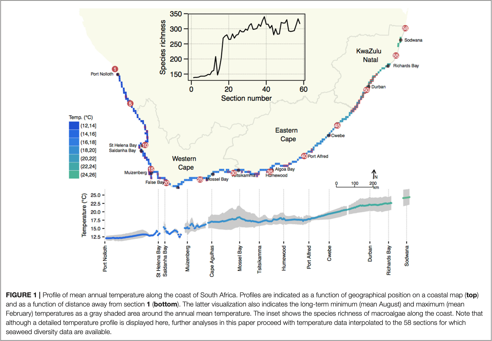
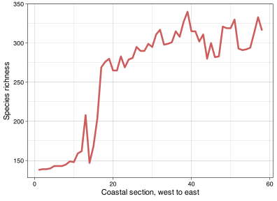
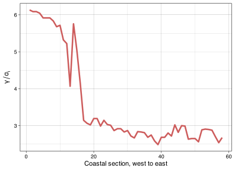
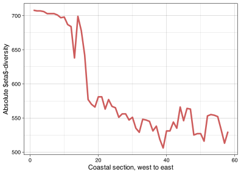
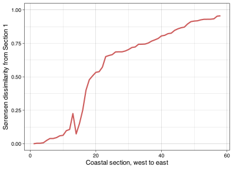
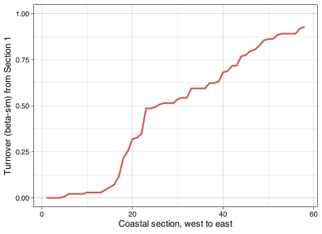

> **NOTE:**
>
> **This material must be reviewed by BCB743 students in Week 1 of Quantitative Ecology.**

> **TIP:**
>
> - [Lecture 4: Biodiversity Concepts](../BDC334/Lec-04-biodiversity.llms.md)

> **TIP:**
>
> The seaweed ([Smit et al. 2017](#ref-smit2017seaweeds)) and toy data are at the links below:
>
> - The seaweed species data – [`SeaweedSpp.csv`](../data/BCB743/seaweed/SeaweedSpp.csv)
> - The seaweed environmental data – [`SeaweedEnv.csv`](../data/BCB743/seaweed/SeaweedEnv.csv)
> - The seaweed coastal sections – [`SeaweedSites.csv`](../data/BCB743/seaweed/SeaweedSites.csv)
> - The fictitious light data [`light_levels.csv`](../data/BDC334/light_levels.csv)

> ***Biodiversity** The variability among living organisms from all sources including,* inter alia*, terrestrial, marine and other aquatic ecosystems and the ecological complexes of which they are part; this includes diversity within species, between species and of ecosystems.*
>
> — International Union for the Conservation of Nature (IUCN), Convention on Biological Diversity

The IUCN definition considers a diversity of diversity concepts. This module looks at diversity only at the species level (species diversity). However, we can also approach macroecological problems from phylogenetic and functional (and other) diversity concepts of view. Functional and phylogenetic diversity ideas will be introduced in the [BDC743 module Quantitative Ecology](../BCB743/BCB743_index.llms.md).

# 1 Preparation

## 1.1 The South African seaweed data

In these examples, we will use the seaweed data of Smit et al. ([2017](#ref-smit2017seaweeds)). Please make sure that you read this paper. An additional file describing the background to the data is available [here](../docs/Smit_the_seaweed_data.pdf) ([Figure 1](#fig-seaweed-sections)).

[](../images/Seaweed_sections.png "Figure 1: The coastal sections and associated seawater temperature profile associated with the study by @smit2017seaweeds.")

Figure 1: The coastal sections and associated seawater temperature profile associated with the study by Smit et al. ([2017](#ref-smit2017seaweeds)).

One of the datasets, $Y$ (in the file `SeaweedSpp.csv`), comprises updated distribution records of 847 macroalgal species within each of 58 × 50 km-long sections of the South African coast ([Bolton and Stegenga 2002](#ref-bolton2002seaweed)). The dataset captures *ca*. 90% of the known seaweed flora of South Africa, but excludes some very small and/or very rare species for which data are insufficient. The data are from verifiable literature sources and John Bolton and Rob Anderson’s collections, assembled from information collected by teams of phycologists over three decades ([Bolton 1986](#ref-bolton1986marine); [Stegenga et al. 1997](#ref-stegenga1997seaweeds); [Bolton and Stegenga 2002](#ref-bolton2002seaweed); [De Clerck et al. 2005](#ref-de2005guide)). Another file, $E$ (in `env.csv`), is a dataset of *in situ* coastal seawater temperatures derived from daily measurements over 40 years ([Smit et al. 2013](#ref-smit2013coastal)).

## 1.2 Setting up the analysis environment

We will use **R**, so first, we must find, install and load various packages. Some packages will be available on CRAN and can be accessed and installed the usual way, but you will need to download others from [R Forge](https://r-forge.r-project.org/R/?group_id=195).

``` numberSource
library(tidyverse)
library(vegan)
library(betapart)
```

## 1.3 A look at the data

Let’s load the data and see how it is structured:

``` numberSource
spp <- read.csv(here::here("data", "BCB743", "seaweed", "SeaweedSpp.csv"))
spp <- dplyr::select(spp, -1)

# Lets look at the data:
dim(spp)
```

    [1]  58 847

We see that our dataset has 58 rows and 847 columns. What is in the columns and rows? Start with the first five rows and five columns:

``` numberSource
spp[1:5, 1:5]
```

      ACECAL ACEMOE ACRVIR AROSP1 ANAWRI
    1      0      0      0      0      0
    2      0      0      0      0      0
    3      0      0      0      0      0
    4      0      0      0      0      0
    5      0      0      0      0      0

Now the last five rows and five columns:

``` numberSource
spp[(nrow(spp) - 5):nrow(spp), (ncol(spp) - 5):ncol(spp)]
```

       WOMKWA WOMPAC WRAARG WRAPUR WURMIN ZONSEM
    53      0      0      1      0      0      0
    54      0      0      1      0      0      0
    55      0      0      1      0      0      0
    56      0      1      1      0      1      0
    57      1      0      1      0      1      0
    58      0      0      1      0      1      0

So, each row corresponds to a site (i.e. each of the coastal sections), and each column contains a species. We arrange the species alphabetically and use a six-letter code to identify them.

# 2 Species data

When ecologists talk about species diversity, they typically consider the characteristics of biological communities in a specific habitat, ecological community, or ecosystem. Species diversity considers three essential concepts about how species are distributed in space: their **richness**, **abundance**, and **evenness**. We can express each of these as biodiversity metrics that allow us to compare communities in space and time.

When ecologists talk about ‘biodiversity’, they might not necessarily be interested in *all* the plants and animals and things that are neither plant nor animal that occur at a particular place. Some ecologists are interested in ants and moths. Others might find fish more insightful. Some even like marine mammals! I prefer seaweed. The analysis of biodiversity data might often be constrained to some higher-level taxon, such as all angiosperms in a landscape, reptiles, etc. (but we sample all species in the higher-level taxon). Some ecological questions benefit from comparisons of diversity assessments among selected taxa (avifauna vs small mammals, for example), as this focus might address some particular ecological hypothesis. The bird vs small mammal comparison might reveal how barriers such as streams and rivers structure biodiversity patterns. In our examples, we will use such focused datasets.

Here we look at the various measures of biodiversity, viz. $\alpha$-, $\gamma$- and $\beta$-diversity. David Zelený, in his [Analysis of community data in R](https://www.davidzeleny.net/anadat-r/doku.php/en:diversity_analysis), provides deeper analysis and compulsory reading.

# 3 Three measures of biodiversity: $\Alpha$-, $\Gamma$-, $\beta$-diversity

Whittaker ([1972](#ref-whittaker1972evolution)) coined three measures of biodiversity, and the concepts were ‘modernised’ by Jurasinski et al. ([2009](#ref-jurasinski2009inventory)). The concepts represent the measurement of biodiversity *across different spatial scales*. $\alpha$- and $\gamma$-diversity express the total number of species in an area. The first, $\alpha$-diversity, represents the number of species at the small (local) scale, such as, for example, within a sampling unit like a quadrat, transect, plot, or trawl. Alternatively, maybe the research question represents the local scale by several sampling units nesting within a small patch of landscape and defines the mean species richness within this patch as local. Multiples (sampling units or patches) are nested within a larger region (or ecosystem) and serve as replicates. The complete number of species across all of these replicates indicates the diversity at a larger scale—this is called $\gamma$-diversity. $\beta$-diversity refers to the change in species composition among samples (sites).

By now, you will have received a brief [Introduction to R](../BDC334/Lab-02a-r_rstudio.llms.md), and we can proceed with looking at some of the measures of biodiversity. We will start by using data on the seaweeds of South Africa to demonstrate some ideas around diversity measures. The **vegan**[^1] (for *vegetation analysis*) package ([Oksanen et al. 2022](#ref-oksanen2022vegan)) offers [various functions](../docs/Oksanen_diversity-vegan.pdf) to calculate diversity indices. I will demonstrate some of these functions below.

## 3.1 Alpha-diversity

We can represent $\alpha$-diversity in three ways:

1.  as *species richness*, $S$;
2.  as a *univariate diversity index*, such as the $\alpha$ parameter of [Fisher’s log-series](../BDC334/Lab-04-biodiversity.llms.md#sec-lab04-sad), Shannon diversity, $H'$, Simpson’s diversity, $\lambda$; or
3.  Species *evenness*, e.g. Pielou’s evenness, $J$.

We will work through each in turn.

### 3.1.1 Species richness, $S$

First, is species richness, which we denote by the symbol $S$. This is the simplest measure of $\alpha$-diversity, counting the number of species (or another taxonomic level) present in a given community or sample. It doesn’t consider the abundance of species.

In the seaweed biodiversity data, I count the number of species within each of the sections. This is because we view each coastal section as the local scale (the smallest unit of sampling).

The preferred option for calculating species richness is the `specnumber()` function in **vegan**:

``` numberSource
specnumber(spp, MARGIN = 1) # <1>
```

1.  The `MARGIN = 1` argument tells R to calculate the number of species within each row (site).

     [1] 138 139 139 140 143 143 143 145 149 148 159 162 208 147 168 204 269 276 280
    [20] 265 265 283 269 279 281 295 290 290 299 295 311 317 298 299 301 315 308 327
    [39] 340 315 315 302 311 280 300 282 283 321 319 319 330 293 291 292 294 313 333
    [58] 316

The data output is easier to understand if we display it as a `tibble()`:

``` numberSource
spp_richness <- tibble(
    section = 1:58,
    richness = specnumber(spp, MARGIN = 1)
)
head(spp_richness)
```

    # A tibble: 6 × 2
      section richness
        <int>    <int>
    1       1      138
    2       2      139
    3       3      139
    4       4      140
    5       5      143
    6       6      143

Now we make a plot seen in [Figure 2](#fig-species-richness):

``` numberSource
ggplot(data = spp_richness, (aes(x = 1:58, y = richness))) +
    geom_line(size = 1.2, colour = "indianred") +
    xlab("Coastal section, west to east") +
    ylab("Species richness") +
    theme_linedraw()
```

[](Lab-03-biodiversity_files/figure-html/fig-species-richness-1.svg "Figure 2: The seaweed species richness, S, within each of the coastal sections along the shore of South Africa.")

Figure 2: The seaweed species richness, $S$, within each of the coastal sections along the shore of South Africa.

In other instances, it makes more sense to calculate the mean species richness of all the sampling units (e.g. quadrats) taken inside the ecosystem of interest. How you calculate and present species richness depend on your research question and so you will have to decide based on your data and study.

In the seaweed study, the mean ± SD species richness across all of the 58 coastal sections is:

``` numberSource
round(mean(spp_richness$richness), 2)
```

    [1] 259.24

``` numberSource
round(sd(spp_richness$richness), 2)
```

    [1] 68.03

### 3.1.2 Univariate diversity indices

The second way we can express $\alpha$-diversity is to use one of the univariate diversity indices. The choice of which index to use should be informed by the extent to which one wants to emphasise richness or evenness. Species richness, $S$, does not consider evenness as it is all about richness (obviously). Simpson’s $\lambda$ emphasises evenness a lot more. Shannon’s $H'$ is somewhere in the middle.

**Shannon’s** $H'$ is sometimes called Shannon’s diversity, the Shannon-Wiener index, the Shannon-Weaver index, or the Shannon entropy. This is a more nuanced measure that considers both species richness and evenness (how evenly individuals are distributed across different species).

It is calculated as:

$$H' = -\sum_{i=1}^{S} p_{i} \ln p_{i}$$

where $p_{i}$ is the proportion of individuals belonging to the $i$-th species, and $S$ is the species richness.

**Simpson’s** $\lambda$, or simply the Simpson index, is a measure that represents the probability that two individuals randomly selected from a sample will belong to the same species. It is calculated as:

$$\displaystyle \lambda = \sum_{i=1}^{S} p_{i}^{2}$$

where $S$ is the species richness and $p_{i}$ is the relative abundance of the $i$th species.

**Fisher’s** $\alpha$ estimates the $\alpha$ parameter of [Fisher’s logarithmic series](../BDC334/Lab-04-biodiversity.llms.md#sec-lab04-sad) (see functions `fisher.alpha()` and `fisherfit()`). The estimation is possible only for actual counts (i.e. integers) of individuals, so it will not work for per cent cover, biomass, and other measures that real numbers can express. It’s especially useful for comparing the diversity of samples with different total abundances. We will get to this function later under [Fisher’s logarithmic series](../BDC334/Lab-04-biodiversity.llms.md#sec-lab04-sad).

Except for Fisher’s-$\alpha$, we cannot calculate these for the seaweed data, because, in order to do so, we require abundance data—the seaweed data are presence-absence only. Let us load a fictitious dataset of the diversity of three different communities of plants, with each community corresponding to a different light environment (dim, mid, and high light):

``` numberSource
light <- read.csv(here::here("data", "BDC334", "light_levels.csv"))
light
```

            Site    A    B    C    D    E    F
    1  low_light 0.75 0.62 0.24 0.33 0.21 0.14
    2  mid_light 0.38 0.15 0.52 0.57 0.28 0.29
    3 high_light 0.08 0.15 0.18 0.52 0.54 0.56

We can see above that instead of having data with 1s and 0s for presence-absence, here we have some values that indicate the relative number of individuals belonging to each of the species in the three light environments. We calculate species richness (as before), and also the Shannon and Simpson indices using **vegan**’s `diversity()` function:

``` numberSource
light_div <- tibble(
    site = c("low_light", "mid_light", "high_light"),
    richness = specnumber(light[, 2:7], MARGIN = 1),
    shannon = round(diversity(light[, 2:7], MARGIN = 1, index = "shannon"), 2),
    simpson = round(diversity(light[, 2:7], MARGIN = 1, index = "simpson"), 2)
)
light_div
```

    # A tibble: 3 × 4
      site       richness shannon simpson
      <chr>         <int>   <dbl>   <dbl>
    1 low_light         6    1.62    0.78
    2 mid_light         6    1.71    0.81
    3 high_light        6    1.59    0.77

Evenness refers to the shape of a [species abundance distribution](../BDC334/Lab-04-biodiversity.llms.md#sec-lab04-sad), which suggests the relative abundance of different species.

One index for evenness is Pielou’s evenness, $J$:

$$J = \frac{H^{\prime}} {log(S)}$$

where $H'$ is Shannon’s diversity index, and $S$ the number of species (i.e. $S$).

To calculate Pielou’s evenness index for the `light` data, we can do this:

``` numberSource
H <- diversity(light[, 2:7], MARGIN = 1, index = "shannon")

J <- H / log(specnumber(light[, 2:7]))
round(J, 2)
```

       1    2    3 
    0.91 0.95 0.89 

**Berger-Parker Index** indicates the proportion of the community that the most abundant species represents. It is given by the formula:

$$d = \frac{N_{max}}{N}$$ where $N_{max}$ is the number of individuals of the most common species and $N$ is the total number of individuals in the sample.

**Chao1** and **ACE** are estimators often used to predict the total species richness in a community based on the number of rare species observed in samples.

## 3.2 Gamma-diversity

Returning to the seaweed data, $Y$, let us now look at $\gamma$-diversity—this would be the total number of species along the South African coastline in all 58 coastal sections. Since each column represents one species, and the dataset contains data collected at each of the 58 sites (the number of rows), we can do:

``` numberSource
ncol(spp) # <1>`
```

    [1] 847

1.  The number of columns counts all species listed in the file, including any with no recorded presences.

We can also use the `specnumber()` function to calculate $\gamma$-diversity by applying it to columns where the `sum > 0`:

``` numberSource
richness_pooled <- specnumber(colSums(spp > 0))
richness_pooled
```

    [1] 846

> **IMPORTANT:**
>
> (To be reviewed by BCB743 student but not for marks)
>
> **Total: 14 marks for BDC334 students.**
>
> 1.  **(/ 2)** Why is there a difference between the two?
> 2.  **(/ 1)** Which is correct?

> **TIP:**
>
> ### 3.2.1 1. Why the totals differ
>
> **Marking: 2 marks; 1 for both totals and 1 for the all-zero column.**
>
> `ncol(spp)` returns **847**, whereas `specnumber(colSums(spp > 0))` returns **846**. The file lists 847 species, but the column `ANTNEM` contains only zeros across all 58 sections. It contributes to the column count without contributing a recorded species to the pooled assemblage. We can check this directly:
>
> ``` numberSource
> c(
>     listed_species = ncol(spp),
>     recorded_species = specnumber(colSums(spp > 0))
> )
> ```
>
>       listed_species recorded_species 
>                  847              846 
>
> ``` numberSource
> names(spp)[colSums(spp > 0) == 0]
> ```
>
>     [1] "ANTNEM"
>
> ### 3.2.2 2. The correct regional richness
>
> **Marking: 1 mark for the pooled presence-based count of 846.**
>
> For the observed $\gamma$-diversity of these 58 sections, **846 species** is correct. A species must occur in at least one section to enter the regional count. `sum(colSums(spp > 0) > 0)` gives the same result. Counting columns works only when every species column has at least one presence. This is richness recorded in the supplied dataset, not an estimate of all seaweed species that might occur along the coast.

Think before you calculate $\gamma$-diversity for your own data as it might not be as simple as here!

## 3.3 Beta-diversity

### 3.3.1 Whittaker’s $\beta$-diversity

Whittaker’s multiplicative $\beta$-diversity is regional $\gamma$-diversity divided by mean local $\alpha$-diversity ([Whittaker 1960](#ref-whittaker1960vegetation)). Here, `richness_pooled / mean(spp_richness$richness)` gives that regional summary. To see how each section’s richness compares with the regional pool, we can also plot $\gamma / \alpha_i$ for each section ([Figure 3](#fig-true-beta)). These section-specific ratios are not separate estimates of regional $\beta$-diversity.

``` numberSource
true_beta <- data.frame(
    beta = richness_pooled / specnumber(spp, MARGIN = 1),
    section_no = c(1:58)
)
# true_beta
ggplot(data = true_beta, (aes(x = section_no, y = beta))) +
    geom_line(size = 1.2, colour = "indianred") +
    xlab("Coastal section, west to east") +
    ylab(expression(gamma / alpha[i])) +
    theme_linedraw()
```

[](Lab-03-biodiversity_files/figure-html/fig-true-beta-1.svg "Figure 3: Regional species richness divided by the richness of each coastal section.")

Figure 3: Regional species richness divided by the richness of each coastal section.

The second measure of $\beta$-diversity is *absolute species turnover*, and to calculate this, we subtract $\alpha$-diversity for each section from the region’s $\gamma$-diversity ([Figure 4](#fig-abs-beta)):

``` numberSource
abs_beta <- data.frame(
    beta = richness_pooled - specnumber(spp, MARGIN = 1),
    section_no = c(1:58)
)
# abs_beta
ggplot(data = abs_beta, (aes(x = section_no, y = beta))) +
    geom_line(size = 1.2, colour = "indianred") +
    xlab("Coastal section, west to east") +
    ylab("Absolute $\beta$-diversity") +
    theme_linedraw()
```

[](Lab-03-biodiversity_files/figure-html/fig-abs-beta-1.svg "Figure 4: Whittaker’s absolute species turnover shown in action in the seaweed data.")

Figure 4: Whittaker’s absolute species turnover shown in action in the seaweed data.

### 3.3.2 Contemporary definitions $\beta$-diversity

Contemporary definitions of $\beta$-diversity are anchored in [pairwise *dissimilarity indices*](../BDC334/Lec-04-biodiversity.llms.md#sec-dissimilarity-indices) such as Bray–Curtis, Jaccard, or Sørensen dissimilarities—see Koleff et al. ([2003](#ref-koleff2003measuring)) for a broader catalogue, and consult `?vegdist` for implementation details.

#### Dissimilarity indices

Dissimilarity indices constitute a subset of diversity measures that rely on pairwise comparisons between sampling units, habitats, or ecosystems.

The outcome of such comparisons is a *pairwise matrix* of species dissimilarities, directly analogous to the correlation and Euclidean distance matrices introduced in [Lab 1](../BDC334/Lec-01-introduction.llms.md). In [Lab 2b](../BDC334/Lec-04-biodiversity.llms.md) you learned how to compute these ecological distances in **R**. Unlike univariate diversity indices, these measures are multivariate, designed to quantify differences between sites, plots, or regions rather than summarising properties of a single community.

Different indices are used depending on the data structure: Bray–Curtis and Jaccard for abundance data, and Sørensen for presence–absence data. Because the seaweed dataset is presence–absence, Sørensen is the appropriate choice. Regardless of whether the matrix derives from abundance or presence–absence data, the interpretation is consistent: values range from 0 (two sites share all species) to 1 (no species in common). By construction, the diagonal is always 0, since any site is identical to itself.

For the seaweed dataset of 58 sites, the pairwise comparison yields

$$(58 \times (58 - 1))/2 = 1653$$

unique values, each falling between 0 and 1. These entries populate a symmetric square matrix whose structure is both intuitive and mathematically consistent: the ecological distance between sites is expressed in a form readily amenable to further multivariate analysis.

The first step begins with the species table, $Y$. Using presence–absence data, we compute the Sørensen dissimilarity index, $\beta_{\text{sør}}$, which quantifies the dissimilarity between all pairs of coastal sections. This measure is derived from three quantities: $a$, the number of species shared by both sites; and $b$ and $c$, the numbers of species unique to each site. Formally,

$$\beta_\text{sør} = \frac{b + c}{2a + b + c} = 1 - \frac{2a}{2a + b + c}.$$

Here, $a$ denotes the species common to both sites, while $b$ and $c$ capture the exclusive species of each. The index ranges from 0 to 1: a value of 0 indicates identical species composition (complete overlap), whereas a value of 1 indicates complete dissimilarity (no overlap).

In practice, the vegan function `vegdist()` provides access to a range of dissimilarity indices, including Sørensen, which we apply to the species table to generate the full pairwise matrix.

``` numberSource
sor <- vegdist(spp, method = "bray", binary = TRUE) # Sørensen dissimilarity
sor_df <- round(as.matrix(sor), 4)
dim(sor_df)
```

    [1] 58 58

``` numberSource
sor_df[1:10, 1:10] # display only the first 10 rows and columns
```

            1      2      3      4      5      6      7      8      9     10
    1  0.0000 0.0036 0.0036 0.0072 0.0249 0.0391 0.0391 0.0459 0.0592 0.0629
    2  0.0036 0.0000 0.0000 0.0036 0.0213 0.0355 0.0355 0.0423 0.0556 0.0592
    3  0.0036 0.0000 0.0000 0.0036 0.0213 0.0355 0.0355 0.0423 0.0556 0.0592
    4  0.0072 0.0036 0.0036 0.0000 0.0177 0.0318 0.0318 0.0386 0.0519 0.0556
    5  0.0249 0.0213 0.0213 0.0177 0.0000 0.0140 0.0140 0.0208 0.0342 0.0378
    6  0.0391 0.0355 0.0355 0.0318 0.0140 0.0000 0.0000 0.0069 0.0205 0.0241
    7  0.0391 0.0355 0.0355 0.0318 0.0140 0.0000 0.0000 0.0069 0.0205 0.0241
    8  0.0459 0.0423 0.0423 0.0386 0.0208 0.0069 0.0069 0.0000 0.0136 0.0171
    9  0.0592 0.0556 0.0556 0.0519 0.0342 0.0205 0.0205 0.0136 0.0000 0.0034
    10 0.0629 0.0592 0.0592 0.0556 0.0378 0.0241 0.0241 0.0171 0.0034 0.0000

What we see above is a square dissimilarity matrix. The most important characteristics of the matrix are:

1.  whereas the raw species data, $Y$, is rectangular (number rows ≠ number columns), the dissimilarity matrix is square (number rows = number columns);
2.  the number of rows/columns is equal to the number of sites (58 in this case);
3.  the diagonal is filled with 0;
4.  the matrix is symmetrical—it is comprised of symetrical upper and lower triangles.

To continue using the dissimilarity matrix, it helps if we convert it to `data.frame`. This makes the matrix more amenable to a host of subsequent manipulations, including using it for plotting:

``` numberSource
sor_df <- data.frame(round(as.matrix(sor), 4))
```

> **IMPORTANT:**
>
> (To be reviewed by BCB743 student but not for marks)
>
> These questions concern matrices produced from species data using any of the indices available in `vegdist()`:
>
> 3.  **(/ 2)** Why is the matrix square, and what determines the number of rows/columns?
> 4.  **(/ 1)** What is the meaning of the diagonal?
> 5.  **(/ 2)** What is the meaning of the non-diagonal elements?
> 6.  **(/ 3)** Referring to the seaweed species data specifically, take the data in row 1 or column 1 and create a line graph showing these values as a function of the section number.
> 7.  Provide a mechanistic (ecological) explanation for why this figure takes the shape that it does. Which community assembly process does this hint at?

> **TIP:**
>
> ### 3.3.3 3. Why the matrix is square
>
> **Marking: 2 marks; 1 for the same sites on both axes and 1 for 58 × 58.**
>
> Each of the 58 coastal sections is compared with every section, including itself. Rows and columns therefore identify the same 58 sites, giving a **58 × 58** matrix. The 847 species columns in `spp` supply the information for these comparisons; they do not determine the dimensions of the site-by-site matrix. Its two triangles repeat the same comparisons, so there are $58 \times 57 / 2 = 1653$ unique off-diagonal pairs.
>
> ### 3.3.4 4. The diagonal
>
> **Marking: 1 mark for zero dissimilarity in self-comparisons.**
>
> The entry at row $i$, column $i$ compares Section $i$ with itself. Its species composition is identical to itself, so dissimilarity is **0**. This says nothing about how many species occur there: a species-rich section and a species-poor section both have a zero on the diagonal.
>
> ### 3.3.5 5. The non-diagonal entries
>
> **Marking: 2 marks; 1 for pairwise compositional differences and 1 for both Sørensen endpoints.**
>
> The entry at row $i$, column $j$ measures the difference in species composition between Sections $i$ and $j$. In this presence–absence Sørensen matrix, **0** means identical sets of recorded species and **1** means no species in common. Intermediate values indicate partial overlap. For example, Sections 1 and 2 have dissimilarity about **0.0036**, whereas Sections 1 and 58 have dissimilarity about **0.9559**. This is a dimensionless index, not a distance in kilometres or a difference in species richness alone. Other indices available in `vegdist()` may have different ranges; the upper limit of 1 is specific to the indices for which it is defined.
>
> ### 3.3.6 6. Dissimilarity relative to Section 1
>
> **Marking: 3 marks; 1 for code, 1 for all 58 correct plotted values and 1 for readable, correctly labelled axes.**
>
> Extract one column of the full matrix. Every value then compares a section with the same reference, **Section 1**. Extracting row 1 gives the same values because the matrix is symmetric. Use the unrounded matrix for calculations and plotting:
>
> ``` numberSource
> sor_matrix <- as.matrix(sor)
> sor_section1 <- tibble(
>     section = seq_len(nrow(spp)),
>     sorensen = sor_matrix[, 1]
> )
>
> ggplot(sor_section1, aes(x = section, y = sorensen)) +
>     geom_line(linewidth = 1, colour = "indianred") +
>     labs(
>         x = "Coastal section, west to east",
>         y = "Sørensen dissimilarity from Section 1"
>     ) +
>     scale_y_continuous(limits = c(0, 1)) +
>     theme_linedraw()
> ```
>
> [](Lab-03-biodiversity_files/figure-html/fig-lab3-answer-sorensen-1.svg "Figure 5: Sørensen dissimilarity between Section 1 and each of the 58 coastal sections. All comparisons use the same reference section.")
>
> Figure 5: Sørensen dissimilarity between Section 1 and each of the 58 coastal sections. All comparisons use the same reference section.
>
> Plotting row 1 or column 1 of the rounded `sor_df` is also acceptable.
>
> The curve begins at **0**, remains low in the western sections and generally rises towards the east, reaching about **0.956** at Section 58. It is not strictly increasing: for example, it falls from about 0.225 at Section 13 to 0.074 at Section 14. This graph shows comparisons with Section 1, not dissimilarities between successive sections.
>
> ### 3.3.7 7. A possible ecological mechanism
>
> **No marks are assigned to this question.**
>
> One plausible explanation is **environmental filtering**, a niche-based assembly process. Along the coast’s thermal gradient, species with different temperature tolerances can survive, grow and reproduce in different sections. Assemblages then become less similar to the western reference as conditions change eastwards. This interpretation is consistent with the analysis of Smit et al. ([2017](#ref-smit2017seaweeds)).
>
> The curve alone does not establish that mechanism. Geographic and environmental separation covary, and dispersal limitation and historical barriers could also contribute. Total Sørensen dissimilarity combines replacement and nestedness-resultant differences. Distinguishing these explanations requires the partition below and analyses of environmental and spatial predictors, rather than inferring a process from the curve alone.

There are different interpretations linked to $\beta$-diversity, each telling us something different about community formation processes.

### 3.3.8 Species turnover and nestedness-resultant $\beta$-diversity

There are two principal forms of $\beta$-diversity: [species turnover and nestedness-resultant](../BDC334/Lec-04-biodiversity.llms.md#sec-beta-diversity) $\beta$-diversity. Turnover reflects species replacement between sites, whereas nestedness-resultant $\beta$-diversity reflects ordered species loss or gain. The Sørensen index, $\beta_\text{sør}$, can be partitioned into these two components.

To calculate them, we rely on the **betapart** package ([Baselga et al. 2022](#ref-baselga2022betapart)), which implements the framework introduced by Baselga ([2010](#ref-baselga2010partitioning)). The decomposition separates $\beta_\text{sør}$ into $\beta_\text{sim}$ (turnover) and $\beta_\text{sne}$ (nestedness-resultant) components, using the functions `betapart.core()` and `betapart.pair()`. The resulting matrices, $Y1$ and $Y2$, contain these partitioned dissimilarities.

Once obtained, these matrices can serve as the basis for subsequent multivariate analyses—for instance, principal components analysis (PCA) or related ordination techniques applied to $Y$ to identify dominant community patterns. We will pursue such analyses in [BCB743](../BCB743/BCB743_index.llms.md).

``` numberSource
# Decompose total Sørensen dissimilarity into turnover and nestedness-resultant
# components:
Y.core <- betapart.core(spp)
Y.pair <- beta.pair(Y.core, index.family = "sor")

# Let Y1 be the turnover component (beta-sim):
Y1 <- data.frame(round(as.matrix(Y.pair$beta.sim), 3))

# Let Y2 be the nestedness-resultant component (beta-sne):
Y2 <- data.frame(round(as.matrix(Y.pair$beta.sne), 3))
```

A portion of the turnover component matrix:

``` numberSource
Y1[1:10, 1:10]
```

          X1    X2    X3    X4    X5    X6    X7    X8    X9   X10
    1  0.000 0.000 0.000 0.000 0.007 0.022 0.022 0.022 0.022 0.029
    2  0.000 0.000 0.000 0.000 0.007 0.022 0.022 0.022 0.022 0.029
    3  0.000 0.000 0.000 0.000 0.007 0.022 0.022 0.022 0.022 0.029
    4  0.000 0.000 0.000 0.000 0.007 0.021 0.021 0.021 0.021 0.029
    5  0.007 0.007 0.007 0.007 0.000 0.014 0.014 0.014 0.014 0.021
    6  0.022 0.022 0.022 0.021 0.014 0.000 0.000 0.000 0.000 0.007
    7  0.022 0.022 0.022 0.021 0.014 0.000 0.000 0.000 0.000 0.007
    8  0.022 0.022 0.022 0.021 0.014 0.000 0.000 0.000 0.000 0.007
    9  0.022 0.022 0.022 0.021 0.014 0.000 0.000 0.000 0.000 0.000
    10 0.029 0.029 0.029 0.029 0.021 0.007 0.007 0.007 0.000 0.000

A portion of the nestedness-resultant matrix:

``` numberSource
Y2[1:10, 1:10]
```

          X1    X2    X3    X4    X5    X6    X7    X8    X9   X10
    1  0.000 0.004 0.004 0.007 0.018 0.017 0.017 0.024 0.037 0.034
    2  0.004 0.000 0.000 0.004 0.014 0.014 0.014 0.021 0.034 0.030
    3  0.004 0.000 0.000 0.004 0.014 0.014 0.014 0.021 0.034 0.030
    4  0.007 0.004 0.004 0.000 0.011 0.010 0.010 0.017 0.030 0.027
    5  0.018 0.014 0.014 0.011 0.000 0.000 0.000 0.007 0.020 0.017
    6  0.017 0.014 0.014 0.010 0.000 0.000 0.000 0.007 0.021 0.017
    7  0.017 0.014 0.014 0.010 0.000 0.000 0.000 0.007 0.021 0.017
    8  0.024 0.021 0.021 0.017 0.007 0.007 0.007 0.000 0.014 0.010
    9  0.037 0.034 0.034 0.030 0.020 0.021 0.021 0.014 0.000 0.003
    10 0.034 0.030 0.030 0.027 0.017 0.017 0.017 0.010 0.003 0.000

A portion of the nestedness-resultant matrix reformatted as a `tibble()`[^2], which is a modern take on a dataframe.:

``` numberSource
Y2_tib <- as_tibble(Y2)
head(Y2_tib)
```

    # A tibble: 6 × 58
         X1    X2    X3    X4    X5    X6    X7    X8    X9   X10   X11   X12   X13
      <dbl> <dbl> <dbl> <dbl> <dbl> <dbl> <dbl> <dbl> <dbl> <dbl> <dbl> <dbl> <dbl>
    1 0     0.004 0.004 0.007 0.018 0.017 0.017 0.024 0.037 0.034 0.069 0.078 0.196
    2 0.004 0     0     0.004 0.014 0.014 0.014 0.021 0.034 0.03  0.065 0.074 0.193
    3 0.004 0     0     0.004 0.014 0.014 0.014 0.021 0.034 0.03  0.065 0.074 0.193
    4 0.007 0.004 0.004 0     0.011 0.01  0.01  0.017 0.03  0.027 0.062 0.071 0.19 
    5 0.018 0.014 0.014 0.011 0     0     0     0.007 0.02  0.017 0.052 0.061 0.181
    6 0.017 0.014 0.014 0.01  0     0     0     0.007 0.021 0.017 0.053 0.062 0.184
    # ℹ 45 more variables: X14 <dbl>, X15 <dbl>, X16 <dbl>, X17 <dbl>, X18 <dbl>,
    #   X19 <dbl>, X20 <dbl>, X21 <dbl>, X22 <dbl>, X23 <dbl>, X24 <dbl>,
    #   X25 <dbl>, X26 <dbl>, X27 <dbl>, X28 <dbl>, X29 <dbl>, X30 <dbl>,
    #   X31 <dbl>, X32 <dbl>, X33 <dbl>, X34 <dbl>, X35 <dbl>, X36 <dbl>,
    #   X37 <dbl>, X38 <dbl>, X39 <dbl>, X40 <dbl>, X41 <dbl>, X42 <dbl>,
    #   X43 <dbl>, X44 <dbl>, X45 <dbl>, X46 <dbl>, X47 <dbl>, X48 <dbl>,
    #   X49 <dbl>, X50 <dbl>, X51 <dbl>, X52 <dbl>, X53 <dbl>, X54 <dbl>, …

``` numberSource
# this is functionally eqivalent to:
Y2_df <- round(as.matrix(Y2), 4)
head(Y2_df)[, 1:13]
```

         X1    X2    X3    X4    X5    X6    X7    X8    X9   X10   X11   X12   X13
    1 0.000 0.004 0.004 0.007 0.018 0.017 0.017 0.024 0.037 0.034 0.069 0.078 0.196
    2 0.004 0.000 0.000 0.004 0.014 0.014 0.014 0.021 0.034 0.030 0.065 0.074 0.193
    3 0.004 0.000 0.000 0.004 0.014 0.014 0.014 0.021 0.034 0.030 0.065 0.074 0.193
    4 0.007 0.004 0.004 0.000 0.011 0.010 0.010 0.017 0.030 0.027 0.062 0.071 0.190
    5 0.018 0.014 0.014 0.011 0.000 0.000 0.000 0.007 0.020 0.017 0.052 0.061 0.181
    6 0.017 0.014 0.014 0.010 0.000 0.000 0.000 0.007 0.021 0.017 0.053 0.062 0.184

> **IMPORTANT:**
>
> (To be reviewed by BCB743 student but not for marks)
>
> 8.  **(/ 3)** Plot species turnover as a function of Section number, and provide a mechanistic explanation for the pattern observed. Use Section 1 as the reference, as in Question 6.
> 9.  Based on an assessment of literature on the topic, provide a discussion of nestedness-resultant $\beta$-diversity. Use either a marine or terrestrial example to explain this mode of structuring biodiversity (i.e. assembly of species into a community).

> **TIP:**
>
> ### 3.3.9 8. Species turnover relative to Section 1
>
> **Marking: 3 marks; 1 for code, 1 for all 58 correct plotted values and 1 for readable, correctly labelled axes. The mechanistic explanation is not marked.**
>
> Use `Y.pair$beta.sim`, the turnover component, rather than total Sørensen dissimilarity or species richness. Column 1 of `Y1` gives the same comparisons rounded to three decimal places and is also acceptable.
>
> ``` numberSource
> turnover_matrix <- as.matrix(Y.pair$beta.sim)
> turnover_section1 <- tibble(
>     section = seq_len(nrow(spp)),
>     turnover = turnover_matrix[, 1]
> )
>
> ggplot(turnover_section1, aes(x = section, y = turnover)) +
>     geom_line(linewidth = 1, colour = "indianred") +
>     labs(
>         x = "Coastal section, west to east",
>         y = "Turnover (beta-sim) from Section 1"
>     ) +
>     scale_y_continuous(limits = c(0, 1)) +
>     theme_linedraw()
> ```
>
> [](Lab-03-biodiversity_files/figure-html/fig-lab3-answer-turnover-1.svg "Figure 6: The turnover component of Sørensen dissimilarity between Section 1 and each coastal section. The vertical axis measures species replacement, not species richness.")
>
> Figure 6: The turnover component of Sørensen dissimilarity between Section 1 and each coastal section. The vertical axis measures species replacement, not species richness.
>
> Turnover is **0** for Sections 1–4 relative to Section 1, remains low through the western sections and rises eastwards to about **0.928** at Section 58. It never exceeds total Sørensen dissimilarity for the same pair. At Section 58, total dissimilarity is approximately 0.956, partitioned into 0.928 turnover and 0.028 nestedness-resultant dissimilarity.
>
> An ecological explanation is that changing thermal conditions favour different species, so western species are progressively replaced by species suited to other conditions. This is consistent with environmental filtering. Turnover describes the compositional pattern, however; it does not by itself prove niche-based assembly or exclude dispersal limitation and historical effects.
>
> ### 3.3.10 9. Nestedness-resultant beta-diversity
>
> **No marks are assigned to this question.**
>
> Nestedness describes a pattern in which a species-poor assemblage is a subset of a richer assemblage. Baselga ([2010](#ref-baselga2010partitioning)) separates the portion of Sørensen dissimilarity attributable to this pattern from species replacement:
>
> $$\beta_{\mathrm{sor}} = \beta_{\mathrm{sim}} + \beta_{\mathrm{sne}},
> \qquad
> \beta_{\mathrm{sne}} = \beta_{\mathrm{sor}} - \beta_{\mathrm{sim}}.$$
>
> For example, suppose one shore has species A, B and C, while another has A, B, C, D and E. Then $a = 3$, $b = 0$ and $c = 2$. Sørensen dissimilarity is $2/8 = 0.25$, turnover is 0, and nestedness-resultant dissimilarity is 0.25. The poorer assemblage is a complete subset of the richer one. Unequal richness alone does not establish nestedness because sites can also contain different species. The nestedness-resultant component quantifies a contribution to dissimilarity, rather than serving as a general index of nestedness for the whole species matrix. See the [partitioning framework](https://doi.org/10.1111/j.1466-8238.2009.00490.x).
>
> For a marine example, Smit et al. ([2017](#ref-smit2017seaweeds)) found a greater role for nestedness-resultant differences along South Africa’s west coast, whereas turnover was more prominent along the south and east coasts. They proposed historical restrictions on connectivity around the Cape Peninsula as an explanation for this contrast. Their [seaweed study](https://www.frontiersin.org/journals/marine-science/articles/10.3389/fmars.2017.00404/full) illustrates why total dissimilarity alone can conceal different compositional patterns.
>
> Selective colonisation or loss can produce subsets, but a positive $\beta_{\mathrm{sne}}$ does not identify which mechanism operated. Environmental filtering can also produce nested subsets when only tolerant species persist under restrictive conditions. Nestedness is therefore not proof of neutral assembly, and a spatial comparison alone does not demonstrate that species became locally extinct over time.

> **IMPORTANT:**
>
> The Lab 3 assignment is due at **08:00 on Monday, 21 September 2026**.
>
> Provide a **neat and thoroughly annotated** R file which can recreate all the graphs and all calculations. Written answers must be typed in the same file as comments.
>
> Please label the R file as follows:
>
> - `BDC334_<first_name>_<last_name>_Lab_3.R`
>
> (the `<` and `>` must be omitted as they are used in the example as field indicators only).
>
> Upload your appropriately named R document to iKamva by the stated deadline. This requirement applies to both pre-assessed and self-assessed submissions. If this Lab is self-assessed, complete and upload the self-assessment to iKamva by 23:59 on the same day. See the [Lab submission and self-assessment policy](../BDC334/BDC334_syllabus.llms.md#sec-lab-self-assessment) for the checking and penalty rules.
>
> The marked components total **14 marks**. Questions 7 and 9 and the mechanistic explanation in Question 8 remain learning exercises without marks. Figure presentation is assessed through the explicit axis and readability criteria in Questions 6 and 8; there is no separate formatting mark.

## References

Baselga A (2010) Partitioning the turnover and nestedness components of beta diversity. Global Ecology and Biogeography 19:134–143.

Baselga A, Orme D, Villeger S, De Bortoli J, Leprieur F, Logez M (2022) [betapart: Partitioning Beta Diversity into Turnover and Nestedness Components](https://CRAN.R-project.org/package=betapart).

Bolton J (1986) Marine phytogeography of the Benguela upwelling region on the west coast of southern africa: A temperature dependent approach.

Bolton J, Stegenga H (2002) Seaweed species diversity in South Africa. South African Journal of Marine Science 24:9–18.

De Clerck O, Bolton J, Anderson R, Coppejans E, Bolton J, Anderson R (2005) Guide to the seaweeds of KwaZulu-Natal.

Jurasinski G, Retzer V, Beierkuhnlein C (2009) Inventory, differentiation, and proportional diversity: A consistent terminology for quantifying species diversity. Oecologia 159:15–26.

Koleff P, Gaston KJ, Lennon JJ (2003) Measuring beta diversity for presence–absence data. Journal of Animal Ecology 72:367–382.

Oksanen J, Simpson GL, Blanchet FG, Kindt R, Legendre P, Minchin PR, O’Hara RB, Solymos P, Stevens MHH, Szoecs E, Wagner H, Barbour M, Bedward M, Bolker B, Borcard D, Carvalho G, Chirico M, De Caceres M, Durand S, Evangelista HBA, FitzJohn R, Friendly M, Furneaux B, Hannigan G, Hill MO, Lahti L, McGlinn D, Ouellette M-H, Ribeiro Cunha E, Smith T, Stier A, Ter Braak CJF, Weedon J (2022) [vegan: Community Ecology Package](https://CRAN.R-project.org/package=vegan).

Smit AJ, Roberts M, Anderson RJ, Dufois F, Dudley SF, Bornman TG, Olbers J, Bolton JJ (2013) A coastal seawater temperature dataset for biogeographical studies: large biases between in situ and remotely-sensed data sets around the coast of South Africa. PLoS One 8:e81944.

Smit AJ, Bolton JJ, Anderson RJ (2017) Seaweeds in two oceans: Beta-diversity. Frontiers in Marine Science 4:404.

Stegenga H, Bolton JJ, Anderson RJ (1997) Seaweeds of the South African west coast. Contributions of the Bolus Herbarium 18:3–637.

Whittaker RH (1960) Vegetation of the Siskiyou mountains, Oregon and California. Ecological Monographs 30:279–338.

Whittaker RH (1972) Evolution and measurement of species diversity. Taxon 21:213–251.

## Footnotes

## Reuse

[CC BY-NC-SA 4.0](https://creativecommons.org/licenses/by-nc-sa/4.0/)

## Citation

BibTeX citation:

``` quarto-appendix-bibtex
@online{smit2026,
  author = {Smit, A. J. and J. Smit, A.},
  title = {Lab 3: {Quantifying} Biodiversity},
  date = {2026-08-19},
  url = {https://tangledbank.netlify.app/BDC334/Lab-03-biodiversity.html},
  langid = {en}
}
```

For attribution, please cite this work as:

Smit AJ, J. Smit A (2026) Lab 3: Quantifying biodiversity. [https://tangledbank.netlify.app/BDC334/Lab-03-biodiversity.html.](https://tangledbank.netlify.app/BDC334/Lab-03-biodiversity.html)

[^1]: I am by no means an advocate for veganism.

[^2]: Note that the rows are no longer numbered in the tibble view, but it can easily be recreated by `seq(1:58)`.
