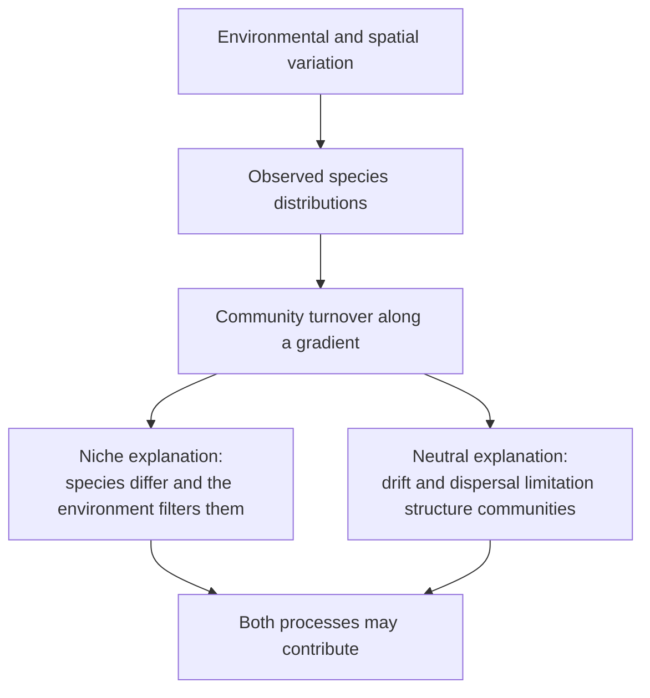
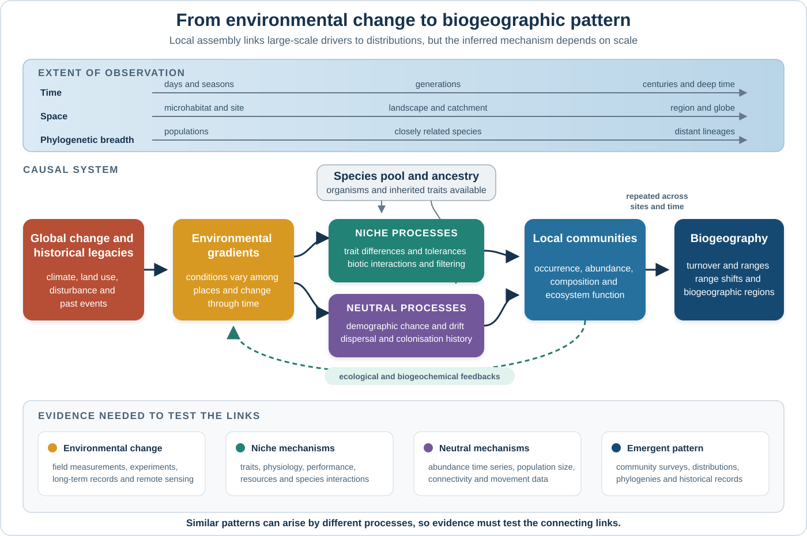
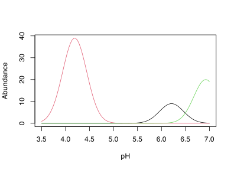

> **NOTE:**
>
> **This material must be reviewed by BCB743 students in Week 1 of Quantitative Ecology.**

> **NOTE:**
>
> **Please see the [BDC334 Lecture Transcript](../BDC334/BDC334-Lecture-Transcripts.llms.md) for the main content of all lectures.**

> **NOTE:**
>
> This lecture draws on material developed by Alex Matthew, Keanan Jarvis, and Ethan Bell. Alex developed the simulations and worked analyses. Keanan developed the analytical logic and the critique of the Mantel test, while Ethan developed the synthesis and study-design sections. All three authors contributed to the theory, writing, and revision of the material.

> **TIP:**
>
> - [Lab 1. Ecological Data](../BDC334/Lab-01-introduction.llms.md)
> - [Lab 2a. R & RStudio](../BDC334/Lab-02a-r_rstudio.llms.md)
> - [Lab 2b. Environmental Distance](../BDC334/Lab-02b-env_dist.llms.md)

# 1 From environmental gradients to community assembly

An ecological gradient describes environmental change across space or time, while community assembly concerns the processes that determine which species occur together. I bring these ideas together because the same community pattern may have several causes, including differences among species in their responses to the environment. That is the basis of niche theory. Their distributions may also reflect chance births and deaths, limited dispersal, and the position of source populations, as emphasised by neutral theory.

Biogeography records the outcome.

Along a river, across a coastline, or up a mountain, we observe changes in community composition and species distributions. Environmental filtering may account for part of that change. Dispersal, demographic chance, and past conditions may account for the rest. **Systems thinking** connects these observations to their possible causes because global change first alters environmental and biogeochemical conditions, which then affect organismal physiology and demography. Population changes alter community composition and, over a wider area, species distributions. The sequence has delays and feedbacks. Its interpretation also changes with spatial extent and history.

The Doubs River data introduced in [Lab 1](../BDC334/Lab-01-introduction.llms.md) make the problem concrete because physical and chemical conditions change downstream, as does fish composition, while the river channel connects the sampling sites. The same data consequently support environmental and spatial explanations for community turnover.

## 1.1 Learning objectives

By the end of this lecture, you should be able to:

1.  use systems thinking to trace connections among global change, environmental gradients, species responses, community assembly, and biogeography.
2.  describe environmental gradients across space and time.
3.  explain Whittaker’s individualistic hypothesis and unimodal species responses.
4.  distinguish coenoclines, coenoplanes, and coenospaces.
5.  distinguish fundamental and realised niches.
6.  explain environmental filtering as a niche-based assembly process.
7.  explain demographic equivalence, ecological drift, dispersal limitation, and distance decay in neutral theory.
8.  show how niche and neutral processes can produce similar community patterns.
9.  use the Doubs River data to make cautious, testable interpretations of community turnover.



Figure 1: The reasoning developed in this lecture. An observed community gradient is a pattern that may have more than one process explanation.

[Figure 1](#fig-gradient-assembly) separates the observed community gradient from the processes that could have produced it, since niche and neutral processes may leave similar spatial patterns that require evidence to test their different predictions.

# 2 Environmental gradients

Environmental gradients are continuous changes in abiotic conditions across space or time.

They connect large-scale environmental change with the conditions experienced by organisms, whose responses produce ecological and biogeographic patterns ([Figure 2](#fig-scale-dependent-system)).

[](../images/scale-dependent-community-assembly.svg "Figure 2: A scale-dependent system connecting global change and historical legacies to environmental gradients, niche and neutral assembly processes, local communities, and biogeographic patterns. Temporal extent, spatial extent, and phylogenetic breadth affect every connection.")

Figure 2: A scale-dependent system connecting global change and historical legacies to environmental gradients, niche and neutral assembly processes, local communities, and biogeographic patterns. Temporal extent, spatial extent, and phylogenetic breadth affect every connection.

## 2.1 Reading the system across scales

Biogeographic patterns emerge when local assembly is repeated across places and through time. Environmental gradients influence that assembly, with differences among species producing niche-based responses and demographic chance, dispersal, and colonisation history producing neutral responses. Both contribute to the communities that we observe.

Read [Figure 2](#fig-scale-dependent-system) from left to right. Global change and historical events alter environmental conditions, but the magnitude of that change differs among places and through time. A gradient follows. The organisms that encounter it come from a species pool shaped by evolution, past dispersal, and extinction, after which the figure separates two sets of assembly mechanisms. Niche processes arise from differences in traits, tolerances, resource use, or interactions, whereas neutral processes arise from chance births and deaths, dispersal, and arrival order. Both operate in ordinary communities. A species may tolerate the conditions at a site yet fail to reach it, while immigration may temporarily sustain a population where its performance is poor.

The result is a local community.

When comparable changes occur at many sites, local gains and losses produce community turnover, range shifts, and changes in biogeographic regions. A global driver can therefore contribute to a range shift without acting on the range directly.

Would a three-month survey reveal the same process as a thirty-year record?

The upper part of the figure explains why it may not. A short study can detect seasonal physiology or demographic variation. Work extending over generations may reveal adaptation, persistent population change, or local extinction. The spatial comparison changes too. Measurements at one site can identify a physiological constraint, whereas regional coverage is needed to estimate turnover or a range boundary. Wider spatial or temporal coverage may also introduce another environmental gradient, a dispersal barrier, or a historical event that was absent from the smaller study. **Phylogenetic breadth** changes the comparison once again. Closely related species often share inherited traits, although their ecology can still differ, while comparisons among distant lineages may encompass much larger differences in physiology, form, and life history. Demographic equivalence may be a useful approximation within one group and fail across a broader set of organisms. Phylogenetic breadth is not a separate assembly process. It alters the species pool and the biological differences against which niche and neutral explanations are tested.

The evidence shown at the bottom of the figure guards against inferring a process from the final pattern alone. A range shift needs an environmental record, evidence that the proposed driver affects performance, and demographic or movement data that connect local responses to the range boundary. Working backwards from a distribution can identify hypotheses, but each intervening link still requires evidence.

Feedbacks matter too.

Organisms alter local conditions through production, respiration, consumption, decomposition, and habitat modification. Community change can alter biogeochemical conditions and modify the gradient that first affected the organisms. Systems thinking keeps these mechanisms, scales, evidence, and feedbacks in the same explanation.

Ecologists commonly work with several classes of gradient at once:

- **Climatic gradients:** temperature, rainfall, humidity, radiation, and wind exposure.
- **Edaphic gradients:** soil texture, pH, salinity, nutrient availability, and organic matter.
- **Hydrological gradients:** water depth, flow, inundation frequency, and groundwater influence.
- **Disturbance gradients:** fire frequency, grazing intensity, storm exposure, pollution, and other human pressures.

Three broad geographic gradients are especially familiar:

- **Elevation:** temperature and oxygen partial pressure generally decline with increasing elevation, while vegetation and animal communities often change in zones.
- **Water depth:** light declines and pressure rises with depth, while temperature and water movement may also change.
- **Latitude:** temperature, seasonality, and solar radiation change towards the poles and are associated with broad turnover in biomes and species pools.

Elevation, depth, latitude, and distance from a river source are usually **proxy variables**. A fish does not respond physiologically to a site number or to the number of kilometres printed in a data table. It responds to conditions that covary with position, such as flow, temperature, oxygen, substrate, or food. Recognising the difference between a proxy and a proximate driver prevents weak causal explanations.

## 2.2 Gradients across spatial scales

Gradients are nested across scales:

- **Global scale:** broad climate zones, major ocean currents, and biome transitions.
- **Regional scale:** catchment position, rainfall gradients, topography, and coastal temperature regimes.
- **Local scale:** canopy gaps, rock crevices, tide pools, sediment patches, and local pollution.

These levels correspond to the spatial row in [Figure 2](#fig-scale-dependent-system). The scale of observation affects the pattern we detect because a broad downstream trend can coexist with a sharp local disturbance, as in the Doubs River where gradual physical change is interrupted by a water-quality disturbance around Sites 23 to 25.

## 2.3 Gradients through time

Environmental conditions also vary through time:

- **Seasonal gradients** arise from within-year cycles in temperature, rainfall, flow, and productivity.
- **Interannual gradients** arise from year-to-year climatic and oceanographic variation.
- **Long-term gradients** include persistent changes in temperature, rainfall, sea level, and nutrient cycles.

Conditions at a site vary through time. A species occupies a site only if its tolerances and life history allow it to persist through the conditions experienced there.

# 3 Whittaker and the individualistic hypothesis

Robert H. Whittaker challenged the view that ecological communities form discrete, tightly integrated units, proposing instead that species respond independently to environmental gradients according to their own tolerances and requirements ([Whittaker 1953](#ref-whittaker1953consideration); [Whittaker 1967](#ref-whittaker1967gradient)). This became his **individualistic hypothesis**. Community boundaries may remain diffuse. Species replace one another gradually, and the community at any position consists of the species whose requirements are met there.

Species responses connect organismal biology with biogeography.

1.  environmental conditions change along a gradient.
2.  species differ in their responses to those conditions.
3.  each species reaches high abundance in a different part of the gradient.
4.  the overlapping responses produce turnover in community composition.

# 4 The unimodal response model

A unimodal response curve has one peak.

It models how abundance, biomass, frequency, or probability of occurrence changes along one environmental gradient. Abundance is greatest near the species’ environmental **optimum** and declines towards both ends of its **tolerance range**.

Show the code

``` numberSource
library(coenocliner)
set.seed(666)
M <- 3
ming <- 3.5
maxg <- 7
locs <- seq(ming, maxg, length = 100)
opt <- runif(M, min = ming, max = maxg)
tol <- rep(0.25, M)
h <- ceiling(rlnorm(M, meanlog = 3))
pars <- cbind(opt = opt, tol = tol, h = h)

mu <- coenocline(
    locs,
    responseModel = "gaussian",
    params = pars,
    expectation = TRUE
)

matplot(
    locs,
    mu,
    lty = "solid",
    type = "l",
    xlab = "pH",
    ylab = "Abundance"
)
```

[](Lec-03-gradients_files/figure-html/fig-coenocline-1.svg "Figure 3: A coenocline representing unimodal responses of three species along a hypothetical pH gradient. Each species has a different optimum.")

Figure 3: A coenocline representing unimodal responses of three species along a hypothetical pH gradient. Each species has a different optimum.

The model is an idealisation, and we see the complete bell-shaped curve only when sampling extends across both sides of the optimum. Along a short gradient, the observations may contain only the increasing or decreasing part of the curve, while competitors, predators, disturbance, dispersal, and sampling error may alter abundance. When species with different optima occur together, their curves overlap ([Figure 3](#fig-coenocline)) and relative abundances change continuously. The result is a **coenocline**.

# 5 From one gradient to many

Real species face many gradients.

Temperature, oxygen, flow, nutrients, substrate, and biotic interactions may all influence the same fish population, together defining a multidimensional environmental space. [Lab 1](../BDC334/Lab-01-introduction.llms.md#coenoclines-coenoplanes-and-coenospaces) develops these ideas further and demonstrates how to simulate species responses with the `coenocliner` package.

## 5.1 Coenoclines

A **coenocline** displays the responses of several species along one environmental gradient. It is the simplest representation of gradual community turnover.

## 5.2 Coenoplanes

A **coenoplane** extends this idea to two gradients. For example, a fish may be abundant only where both flow and dissolved oxygen fall within suitable ranges. Its response is then represented as a surface rather than a line.

## 5.3 Coenospaces

A **coenospace** represents community responses to more than two gradients. The Doubs environmental table contains 11 variables, so each site can be thought of as a position in an 11-dimensional environmental space. We can’t draw that space directly, but we can calculate the environmental distance between pairs of sites after standardising the variables.

The terms distinguish the number of environmental dimensions represented.

| Representation | Environmental dimensions | BDC334 example |
|----|---:|----|
| Coenocline | One | Fish abundance along an oxygen gradient |
| Coenoplane | Two | Fish abundance in relation to oxygen and flow |
| Coenospace | Many | Doubs sites described by 11 environmental variables |

# 6 Niche theory

Niche theory develops the niche branch of [Figure 2](#fig-scale-dependent-system) by showing how differences among species convert an environmental gradient into differences in performance, persistence, and geographic distribution. Hutchinson described a species’ niche as a multidimensional set of environmental conditions and resources under which it can persist ([Hutchinson 1957](#ref-hutchinson1957)). Each variable forms one axis, and a species may tolerate a range of values on every axis, but persistence requires a suitable combination across all of them.

## 6.1 Fundamental and realised niches

The **fundamental niche** is the full set of abiotic conditions under which a species could maintain a population in the absence of competitors, predators, and other biotic restrictions. The **realised niche** is the subset of conditions where the species occurs after biotic interactions, dispersal, and history have influenced its distribution.

Several processes can reduce the realised niche below the fundamental niche.

- Competitors can exclude the species from otherwise suitable conditions.
- Predators or pathogens can make some sites unsuitable.
- The species may not have dispersed to every suitable site.
- Historical events may have prevented establishment.

Observed occurrence gives an incomplete estimate of the fundamental niche. A species may be absent because conditions are unsuitable, because it failed to reach the site, or because the local population disappeared through chance.

## 6.2 Environmental filtering

**Environmental filtering** is the niche-based process by which local conditions allow some members of the regional species pool to persist while excluding others. Species differ in physiology, morphology, behaviour, and life history. Those differences produce unequal performance under the same conditions.

Niche theory makes several broad predictions.

- Species have different environmental optima and tolerances.
- Similar environments tend to support similar sets of species.
- Community composition changes when environmental conditions change.
- A sharp environmental disturbance can produce a sharp biological response.

Correlation alone can’t identify the mechanism. Distance from source, altitude, and flow may all change together, and associations with all three variables do not show that fish respond independently to each one. Ecological interpretation must identify plausible proximate drivers.

> **NOTE:**
>
> If environmental filtering is important, community difference should increase as environmental difference increases. Two environmentally similar sites should support similar communities even when they are far apart, provided that the relevant species can reach both sites.

## 6.3 Applying niche theory to a river

Consider a fish adapted to cold, fast, oxygen-rich headwaters. Its abundance may decline downstream as water warms, flow conditions change, and oxygen decreases, while another species performs better in slower, warmer reaches. Their distributions overlap, but different optima produce gradual replacement along the river, while the local water-quality disturbance in the Doubs adds a sharper contrast. High nutrient concentrations and biological oxygen demand around Sites 23 to 25 coincide with low dissolved oxygen and a decline in fish richness. Environmental filtering is a plausible explanation because oxygen is a direct physiological requirement. Site number, by itself, explains nothing about fish performance.

# 7 Neutral theory

The neutral branch of [Figure 2](#fig-scale-dependent-system) asks what environmental differences leave unexplained by considering how population size, demographic chance, movement, and spatial connectivity influence which species occur at a site. Neutral theory isolates these processes and asks how much of a biogeographic pattern can arise without assuming niche differences. Niche theory begins with ecological differences among species. Neutral theory instead asks how much community structure could arise if species within the same trophic group had similar average demographic performance ([Hubbell 2001](#ref-hubbell2001); [Rosindell et al. 2011](#ref-rosindell2011)). Its model rests on demographic chance and limited dispersal.

**Demographic equivalence** is the simplifying assumption.

At the scale of the analysis, individuals of the species considered have the same average probabilities of birth, death, dispersal, and establishment. Species remain biologically distinct and environmental conditions still affect life, but the assumption lets us test how much pattern can arise from drift and dispersal before we invoke differences among species.

## 7.1 Ecological drift

**Ecological drift** is random change in species abundances caused by chance births and deaths. Two species with equal average performance can still diverge in abundance because births and deaths are never perfectly balanced in finite populations. Drift has stronger effects when local populations are small. Over time it can alter relative abundance and may cause a species to disappear from a site, after which an offspring produced locally or an immigrant from elsewhere can occupy the vacant place.

## 7.2 Dispersal limitation

**Dispersal limitation** occurs when organisms are more likely to reach some sites than others, as in a river where movement may be easier between adjacent reaches than between distant ones. Directional flow, barriers, swimming ability, and channel structure all affect movement. With local dispersal, nearby communities exchange individuals and tend to remain similar, while exchange weakens with distance and allows drift and chance colonisation to increase the differences among distant communities. This decline in similarity is called **distance decay**. It does not belong exclusively to neutral theory. Along a river, environmental conditions may also change with distance, so distant sites differ in their environment as well as in their connection through dispersal.

> **NOTE:**
>
> If dispersal limitation is important, community difference should increase with separation along the river or another relevant movement route, while nearby sites should remain similar because organisms move between them even when species have similar average demographic performance.

## 7.3 Neutral theory as a null model

A **null model** provides a deliberately simplified reference against which neutral theory tests whether drift and dispersal could plausibly generate the observed pattern. If they can, niche filtering remains one possible explanation and requires further evidence. The comparison sharpens niche-based reasoning because it forces us to identify observations that show ecological differences among species instead of inferring those differences from the community pattern alone.

# 8 The same pattern can have different causes

A community gradient records the pattern but leaves its cause unresolved because niche filtering and neutral dynamics can both produce gradual species turnover and distance decay.

| Observation | Niche-based explanation | Neutral explanation |
|----|----|----|
| Nearby sites have similar communities | Nearby sites have similar environments | Nearby sites exchange more dispersers |
| Distant sites have different communities | Environmental differences increase with separation | Limited dispersal and drift allow communities to diverge |
| Species replace one another along a river | Species have different environmental optima | Chance colonisation and local dispersal create spatial structure |
| A disturbed reach has fewer sensitive species | Local conditions filter species according to tolerance | A local loss could arise by chance, especially in a small population |

A repeatable loss of oxygen-sensitive fish at low-oxygen sites, supported by physiological evidence, favours niche filtering, whereas changes among otherwise similar sites are more compatible with drift. One observational gradient seldom separates the processes completely.

## 8.1 A niche-neutral continuum

Niche and neutral theory define the endpoints of a continuum ([Leibold and McPeek 2006](#ref-leibold2006); [Adler et al. 2007](#ref-adler2007)). Real communities occur between them.

- Strong environmental differences can make niche filtering dominant.
- Weak environmental differences and small populations can make drift more visible.
- Restricted movement can strengthen dispersal limitation.
- High connectivity can reduce spatial differences by moving individuals among sites.

Their relative contributions change with scale. Strong habitat differences may explain turnover across a whole catchment, while drift contributes to differences among small patches within one habitat. Community assembly includes selection, drift, dispersal, and the formation of new species as interacting processes ([Vellend 2010](#ref-vellend2010)). For each process, we need a prediction that can be compared with observations, followed by a clear statement of what the data leave unresolved.

# 9 The Doubs River as a niche-neutral case study

The Doubs River is useful because its environmental, species, and spatial data refer to the same sequence of sampled sites ([Verneaux 1973](#ref-verneaux1973cours); [Borcard et al. 2011](#ref-borcard2011numerical)). We can compare environmental change with change in the fish community, then use the centre of [Figure 2](#fig-scale-dependent-system) to frame the inference. How much of the local community can be related to environmental filtering? How much may reflect the river’s connectivity, dispersal, and demographic chance? The tables let us develop predictions for each explanation, although additional evidence is needed to settle the questions.

## 9.1 What the three tables contain

| Table | Rows | Columns | Ecological role |
|----|----|----|----|
| `DoubsSpe.csv` | 30 sampled sites | Abundances of 27 fish species | Describes community composition |
| `DoubsEnv.csv` | The same 30 sites | 11 environmental variables | Describes the conditions at each site |
| `DoubsSpa.csv` | The same 30 sites | Spatial coordinates | Describes the sampled river course |

The row correspondence is essential. Site 12 in one table must refer to Site 12 in the others. Otherwise, an apparent species-environment relationship could be an artefact of mismatched observations.

## 9.2 The environmental structure seen in Lab 1

The raw data reveal two kinds of environmental change:

1.  **A broad longitudinal gradient.** Distance from source increases, altitude declines from 934 to 172, and flow generally increases from 0.84 to 69.0. Hardness also tends to increase downstream.
2.  **A local water-quality disturbance.** Phosphate, nitrate, ammonium, and biological oxygen demand rise sharply around Sites 23 to 25. Dissolved oxygen reaches its minimum at Site 25 and then recovers farther downstream.

The longitudinal variables are correlated. Distance from source, altitude, and flow describe related aspects of river position and development, so they should not be counted as three independent mechanisms. The water-quality variables also form a related group: nutrient and organic inputs can stimulate microbial decomposition, increase biological oxygen demand, and reduce dissolved oxygen.

## 9.3 A niche-based interpretation

Niche theory predicts that fish will be sorted according to their tolerances of the measured conditions, such as flow and oxygen, together with unmeasured factors such as temperature and substrate. Under this explanation:

- Upstream and downstream communities differ because the physical habitat changes.
- Species have different optima along these gradients.
- Low oxygen near Sites 23 to 25 excludes sensitive species.
- Fish richness can recover downstream as water quality improves.

These are plausible mechanistic interpretations because the proposed drivers affect fish performance. The abrupt disturbance is especially informative because it interrupts the broad downstream trend.

## 9.4 A neutral interpretation

Neutral theory draws attention to the river’s spatial structure. Adjacent reaches are connected, while distant reaches exchange fewer individuals. Under this explanation:

- Nearby fish communities remain similar because dispersal connects them.
- Distant communities diverge because exchange is weaker.
- Local abundances change partly through ecological drift.
- Chance colonisation can influence which species occupy a suitable stretch.

The spatial coordinates show that the Doubs bends. Straight-line proximity on a map can differ from proximity along the channel. For aquatic organisms, the distance travelled through the connected river course is often the more relevant measure of separation.

## 9.5 Why inspection cannot separate the processes

Environment and channel position change together. Sites that are far apart along the river also tend to differ environmentally. Consequently:

- A relationship between community composition and environment is consistent with niche filtering.
- A relationship between community composition and river distance is consistent with dispersal limitation.
- Neither relationship alone proves that its associated process caused the pattern.

The data remain informative within this limit. We can identify plausible drivers, compare observations with predictions, and use contrasts that favour one explanation, even though the observations cannot assign the whole community pattern to niche or neutral processes. The local disturbance around Sites 23 to 25 provides one such contrast. If these disturbed sites differ from other sites nearby along the river, distance alone becomes an inadequate explanation and environmental filtering gains support. The conclusion must remain cautious because the dataset is observational and other unmeasured conditions may differ at the same sites.

## 9.6 Environmental distance and the BDC334 workflow

The 11 Doubs environmental variables have different units and ranges. [Lab 1](../BDC334/Lab-01-introduction.llms.md#sec-standardisation) standardises them before Euclidean distances are calculated. Standardisation gives each variable a mean of 0 and a standard deviation of 1, preventing a variable with large numerical units from dominating the calculation because of its scale.

An environmental distance matrix compares every site with every other site:

- A small value means that two sites have similar measured conditions.
- A large value means that their measured conditions differ.
- The matrix describes environmental difference, not geographic separation or species dissimilarity.

For the Doubs, Sites 11 and 13 and Sites 17 and 19 have small environmental distances, while Site 25 is very different from most sites because of its unusual water chemistry and low oxygen. This gives us a quantitative version of the patterns first seen in the graphs.

Use the following sequence when interpreting the data:

1.  **Inspect the spatial table.** Reconstruct the sampled river course in site-number order.
2.  **Graph the raw environmental variables.** Identify broad gradients and local departures.
3.  **Distinguish proxies from drivers.** Treat distance from source as position, then identify conditions that can affect fish directly.
4.  **Standardise the environmental variables.** Make their contributions comparable.
5.  **Calculate environmental distances.** Identify pairs of similar and dissimilar sites.
6.  **Compare the environmental and species patterns.** Ask whether fish turnover occurs where conditions change.
7.  **Consider the neutral alternative.** Ask whether the same pattern could arise because nearby sites are better connected.
8.  **State the limit of inference.** Describe which process is consistent with the evidence without claiming that a correlation proves causation.

> **IMPORTANT:**
>
> Fish composition changes along a river that has both a broad physical gradient and a local water-quality disturbance. The coincidence of fish change with plausible physiological drivers is consistent with niche-based environmental filtering. The connected river channel also makes dispersal limitation and ecological drift plausible contributors. Because environment and position covary, the observed gradient alone cannot apportion all turnover between the two sets of processes.

# 10 Examples across spatial scales

The niche-neutral distinction applies beyond rivers. The balance of mechanisms depends on the system, spatial extent, and organisms studied.

## 10.1 Global example: latitude and biome turnover

Temperature, seasonality, and radiation change with latitude. These environmental differences filter the global species pool and contribute to turnover among tropical, temperate, and polar biomes. Historical dispersal barriers and the location of source populations also affect which species have reached each region. The global pattern contains environmental and historical components.

## 10.2 Regional example: Southern Africa

Southern Africa becomes broadly wetter towards the east and drier towards the west. Ocean-atmosphere coupling and topography contribute to this pattern. The warm Agulhas system supplies heat and moisture along the east, while aridity increases westwards. Plant and animal communities change as water availability, temperature, and seasonality change, which is consistent with niche differences. Yet the regional species pool also carries the effects of past dispersal and barriers. Suitable habitat remains empty when a species has never reached the region.

## 10.3 Local example: the Cape oceanic transition

Between Cape Point and Cape Agulhas, Indian and Atlantic Ocean influences produce a transition between warm-temperate and cold-temperate marine assemblages. Temperature, upwelling, wave exposure, and other environmental variables change along the coast, while currents transport propagules and connect sites. The required reading on “Seaweeds in Two Oceans” quantifies community turnover across this transition ([Smit et al. 2017](#ref-smit2017seaweeds)). Niche-based thermal responses provide one explanation. Dispersal and biogeographic history help determine which species are available to respond.

# 11 Synthesis

The system in [Figure 2](#fig-scale-dependent-system) connects the chapter’s main ideas. Global change and biogeochemical processes alter environmental conditions across space and time. Earth observation, field measurements, and long-term records show where and when those changes occur. Ecophysiology provides the next part of the explanation by showing how altered conditions affect the performance of organisms. Niche filtering converts those performance differences into changes in community composition. Drift and dispersal modify the same communities, especially where populations are small or connections among sites are weak. Their relative contributions vary among species, places, and times, yet both can produce gradual turnover and distance decay.

Local population changes accumulate across space.

Species ranges shift, bioregional boundaries move, and broad diversity gradients may change. Organisms can then modify biogeochemical conditions through primary production, respiration, consumption, or decomposition, which creates feedbacks. Systems thinking changes how we interpret the resulting patterns. A global driver alone cannot specify the biological response, and physiological tolerance cannot show that a species reached suitable habitat. Geographic pattern supplies the observation. Identifying its cause requires environmental, physiological, demographic, and dispersal evidence, with the remaining uncertainty stated in the conclusion.

Whittaker’s gradient analysis shows how individual responses combine to produce a community pattern. Niche theory relates those responses to ecological differences among species, while neutral theory accounts for spatial pattern and chance under demographic equivalence. In the Doubs River, environmental conditions and river position co-vary, which is why both explanations remain plausible.

# 12 Example questions

> **NOTE:**
>
> **Question 1. Environmental gradients and species responses**
>
> 1.  Define an environmental gradient and distinguish a proxy gradient from a proximate environmental driver. Use distance from source in the Doubs River as your example. (5)
>
> 2.  Explain Whittaker’s individualistic hypothesis and how overlapping unimodal response curves produce gradual community turnover. (7)
>
> 3.  Define the optimum and tolerance range of a unimodal response. Explain why field data may show only part of the expected curve. (4)
>
> 4.  Distinguish a coenocline, coenoplane, and coenospace. (4)
>
> Total: **20 marks**
>
> Purpose: tests the sequence **gradient to species response to community pattern**.
>
> ------------------------------------------------------------------------
>
> **Question 2. Niches and environmental filtering**
>
> 1.  Explain Hutchinson’s multidimensional niche concept. (4)
>
> 2.  Distinguish the fundamental niche from the realised niche. Give two processes that can make the realised niche smaller than the fundamental niche. (6)
>
> 3.  Explain environmental filtering and give three predictions that follow from a niche-based explanation of community assembly. (6)
>
> 4.  Explain why the absence of a species from apparently suitable habitat does not, by itself, show that the habitat lies outside its fundamental niche. (4)
>
> Total: **20 marks**
>
> Purpose: tests the connection between **species tolerances, filtering, and observed distributions**.
>
> ------------------------------------------------------------------------
>
> **Question 3. Neutral theory and alternative explanations**
>
> 1.  Define demographic equivalence as used in neutral theory. Why is it useful as a simplifying assumption rather than a literal claim that species are identical? (5)
>
> 2.  Explain ecological drift and why its effects are expected to be stronger in small populations. (5)
>
> 3.  Explain how dispersal limitation can produce distance decay in community similarity. (5)
>
> 4.  Explain why distance decay can also arise through niche-based environmental filtering. (5)
>
> Total: **20 marks**
>
> Purpose: tests understanding of **neutral mechanisms and why pattern alone does not identify process**.
>
> ------------------------------------------------------------------------
>
> **Question 4. Niche and neutral theory in the Doubs River**
>
> The Doubs River has a broad upstream-to-downstream physical gradient and a local water-quality disturbance around Sites 23 to 25.
>
> 1.  Describe the main longitudinal and local environmental patterns in the Doubs data. (5)
>
> 2.  Give a niche-based explanation for fish turnover along the river. Identify two proximate environmental drivers and explain their likely effects. (5)
>
> 3.  Give a neutral explanation for turnover along the river using dispersal limitation and ecological drift. (4)
>
> 4.  Explain why environment and river position are difficult to separate in this dataset. (3)
>
> 5.  Write a defensible conclusion about the relative roles of niche and neutral processes. Your conclusion must distinguish evidence that is consistent with a process from evidence that proves it. (3)
>
> Total: **20 marks**
>
> Purpose: evaluates the application of **competing process explanations to a familiar BDC334 dataset**.
>
> ------------------------------------------------------------------------
>
> **Question 5. From global change to biogeography**
>
> 1.  Trace how a change in climate or a biogeochemical cycle can alter an environmental gradient, organismal performance, community composition, and ultimately a biogeographic pattern. (8)
>
> 2.  Explain where niche filtering, ecological drift, and dispersal limitation enter this system. Give one prediction for each process. (8)
>
> 3.  Explain why systems thinking produces a stronger forecast than extrapolating a present-day correlation between environment and distribution. (4)
>
> Total: **20 marks**
>
> Purpose: tests the integration of **global drivers, biological mechanisms, community assembly, and spatial outcomes**.

## References

Adler PB, HilleRisLambers J, Levine JM (2007) A niche for neutrality. Ecology Letters 10:95–104. doi: [10.1111/j.1461-0248.2006.00996.x](https://doi.org/10.1111/j.1461-0248.2006.00996.x)

Borcard D, Gillet F, Legendre P, others (2011) Numerical ecology with R. Springer

Hubbell SP (2001) The unified neutral theory of biodiversity and biogeography. Princeton University Press, Princeton, New Jersey

Hutchinson GE (1957) [Concluding remarks](https://doi.org/10.1101/SQB.1957.022.01.039). In: Cold spring harbor symposia on quantitative biology. pp 415–427

Leibold MA, McPeek MA (2006) Coexistence of the niche and neutral perspectives in community ecology. Ecology 87:1399–1410. doi: [10.1890/0012-9658(2006)87\[1399:COTNAN\]2.0.CO;2](https://doi.org/10.1890/0012-9658(2006)87%5B1399:COTNAN%5D2.0.CO;2)

Rosindell J, Hubbell SP, Etienne RS (2011) The unified neutral theory of biodiversity and biogeography at age ten. Trends in Ecology & Evolution 26:340–348. doi: [10.1016/j.tree.2011.03.024](https://doi.org/10.1016/j.tree.2011.03.024)

Smit AJ, Bolton JJ, Anderson RJ (2017) Seaweeds in two oceans: Beta-diversity. Frontiers in Marine Science 4:404.

Vellend M (2010) Conceptual synthesis in community ecology. The Quarterly Review of Biology 85:183–206. doi: [10.1086/652373](https://doi.org/10.1086/652373)

Verneaux J (1973) Cours d’eau de Franche-Comté (Massif du Jura). Recherches écologiques sur le réseau hydrographique du Doubs.

Whittaker RH (1953) A consideration of climax theory: The climax as a population and pattern. Ecological monographs 23:41–78.

Whittaker RH (1967) Gradient analysis of vegetation.

## Reuse

[CC BY-NC-SA 4.0](https://creativecommons.org/licenses/by-nc-sa/4.0/)

## Citation

BibTeX citation:

``` quarto-appendix-bibtex
@online{smit2026,
  author = {Smit, A. J. and J. Smit, A.},
  title = {Lecture 3: {Ecological} Gradients, Niches, and Neutral
    Theory},
  date = {2026-08-19},
  url = {https://tangledbank.netlify.app/BDC334/Lec-03-gradients.html},
  langid = {en}
}
```

For attribution, please cite this work as:

Smit AJ, J. Smit A (2026) Lecture 3: Ecological gradients, niches, and neutral theory. [https://tangledbank.netlify.app/BDC334/Lec-03-gradients.html.](https://tangledbank.netlify.app/BDC334/Lec-03-gradients.html)
