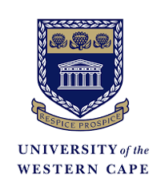
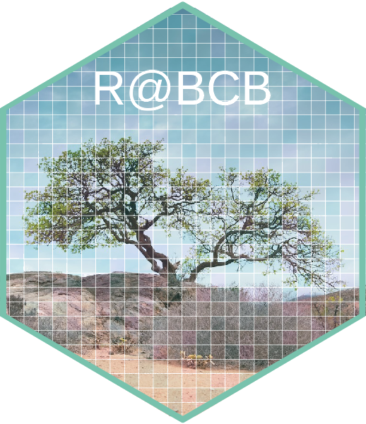

Teaching material for ecology, biostatistics, and quantitative ecology modules at the University of the Western Cape, built around R and real ecological and Earth-system data.

Author

Affiliation

[A. J. Smit](https://tangledbank.netlify.app) [![](data:image/png;base64,iVBORw0KGgoAAAANSUhEUgAAABAAAAAQCAYAAAAf8/9hAAAAGXRFWHRTb2Z0d2FyZQBBZG9iZSBJbWFnZVJlYWR5ccllPAAAA2ZpVFh0WE1MOmNvbS5hZG9iZS54bXAAAAAAADw/eHBhY2tldCBiZWdpbj0i77u/IiBpZD0iVzVNME1wQ2VoaUh6cmVTek5UY3prYzlkIj8+IDx4OnhtcG1ldGEgeG1sbnM6eD0iYWRvYmU6bnM6bWV0YS8iIHg6eG1wdGs9IkFkb2JlIFhNUCBDb3JlIDUuMC1jMDYwIDYxLjEzNDc3NywgMjAxMC8wMi8xMi0xNzozMjowMCAgICAgICAgIj4gPHJkZjpSREYgeG1sbnM6cmRmPSJodHRwOi8vd3d3LnczLm9yZy8xOTk5LzAyLzIyLXJkZi1zeW50YXgtbnMjIj4gPHJkZjpEZXNjcmlwdGlvbiByZGY6YWJvdXQ9IiIgeG1sbnM6eG1wTU09Imh0dHA6Ly9ucy5hZG9iZS5jb20veGFwLzEuMC9tbS8iIHhtbG5zOnN0UmVmPSJodHRwOi8vbnMuYWRvYmUuY29tL3hhcC8xLjAvc1R5cGUvUmVzb3VyY2VSZWYjIiB4bWxuczp4bXA9Imh0dHA6Ly9ucy5hZG9iZS5jb20veGFwLzEuMC8iIHhtcE1NOk9yaWdpbmFsRG9jdW1lbnRJRD0ieG1wLmRpZDo1N0NEMjA4MDI1MjA2ODExOTk0QzkzNTEzRjZEQTg1NyIgeG1wTU06RG9jdW1lbnRJRD0ieG1wLmRpZDozM0NDOEJGNEZGNTcxMUUxODdBOEVCODg2RjdCQ0QwOSIgeG1wTU06SW5zdGFuY2VJRD0ieG1wLmlpZDozM0NDOEJGM0ZGNTcxMUUxODdBOEVCODg2RjdCQ0QwOSIgeG1wOkNyZWF0b3JUb29sPSJBZG9iZSBQaG90b3Nob3AgQ1M1IE1hY2ludG9zaCI+IDx4bXBNTTpEZXJpdmVkRnJvbSBzdFJlZjppbnN0YW5jZUlEPSJ4bXAuaWlkOkZDN0YxMTc0MDcyMDY4MTE5NUZFRDc5MUM2MUUwNEREIiBzdFJlZjpkb2N1bWVudElEPSJ4bXAuZGlkOjU3Q0QyMDgwMjUyMDY4MTE5OTRDOTM1MTNGNkRBODU3Ii8+IDwvcmRmOkRlc2NyaXB0aW9uPiA8L3JkZjpSREY+IDwveDp4bXBtZXRhPiA8P3hwYWNrZXQgZW5kPSJyIj8+84NovQAAAR1JREFUeNpiZEADy85ZJgCpeCB2QJM6AMQLo4yOL0AWZETSqACk1gOxAQN+cAGIA4EGPQBxmJA0nwdpjjQ8xqArmczw5tMHXAaALDgP1QMxAGqzAAPxQACqh4ER6uf5MBlkm0X4EGayMfMw/Pr7Bd2gRBZogMFBrv01hisv5jLsv9nLAPIOMnjy8RDDyYctyAbFM2EJbRQw+aAWw/LzVgx7b+cwCHKqMhjJFCBLOzAR6+lXX84xnHjYyqAo5IUizkRCwIENQQckGSDGY4TVgAPEaraQr2a4/24bSuoExcJCfAEJihXkWDj3ZAKy9EJGaEo8T0QSxkjSwORsCAuDQCD+QILmD1A9kECEZgxDaEZhICIzGcIyEyOl2RkgwAAhkmC+eAm0TAAAAABJRU5ErkJggg==)](https://orcid.org/0000-0002-3799-6126)

[University of the Western Cape](https://uwc.ac.za)

University of the Western Cape · Biodiversity & Conservation Biology

# The Tangled Bank

Teaching material by Professor [AJ Smit](https://www.uwc.ac.za/study/all-areas-of-study/departments/department-of-biodiversity-and-conservation-biology/people), all built around [R](https://cran.r-project.org/) and real ecological and Earth-system data.

[BDC223 · Undergraduate Plant Ecophysiology How plants sense and respond to light, carbon, nutrients, and stress. Enter course →](BDC223/BDC223_index.llms.md) [BDC334 · Undergraduate Biogeography & Global Ecology Gradients, biodiversity, and the processes that arrange life across the planet. Enter course →](BDC334/BDC334_index.llms.md) [BCB744 · Honours core Intro to R & Biostatistics From first principles in R to inference, regression, and reproducible analysis. Enter course →](BCB744/BCB744_index.llms.md) [BCB743 · Honours elective Quantitative Ecology Correlation, ordination, and the multivariate analysis of community data. Enter course →](BCB743/BCB743_index.llms.md)

[Vignettes · Worked examples R for ocean and Earth-system data Techniques gathered over the years: gridded and netCDF data, ERDDAP, regridding, marine heatwaves, and high-performance computing on Lengau. Browse the vignettes →](vignettes/index.llms.md)

“It is interesting to contemplate **a tangled bank**, clothed with many plants of many kinds, with birds singing on the bushes, with various insects flitting about, and with worms crawling through the damp earth, and to reflect that these elaborately constructed forms, so different from each other, and dependent upon each other in so complex a manner, have all been produced by laws acting around us. These laws, taken in the largest sense, being Growth with reproduction; Inheritance which is almost implied by reproduction; Variability from the indirect and direct action of the conditions of life, and from use and disuse; a Ratio of Increase so high as to lead to a Struggle for Life, and as a consequence to Natural Selection, entailing Divergence of Character and the Extinction of less improved forms. Thus, from the war of nature, from famine and death, the most exalted object which we are capable of conceiving, namely, the production of the higher animals, directly follows.”

Charles Darwin, *On the Origin of Species*, 1859

## Reuse

[CC BY-NC-SA 4.0](https://creativecommons.org/licenses/by-nc-sa/4.0/)
