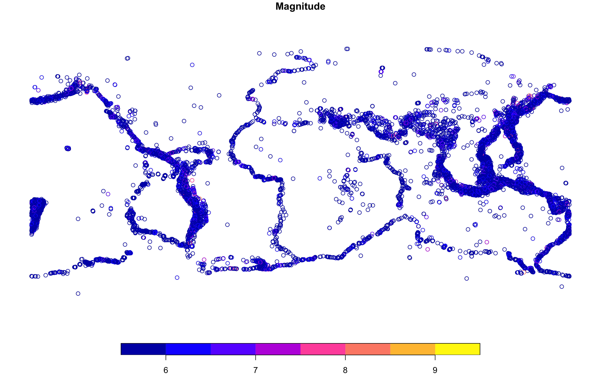
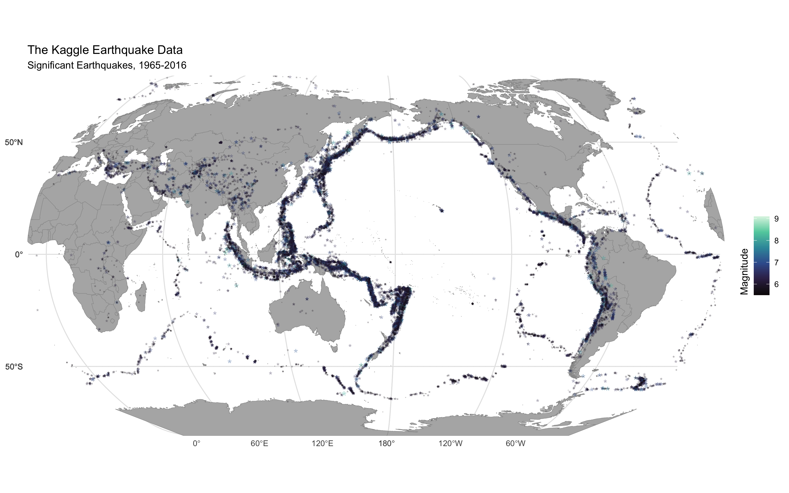

# Kaggle Earthquake Database

Code

Authors

Affiliation

[A. J. Smit](https://tangledbank.netlify.app) [![](data:image/png;base64,iVBORw0KGgoAAAANSUhEUgAAABAAAAAQCAYAAAAf8/9hAAAAGXRFWHRTb2Z0d2FyZQBBZG9iZSBJbWFnZVJlYWR5ccllPAAAA2ZpVFh0WE1MOmNvbS5hZG9iZS54bXAAAAAAADw/eHBhY2tldCBiZWdpbj0i77u/IiBpZD0iVzVNME1wQ2VoaUh6cmVTek5UY3prYzlkIj8+IDx4OnhtcG1ldGEgeG1sbnM6eD0iYWRvYmU6bnM6bWV0YS8iIHg6eG1wdGs9IkFkb2JlIFhNUCBDb3JlIDUuMC1jMDYwIDYxLjEzNDc3NywgMjAxMC8wMi8xMi0xNzozMjowMCAgICAgICAgIj4gPHJkZjpSREYgeG1sbnM6cmRmPSJodHRwOi8vd3d3LnczLm9yZy8xOTk5LzAyLzIyLXJkZi1zeW50YXgtbnMjIj4gPHJkZjpEZXNjcmlwdGlvbiByZGY6YWJvdXQ9IiIgeG1sbnM6eG1wTU09Imh0dHA6Ly9ucy5hZG9iZS5jb20veGFwLzEuMC9tbS8iIHhtbG5zOnN0UmVmPSJodHRwOi8vbnMuYWRvYmUuY29tL3hhcC8xLjAvc1R5cGUvUmVzb3VyY2VSZWYjIiB4bWxuczp4bXA9Imh0dHA6Ly9ucy5hZG9iZS5jb20veGFwLzEuMC8iIHhtcE1NOk9yaWdpbmFsRG9jdW1lbnRJRD0ieG1wLmRpZDo1N0NEMjA4MDI1MjA2ODExOTk0QzkzNTEzRjZEQTg1NyIgeG1wTU06RG9jdW1lbnRJRD0ieG1wLmRpZDozM0NDOEJGNEZGNTcxMUUxODdBOEVCODg2RjdCQ0QwOSIgeG1wTU06SW5zdGFuY2VJRD0ieG1wLmlpZDozM0NDOEJGM0ZGNTcxMUUxODdBOEVCODg2RjdCQ0QwOSIgeG1wOkNyZWF0b3JUb29sPSJBZG9iZSBQaG90b3Nob3AgQ1M1IE1hY2ludG9zaCI+IDx4bXBNTTpEZXJpdmVkRnJvbSBzdFJlZjppbnN0YW5jZUlEPSJ4bXAuaWlkOkZDN0YxMTc0MDcyMDY4MTE5NUZFRDc5MUM2MUUwNEREIiBzdFJlZjpkb2N1bWVudElEPSJ4bXAuZGlkOjU3Q0QyMDgwMjUyMDY4MTE5OTRDOTM1MTNGNkRBODU3Ii8+IDwvcmRmOkRlc2NyaXB0aW9uPiA8L3JkZjpSREY+IDwveDp4bXBtZXRhPiA8P3hwYWNrZXQgZW5kPSJyIj8+84NovQAAAR1JREFUeNpiZEADy85ZJgCpeCB2QJM6AMQLo4yOL0AWZETSqACk1gOxAQN+cAGIA4EGPQBxmJA0nwdpjjQ8xqArmczw5tMHXAaALDgP1QMxAGqzAAPxQACqh4ER6uf5MBlkm0X4EGayMfMw/Pr7Bd2gRBZogMFBrv01hisv5jLsv9nLAPIOMnjy8RDDyYctyAbFM2EJbRQw+aAWw/LzVgx7b+cwCHKqMhjJFCBLOzAR6+lXX84xnHjYyqAo5IUizkRCwIENQQckGSDGY4TVgAPEaraQr2a4/24bSuoExcJCfAEJihXkWDj3ZAKy9EJGaEo8T0QSxkjSwORsCAuDQCD+QILmD1A9kECEZgxDaEZhICIzGcIyEyOl2RkgwAAhkmC+eAm0TAAAAABJRU5ErkJggg==)](https://orcid.org/0000-0002-3799-6126)

[University of the Western Cape](https://uwc.ac.za)

AJ Smit

``` numberSource
library(tidyverse)
library(ggthemes)
library(sf)
library(rnaturalearth)
library(rnaturalearthhires)
```

Here’s a map of earthquake location and magnitude (\>=5.5) from 1965-2016. The data may be found on [Kaggle](https://www.kaggle.com/datasets/usgs/earthquake-database).

``` numberSource
WGS84_proj <- "+proj=longlat +datum=WGS84 +no_defs +ellps=WGS84 +towgs84=0,0,0"
NE_proj <- "+proj=natearth +lon_0=170"
```

``` numberSource
quakes <- read_csv(here::here("data", "kaggle_earthquakes_database.csv"),
  skip = 3, col_types = cols(Date = col_date(format = "%d/%m/%Y")))
quakes_sf <- quakes |> 
  st_as_sf(coords = c("Longitude", "Latitude"),
    crs = WGS84_proj)
quakes_sf_trans <- st_transform(quakes_sf, NE_proj)
head(quakes_sf)
```

    Simple feature collection with 6 features and 19 fields
    Geometry type: POINT
    Dimension:     XY
    Bounding box:  xmin: -173.972 ymin: -59.076 xmax: 166.629 ymax: 19.246
    Geodetic CRS:  +proj=longlat +datum=WGS84 +no_defs +ellps=WGS84 +towgs84=0,0,0
    # A tibble: 6 × 20
      Date       Time     Type  Depth `Depth Error` Depth Seismic Statio…¹ Magnitude
      <date>     <time>   <chr> <dbl>         <dbl>                  <dbl>     <dbl>
    1 1965-02-01 13:44:18 Eart…  132.            NA                     NA       6  
    2 1965-04-01 11:29:49 Eart…   80             NA                     NA       5.8
    3 1965-05-01 18:05:58 Eart…   20             NA                     NA       6.2
    4 1965-08-01 18:49:43 Eart…   15             NA                     NA       5.8
    5 1965-09-01 13:32:50 Eart…   15             NA                     NA       5.8
    6 1965-10-01 13:36:32 Eart…   35             NA                     NA       6.7
    # ℹ abbreviated name: ¹​`Depth Seismic Stations`
    # ℹ 13 more variables: `Magnitude Type` <chr>, `Magnitude Error` <dbl>,
    #   `Magnitude Seismic Stations` <dbl>, `Azimuthal Gap` <dbl>,
    #   `Horizontal Distance` <dbl>, `Horizontal Error` <dbl>,
    #   `Root Mean Square` <dbl>, ID <chr>, Source <chr>, `Location Source` <chr>,
    #   `Magnitude Source` <chr>, Status <chr>, geometry <POINT [°]>

``` numberSource
plot(quakes_sf[,"Magnitude"])
```

[](kaggle_earthquakes_files/figure-html/fig-plot-quakes-sf-magnitude-1.png "Figure 1: ")

Figure 1

``` numberSource
world_1 <- ne_countries(returnclass = 'sf',
  scale = 10, type = "countries") |> 
  select(continent, sovereignt, iso_a3) |> 
  st_break_antimeridian(lon_0 = 170) |> 
  st_transform(NE_proj)
```

``` numberSource
ggplot() +
  geom_sf(data = world_1, colour = "grey60", fill = "grey70") +
  geom_sf(data = quakes_sf_trans, aes(colour = Magnitude, size = Magnitude),
    stat = "sf_coordinates",
    shape = "*", alpha = 0.4) +
  scale_colour_viridis_c(option = "mako", direction = 1) +
  guides(size = "none",
    colour = guide_colourbar(title = "Magnitude",
      title.position = "left")) +
  coord_sf(expand = FALSE) +
  labs(x = NULL, y = NULL,
    title = "The Kaggle Earthquake Data",
    subtitle = "Significant Earthquakes, 1965-2016") +
  theme_minimal() +
  theme(
    panel.grid.major = element_line(colour = "grey90"),
    legend.background = element_blank(),
    legend.title = element_text(angle = 90),
    legend.title.align = 0.5)
```

[](kaggle_earthquakes_files/figure-html/fig-ggplot-1.png "Figure 2: ")

Figure 2

## Reuse

[CC BY 4.0](https://creativecommons.org/licenses/by/4.0/)

## Citation

BibTeX citation:

``` quarto-appendix-bibtex
@online{smit,
  author = {Smit, A. J. and Smit, AJ},
  title = {Kaggle {Earthquake} {Database}},
  url = {https://tangledbank.netlify.app/pages/kaggle_earthquakes.html},
  langid = {en}
}
```

For attribution, please cite this work as:

Smit AJ, Smit A Kaggle Earthquake Database. [https://tangledbank.netlify.app/pages/kaggle_earthquakes.html.](https://tangledbank.netlify.app/pages/kaggle_earthquakes.html)
