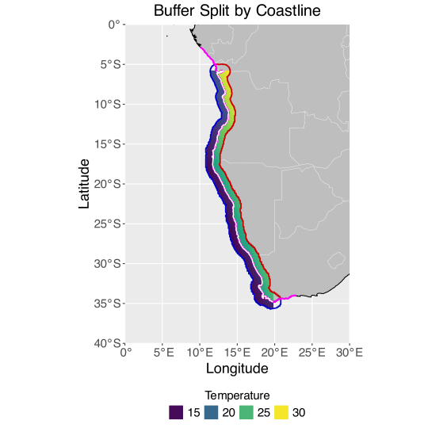

``` numberSource
# Load necessary libraries
library(tidyverse)
library(sf)
library(rnaturalearth)
library(rnaturalearthdata)
library(lwgeom) # For st_split function
# library(nngeo)
```

Download the coastline data for the entire world:

``` numberSource
world_coastline <- ne_download(scale = "large", type = "coastline", category = "physical", returnclass = "sf")
world_countries <- ne_download(scale = "medium", type = "countries", category = "cultural", returnclass = "sf")
africa_countries <- world_countries %>%
  filter(CONTINENT == "Africa")
```

Throughout the analysis we must keep track of the coordinate reference system (CRS) of the data. The CRS of the world coastline data is CRS 4326:

- EPSG Code: 4326
- Datum: WGS84 (World Geodetic System 1984)
- Coordinate System: Geographic (latitude and longitude)
- Units: Degrees

We get it from the world_coastline object; let’s check it…

``` numberSource
st_crs(world_coastline)
```

    Coordinate Reference System:
      User input: WGS 84 
      wkt:
    GEOGCRS["WGS 84",
        DATUM["World Geodetic System 1984",
            ELLIPSOID["WGS 84",6378137,298.257223563,
                LENGTHUNIT["metre",1]]],
        PRIMEM["Greenwich",0,
            ANGLEUNIT["degree",0.0174532925199433]],
        CS[ellipsoidal,2],
            AXIS["latitude",north,
                ORDER[1],
                ANGLEUNIT["degree",0.0174532925199433]],
            AXIS["longitude",east,
                ORDER[2],
                ANGLEUNIT["degree",0.0174532925199433]],
        ID["EPSG",4326]]

Define the bounding box for Africa so we can work with only the coastline data for the continent and not the whole world. We then crop the coastline data to this bounding box.

``` numberSource
africa_bbox <- st_bbox(c(xmin = -20, ymin = -35, xmax = 52, ymax = 38), crs = st_crs(world_coastline))
africa_coastline <- st_crop(world_coastline, africa_bbox)
```

Now we define the BCLME region and extract a portion of coastline within this bounding box. We will use this section of coastline around which to create a buffer within which the data will be extracted. First, define the spatial extent of the BCLME region:

``` numberSource
bclme_bbox <- st_bbox(c(xmin = 7.91755, ymin = -36.61979, xmax = 19.788742, ymax = -5.811113), crs = st_crs(world_coastline))
```

Crop the coastline data to the bounding box:

``` numberSource
bclme_coastline <- st_crop(africa_coastline, bclme_bbox)
```

Create a buffer of 50 nautical miles (1 nautical mile = 1852 meters) around the portion of the coastline within the BCLME region:

``` numberSource
buffer_50nm <- st_make_valid(st_union(st_buffer(bclme_coastline, dist = 50 * 1852)))
```

We need to ensure the coastline extends beyond buffer. I do this by creating a new bounding box that’s slightly larger than the BCLME bbox (by 3 degrees in each direction). This new ‘extended’ coastline we will insersect the buffer ‘ribbon’ at both ends, effectively splitting it lengthwise. The extended bounding is:

``` numberSource
extended_bbox <- st_bbox(c(xmin = 7.91755 - 3,
                           ymin = -36.61979 - 3,
                           xmax = 19.788742 + 3,
                           ymax = -5.811113 + 3),
                         crs = st_crs(world_coastline))
```

Now crop the coastline data to the outer extended bbox:

``` numberSource
extended_coastline <- st_crop(africa_coastline, extended_bbox)
```

Convert the outer coastline to a single LINESTRING object else it cannot be used to split the buffer:

``` numberSource
extended_coastline_line <- st_union(st_cast(extended_coastline, "LINESTRING"))
extended_coastline_line <- st_make_valid(extended_coastline_line)
```

Now, use the extended coastline to split the buffer into the inland and offshore portions and extract the two portions:

``` numberSource
split_buffers <- st_split(buffer_50nm, extended_coastline_line)
split_buffers_sf <- st_collection_extract(split_buffers)

# the resulting polygons are in a list, so we extract them to a simple feature collection
offshore_buffer <- split_buffers_sf[1, ]
inland_buffer <- split_buffers_sf[2, ]
```

Ensure buffers are in the original CRS:

``` numberSource
offshore_buffer <- st_transform(offshore_buffer, crs = st_crs(world_coastline))
inland_buffer <- st_transform(inland_buffer, crs = st_crs(world_coastline))
```

Make some simulate data that we can subset using the buffers:

``` numberSource
# Create simulated gridded data to test the buffer splitting
# Define the bounding box for the region
xmin <- 7.91755
ymin <- -36.61979
xmax <- 19.788742
ymax <- -5.811113

# Generate a grid of points within the bounding box
lon <- seq(xmin, xmax, length.out = 100)
lat <- seq(ymin, ymax, length.out = 200)
grid <- expand.grid(lon = lon, lat = lat)

# Create a gradient for temperature increasing from south to north and east to west
grid <- grid %>%
  mutate(
    temp_lat = scales::rescale(lat, to = c(10, 30)),  # Rescale lat to temperature range
    temp_lon = scales::rescale(lon, to = c(10, 30)),  # Rescale lon to temperature range
    temperature = (temp_lat + temp_lon) / 2           # Combine gradients
  )

# Convert the data frame to an sf object
grid_sf <- st_as_sf(grid, coords = c("lon", "lat"), crs = st_crs(world_coastline))
```

Extract the points within the inland and offshore buffers:

``` numberSource
# Extract points within the inland buffer
points_in_inland_buffer <- st_intersects(grid_sf, inland_buffer, sparse = FALSE)
inland_data <- grid[apply(points_in_inland_buffer, 1, any), ]

# Extract points within the offshore buffer
points_in_offshore_buffer <- st_intersects(grid_sf, offshore_buffer, sparse = FALSE)
offshore_data <- grid[apply(points_in_offshore_buffer, 1, any), ]

# Print the number of points extracted for verification
print(paste("Number of points in inshore buffer:", nrow(inland_data)))
```

    [1] "Number of points in inshore buffer: 1678"

``` numberSource
print(paste("Number of points in offshore buffer:", nrow(offshore_data)))
```

    [1] "Number of points in offshore buffer: 1765"

Plot the offshore and inland buffers over the coastlines and simulated data:

``` numberSource
ggplot() +
  geom_sf(data = africa_countries, fill = "grey", colour = "grey89") +
  geom_raster(data = offshore_data, aes(x = lon, y = lat, fill = temperature * 0.8)) + # Simulated data within the offshore buffer area
  geom_raster(data = inland_data, aes(x = lon, y = lat, fill = temperature * 1.2)) + # Simulated data within the inland buffer area
  scale_fill_viridis_c() +
  geom_sf(data = africa_coastline, color = "black") + # All of Africa's coastline
  geom_sf(data = offshore_buffer, fill = NA, color = "blue3", linewidth = 0.8) + # Offshore buffer polygon
  geom_sf(data = inland_buffer, fill = NA, color = "red3", linewidth = 0.8) +  # Inland buffer polygon
  geom_sf(data = extended_coastline_line, color = "magenta", size = 1) + # The outer, extended coastline intersecting the buffer
  geom_sf(data = bclme_coastline, color = "white", linewidth = 0.7) + # The BCLME coastline section around which the buffer was 'grown'
  coord_sf(xlim = c(0, 30),
           ylim = c(-40, 0),
           expand = FALSE) +
  labs(title = "Buffer Split by Coastline",
       x = "Longitude",
       y = "Latitude",
       fill = "Temperature") +
  # theme_minimal() +
  theme(
    plot.title = element_text(hjust = 0.5, size = 20),
    axis.title = element_text(size = 18),
    axis.text = element_text(size = 15),
    legend.title = element_text(size = 15, hjust = 0.5),
    legend.text = element_text(size = 15),
    legend.position = "bottom",
    legend.box = "horizontal"
  ) +
  guides(
    fill = guide_legend("Temperature",
                        position = "bottom",
                        title.position = "top"))
```

[](buffer_data_extract_files/figure-html/fig-ggplot-1.svg "Figure 1: Plot of the coast from Angola to South Africa showing the inland and offshore buffer polygons.")

Figure 1: Plot of the coast from Angola to South Africa showing the inland and offshore buffer polygons.

## Reuse

[CC BY-NC-SA 4.0](https://creativecommons.org/licenses/by-nc-sa/4.0/)

## Citation

BibTeX citation:

``` quarto-appendix-bibtex
@online{smit,
  author = {Smit, A. J.},
  title = {Extracting Gridded Data Within a Buffer},
  url = {https://tangledbank.netlify.app/vignettes/buffer_data_extract.html},
  langid = {en}
}
```

For attribution, please cite this work as:

Smit AJ Extracting gridded data within a buffer. [https://tangledbank.netlify.app/vignettes/buffer_data_extract.html.](https://tangledbank.netlify.app/vignettes/buffer_data_extract.html)
