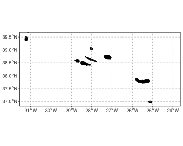
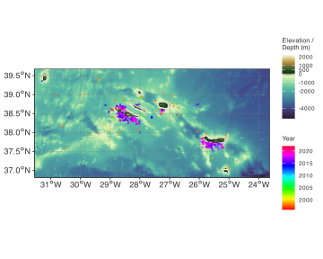

## 1 Load packages

``` numberSource
library(tidyverse)
library(lubridate)
library(gganimate)
library(raster)
library(sf)
library(rnaturalearth)
library(rnaturalearthdata)
library(elevatr)
library(RANN) # for the nearest neighbour search
library(ggpubr)
library(gt) # for nice tables

source(here::here("R", "map_theme.R"))
```

[](../images/Azores.png "Figure 1: The Azores region in the whales sightings study.")

Figure 1: The Azores region in the whales sightings study.

This analysis uses the Azores chlorophyll-*a* data downloaded in [Retrieving Chlorophyll-*a* Data from ERDDAP Servers](../vignettes/chl_ERDDAP.llms.md).

## 2 Background

The region around the Azores is characterised by relatively higher nutrient availability in a ‘sea’ of otherwise oligotrophic conditions, and hence they are of major interest as biodiversity hotspots. The enhanced productivity results from high mesoscale activity (often measured as Eddy Kinetic Energy, EKE) and the presence (and interaction with) undersea topographic features ([Santos et al. 2013](#ref-santos2013phytoplankton)). The enhanced chlorophyll-a biomass in the region results in it being an important foraging area for whales *en route* to areas further north in the Atlantic ([González Garcı́a et al. 2018](#ref-gonzalez2018multi)).

We expect seasonal variation to provide a strongly signal in the region, with typical autumn/winter to spring chl-*a* blooms. All satellite ocean colour products show the same general pattern with the highest pigment concentrations during spring months and the lowest during summer. SST also shows a seasonal trend, with highest SST during summer and the lowest during winter.

## 3 Rui’s objectives

Our main objective is to interpret if Azorean waters are a migratory corridor for the four main baleen whale’s species sighted in the Azores (blue, *Balaenoptera musculus*; fin, *B. physalus*; sei, *B. borealis*; humpback whale, *Megaptera novaeangliae*), during their migration from breeding to feeding areas, and vice-versa. This leads to other main questions:

- How long the target species use the study area during migration? –\> Unlikely achievable without IDs.
- Are they returning in different years? –\> Probably not possible without IDs of individual whales.
- How does the intensity and timing of the spring bloom influence the migration? –\> Timing question already addressed, but we can probably improve. Question about intensity vs sightings can be done using a regression-type approach.

## 4 Questions

1.  Do whales track temporal appearance of chl-*a* max? \[**Yes**\] What is the lag? \[**Table 1**\]

    1.  Is there a correlation in time between whale presence and lagged co-located chl-*a* conc.?
    2.  Is the correlation between whale presence and chl-*a* conc spatially fixed at i) Pico and Faial and ii) São Miguel, or
    3.  do max aggregations at localities located near i) Pico and Faial and ii) São Miguel coincide with the chl-*a* max there? I.e. is there a spatial association?

2.  Is there some association between chl-*a* biomass and the number of whales visiting the region? Look at inter-annual variation.

3.  Show the inverse association between chl-*a* biomass and SST.

4.  González Garcı́a et al. ([2018](#ref-gonzalez2018multi)) identify Mean Kinetic Energy (MKE), meridional and zonal transport components, eddies, bathymetry (depth), slope, nett primary productivity, distance from coast and wind at multiple spatial and temporal scales as influencing whale sightings.

5.  Is there a difference in habitat suitability between the north of the islands, the south, or around the sea mounts? –\> Do a multivariate analyses of all variables (see González Garcı́a et al. ([2018](#ref-gonzalez2018multi))), with data classified a priori into the subsets representing the three regions.

## 5 Load the whale sighting data

``` numberSource
sights <- read_csv(
  here::here("data", "BCB744", "occurences_sampled.Mn.txt"),
  show_col_types = FALSE
)

# make a column with year only
sights <- sights |>
  mutate(year = year(date),
         month = month(date, label = TRUE),
         week = week(date),
         yday = yday(date))
```

## 6 Explore the whale sighting data

The time span of the study:

``` numberSource
range(sights$date)
```

    [1] "1996-09-01 00:00:00 UTC" "2022-05-07 15:41:51 UTC"

``` numberSource
yrs <- max(year(sights$date)) - min(year(sights$date))
```

The longitudinal and latitudinal range:

``` numberSource
range(sights$lat)
```

    [1] 37.04499 39.42898

``` numberSource
range(sights$lon)
```

    [1] -31.29517 -23.86771

``` numberSource
median(sights$lat)
```

    [1] 38.3807

``` numberSource
median(sights$lon)
```

    [1] -28.2625

There is one outlier which I will remove:

``` numberSource
sights <- sights |> 
  filter(lat > min(lat))
```

From here I define the spatial extent for the study region as:

``` numberSource
# the extent of the full regional map
# a region around the Azores

ymin <- min(sights$lat) - 0.25; ymax <- max(sights$lat) + 0.25
xmin <- min(sights$lon) - 0.25; xmax <- max(sights$lon) + 0.25

sights_bbox <- st_bbox(c(xmin = xmin, xmax = xmax, ymax = ymax, ymin = ymin),
                       crs = CRS)

area_sf <- st_as_sfc(sights_bbox)

# EPSG:4326
# WGS 84 -- WGS84 - World Geodetic System 1984, used in GPS
st_crs(area_sf) = 4326
```

The bounding box for the study region is:

``` numberSource
sights_bbox
```

         xmin      ymin      xmax      ymax 
    -31.54517  36.81231 -23.61771  39.67898 

Start preparing all the map layers by loading the Natural Earth data for the continent outlines:

``` numberSource
# Get countries
world_ne <- ne_countries(
  scale = "large",
  returnclass = "sf"
)
class(world_ne)
```

    [1] "sf"         "data.frame"

A first stab plot of the region shows:

``` numberSource
ggplot(data = world_ne) +
  geom_sf(col = "black", fill = "black", linewidth = 0.4) +
  coord_sf(xlim = c(xmin, xmax),
           ylim = c(ymin, ymax),
           expand = FALSE) +
  labs(x = NULL, y = NULL) +
  theme_map()
```

[](chl_sightings_files/figure-html/fig-basicmap-1.svg "Figure 2: The Azores Islands.")

Figure 2: The Azores Islands.

Next we get a DEM of the region using **elevatr**:

``` numberSource
dem <- elevatr::get_elev_raster(locations = area_sf, z = 7, 
                                src = "srtm15plus",
                                clip = "bbox")

# keep for later and to prevent having to download each time
save(dem, file = here::here("data", "BCB744", "azores.dem"))
```

``` numberSource
# re-use previously downloaded dem
load(here::here("data", "BCB744", "azores.dem"))

# make dataframe from DEM raster
dem_df <- as.data.frame(dem, xy = TRUE, na.rm = TRUE)
colnames(dem_df)[3] <- "layer"
```

## 7 Mapping and plotting observations

Let us add all the map layer together:

1.  the bathymetry for the region,
2.  the land area polygons around the above-water regions, and
3.  all the whale sighting data.

``` numberSource
# make a colourmap
library(cmocean)
cmap <- cmocean("topo")
cols <- cmap(51) # for bathy/topo
cols3 <- rainbow(33) # for observations

# create the layered graph
ggplot() +
  geom_raster(data = dem_df, aes(x = x, y = y, fill = layer)) +
  geom_sf(data = world_ne, col = "white", fill = NA, linewidth = 0.4) +
  scale_fill_gradientn(colours = cols,
                       values = scales::rescale(c(min(dem_df$layer), 0,
                                                  max(dem_df$layer))),
                       breaks = c(-4000, -2000, -1000, 0, 500, 1000, 2000),
                       name = "Elevation /\nDepth (m)") +
  geom_point(data = sights, aes(x = lon, y = lat, colour = year(date)),
             size = 0.5, shape = 4, alpha = 1) +
  scale_color_gradientn(colours = cols3,
                        name = "Year") +
  coord_sf(xlim = c(xmin, xmax),
           ylim = c(ymin, ymax),
           expand = FALSE) +
  labs(x = NULL, y = NULL) +
  theme_map()
```

[](chl_sightings_files/figure-html/fig-aggregatedsightings-1.svg "Figure 3: A view of the aggregated whale sigtings over the period 1989-08-20 to 2022-05-07.")

Figure 3: A view of the aggregated whale sigtings over the period 1989-08-20 to 2022-05-07.

Are there distribution differences across years? Difficult to see in the above figure, so I create an animation of pooled annual observations across years:

``` numberSource
p <- ggplot() +
  geom_raster(data = dem_df, aes(x = x, y = y, fill = layer)) +
  geom_sf(data = world_ne, col = "white", fill = NA, linewidth = 0.4) +
  scale_fill_gradientn(colours = cols,
                       values = scales::rescale(c(min(dem_df$layer), 0,
                                                  max(dem_df$layer))),
                       breaks = c(-4000, -2000, -1000, 0, 500, 1000, 2000),
                       name = "Elevation /\nDepth (m)") +
  geom_point(data = sights, aes(x = lon, y = lat),
             colour = "red", size = 0.8, shape = 1, alpha = 1) +
  coord_sf(xlim = c(xmin, xmax),
           ylim = c(ymin, ymax),
           expand = FALSE) +
  theme_map() +
  labs(title = 'Year: {floor(frame_time)}', x = NULL, y = NULL) +
  transition_time(year) +
  ease_aes('linear')

gganimate::animate(p, fps = 2, nframes = 1 * yrs, device = "svg")

gganimate::anim_save(here::here("data", "sightings_anim.gif"))
```

[](sightings_anim.gif "Figure 4: Animation of yearly whale sightings.")

Figure 4: Animation of yearly whale sightings.

## 8 Annual chl-*a* climatology

``` numberSource
chlDir <- "/Users/ajsmit/Documents/R/R_in_Ocean_Science/_development/ERDDAP/"
load(paste0(chlDir, "MODIS_chl_data.Rdata"))

# Create a column of weeks
chl_data <- chl_data |> 
  mutate(year = year(time),
         month = month(time, label = TRUE),
         week = week(time),
         yday = yday(time))
```

``` numberSource
library(palr)
pal <- chl_pal(palette = TRUE)

chl_data |> 
  group_by(longitude, latitude) |> 
  summarise(med_chlorophyll = median(chlorophyll, na.rm = TRUE),
            .groups = "drop") |> 
  ggplot() + 
  geom_tile(aes(x = longitude, y = latitude, fill = med_chlorophyll)) +
  geom_sf(data = world_ne, col = "white", fill = "black", linewidth = 0.4) +
  scale_fill_gradientn(
    colours = pal$cols,
    trans = "log",
    breaks = c(0.1, 1, 3, 9)
  ) +
  guides(fill = guide_colourbar(title = "Chl-a [mg/L]",
                                title.position = "top",
                                direction = "horizontal",
                                barwidth = 8)) +
  scale_x_continuous(breaks = seq(-30.5, -25, 2.75)) +
  scale_y_continuous(breaks = seq(37, 39.5, 1.25)) +
  coord_sf(xlim = c(xmin, xmax),
           ylim = c(ymin, ymax),
           expand = FALSE) +
  labs(title = "MODIS Aqua annual chlorophyll-a climatology",
       x = NULL, y = NULL) +
  theme_map() +
  theme(legend.position = "bottom")
```

## 9 Monthly chl-*a* climatology

Plots for the full regional extent:

``` numberSource
chl_data |> 
  mutate(month = month(time, label = TRUE)) |> 
  group_by(longitude, latitude, month) |> 
  summarise(med_chlorophyll = median(chlorophyll, na.rm = TRUE),
            .groups = "drop") |> 
  ggplot() + 
  geom_tile(aes(x = longitude, y = latitude, fill = med_chlorophyll)) +
  geom_sf(data = world_ne, col = "white", fill = "grey50", linewidth = 0.4) +
  scale_fill_gradientn(
    colours = pal$cols,
    trans = "log",
    breaks = c(0.05, 0.1, 1),
    limits = c(0.05, 1)
  ) +
  guides(fill = guide_colourbar(title = "Chl-a [mg/m3]",
                                title.position = "top",
                                direction = "horizontal",
                                barwidth = 8)) +
  scale_x_continuous(breaks = c(-30.5, -25)) +
  scale_y_continuous(breaks = c(37, 39.5)) +
  coord_sf(xlim = c(xmin, xmax),
           ylim = c(ymin, ymax),
           expand = FALSE) +
  labs(title = "MODIS Aqua seasonal chlorophyll-a climatology",
       x = NULL, y = NULL) +
  theme_map() +
  theme(legend.position = "bottom") +
  facet_wrap(vars(month), ncol = 3)
```

I also plot the seasonal profile for the central (Ilha do Faial, Ilha do Pico, São Jorge, Graciosa, Ilha Terceira) and eastern-most (Ilha do São Miguel, São Pedro) island groups. The respective bounding boxes are:

``` numberSource
# center group
c_lonmin <- -29
c_lonmax <- -27.5
c_latmin <- 38
c_latmax <- 39

# eastern group
e_lonmin <- -26
e_lonmax <- -25
e_latmin <- 37.5
e_latmax <- 38
```

``` numberSource
chl_data |>
  filter(between(longitude, c_lonmin, c_lonmax),
         between(latitude, c_latmin, c_latmax)) |>
  mutate(month = month(time, label = TRUE)) |>
  group_by(longitude, latitude, month) |>
  summarise(med_chlorophyll = median(chlorophyll, na.rm = TRUE),
            .groups = "drop") |>
  ggplot() +
  geom_tile(aes(x = longitude, y = latitude, fill = med_chlorophyll)) +
  geom_point(data = sights, aes(x = lon, y = lat),
             colour = "black", shape = 4, size = 0.5) +
  geom_sf(
    data = world_ne,
    col = "white",
    fill = "grey50",
    linewidth = 0.4
  ) +
  scale_fill_gradientn(
    colours = pal$cols,
    trans = "log",
    breaks = c(0.05, 0.1, 1),
    limits = c(0.05, 1)
  ) +
  guides(
    fill = guide_colourbar(
      title = "Chl-a [mg/m3]",
      title.position = "top",
      direction = "horizontal",
      barwidth = 8
    )
  ) +
  scale_x_continuous(breaks = c(-28.6, -27.8)) +
  scale_y_continuous(breaks = c(38.2, 38.8)) +
  coord_sf(
    xlim = c(c_lonmin, c_lonmax),
    ylim = c(c_latmin, c_latmax),
    expand = FALSE
  ) +
  labs(title = "Seasonal chl-a climatology",
       subtitle = "Central group",
       x = NULL, y = NULL) +
  theme_map() +
  theme(legend.position = "bottom") +
  facet_wrap(vars(month), ncol = 3)
```

``` numberSource
chl_data |>
  filter(between(longitude, e_lonmin, e_lonmax),
         between(latitude, e_latmin, e_latmax)) |>
  mutate(month = month(time, label = TRUE)) |>
  group_by(longitude, latitude, month) |>
  summarise(med_chlorophyll = median(chlorophyll, na.rm = TRUE),
            .groups = "drop") |>
  ggplot() +
  geom_tile(aes(x = longitude, y = latitude, fill = med_chlorophyll)) +
  geom_point(
    data = sights,
    aes(x = lon, y = lat),
    colour = "black",
    shape = 4,
    size = 0.5
  ) +
  geom_sf(
    data = world_ne,
    col = "white",
    fill = "grey50",
    linewidth = 0.4
  ) +
  scale_fill_gradientn(
    colours = pal$cols,
    trans = "log",
    breaks = c(0.05, 0.1, 1),
    limits = c(0.05, 1)
  ) +
  guides(
    fill = guide_colourbar(
      title = "Chl-a [mg/m3]",
      title.position = "top",
      direction = "horizontal",
      barwidth = 8
    )
  ) +
  scale_x_continuous(breaks = c(-25.8, -25.2)) +
  scale_y_continuous(breaks = c(37.6, 37.9)) +
  coord_sf(
    xlim = c(e_lonmin, e_lonmax),
    ylim = c(e_latmin, e_latmax),
    expand = FALSE
  ) +
  labs(
    title = "Seasonal chl-a climatology",
    subtitle = "Eastern group",
    x = NULL,
    y = NULL
  ) +
  theme_map() +
  theme(
    legend.position = "bottom",
  ) +
  facet_wrap(vars(month), ncol = 3)
```

## 10 ‘Climatology’ of whale sightings

I create a histogram of Julian days (day of the year), which summarises the times during the year across the observational record when most sightings are observed for the full region, the central group, and the eastern group.

I also want to create a plot of cl-*a* concentration with time for the full extent, the central group, and the eastern group. All of these plots will then be displayed in an intuitive manner so that the time of highest chl-*a* concentration can be displayed next to the timing of whale sightings.

``` numberSource
# make labels to use along the x-axis in stead of yday
fig_labels <-
  data.frame(date = seq.Date(
    from = as.Date("2020-01-01"),
    to = as.Date("2020-12-01"),
    by = "2 month"
  ))
fig_labels <- fig_labels |> 
  mutate(yday = yday(date),
         month = month(date, label = TRUE))

# plot the sightings histograms
a <- sights |>
  ggplot(aes(x = yday)) +
  stat_bin(geom = "step",
           binwidth = 14,
           colour = "navy",
           linewidth = 0.75) + 
  scale_x_continuous(breaks = fig_labels$yday,
                     labels = fig_labels$month) +
  labs(x = NULL, y = "Number of sightings",
       title = "Full region")

b <- sights |>
  filter(between(lon, c_lonmin, c_lonmax),
         between(lat, c_latmin, c_latmax)) |>
  ggplot(aes(x = yday)) +
  stat_bin(geom = "step",
           binwidth = 14,
           colour = "darkcyan",
           linewidth = 0.75) + 
  scale_x_continuous(breaks = fig_labels$yday,
                     labels = fig_labels$month) +
  labs(x = NULL, y = "Number of sightings",
       title = "Central group")

c <- sights |> 
  filter(between(lon, e_lonmin, e_lonmax),
         between(lat, e_latmin, e_latmax)) |>
  ggplot(aes(x = yday)) + 
  scale_x_continuous(breaks = fig_labels$yday,
                     labels = fig_labels$month) +
  stat_bin(geom = "step",
           binwidth = 14,
           colour = "indianred3",
           linewidth = 0.75) +
  labs(x = NULL, y = "Number of sightings",
       title = "Eastern group")

# calculate a cyclic rolling mean with a window width of 30 days
# for the chlorophyll-a data
w_width <- 30
smooth_fun <- function(data) {
  chl <- data |>
    group_by(yday) |>
    summarise(med_chl = median(chlorophyll, na.rm = TRUE),
            .groups = "drop")
  
  chl_pad <-
    data.frame(yday = rbind(tail(chl[, 1], w_width/2),
                            chl[, 1],
                            head(chl[, 1], w_width/2)),
               chlorophyll = rbind(tail(chl[, -1], w_width/2),
                                   chl[, -1],
                                   head(chl[, -1], w_width/2)))

  chl_out <- chl_pad |>
    mutate(s_chl = RcppRoll::roll_mean(
      med_chl,
      n = w_width,
      fill = NA,
      align = "center"
    ))
  return(chl_out[(w_width/2 + 1):(nrow(chl_out) - w_width/2), ])
}

# full <- smooth_fun(chl_data)

# center_group <- chl_data |>
#   filter(between(longitude, c_lonmin, c_lonmax),
#          between(latitude, c_latmin, c_latmax)) |> 
#   smooth_fun()

# east_group <- chl_data |>
#   filter(between(longitude, e_lonmin, e_lonmax),
#          between(latitude, e_latmin, e_latmax)) |> 
#   smooth_fun()

# plot the chlorophyll-a data
d <- ggplot(full, aes(x = yday)) +
  geom_line(aes(y = med_chl), colour = "navy") +
  geom_line(
    aes(y = s_chl),
    colour = "yellow",
    alpha = 0.9,
    linewidth = 0.7
  ) + 
  scale_x_continuous(breaks = fig_labels$yday,
                     labels = fig_labels$month) +
  labs(title = "Full region",
       x = NULL,
       y = expression(Chl-a~(mg.m^-3)))

e <- ggplot(center_group, aes(x = yday)) +
  geom_line(aes(y = med_chl), colour = "darkcyan") +
  geom_line(
    aes(y = s_chl),
    colour = "yellow",
    alpha = 0.9,
    linewidth = 0.7
  ) + 
  scale_x_continuous(breaks = fig_labels$yday,
                     labels = fig_labels$month) +
  labs(title = "Central group",
       x = NULL,
       y = expression(Chl-a~(mg.m^-3)))

f <- ggplot(east_group, aes(x = yday)) +
  geom_line(aes(y = med_chl), colour = "indianred3") +
  geom_line(
    aes(y = s_chl),
    colour = "yellow",
    alpha = 0.9,
    linewidth = 0.7
  ) + 
  scale_x_continuous(breaks = fig_labels$yday,
                     labels = fig_labels$month) +
  labs(title = "Eastern group",
       x = NULL,
       y = expression(Chl-a~(mg.m^-3)))
    
ggarrange(d, e, f, a, b, c, align = "hv",
          nrow = 2, ncol = 3,
          labels = "AUTO")
```

What is the timing of the peak sightings and chl-*a* maximum? Visser et al. ([2011](#ref-visser2011timing)) found that peak abundances of the blue *Balaenoptera musculus*, fin *B. physalus*, humpback *Megaptera novaeangliae* and sei whale *B. borealis* occurred from April to May, tracking the onset of the spring bloom by 13 to 16 wk (depending on species). The lag period accounts for the development of the whales’ zooplankton prey, which is positioned at a trophic position intermediate between phytoplankton and whales. Similar findings were obtained in this study (Table 1), although no distinction was made between cetacean species.

## 11 Finding the nearest chl-*a* pixels to the whale sightings

This analysis is continued in [Spatial Localisation, Subsetting, and Aggregation of the Chlorophyll-*a* Data](../vignettes/chl_localisation.llms.md).

## 12 References

González Garcı́a L, Pierce GJ, Autret E, Torres-Palenzuela JM (2018) Multi-scale habitat preference analyses for azorean blue whales. PLoS One 13:e0201786.

Santos M, Moita M, Bashmachnikov I, Menezes G, Carmo V, Loureiro C, Mendonça A, Silva A, Martins A (2013) Phytoplankton variability and oceanographic conditions at condor seamount, azores (NE atlantic). Deep Sea Research Part II: Topical Studies in Oceanography 98:52–62.

Visser F, Hartman KL, Pierce GJ, Valavanis VD, Huisman J (2011) Timing of migratory baleen whales at the azores in relation to the north atlantic spring bloom. Marine Ecology Progress Series 440:267–279.

## Reuse

[CC BY-NC-SA 4.0](https://creativecommons.org/licenses/by-nc-sa/4.0/)

## Citation

BibTeX citation:

``` quarto-appendix-bibtex
@online{smit,
  author = {Smit, A. J.},
  title = {Plotting the Whale Sightings and Chlorophyll-\emph{a}
    Concentrations},
  date = {},
  url = {https://tangledbank.netlify.app/vignettes/chl_sightings.html},
  langid = {en}
}
```

For attribution, please cite this work as:

Smit AJ Plotting the whale sightings and chlorophyll-*a* concentrations. [https://tangledbank.netlify.app/vignettes/chl_sightings.html.](https://tangledbank.netlify.app/vignettes/chl_sightings.html)
