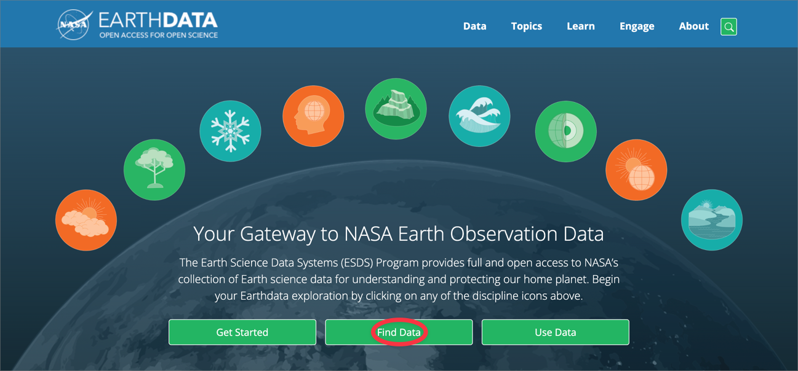
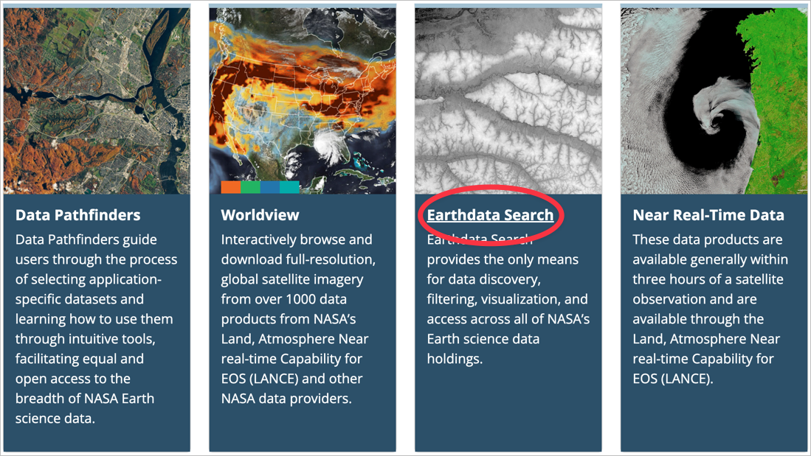
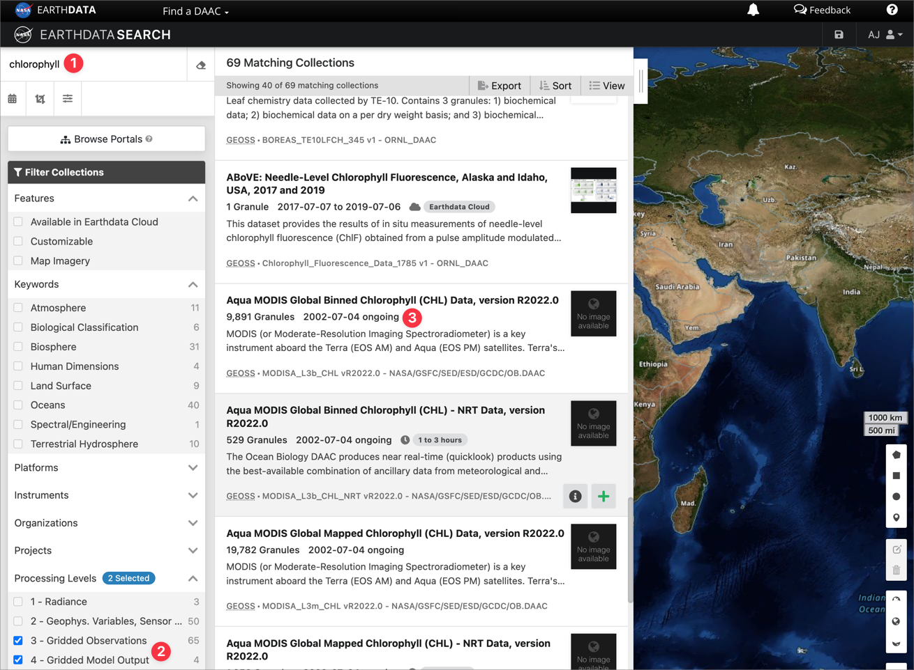

Navigate to **NASA’s EARTHDATA** and follow the **Find Data** link:

[](../images/EARTHDATA1.png "Figure 1: Navigate to the Find Data link.")

Figure 1: Navigate to the Find Data link.

If you have not already registered, select **Register**.

Scroll down a bit on the page you landed on when you selected Find Data, and select the **Earthdata Search** link:

[](../images/EARTHDATA2.png "Figure 2: Go to the Earthdata Search page.")

Figure 2: Go to the Earthdata Search page.

On the search page, enter a keyword for the data product you are interested in downloading (① — I searched for ‘chlorophyll’), select the processing levels of interest (②), and scroll down to the data product you want (③ – here I select “**Aqua MODIS Global Mapped Chlorophyll (CHL) Data, version R2022.0**”):

[](../images/EARTHDATA3.png "Figure 3: Select the data product of interest by entering keywords and selecting from amongst various filter options.")

Figure 3: Select the data product of interest by entering keywords and selecting from amongst various filter options.

Selecting Option ③ in Figure 3 takes you to Figure 4. Here you will notice one file for each day in the observational period; as you can see, there are 19,782 ‘granules’ (as per 15 June 2023). There is an option to download each day using the

## Reuse

[CC BY-NC-SA 4.0](https://creativecommons.org/licenses/by-nc-sa/4.0/)

## Citation

BibTeX citation:

``` quarto-appendix-bibtex
@online{smit,
  author = {Smit, A. J. and Smit, AJ},
  title = {Wget Download from {NASA} {Earthdata}},
  url = {https://tangledbank.netlify.app/vignettes/download_earthdata.html},
  langid = {en}
}
```

For attribution, please cite this work as:

Smit AJ, Smit A Wget download from NASA Earthdata. [https://tangledbank.netlify.app/vignettes/download_earthdata.html.](https://tangledbank.netlify.app/vignettes/download_earthdata.html)
